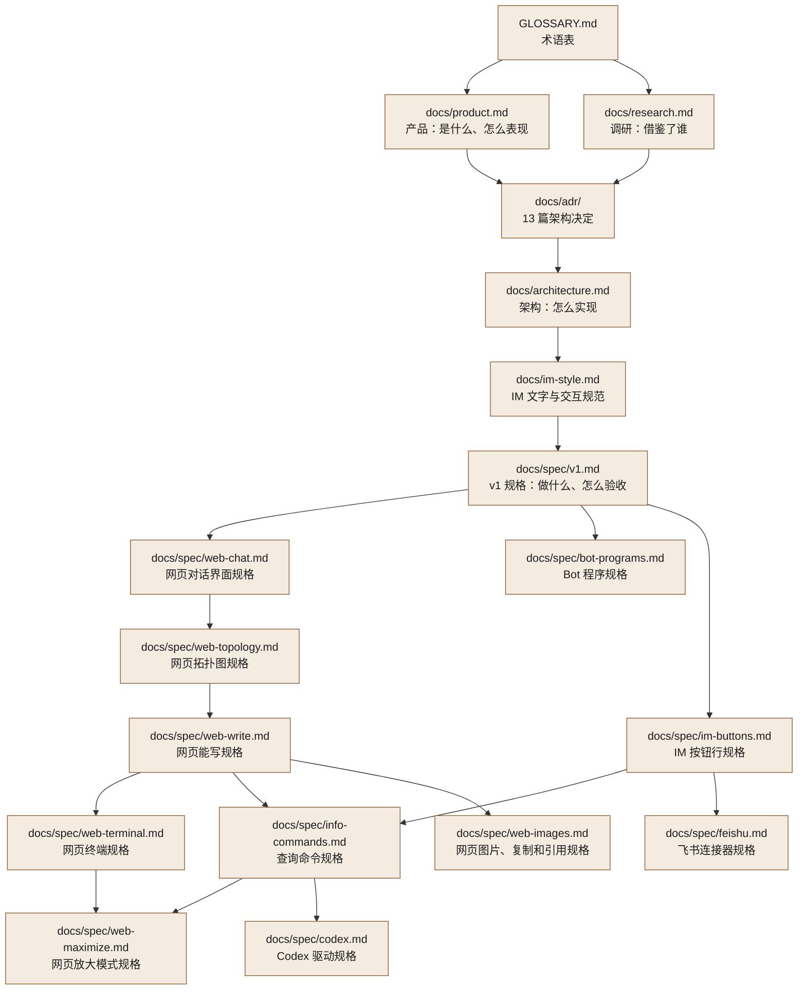

# 文档地图

这篇回答：仓库里有哪些文档，各自回答什么问题，按什么顺序读。

前置阅读：无

这里的文档多数由 agent 编写，也以 agent 为读者。

文档按依赖关系排成一张图：箭头从上游指向下游，下游文档只引用它的上游。第一次读，从上往下读即可。

| 文档 | 回答什么问题 |
|---|---|
| [GLOSSARY.md](../GLOSSARY.md) | 槽位、目标、绑定、联系窗口……这些词是什么意思 |
| [docs/product.md](product.md) | Rhodium 是什么、在各种情况下怎么表现、每项功能放在哪一版 |
| [docs/research.md](research.md) | 设计参考了哪些现成项目、借了什么、避开了什么坑 |
| [docs/adr/](adr/) | 每个难以撤销的架构决定：选了什么、为什么 |
| [docs/architecture.md](architecture.md) | 怎么实现：进程、协议、数据、故障时会怎样 |
| [docs/im-style.md](im-style.md) | Rhodium 在 QQ、Telegram 里的每类话、工具行、选择面板和按钮具体怎么写 |
| [docs/spec/v1.md](spec/v1.md) | v1 做什么、不做什么、怎么测试、分几个里程碑 |
| [docs/spec/web-chat.md](spec/web-chat.md) | 网页第 2 步的对话页做什么、不做什么、怎么测试、怎么验收 |
| [docs/spec/web-topology.md](spec/web-topology.md) | 网页拓扑图的只读部分和对话页的头像做什么、不做什么、怎么测试、怎么验收 |
| [docs/spec/bot-programs.md](spec/bot-programs.md) | Bot 程序这一期做什么、不做什么、怎么测试、分哪两段 |
| [docs/spec/web-write.md](spec/web-write.md) | 网页第 3 步“网页能写”做什么、不做什么、怎么测试、怎么验收、怎么拆工单 |
| [docs/spec/web-terminal.md](spec/web-terminal.md) | 网页第 5 步“终端嵌入”做什么、不做什么、怎么测试、怎么验收、怎么拆工单 |
| [docs/spec/im-buttons.md](spec/im-buttons.md) | IM 的按钮行和 `/` 菜单怎么分开、怎么测试、怎么验收、怎么拆工单 |
| [docs/spec/info-commands.md](spec/info-commands.md) | `/status`、`/usage`、`/context` 这类查询命令在网页和 IM 上什么样、怎么测试、怎么验收、怎么拆工单 |
| [docs/spec/web-maximize.md](spec/web-maximize.md) | 电脑宽屏上的放大模式和侧栏、列表里的 Bot 头像、跳转框、真全屏做什么、怎么测试、怎么验收、怎么拆工单 |
| [docs/spec/feishu.md](spec/feishu.md) | 接飞书私聊做什么、和飞书之间怎么说话、怎么测试、怎么验收、怎么拆工单 |
| [docs/spec/codex.md](spec/codex.md) | 接 Codex 做什么、怎么测试、怎么验收、明确不做什么、怎么拆工单 |
| [docs/spec/web-images.md](spec/web-images.md) | 网页上怎么看图、交给 agent 的图怎么缩、收发的图留多久，整条消息怎么复制和引用，怎么测试、怎么验收、怎么拆工单 |

[AGENTS.md](../AGENTS.md) 和 [docs/agents/](agents/) 是给 AI agent 看的工作约定，不在阅读路径上。`CLAUDE.md` 只引用 `AGENTS.md`。

[deploy/README.md](../deploy/README.md) 讲怎么部署一个实例、怎么升级和回滚、怎么打安装包，也不在阅读路径上。

## 约定

- 文档用中文；代码、标识符、注释和提交信息用英文。
- README 和 CONTRIBUTING 以英文版为准，旁边各有一份中文译本，两份一起改。
- 开发流程：spec → GitHub issue → 每个 issue 一个 PR，先写测试，独立审查后合并。
- 设计过程中的原始调研、8 套候选架构和评审意见都不进仓库。仓库里只放整理后的结论。
- 开发在作者的私有仓库里进行，公开仓库是按版本导出的快照，不带提交历史。文档和代码注释里的 `#编号` 指私有仓库的 issue，在公开仓库里查不到。
- 文件名带 `.local.md` 的只在私有仓库里，写的是作者那台机器自己的事，不公开。
