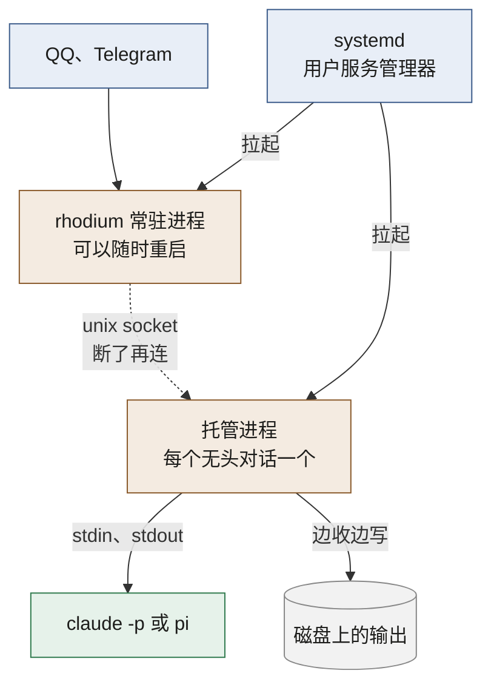

# 一个常驻进程 + 每个无头对话一个托管进程

这篇回答：Rhodium 由哪些进程组成，为什么它自己重启时，正在跑的回合不会断。

前置阅读：[术语表](../../GLOSSARY.md)、[产品说明](../product.md)、[调研摘要](../research.md)

状态：已接受（2026-10-21）。其中 Codex 不配托管进程那一条，已由 [ADR-0011](0011-codex-private-app-server.md) 改掉：Codex 也配托管进程。

Rhodium 只有一个常驻进程 `rhodium`，也就是开机就跑、一直在跑的服务。路由、IM 收发、提问、通知、看板，以及 `rh` 命令背后的服务端，都在它里面。

每个无头对话另配一个托管进程。它由 `systemd-run --user` 拉起，父进程是 systemd，不是 `rhodium`。所以 `rhodium` 重启、升级或崩溃时，托管进程和它攥着的 agent 照常运行。期间的输出先写到磁盘，`rhodium` 回来后接着读。

这样做，是因为别人最常踩的坑就是“桥进程自己持有 agent 子进程”，桥一重启回合就丢（[调研摘要](../research.md) §1）。

两种情况不配托管进程：

- Codex（v1 之后）：连它自己的共享服务，断开不影响回合。
- TUI 模式的槽位：进程在 Herdr 里。

## 考虑过的其他方案

- **IM 连接单独放进网关进程**。好处是 `rhodium` 重启时 QQ 连接不断。代价是 v1 多两个进程和一套进程间协议，第一个里程碑（在 QQ 里和无头 Claude 对话）晚约一周（估算）。接口按进程边界留好，以后真需要再拆。
- **Hub + Node，现在就为多机做准备**。每台机器跑一个 Node 进程攥住 agent，一个 Hub 管其余。代价是为推迟的多机需求提前多写一套双向协议，第一个里程碑估算要 5–6 周。多机现在只需要在标识上留余地。
- **不要托管进程，用 systemd 单元加命名管道直接攥住 agent**。agent 读不到输入结束，只能用信号停它。收到信号后对话记录是否完整，没有验证过。也拿不到退出码。

## 后果

- 托管进程代码很少，崩溃概率低。真崩了会丢当前回合，按崩溃续跑处理（[产品说明](../product.md) §4.5）。
- IM 连接没有单独拆进程，所以 `rhodium` 停机太久会丢 QQ 消息，详见[产品说明](../product.md) §11。
