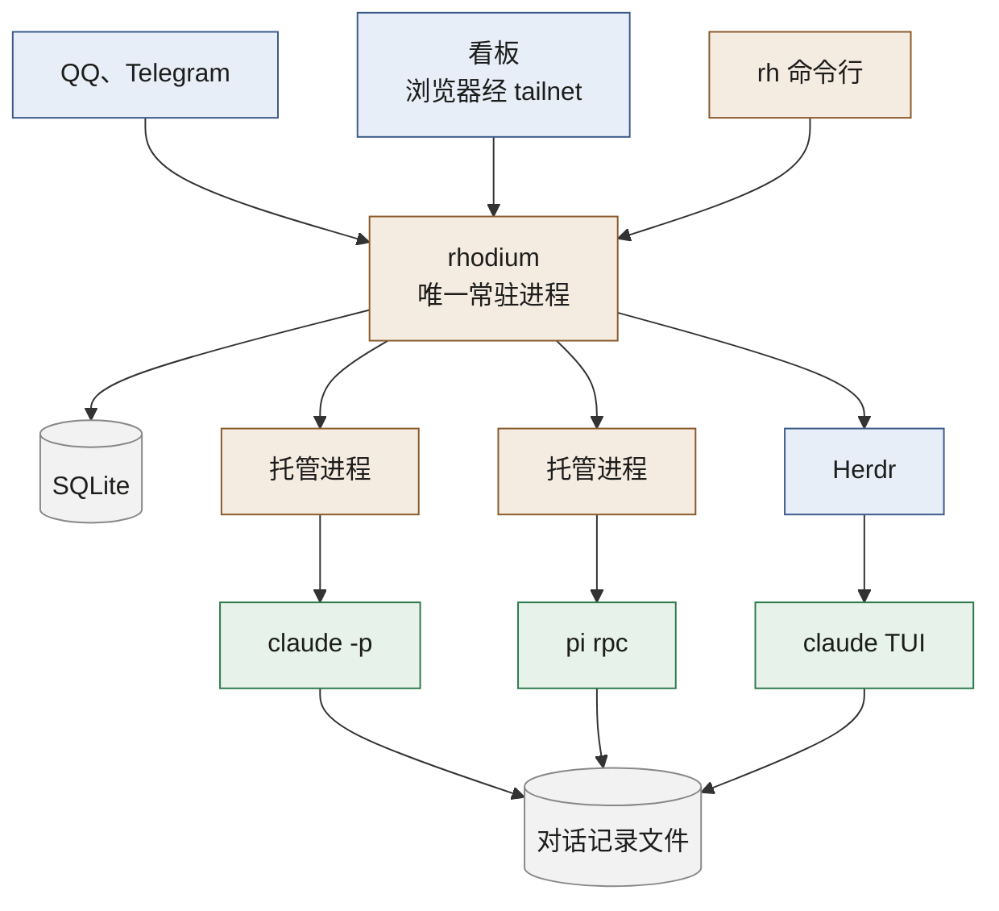
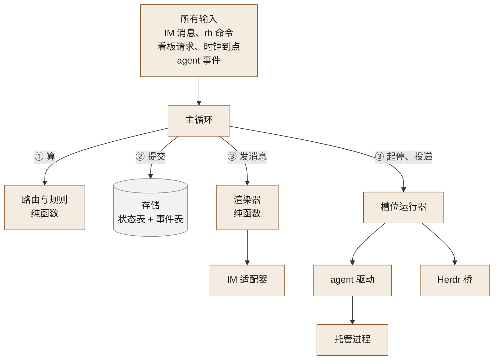
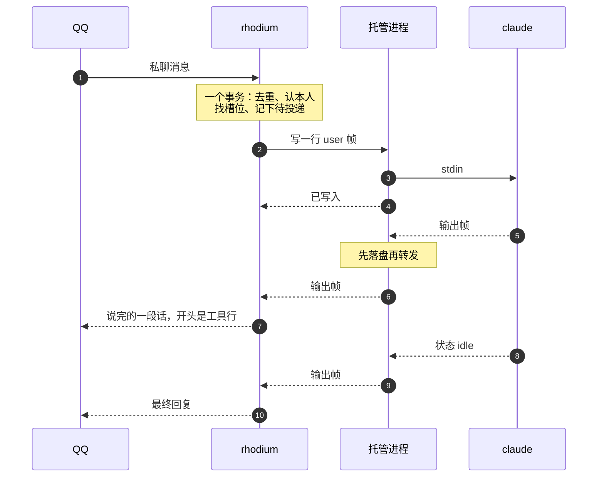
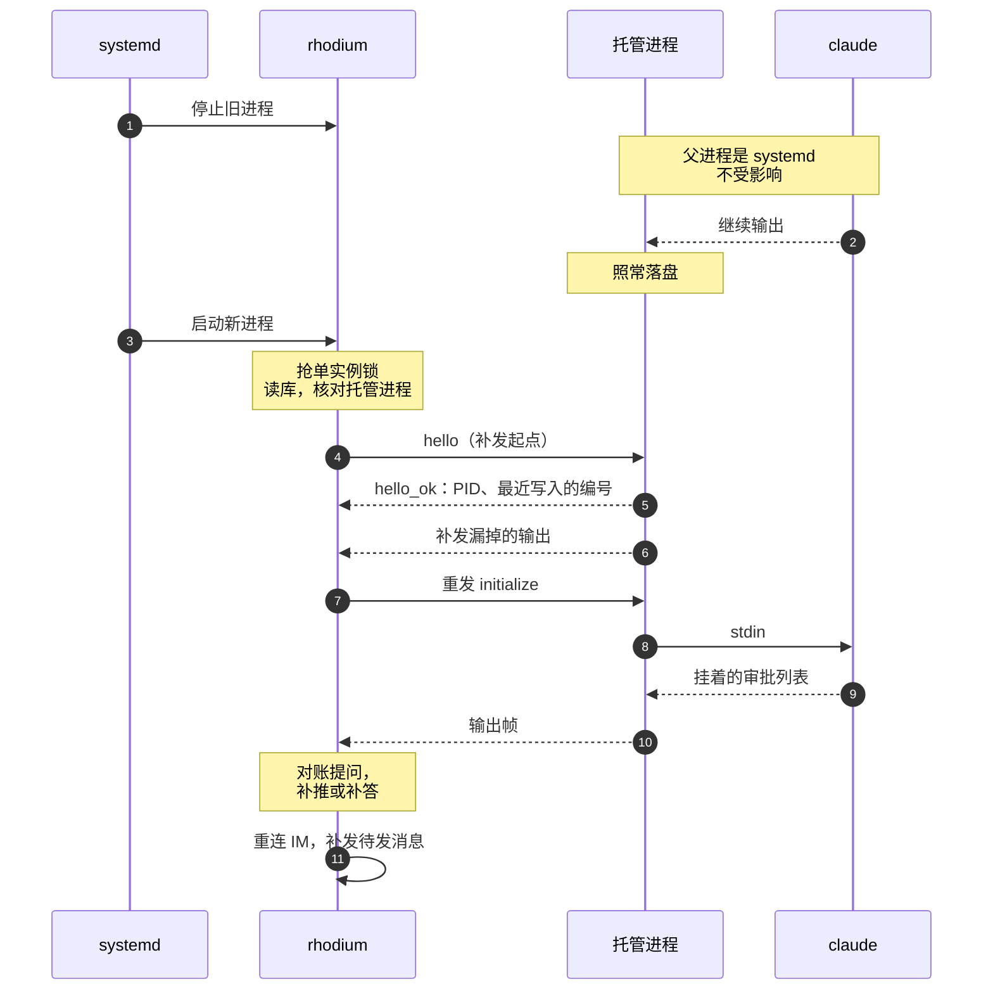
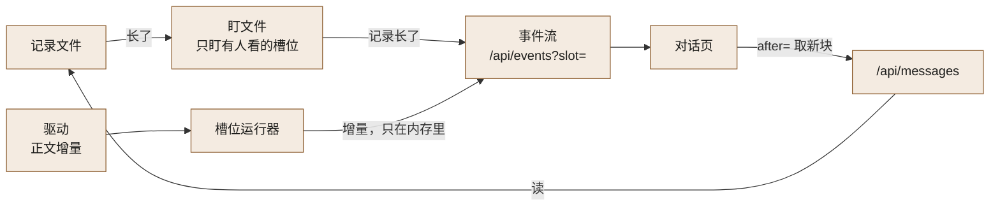
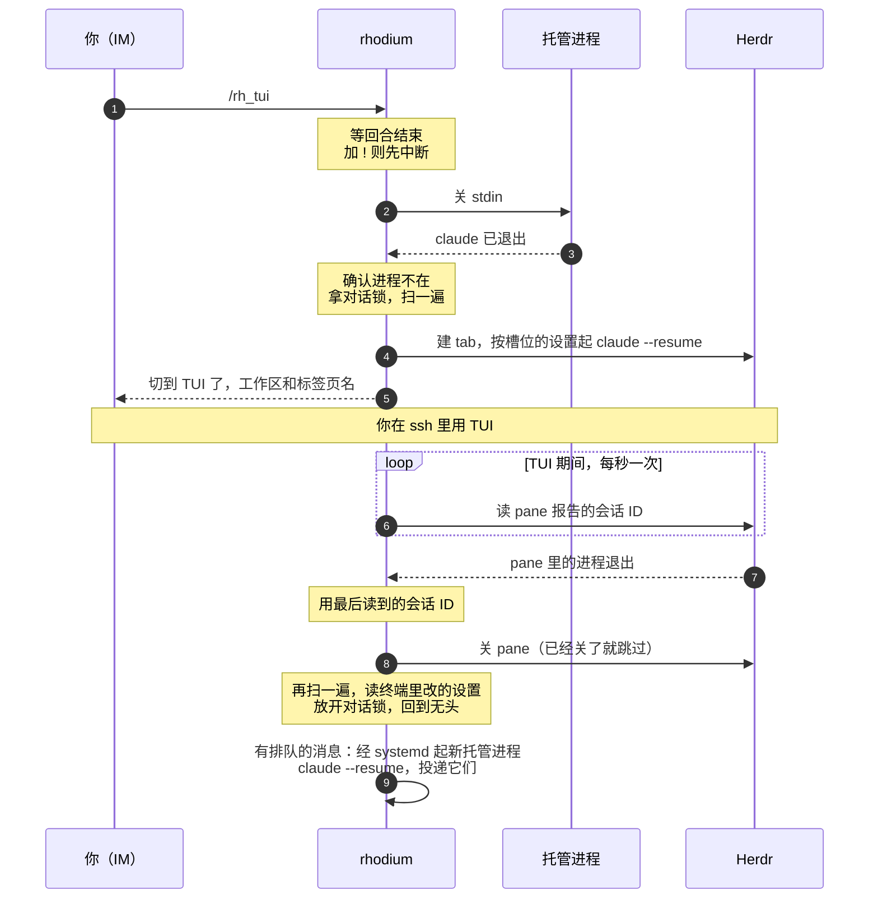
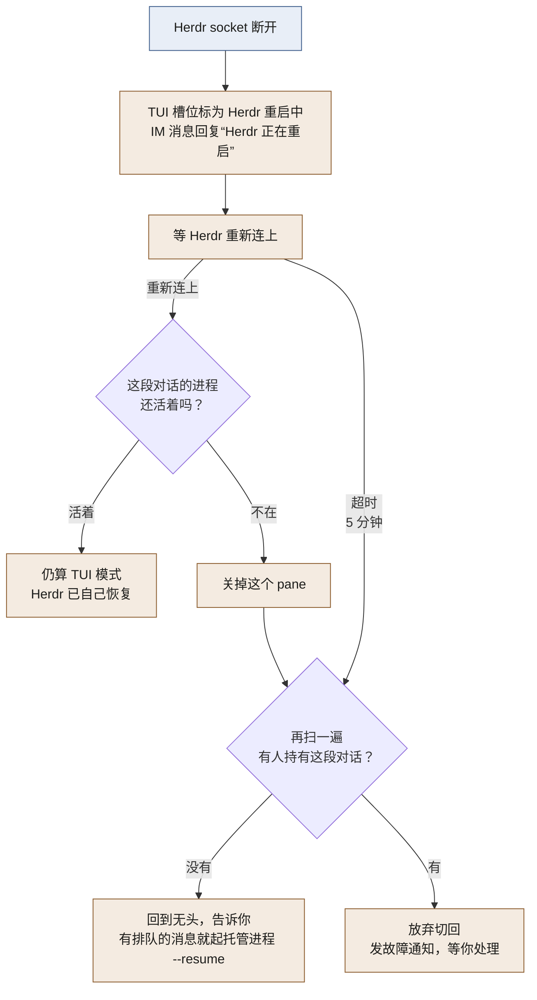
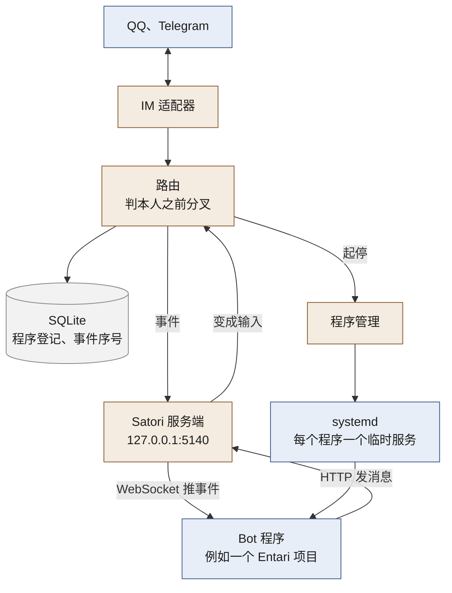

# Rhodium 架构

这篇回答：Rhodium 怎么实现。有哪些进程，各自管什么，一条消息怎么走，出故障时会怎样。

前置阅读：[术语表](../GLOSSARY.md)、[产品说明](product.md)、[调研摘要](research.md)，以及正文各节链接的 [ADR](adr/)。

> 行为规则（超时多久、上限多少、什么时候通知你）以产品说明为准，这里只讲怎么实现。标“待验证”的地方，要在实现前用探针确认。探针指专门为确认一件事而跑的小实验。

## 1. 总览



白话：

- 只有一个常驻进程 `rhodium`。QQ、Telegram、看板和 `rh` 命令都只和它说话。
- 每个无头对话配一个托管进程。它攥着 agent 的输入输出，把输出写到磁盘。
- 托管进程由 systemd 拉起，不是 `rhodium` 的子进程。所以 `rhodium` 重启、升级、崩溃时，回合照跑。为什么这样分，见 [ADR-0002](adr/0002-one-daemon-plus-holders.md)。
- TUI 模式的 agent 跑在 Herdr 的 pane 里。同一段对话同一时刻只在一边运行，见 [ADR-0001](adr/0001-headless-first-exclusive-tui.md)。
- Rhodium 的状态放在一个 SQLite 文件里。聊天正文不进库，以各 agent 自己写的对话记录文件为准。例外见 §7.1。

图里没画两样以后才有的东西：

- Codex（v1 之后）：和 pi 一样，每段对话一个托管进程，里面跑私有的 `codex app-server`，见 [ADR-0011](adr/0011-codex-private-app-server.md)。
- Bot 程序（v1 之后）：独立进程，用 Satori 协议连进 `rhodium`，见 §14。

## 2. 组件和职责

划分按“深模块”的思路：接口小，复杂的东西藏在里面。改一个模块时，只需要读懂它自己和它依赖的那几个接口。

主程序用 TypeScript，跑在 Bun 上，编译成一个二进制。`rh` 是同一个二进制的子命令。见 [ADR-0005](adr/0005-typescript-on-bun.md)。托管进程是另一个用 Rust 写的小二进制。

看板的网页（[产品说明](product.md) §7）：

- 在 `/`，就是手机桌面图标指的地方。源码在 `web/`，manifest 和图标在 `web/public/`。
- 图标从 `docs/assets/logo.svg` 用 Chromium 画出来，再压成 256 色的 PNG（#563）：
  - 标签页用 64px 的 `favicon-64.png`。它占 16 个 CSS 像素，3 倍的手机屏要 48px。64px 在 1 到 3 倍屏上都是缩小，不会发虚。
  - iPhone 主屏用 180px 的 `apple-touch-icon.png`，垫看板的深色底 `#1d1d1b`，四边留白。iOS 会把透明处填成黑色。
  - 安装到桌面的图标是 manifest 列的 `icon-192.png`、`icon-512.png`，透明底。
- 它的文件和接口都用相对地址。
- 它在 `/next/` 试用过，对话界面（产品说明 §7 的第 2 步）验收后换到了 `/`。
  - `/next/...` 一律转到去掉 `/next` 的同一路径。书签和还开着的页面都还能用。
  - 原先手写的旧页，和只有它用的 `/api/transcript`，换的时候删了。

- 技术栈：React 19；shadcn/ui 的 base-nova 风格，组件基于 Base UI；Tailwind 4；lucide-react 图标；TanStack Query 取数据；wouter 管页面地址。
- 对话页加两样：Streamdown 渲染 agent 的话，带中文标记修正（`@streamdown/cjk`）；react-resizable-panels 做宽屏分栏。
  - 对话页的代码按需加载，进了槽位才下载。看板首屏不算它，它自己压缩后不超过 300KB，也由 `test/build.test.ts` 守着。
  - 代码块不高亮，用等宽字显示（用户 2026-10-23 定：先不装 `@streamdown/code`，它让 `rhodium` 大约多 11MB，以后需要再加）。
- 拓扑图加两样：React Flow 12（`@xyflow/react` 写死 12.12.0）画图；dagre（`@dagrejs/dagre` 写死 3.1.1）只排左右两栏里节点的上下次序，别的布局自己算。
  - 拓扑图的代码按需加载，进了拓扑图才下载，连同 React Flow 的样式。它自己压缩后不超过 200KB，`test/build.test.ts` 和对话页那一包分开量。
  - React Flow 的样式放进 Tailwind 的 `base` 层再引入。不放进层里，它会压过 Tailwind 的工具类。
  - 预览里显示消息的代码在对话页那一包里，打开第一个预览时才下载，拓扑图那一包不含它。
  - React Flow 13 出正式版以后再换。
- 网页终端（§10.4）加一样：ghostty-web（写死 0.4.0）画终端，为什么用它见 [ADR-0012](adr/0012-web-terminal-ghostty-web.md)。
  - 它的代码按需加载，进了终端模式的槽位、要画终端时才下载。网页终端那一包压缩后不超过 250KB（ghostty-web 约 190KB，WebAssembly 以 base64 内嵌在里面），`test/build.test.ts` 和别的两包分开量。
- 定下的其余几样（Motion、Zustand 等）等后面的功能用到再加。
- 页面地址在 `#` 后面：`#/` 是看板，`#/slot/<槽位 ID>` 是槽位，`#/topology` 是拓扑图，`#/rhodium` 是 Rhodium 自己。地址里没有 `#` 后面的东西时，进这台设备上次选的列表或拓扑图。
- 每个接口回什么，类型写在 `src/board.ts`，网页直接导入。接口一改，类型检查就报错。
- 页面手机优先，也能在桌面看。深色浅色跟着系统。字体用系统的，中文才显示得好。
- 加 shadcn 组件：在仓库根目录跑 `bunx shadcn add <组件>`，配置在根目录的 `components.json`。它会顺手 `bun add` 依赖，加完看一眼 `package.json` 的版本有没有被改。

构建：

- Vite 把网页打包成一个 HTML、首屏的 JS 和 CSS、进了槽位才下载的对话页的 JS、进了拓扑图才下载的拓扑图的 JS 和 CSS、要画终端时才下载的网页终端的 JS，再加 manifest 和图标。
- 第三方库和我们的代码分开打包（#356）。库的文件里只有库，用到的库不变，文件名就不变。只改我们代码的更新，浏览器缓存里的库多半照样能用。
  - `lib`：首屏用到的库，例如 React、TanStack Query、wouter。
  - `lib-shared`：后加载的几部分里，两部分以上共用的库，例如 Base UI。
  - `lib~slot`、`lib~topology`：只有对话页、只有拓扑图用的库。
  - 图标库 `lucide-react` 跟我们的代码走，不进库的文件。用哪几个图标随我们的代码变，放进库的文件，库的文件名就会跟着变。
  - 其余库文件按文件名引用 `lib`。`lib` 一变（例如首屏多用了一个库），库的文件全部换名字。
  - 我们的文件按文件名互相引用，所以我们的代码改一处，我们的 JS 文件差不多全换名字。它们压缩后合计约 70KB。
- 每个 JS 和 CSS 旁边另存一份 brotli 压缩的 `x.js.br`，用最高压缩级别。
- Streamdown 静态引入 `rehype-raw`，打包时换成什么都不做的 `web/src/no-raw.ts`。我们关掉了 rehype 的插件，它从来不跑，却占对话页那些库的三分之一。
- HTML 里有一行 `<meta name="later">`，按顺序列出对话页和拓扑图要用、首屏和“+”都不加载的文件，给空闲预加载用。
- `scripts/build.sh` 先打包网页，再用 `bun build --compile --asset` 把它编进 `rhodium`。
- 从源码跑的 `rhodium`（`rh dev`、测试）读 `web/dist/`。改了 `web/` 要先跑 `bun run build:web`；没构建过，`/` 回 503 提示这一句。
- 打包结果不进仓库。

传输（手机常走 Tailscale 的中继，慢在网络上）：

- `assets/` 下的文件名带内容哈希，浏览器一直缓存（`immutable`）。HTML 每次都问一遍有没有变（`no-cache`）。
- 浏览器收 br 的（`Accept-Encoding` 里有 `br`），JS 和 CSS 发旁边那份 `.br`。比 gzip 小 15% 左右。
- 别的情况，浏览器收 gzip 的，HTML、JS、CSS、manifest 和接口的 JSON 都压缩了再发。事件流不压缩，压缩会攒够一块才发，事件就晚了。
- 首屏（HTML 和它加载的 JS、CSS，加上标签页图标）按 gzip 算不超过 200KB，`test/build.test.ts` 守着。图标本来就压过，不再 gzip。

空闲预加载（#356）：

- 页面加载完、接口没有在途的请求、浏览器也空闲（`requestIdleCallback`）以后，才算空闲。
- 空闲以后：
  - 顶栏的“+”才加载。原来它一出现就下载，和列表抢带宽。
  - 按 `<meta name="later">` 的顺序，一个接一个取对话页和拓扑图的文件，用低优先级的 `fetch`，放进浏览器缓存。每取一个之前，先等接口没有在途的请求。
  - 在列表上时，低优先级取一次 `/api/topology`。进拓扑图时先画这份，再取新的。
  - 这些文件都取到以后，执行对话页的代码，它从浏览器缓存里来。这样下面的“回合结束就取好”在手机列表上也管用。
  - 有一个没取到，比如断了网，就不执行。浏览器把没加载成的模块一直记成失败，网回来以后打开对话也会失败，只能重新加载整页。不执行的话，打开对话时再取。
- 对话页的代码到了，打开对话时直接画，不经 React 的懒加载（#386）。懒加载第一次画先出占位，React 至少留 300 ms 才换成对话，代码早到了也一样。
- 鼠标挪到槽位行上停 0.1 秒，或者在上面按下，就开始取对话页的代码、这个槽位的 `/api/slot` 和最新一页消息。
  - 从鼠标最后一次移动算起。滚轮把行滚到不动的鼠标下面，鼠标没动，不算。
  - 同一时间只取一行。开始取另一行，或者鼠标离开这一行时，还没取完的就停掉、扔掉，点进去时照常再取。取完的留着。
  - 点进去时还没取完的，接着等这一次，不另取。
  - 鼠标按下的那一行，取完之前不停，也不取别的行。点下以后，对话页出来之前列表还在原处，鼠标往对话那边去时会划过、停在别的行上。
  - 最近看过、对话还留着的槽位（§7.7）不取。
  - 取来的只留最后一个，不算进留着的对话。点进去时才收进去，所以鼠标划过别的行，挤不掉看过的对话。
- 手指按下时只取对话页的代码，所有槽位共用这一份。手指按下也可能是在滑列表，每次都取那一行的消息，就和随后点开的对话抢带宽。这一行的消息等点进去再取。
- 回合结束就取好（#386）：事件流说一个槽位变成空闲或等你，它的对话又不在屏幕上、不在终端里，就先取它的对话。
  - 在留着的对话里，或者是鼠标停过、取来留着的那一个：原地取 `/api/slot` 和之后新写的块。不改它在留着的对话里的先后。取来的块，下次打开槽位时照样算进 2000 块。
  - 都不是：照鼠标停在行上那样取，第一次是最新一页。正在取别的行时不取，也不打断它。
  - 正在取的，不再取。断线重连后补发的事件，可能一下来好几条。
  - 这样取的，和鼠标按下的那一行一样，取完之前不停。手机上抬起手指时，先算离开这一行再算点击，停掉的话点进去还得再取一遍最新一页。
- 浏览器开了省流量（`navigator.connection.saveData`）时，以上预加载都不做。“+”照样在空闲后加载。

升级时开着的页面（#356）：

- 事件流每次连上，先推一条 `page`，带看板现在送的 HTML 里第一个模块脚本的地址，例如 `./assets/index-xxxx.js`。
  - 这个文件名跟着代码变，就当版本号用。
  - 它不带 `id`，也不触发页面里对事件表的那套刷新。
  - 每次连上都现读 HTML。从源码跑时，`web/dist` 重新构建了也能发现。
  - 事件流断了，就当不知道现在是哪一版，连上以后再比。Rhodium 正在重启时刷新，只会拿到连不上的错误页，页面就救不回来了。
- 页面拿它和自己 HTML 里的那个脚本比。不一样，等下面几条同时满足时刷新一次：
  - 页面刚回到前台（`visibilitychange`）或刚加载，之后还没有点、按键、滚轮、输入。一直开在前台的页面不刷，免得打断正在看的人，例如往上翻着看旧消息。
  - 没有会丢的东西：
    - 没有在发的请求，例如带图的消息还在上传。
    - 没有发送失败、等你重试的消息。打开着的对话和留着的对话里的都算。升级重启的那几秒，正是发送最容易失败的时候。
    - 没有附了还没发的文件。
    - 消息框以外的输入框里没有字，例如提问卡片的“自己写”。消息框的草稿存着，只在焦点在它里面时才算。
    - 没开着抽屉、对话框、菜单。
  - 回到前台时有东西挡着，等它没了再刷，例如发送回来了。
- 不会循环刷新：
  - 同一个版本只为它刷新一次。刷新后还对不上，例如 HTML 被缓存了，就不再刷。
  - 上次刷新不到 10 秒，不管为什么刷的，都不刷。
  - 这两条记在 `sessionStorage` 里，刷新后还在。写不进去，就不刷。
- 上一版的文件不保留（用户 2026-10-25 定）。没来得及刷新的旧页面去要已经删掉的懒加载文件，会触发 `vite:preloadError`，整页刷新一次。它也守“10 秒内不再刷”，和上面共用一份记录，两条刷新不会接连互相触发。
- 草稿存在 `localStorage` 里，刷新不丢。

测试：接口在 `test/board.test.ts`；网页的数据逻辑在 `test/board-page.test.tsx`；构建出的 `rhodium` 怎么送网页，在 `test/build.test.ts`。`test/board-smoke.test.ts` 用真 Chromium、手机尺寸跑网页的几条冒烟测试，用 playwright-core 和本机缓存的 Chromium（`~/.cache/ms-playwright`），找不到就跳过。playwright-core 固定在 1.63.0，它要的 Chromium 正是缓存里的 1243 版；升级它，就得另下一份对应的 Chromium。



所有输入都走同一条路，由主循环一个一个处理：

1. 主循环把当前状态和这个输入交给路由。路由算出新状态和要做的动作。
2. 主循环把新状态、事件和待做的动作，在同一个数据库事务里提交。
3. 提交之后，主循环才把动作交给渲染器和运行器去做。做完把结果写回库。

这样 Rhodium 在任何一步崩溃，重启后都能从库里看出哪些做了、哪些没做。

| 模块 | 做什么 | 不做什么 | 对外接口 |
|---|---|---|---|
| 主循环 | 收输入，调路由，提交事务，再交出动作 | 不做业务判断 | 输入队列 |
| 存储 | 状态表和事件表的读写、备份、表结构升级 | 不懂业务规则 | 事务内读写、追加事件、订阅事件 |
| 路由与规则 | 按当前状态决定每个输入怎么处理 | 不碰网络、数据库和时钟 | (当前状态, 输入) → (新状态, 动作列表) |
| 时钟 | 到点产生输入 | 不做决定 | 定时器变成输入 |
| 槽位运行器 | 拉起和停止托管进程、重连、发现崩溃、TUI 切换的每一步 | 不懂 agent 协议 | 启动、停止、投递、回答 |
| agent 驱动 | 把各家协议翻译成统一的操作和事件 | 不知道 IM 的存在 | 见 §6.1 |
| 渲染器 | 把 agent 事件按平台能力变成发送和编辑操作 | 不碰网络 | (事件, 平台能力, 剩余额度) → 操作列表 |
| IM 适配器 | 连平台、收发消息、报告平台能力、注册命令菜单 | 不知道 agent，不做降级 | 能力表、入站消息流、发送、编辑 |
| Herdr 桥 | 建 tab、起 agent、读 pane 的会话 ID、听退出事件 | 不决定什么时候切换 | 少量命令和事件 |
| 对外接口 | `rh` 的 unix socket、看板的 HTTP 和 SSE、网页终端的 WebSocket（§10.4）、Bot 程序的 Satori 接口（§14.2） | 不直接改状态，只把请求变成输入 | `rh` 子命令、REST、SSE、终端转发、Satori |
| 程序管理 | 用 systemd 起停 Bot 程序、查它的单元状态（§14.1） | 不懂 Satori，不看程序里面 | 起、停、查状态 |
| 托管进程 | 见 §4 | 不解析 agent 协议 | 见 §4.4 的消息清单 |

SSE 是浏览器从服务器持续接收更新的一种连接，看板靠它实时刷新。

路由负责的判断：

- 认出你本人。
- 按绑定找到目标槽位。
- 把命令分成 Rhodium 命令、通用命令、透传命令三类。
- 判断一条消息是不是某条提问的回答。
- agent 之间的权限（[产品说明](product.md) §6.2）。
- 派生上限（§9）。
- 要不要通知你。
- QQ 的额度怎么花：每条消息走被动回复、主动消息，还是等你回话（§8.2）。额度计数要和状态在同一个事务里提交，所以这一步在路由里。渲染器只管显示什么、分几段。

时钟产生的输入：提问超时、空闲回收、额度重置、一次性子槽位归档、查 Bot 程序的单元状态（§14.1）。

模块边界的规矩：

- 只有存储碰 SQLite。
- 运行器管托管进程的生死和连接。驱动只在这条连接上说 agent 的协议。
- 驱动和适配器互不引用，只经过主循环和路由相连。
- 路由和渲染器是纯函数，也就是不读写网络、数据库和时钟的函数。测试只要给输入、比输出。
  - 一个例外：`rh send me --file` 要在 `rh` 返回前把文件复制进 `media/`（§8.3），还要先知道发到哪个平台、上限多大。这一步由主循环注入给路由的函数来做，测试可以换成假的。

其他测试手段：

- 驱动：用录制的真实对话回放（§6.2）。
- 运行器：用一个假 agent 脚本，在回合中途 `kill -9` 掉 `rhodium`，检查输出一行不丢。
- 整条链路：`rh dev --fake` 起一个 `rhodium`，在终端里经假 IM 收发，不用真 Bot。agent 按配置的 `[programs]`，用假 agent 就不耗额度。

## 3. 一条消息的完整旅程

场景：你在 QQ 私聊主 Bot。它的目标是调度员槽位，槽位正空闲。v1 只做私聊。

下文的“帧”指 agent 标准输入输出上的一行 JSON。



1. QQ 适配器收到消息，交给主循环。
2. 路由处理这条消息，结果在一个事务里提交：
   - 按“聊天窗口 + 平台消息 ID”去重（§7.3）。平台重发的消息到这里就停了。
   - 这个 Bot 交给了 Bot 程序的，在这里分叉，消息交给程序，下面都不做（§14.3）。
   - 确认发送者是你。
   - 这个窗口有消息在等你回话，先补发（§8.2）。
   - 按绑定找到目标槽位。
   - 记下“这条要投给它”。
3. 接着按[产品说明](product.md) §5.3 的顺序判断：
   - TUI 模式：拒收。
   - 等额度：排队。
   - 恰好一条提问没答，而且已经送到你那里：当作回答。挂着多条或还没送到：先请你选编号。
   - 回合在跑：插话。回合没有发起窗口时，这条消息所在的窗口成为它的发起窗口（§6.1）。

   这里都不是，开始新回合。
4. 槽位进程已被回收的话，运行器先起托管进程，用 `--resume` 恢复对话。
5. 驱动把消息包成一行 user 帧，开头加一行来源说明：从哪个窗口来，例如“[来自 QQ 私聊]”。窗口名的拼法见下面“回复发到哪”，不带窗口 ID。排了很久才交给 agent 的，这一行还写发送时间（§6.1）。帧里带上消息 ID 和“你本人发的”标记（§6.2）。托管进程整行写进 stdin 后回“已写入”。
6. claude 的每帧输出先写进托管进程的磁盘，再转给驱动。驱动翻译成统一事件：回合开始、正文、工具开始、工具调用。
7. 渲染器按 QQ 的能力把事件变成发送动作：agent 每说完一段话发一条，这段话之前的工具行放在开头（§8.2）。
8. 收到 `session_state_changed: idle`，驱动报回合结束。一般不能看 `result`，因为后台任务做完会唤醒会话再跑一轮。后台有子 agent 在跑时例外，见 §6.1。
9. 渲染器发最终回复，也就是 agent 最后说的那段话。agent 这一回合如果用带文字的 `rh send me` 发到了这个回合的窗口，从那以后它说的话和最终回复都不再转发，工具行照常；你的消息之后并进这个回合，或者你在 IM 里回答了它挂着的提问，就照常转发（[产品说明](product.md) §5.5）。每次发送的结果都记进库。

回复发到哪：

- 回合开始时，记下发起它的聊天窗口和 Bot。最终回复只发回那里。
- 别的窗口在回合中途发来的插话，不改变回复的去向。路由在插话的窗口回一句“已并入 <窗口名>那边正在跑的回合”，写法见[产品说明](product.md) §5.3。
  - 窗口名由平台名、Bot 名（同平台有几个 Bot 时才带）和“私聊”拼成。私聊按窗口 ID 等于 Bot 的某个[主人](../GLOSSARY.md)的用户 ID 认出；其他窗口叫“聊天窗口”。一个 Bot 有几个主人时，几个私聊都叫“私聊”。
  - Bot 名取配置里这个 Bot 的 `label`，没写就用它的 ID（`[bots.<ID>]` 的键）。
- 插话恰好在回合结束时写进去，agent 会把它当作新回合来跑。这个新回合的发起窗口是这条插话所在的窗口（§6.1）。
- 这样回复不会串到别的消息上。cc-connect 就踩过这个坑（[调研摘要](research.md) §3）。
- 由内部消息开始的回合，例如子槽位汇报，没有发起窗口，不代发最终回复。你的消息并进去以后，它就有了发起窗口（§6.1）。产品说明 §5.5 只要求代发从 IM 发起的回合。定时任务（v1 之后）除外，回复发到联系窗口，见产品说明 §4.9。

子槽位的汇报、别的 agent 的 `rh send`、以后的定时任务，走的也是这条路，只是入口换成了 `rh` 或时钟。和 IM 消息的区别见 §9.3。

## 4. 托管进程

### 4.1 做什么

- 每个无头对话一个。Rust 写，只用标准库，约 200 行（估算）。为什么用 Rust，见 [ADR-0003](adr/0003-holder-in-rust.md)。
- 它攥着 agent 的 stdin 和 stdout。agent 的输出原样追加到磁盘，再转给 `rhodium`。
- 它不解析 agent 协议。它只按换行符切行，不看每一行的内容。所以 Claude 每天发新版，它不用改。
- 切行只认字节 `0x0A`，切之前不解码。按文字切行的工具（例如 Node 的 `readline`）会在 U+2028 处错切，而 JSON 字符串里允许出现这个字符。
- pi 的输出一旦没人读，它就会卡住。所以 `rhodium` 不在时，托管进程照样一直读，把输出写到磁盘。

单行多长都收：

- 托管进程对单行长度不设上限。字节一到就追加到磁盘，转发时缓存到换行为止。
- 工具结果里可能有 base64 图片，一行可能很大。上限策略放在 `rhodium` 的驱动里，因为驱动容易改，托管进程要写好就不动。
- 驱动遇到超过 64MB（估算，来自协议调研的建议）的行，跳过不处理，报一个“协议异常”。原始行仍完整地留在磁盘上，不会被静默丢掉。
- 大行会让托管进程的内存暂时涨上去。§13 里的 2–4MB 只是空闲时的估算。

### 4.2 怎么拉起

- `rhodium` 先在库里记下“要起这个对话”，再调 `systemd-run --user`，建一个临时服务单元 `rh-hold-<对话 ID>`。先记后起，所以不会出现不认识的托管进程。
- 这个单元的父进程是 systemd。`systemctl --user restart rhodium` 碰不到它。
- 单元的几个关键设置：
  - `KillMode=mixed`：停单元时连 agent 一起停。
  - `MemoryHigh=3G`：超了先减速。不设硬上限：架构评审的结论是，2G 的硬上限会让大会话恢复时整组被杀，然后陷入“恢复、再被杀”的循环。
  - `OOMPolicy=continue`：内存耗尽时内核只杀吃得最多的那个进程，例如 agent 跑的一遍测试，单元照常运行。默认的 `stop` 会连 agent 一起停掉（2026-10-24 碰到，#277）。被杀的是 agent 本身时，按 agent 崩溃处理。
  - `ExecStopPost`：托管进程自己崩了，由它写 `exit` 文件（见下）。
  - 显式传 `PATH` 和各程序的绝对路径。systemd 用户服务的 `PATH` 里没有 nvm 和 bun（本机核实）。agent 的 `PATH` 取自配置项，经 `start` 的 `env` 传给它。
  - `Type=notify`：托管进程的 socket 开始监听，才算起来。`systemd-run` 这时才返回，`rhodium` 接着就能连。
  - 加 `--collect`：单元结束后连同失败状态一起卸掉。
- 同一段对话的上一个单元可能还在收尾，`ExecStopPost` 还在跑。这时 systemd 不接受同名的新单元，所以 `rhodium` 先等它卸掉再拉起。
- 托管进程起来后先等 `start` 消息，10 秒没等到就自己退出，不留空单元。这时 `exit` 由 `ExecStopPost` 写，`from` 是 `holder`，`code` 是 `0`。启动参数和令牌经 socket 传，不出现在命令行里。

agent 程序暂时不在时，先等它回来（2026-10-22 验收时碰到）：

- Claude 和 pi 会原地自更新。更新的几秒里，程序文件不在，常见的是 nvm 下的符号链接被删掉重建。这时起 agent 会失败。
- 所以槽位运行器拉起托管进程前，先看 agent 程序在不在。配置里是裸名字的，按配置的 `PATH` 找；是绝对路径的，看这个文件在不在。不在就不拉起，隔 2 秒再看。
- 程序在，托管进程却回了起不来的 `exit`（§4.4），而且 `err.log` 最后一行是 `rh-hold: cannot start <程序>: No such file or directory (os error 2)`，槽位目录也在：说明程序或它的解释器刚好不在。这个托管进程报的东西都不算数，同样隔 2 秒再试。
- 最多等 `durations.programWait`，默认 30 秒。期间槽位是“启动中”，等着的消息照旧排队。程序回来了，就和正常启动一样，你什么也看不到。
- 期间来的通用命令（例如 `/model`）跟着等，agent 起来后执行（2026-10-22 确认）。等不到才回“没做成”，原因是找不到程序。
  - 命令平时最多等 `durations.holdStartTimeout`，等程序的这段不算在里面。不直接把它拉长：那样别的原因起不来时，命令也要多等这么久才回。
- 期间 `rh stop` 或急停，运行器马上结束等待，不再拉起，也不发“没能启动”的通知。槽位回到“未运行”。
  - 退出事件自己带上“是停止结束的”。对话第一次启动时库里还没有托管进程这一行，路由记不下“要停它”，不带的话会当成崩溃。
- 等不到就不再试。这不算崩溃，和对话别处正在用（§10.1）一样处理：槽位回到“未运行”，等着的消息留着，下一次启动时一起交给它。你收到一条通知，写法见[产品说明](product.md) §4.5。
  - 这两种都没有回合跑过，所以不改槽位最近一个回合结束的时间（#489）。
- 别的原因起不来，例如槽位目录不在、对话锁被别的进程拿着，照旧按崩溃处理（§4.8），不重试。等着的消息同样留着，下一次启动时交给它，故障通知也照此说，不叫你重发（[产品说明](product.md) §4.5）。
- 托管进程的程序叫 `rh-hold`，命令行只有三种：
  - `rh-hold run <目录> <socket> <对话锁> <等 start 的毫秒数>`：托管一段对话，是单元的主进程。
  - `rh-hold stop-post <目录>`：给 `ExecStopPost` 用，见下。
  - `rh-hold --version`：打印版本号。
  - 旧单元的 `ExecStopPost` 会按装好时的路径调用旧版。所以这套命令行和协议一样，只加不改（§4.7）。

`exit` 文件有两个写者，记的不是同一个东西：

- agent 退出时，托管进程把 agent 的退出码写进 `exit`，标明来源是 agent，然后自己退出。
- 托管进程自己崩了，由 `ExecStopPost` 写入托管进程的退出状态，标明来源是托管进程。
- `ExecStopPost` 每次单元结束都会跑。`exit` 已经存在时它不覆盖。
- `rhodium` 处理一个托管进程的退出时，在同一个事务里给它记上“退出已处理”。从这时起，它留下的 `exit` 就是旧的。
  - 这段对话已经不是哪个槽位的当前对话时也照记。`/new`、`/rh_agent`、`/resume` 换对话时，会停掉槽位离开的那个 agent，它的退出总在换完之后才到。
- 拉起新的托管进程时，`rhodium` 先等上一个单元卸掉，再删掉旧的 `exit`，然后才在库里记下新的托管进程，同时清掉“退出已处理”。
- 所以重启核对时（§5 第 3 步）：
  - 还记着“退出已处理”，说明新的托管进程还没记下。这时的 `exit` 只可能是旧的。
  - 没有这个标记、单元没了而 `exit` 在，说明是这一个托管进程跑过、又结束了。
- §5 重启核对时，按来源区分“agent 退出”和“托管进程崩溃”。

### 4.3 文件

| 文件 | 内容 |
|---|---|
| `~/.local/state/rhodium/hold/<对话>/out.log` | agent 的 stdout，原样追加。换了托管进程也接着追加，见 §4.5 |
| 同目录 `in.log` | 写进 stdin 的每一行，附带当时 `out.log` 的长度。格式见 §4.5 |
| 同目录 `err.log` | agent 的 stderr，10MB 轮转。托管进程自己起不来 agent 时，也把原因写在这里 |
| 同目录 `exit` | 退出码和来源：agent 或托管进程（§4.2）。格式见下 |
| `$XDG_RUNTIME_DIR/rhodium/hold/<对话>.sock` | 和 `rhodium` 通信的 socket |
| `~/.local/state/rhodium/lock/<对话>` | 对话锁，agent 活着时托管进程一直拿着 |

`exit` 文件是一行 JSON，例如 `{"from":"agent","code":0,"signal":null}`：

- `from`：`agent` 或 `holder`，即 §4.2 说的两个写者。
- `code`：退出码。被信号杀掉时是 `null`。
- `signal`：杀掉它的信号名，不带 `SIG`，和 systemd 的写法一样，例如 `KILL`、`SYS`。正常退出时是 `null`。
- `from` 是 `holder` 时，`code` 和 `signal` 取自 systemd 交给 `ExecStopPost` 的退出状态。

其他：

- 输出放磁盘，不放内存盘。
- 拉起托管进程时，库里记下 `err.log` 当时的长度，作为这个 agent 进程报错的起点。agent 没能启动时，故障通知引用它从这里起最后报的几行（[产品说明](product.md) §4.5）。`err.log` 轮转过、比起点还短，就从头读。
- 对话进程退出后，目录最多保留 7 天，方便排障和挑录制。还在用的不删：槽位当前的对话，以及托管进程还没退出的。状态目录超过总上限时，退出不满 7 天的也可能先删，见 §7.8（2026-10-21 确认）。
- 运行期间不截断。`rh doctor` 报告大小，增长太快再加截断（待验证）。

### 4.4 和 rhodium 的协议

协议叫 `hold/1`。一行一个 JSON，字段 `type` 是消息名。这一节是定稿：

- 只加字段，不改已有字段的含义。要改含义，就开 `hold/2`（§4.7）。
- 收方遇到不认识的字段，一律忽略。所以加字段不用升版本号。

启动编号：`rhodium` 每启动一次加 1。它用来认出上一次启动留下的迟到应答。

| 方向 | 消息 | 字段 | 含义 |
|---|---|---|---|
| R → H | `hello` | `proto`、`boot`、`offset` | 每个连接的第一条：协议版本（`1`）、`rhodium` 的启动编号、托管进程从 `out.log` 的哪个字节开始补发（§4.5）。新连接会顶掉旧连接 |
| H → R | `hello_ok` | `proto`、`pid`、`size`、`written`、`writing` | agent 的 PID，还没起时是 `null`；`out.log` 当前的长度；最近 64 个已写入的编号；正在写进 stdin、还没写完的那个编号，没有时是 `null`（§4.6） |
| R → H | `start` | `argv`、`env`、`cwd` | 启动参数、环境变量、工作目录。只发一次，收到后才起 agent。`env` 是 agent 的全部环境变量，托管进程自己的一个都不传下去 |
| H → R | `started` | `pid` | agent 已经起来 |
| H → R | `out` | `pos`、`data` | 若干整行 agent 输出，从 `out.log` 的字节 `pos` 开始。`data` 是这些字节的 base64，含换行符。先从 `hello` 给的位置补发，再接着直播 |
| R → H | `write` | `id`、`line` | 写入编号加一行内容。`line` 里没有换行符，托管进程写入时补上 |
| H → R | `ack` | `id` | 这一行已经整行写进 stdin。发给写完时在线的连接，不一定是发 `write` 的那个（§4.6） |
| R → H | `eof` | 无 | 关掉 agent 的 stdin，让它正常退出 |
| R → H | `signal` | `sig` | 给 agent 的进程组发 `TERM` 或 `KILL` |
| H → R | `exit` | `code`、`signal` | agent 的退出码，被信号杀掉时 `code` 是 `null`、`signal` 是信号名。之后托管进程自己退出 |

一个连接的顺序：

1. `rhodium` 连上 socket，先发 `hello`。
2. 托管进程回 `hello_ok`，接着从 `offset` 起补发 `out`。`hello_ok` 一定是这个连接收到的第一条消息，`ack` 也排在它后面。
3. `hello_ok` 里 `pid` 是 `null`，说明 agent 还没起。这时 `rhodium` 发 `start`，托管进程起好 agent 后回 `started`。
4. 之后双方各自随时发消息。

几条细节：

- `out` 用 base64，因为托管进程不解码 agent 的输出（§4.1）。这样字节原样到达，`pos` 也不会算错。
- 写入编号由 `rhodium` 生成，是一个字符串。托管进程只原样回传，不解析。
- 托管进程收到坏行、不认识的消息、版本不对的 `hello`，或者第二个 `start`，就断开这个连接，自己不退出。`offset` 不是非负整数的 `hello` 也算坏行，嵌套超过 32 层的 JSON 也算。
- `start` 之前或 `eof` 之后收到 `write`，也断开这个连接。这一行没有写进去（§4.6）。
- 被新 `hello` 顶掉的连接马上关掉。它发来、还没轮到处理的消息，一律丢掉。
- 收到 `start` 后 agent 起不来，例如 `argv[0]` 或 `cwd` 不存在，或者对话锁被别的进程拿着：不发 `started`，把原因写进 `err.log`，回 `exit`（`code` 是 `127`，`signal` 是 `null`），`exit` 文件照此写（`from` 是 `agent`），然后自己退出。`rhodium` 按崩溃处理（§4.8）。例外是程序不存在，`rhodium` 先等它回来再试（§4.2）。
- `rhodium` 这一侧的编解码在 `src/hold.ts`。

### 4.5 输出落盘与回放

- `rhodium` 在库里给每段对话记“处理到 `out.log` 的第几个字节”。这个位置和它引起的状态变化在同一个事务里提交。
- 拉起托管进程时，库里还记下这个 agent 进程的输出在 `out.log` 里从哪开始。
- 重连时 `hello` 带上这个起点，托管进程从这里补发：
  - 库里位置之前的，`rhodium` 已经处理过。它们只用来恢复驱动的状态，例如回合进行到哪、目前最后一条回复是什么。这些状态只在内存里，重启就没了。
  - 库里位置之后的是漏掉的输出。一字不少地补回来，也不会被处理两遍。
- 回合显示到哪了、已经发出去多少、Telegram 上在编辑哪条消息，不靠回放来恢复。它存在库里，和这个位置在同一个事务里提交（§7.1）。所以重启后，位置之后的输出接着它往下走：QQ 上发过的不再发，没发的也不丢；Telegram 上接着编辑原来那条。
- `in.log` 加 `out.log` 就是一段完整的真实录制，直接可以拿去做回放测试（§6.2）。
- 同一段对话再起托管进程（例如崩溃续跑）时，`out.log` 和 `in.log` 接着追加，不清空。字节位置一直有效，库里记的位置不用改。
- 例外是目录已经被删掉（§4.3），这时 `out.log` 从 0 开始。所以 `rhodium` 拉起托管进程前先看 `out.log` 的长度，文件不在算 0。比库里记的位置短，就把位置改回 0。
- 上一个 agent 留下一行没写完（结尾没有换行）时，新托管进程先补一个换行，免得这半行吞掉新 agent 的第一行。这时 `out.log` 比 stdout 多这一个字节。
- 补上换行后，这半行成了一整行。库里记的位置在它前面时，新托管进程补发时会把它当一整行发给 `rhodium`，看起来像新 agent 说的。驱动多半会把它报成一条坏行。

agent 退出之后：

- 托管进程先把 agent 的 stdout 和 stderr 都读完，最多等 2 秒。再让连着的 `rhodium` 收完剩下的 `out` 和 `exit`，也最多等 2 秒。然后删掉 socket，自己退出。
- 这几样只在 `out.log` 里，`rhodium` 从 socket 收不到：
  - 结尾没有换行的最后半行。
  - 2 秒内没送出去的输出，例如 `rhodium` 这时正好不在。
- agent 起的子进程在 agent 退出后还占着 stdout 或 stderr 时，托管进程只等上面那 2 秒。托管进程退出后，这个子进程再写的输出就没人记了。
- 托管进程一退出，socket 就没了。所以 `rhodium` 发现托管进程已经退出时，要直接读 `out.log`，从这个 agent 进程的起点读到文件末尾（§5 第 3 步）。和重连补发一样，库里位置之前的只用来恢复驱动的状态。

录制格式。全项目只在这里定义一次。托管进程、假 agent 兼回放器、探针做的录制，都照这里：

- 每份录制是一个目录，里面有三个文件：`meta`、`in.log`、`out.log`。
- `meta` 是一行 JSON，例如 `{"agent":"claude","version":"2.1.270","scenario":"normal-turn","edited":false}`：
  - `agent`：agent 种类，`claude` 或 `pi`。
  - `version`：agent 的版本号。
  - `scenario`：场景名。
  - `edited`：是否手工改过。例如手工插入了不认识的消息类型，就是 `true`。
- `in.log` 每行是：写入时 `out.log` 的字节数、一个空格、写进 stdin 的原始行。例如 `1834 {"type":"user",...}`。
- `out.log` 是 agent 的 stdout，原样。
- 托管进程写的 `in.log` 也用这个格式。所以把托管进程的目录拷出来，补一个 `meta`，就是一份录制。
- 托管进程先记 `in.log`，再写 stdin。agent 在这一行写进去之前就退出了，`in.log` 里仍有这一行。这样的录制在 agent 退出前多一行输入。
- 回放时，`in.log` 里的字节数说明 agent 吐到 `out.log` 的哪里时收到了这一行输入。

### 4.6 输入到底写进去没有

- 每次写入带编号。`rhodium` 先在库里标“写入中”，收到 `ack` 再标“已写入”。
- 写进 stdin 不等于 agent 收下了。agent 把它并进对话，驱动报“收下了”，才标“已收下”：
  - Claude 在回合中途读到的帧，先排在自己内存里，到两次工具调用之间或回合结束才并进对话。pi 的插话也要等当前的工具调用做完。
  - agent 这时被杀，管道里和它内存里的消息都没了。2026-10-22 真机验收时，调度员在回合中途被杀，你刚发的一条就这样悄悄丢了，故障通知里也没提。
  - Claude 看 `command_lifecycle` 的 `started`（§6.2）。pi 看这条消息的 `message_start`（§6.3）。Codex 看带着这条编号的 `userMessage` 条目（§6.4）。
  - “收下了”可能比 `ack` 先到。这时直接从“写入中”标“已收下”，后到的 `ack` 不再改它。
- `rhodium` 恰好在“写入中”和“已写入”之间崩了：重连时拿“写入中”的编号对 `hello_ok`。
  - 在 `written` 里：已经写进去了。
  - 等于 `writing`：托管进程还在往 stdin 写，agent 暂时没读。不要再写，等它的 `ack`。托管进程写完时把 `ack` 发给当时在线的连接，也就是这个新连接。
  - 都不在：没写进去，可以安全地再写一次。旧连接上排在后面、还没轮到的写入就属于这种：连接被顶掉后，托管进程不再处理它们（§4.4）。
- agent 不读 stdin 时，比管道缓冲（64KB）长的一行会卡在写入上，同一个连接后面的请求也跟着等。新连接的 `hello` 不用等它，所以重连能解开，例如重连后发 `signal`。
- `rhodium` 自己重启，不影响已写入、还没收下的输入：它们还在 agent 那里，照常会被收下。
  - 驱动记的“写了、还没收下”只在内存里。所以运行器接上托管进程、补读输出之前，先把库里“写入中”和“已写入”的输入交给驱动。补读的输出里有“收下了”的，照样报出来。
  - Claude 帧里的 `uuid` 由输入编号算出来，重启后的驱动也认得出 `command_lifecycle` 指的是哪条（§6.2）。
  - pi 按写入顺序收下，驱动按顺序对（§6.3）。库里位置之前的输出已经处理过（§4.5），补读这一段时不算。
  - Codex 按编号对，怎么对见 §6.4。
- agent 退出时，还在“写入中”的，和“已写入”、还没收下的，都说不清它收到没有。托管进程自己死了时也一样。
  - 这时不自动重发，标“结局不明”，在故障通知里引用它们，提醒你确认后再发（[产品说明](product.md) §4.5）。
  - 例外：Codex 没能打开线程就退出时，这些输入一条也没写给它，驱动等线程开好才写（§6.4）。它们回到队列，等下次启动，故障通知里不引用。
  - 退出是 Rhodium 要的（`rh stop`、急停）时没有故障通知，可其中你的消息一样没了。路由另发一条，只引用你的消息，附“复制”按钮（[产品说明](product.md) §10）。
    - 发到每条消息来的窗口，不按联系窗口找：你多半就在那里等它回话。路由的状态里带着这几条消息各自的窗口，从入站记录查。
  - 已收下的不引用。回合的第一条消息正常收下以后才崩的，通知里不提它。
  - 回合的输入一条也没收下，agent 就没有这个回合，不续跑（§4.8）。

### 4.7 版本与升级

- 新版托管进程装到新路径。升级后只有新开的对话用新版。
- 旧版继续跑，直到这段对话的 agent 进程退出，通常是空闲 1 小时后被回收。
- 关了空闲回收、或者一直有后台任务的槽位，旧版会一直跑。`rh doctor` 会列出它们。
- `rhodium` 必须能和所有还在跑的旧版本说话。所以协议只加不改，要改就升版本号。

### 4.8 崩溃时会怎样

| 谁崩了 | 结果 |
|---|---|
| `rhodium` | 回合不受影响，输出照常落盘。重启后补读（§5） |
| agent 自己 | 托管进程把 agent 的退出码写进 `exit`，然后退出 |
| 托管进程 | systemd 清掉同一单元里的 agent，`ExecStopPost` 写 `exit`。当前回合丢失 |
| 整台机器 | 所有托管进程都没了，在跑的槽位全部按崩溃处理 |

- 判断规则只有一条：`rhodium` 事先没在库里记下“我要停它”的退出，都算崩溃。
- 崩溃后按[产品说明](product.md) §4.5 崩溃续跑：发故障通知，用 `--resume` 恢复，让 agent 接着做被打断的回合。10 分钟内第 3 次就熔断。挂着的提问作废。
- 只有 agent 已经有了这个回合，才算回合被打断，才续跑：
  - 路由把消息交给 agent 时就开始回合（§3）。这时 agent 还没读到它。
  - 对话表上记一个标记“agent 有这个回合”。驱动报某条输入“收下了”（§4.6），就标上。agent 自己开始回合也标上，这时回合开始事件不带输入，例如 Claude 自己重跑被打断的回合、后台任务唤醒它。
  - 回合结束或 agent 退出时清掉标记。它跟着对话走，所以 `/new` 之后旧进程的退出也清得掉。
  - 退出时没有标记：回合的输入一条也没收下，都变成“结局不明”。按空闲时崩溃处理：不续跑，不写恢复提示，通知照常引用它们。2026-10-22 真机验收时，Claude 卡住时被杀，你的消息它没读到，Rhodium 却让它续跑，它就翻出了以前的事。
- Claude 有个没公开的环境变量 `CLAUDE_CODE_RESUME_INTERRUPTED_TURN`。探针 9 实测（2.1.304）：
  - 设成 `1` 再 `--resume`，不用发任何消息，CLI 一启动就自己重跑被打断的回合。不设就什么也不做。
  - 它往对话里加一条隐藏的 user 消息“Continue from where you left off.”，这一轮的输出帧带 `resume_reason: "interrupted_turn"`。
  - 这一轮比 `initialize` 的应答还早开始，驱动要能在握手完成前就处理输出。
  - 回合的输入收下过，CLI 才会被要求续跑，这时它的对话里有被打断的回合。万一没有，Rhodium 也等到 `initialize` 应答：之前已经有回合开始，就不写恢复提示；没有，就照常写。
  - 它自己重跑的回合不带输入开始，算 agent 有这个回合（见上）。这一回合再崩，照常续跑。
  - 续跑的进程没等到应答就退出了，这次续跑随它作废。下一个进程只有在又一次续跑时才设这个变量。
  - Claude 槽位用它代替 Rhodium 自己的恢复提示（产品说明 §4.5）。它只说“接着做”，不要求先检查现状。pi 没有这个机制，由 Rhodium 发恢复提示。

## 5. Rhodium 重启或升级时



1. systemd 停掉旧 `rhodium`。托管进程和 agent 不在它的进程组里，照跑，输出照常写进 `out.log`。
2. 新 `rhodium` 先抢单实例锁，防止两个同时跑。
3. 读库，列出应该活着的对话，和 `systemctl --user list-units 'rh-hold-*'` 核对：
   - 还在启动、库里还记着上一个托管进程“退出已处理”的：新的托管进程还没记下，启动被这次重启打断了（§4.2）。重新启动它，不算崩溃。上一个单元就算还在，也不去连它。
   - 库里有、单元已经没了的，先直接从 `out.log` 补读。和重连一样从这个 agent 进程的起点读，好恢复驱动的状态。库里位置之后的才是漏掉的输出（§4.5）。
   - 补读完，再看 `exit` 文件的来源。agent 退出，按正常退出或 agent 崩溃处理。托管进程退出，按托管进程崩溃处理（§4.2）。
   - 例外是还在启动的槽位：没有 `exit` 文件，或者 `exit` 说托管进程自己正常退出，说明 agent 还没起来。这时也是重新启动它，不算崩溃。
   - 其余没记“退出已处理”、单元也没了的托管进程，对话不在上面这些槽位上。这是旧版漏记的退出：槽位换走以后才到的退出，旧版不记（2026-10-22 升级开发实例时碰到）。直接记上“退出已处理”，再记一条事件 `holder_gone`。不补读，也不算崩溃。
4. 逐个连托管进程：
   - 补读漏掉的输出，并用 `hello_ok` 里的 `written` 和 `writing` 了结“写入中”的输入（§4.6）。
   - 连不上、单元随后也没了的：托管进程正好在核对之后退出，socket 跟着删了。按第 3 步从 `out.log` 和 `exit` 了结它。
   - 连不上、单元 10 秒后还在的：socket 被别的东西删了，托管进程和 agent 还在跑，却再也连不上。先停掉这个单元，免得 agent 没人管着接着跑，再按第 3 步了结它。这算托管进程崩溃。
5. 对每个 Claude 再发一次 `initialize`。回应里的 `pending_permission_requests` 是 CLI 还在等答复的提问，拿它和库里的提问表对账：
   - 库里没有的：新建，推到 IM。库里有记录的，不管是挂着、已答、已送达还是失效，都不再推。
   - 你已经答了、答复还没送到的：现在送。
   - 库里有、CLI 那边已经没有的：标为失效。
   - 这个字段 2.1.268 起才保证有。缺了就把所有没答的提问标为失效。
6. pi 没有这样的对账接口。挂着的提问从补读的输出里找回来。补读到的审批请求后面如果已经有 `agent_settled`，说明它被中断了结了，标为失效（§6.3）。整段补读完以后，才拿找回来的提问和库里对账，规则同第 5 步。答复写进的是 pi 的标准输入，补读的输出里看不到。所以找回来的审批可能早已答过、送到了，命令还在跑。它在库里有记录，按第 5 步不再推，你的下一条消息照常插话进回合。
7. 重连 IM。Telegram 从上次读到的位置（offset）接着拉。QQ 续上停机前的断点（RESUME），平台补发停机期间的消息（[产品说明](product.md) §11）：
   - 断点是 SDK 的 `sessionId` 和 `lastSeq`。SDK 每收到一个带序号的帧，就经存取口（`sessionPersistence`）存一次，写进 meta 表的一行。
   - 这行的键是 `qqSession:<appId>`。同一个名字下换了 Bot，不会拿别的 Bot 的断点去续。
   - 启动时读出断点，续上。没有断点就从头连（IDENTIFY）。
   - SDK 认为断点失效了，就删掉它，从头连，断开期间的消息就丢了。这时记一条事件（`qq_session_lost`）。SDK 认为失效的情形：关闭码 4006、4007、4009、4900–4913，或者 op 9 且说不能续。
     - 4009 是连接过期，QQ 允许续，但 SDK 照样从头连。
     - 4900–4913 是 QQ 内部错误，和停机多久无关。
   - SDK 先存序号，再把消息交给 `rhodium`。消息还没进库进程就死了，续上以后这条不会再补发。窗口只有几毫秒，接受。
   - `rhodium` 在跑时断线，SDK 自己续上断点，规则同上。平台补发的消息里重复的，由入站去重挡掉（§7.3）。
   - 飞书（v1 之后）没有断点可续，改为每次连上都[补拉](../GLOSSARY.md)：用消息列表接口，把你和这个 Bot 私聊最近 24 小时里你发的消息拉回来，照推来的消息一样收下。
     - 为什么要补拉：飞书把 Rhodium 不在线时的消息记成推送失败，按 15 秒、5 分钟、1 小时、6 小时重推，最后一次之后就丢了。2026-10-26 实测，断线 91 秒、断线时发的一句，重连后又过了 5 分多钟才重推，离发出 394 秒。
     - 补拉不早于这一行 Bot 第一次接进这个应用的时刻。选了已有的应用时，以前那边处理过的话不交给 agent。
       - 这个时刻记在 meta 表，键是 `feishuSince:<Bot 行 ID>:<App ID>`。
       - 带 Bot 行，因为去重按聊天窗口，窗口挂在 Bot 行下。改了 Bot 的名字、或去掉再加回同一个应用，是一行新的 Bot，没有入站记录，起点也跟着重来。
     - 列表要用私聊的 chat_id，它不是你的 open_id。适配器从自己发出消息的应答里记下，键是 `feishuChat:<App ID>`，变了就换。Rhodium 只给你发，所以记下的一定是你的私聊。还没记下时不补拉，只靠重推。
     - 补拉到的和推来的，适配器都先查入站表，收下过的不下载附件、不展开合并转发、不再交。补拉交完之前推来的先等着，旧消息不排到新消息后面。
     - 列表里也有 Bot 自己发的，只留你发的。
     - 补拉到的、之后又重推来的，由入站去重挡掉（§7.3）。重推的 `event_id` 是新的，所以按消息 ID 去重。
     - 补拉到的消息晚到超过 `durations.sentAtAfter`，来源行照常带发送时间（§6.1）。
8. 补发库里“待发”的消息。停在“发送中”的算结局不明，不重发，在看板上标出（§7.4）。

升级就是换二进制再重启，走同一条路。托管进程自己的升级见 §4.7。

## 6. Agent 驱动

### 6.1 统一接口

三家的协议差很多。驱动把它们翻成同一套操作和事件，路由只认这一套。不用 ACP 来统一，原因见 [ADR-0009](adr/0009-no-acp.md)。

驱动以外按 agent 不同的事实，都登记在表里，不写成“是不是 pi”的判断（#419）：

- `src/agents.ts` 每个 agent 一行：名字、默认程序、各项能力（能不能实时切审批、有没有 ultracode、能不能导入它的 pane 等），以及能不能拿 Claude 的凭据。这个文件不导入别的代码，`rh` 和网页都直接用。
- 离不开具体代码的，在用它的地方各写一张按 agent 分的表：
  - 驱动怎么建：`src/runner.ts`。
  - 对话记录放在哪、怎么读：`src/transcript.ts`。
  - 终端里怎么起：`src/tui.ts`。
  - 切回无头时带回哪些设置：`src/router.ts`。
  - 网页的 logo 和工具名：`web/src/`。
- 这些表都写成按 agent 种类的完整映射。加一个 agent 时少填哪一张，类型检查就报错。
- 环境变量怎么滤也在 `src/agents.ts`，无头和终端用同一条规则（§6.3）。
- 槽位运行器只认驱动接口，不认具体是哪家的驱动。

驱动对外提供的操作：

| 操作 | 说明 |
|---|---|
| 起进程 | 给出启动 agent 用的参数和环境变量 |
| 接上连接 | 接上托管进程 |
| 发消息 | 两种发法：开始新回合、插话 |
| 中断 | 停掉当前回合 |
| 回答提问 | 把你的答复交给 agent |
| 执行通用命令 | 10 个通用命令，输出格式统一，映射见下表 |
| 关闭 | 关 stdin，等它自己退出 |

驱动报出的统一事件：

- 回合开始。驱动认得出时，带上开始这个回合的那条输入。
- 回合结束。
- 正文增量。
- 工具开始：工具名和参数，结果还没回来。这时它可能还在等你审批。
- 一条消息或一次工具调用完成。
- 提问出现。
- 提问撤回。
- 状态变化：空闲、运行、等你。
- 用量和额度。
- 命令列表变化。
- 后台任务列表。
- 协议异常，例如读到坏行或超长行。
- 输入收下了：agent 把这条输入并进了对话，或者明说不要它（§4.6）。

几条通用规则：

- 每个事件带对话 ID 和 agent 进程的序号。序号在每起一次 agent 进程时加 1。换对话或重启进程后，带旧序号的迟到事件直接丢掉。
- 回合结束只认各家的空闲信号：Claude 的 `session_state_changed: idle`，pi 的 `agent_settled`，Codex 的 `turn/completed`。
  - 例外：Claude 后台有子 agent 在跑时，等子 agent 全部结束才报 `idle`。这期间驱动把每个 `result` 当作回合结束，带“后台还有任务”。
  - 理由：只认 `idle` 的话，这个回合一直不结束。最终回复发不出去，你之后的每条消息都成了插话（#226）。
  - 子 agent 结束后唤醒的那一轮，和别的后台任务唤醒的一样，是内部回合，不当作给你的回复。协议上怎么认见 §6.2。
- 插话：回合进行中来的消息，默认并进当前回合。以 `!` 开头的，先中断再发。
  - 回合没有发起窗口，例如内部回合、Claude 上的 `/compact`、后台任务唤醒的回合：你的消息照样插话。路由在投递的同时把它所在的窗口和这条入站消息记为回合的发起窗口和入站消息（[产品说明](product.md) §5.3）。
    - 过程消息从这以后才有地方发：回合进度只在有发起窗口时记，之前说的话没有记下，也就不补发。最终回复照常是回合结束时 agent 说的最后那段话。
    - 之后来的内部消息照 §9.3 排队等回合结束，回合因此能结束。原来让你的消息排在后面，内部消息接连并进来时，你的消息就一直进不去（#215）。
    - 这个回合崩溃时，你的消息就是一条普通的插话，照[产品说明](product.md) §4.5 处理：还没读进去的，故障通知里引用它。
  - 插话恰好在回合结束时写进去：agent 其实已经空闲，只是“回合结束”还在路上。路由仍按插话投递，接着处理回合结束，清掉发起窗口。agent 把这条消息当作新回合来跑。
    - 驱动在回合开始时报出开始它的那条输入。Claude 怎么认见 §6.2，pi 见 §6.3，Codex 见 §6.4。
    - 新回合没有发起窗口，而那条输入是你从 IM 发的消息时，路由把它所在的窗口和这条入站消息记为回合的发起窗口和入站消息。回复照常发回那里。
  - 中断由路由发，`!` 开头的消息和 `/stop` 都一样。路由在槽位上记下打断的时间，到被打断的回合结束时清掉。
  - 这期间来的消息，不管带不带 `!`，都排队，排队原因记为“等打断”。第一条接管回合的发起窗口。
  - 运行器不写有排队原因的输入，也不越过它写后面的，所以消息的先后不乱。例外是等回合结束的输入，也就是 IM 开始的回合里的内部消息（§9.3），和网页待发队列里的消息（见下）。运行器越过它们，随后不用等的输入照常写入当前回合。
  - 被打断的回合结束时不代发回复。路由清掉排队原因、让运行器写入，这些消息就作为下一个回合跑。
  - 这样不依赖 CLI 在回合中途收到新消息时怎么排。探针 4 录的也是这个顺序：等空闲再发。
  - agent 在这之前退出了，排队原因也清掉，下次启动照常写入，消息不丢。急停时例外：排着的你的消息从队列里撤下，单独说一声没交给它，附原文和“复制”按钮，不留到下次启动（[产品说明](product.md) §10）。切到 TUI 时也这样（§10.1）。
- 网页的待发队列（[产品说明](product.md) §7）：回合在跑时你在网页上发的话不插话，排队原因记为“网页排队”。
  - 回合正常结束时，路由清掉它们的排队原因，作为下一个回合写入。这个回合由网页开始，第一条是它的入站消息。
  - 停止、打断、`rh stop` 停掉进程、进程退出或崩溃时，改记“网页暂停”。只有你在网页上按“继续”或那一条的“发送”才放，别的回合结束都不放。
  - 换对话（`/new`、`/resume`、换 agent）时，它们跟着槽位进新对话，一律暂停。
  - 切到 TUI、急停时照上一条撤下。网页的不在 IM 里引用，事件里记下原文，页面开着就放回输入框。

追加系统提示：

- 不变的内容写进系统提示：`rh` 用法、回复约定、各 Bot 的格式限制。其中 `rh` 用法由 `rh --skill` 从命令定义生成，不会和实际命令脱节。
  - 一次性槽位多久归档，系统提示里写配置里的值，例如“最后一个回合结束 24 小时后自动归档”。`rh --skill` 和 `rh --help` 不连 `rhodium`、读不到配置，写“默认 24 小时”。
  - `rh set` 那条写明回收时长是空闲多久停掉进程，槽位还在，不是归档。你口语里的“回收”指归档（[术语表](../GLOSSARY.md)），槽位详情里又有“回收时长 1h”，agent 曾把它当成归档时间。
  - 格式限制取自能力表，列出全部 Bot，不只是绑定这个槽位的。绑定随时会改，`rh send me` 也可能经别的 Bot 发出。
  - 每个 Bot 按它私聊的窗口名列出，拼法同 §3，例如“QQ Bot Echo 的私聊”，同平台只有一个 Bot 时是“QQ 私聊”。和来源行的叫法一样，agent 才对得上哪条限制管哪条消息。
  - 每起一个 agent 进程，重写一次这个文件。
- 会变的内容放在每条消息开头一行：这条从哪个窗口来，只写窗口名（§3）。
  - 你在网页上发的写 `[来自 网页]`（[产品说明](product.md) §7）。
  - 以 `/` 开头的透传命令例外，原样交给 agent。多了这一行，agent 就认不出它是命令。
  - 你的消息交给 agent 时，离你发出已超过 `durations.sentAtAfter`（默认 5 分钟），这一行再写发送时间：`[来自 QQ 私聊，发送于 21:05]`，不是当天的写 `发送于 10-22 21:05`。例如排队等额度、等上一回合，或者 Rhodium 停机时平台攒下的消息。
  - 运行器把它写进 agent 的那一刻判断，不在收到时：排多久，收到时还不知道。发送时间取入站记录里平台给的时间。
  - 给 agent 看的，所以不写“昨天”这样的口语。`/resume` 和导入列表里的对话开头去掉这一行时，两种写法都认。

10 个通用命令的映射：

| 命令 | Claude | pi | Codex（v1 之后） |
|---|---|---|---|
| `/new` | 关进程，用新的 `--session-id` 重起 | 同左（§6.3） | 关进程，新进程里 `thread/start`（§6.4） |
| `/stop` | 控制请求 `interrupt` | `abort` | `turn/interrupt` |
| `/status` | Rhodium 自己的状态；agent 在跑时加上和 `/context` 同一份的上下文，再加 `get_usage` 的额度窗口 | Rhodium 自己的状态；agent 在跑时加上 `get_session_stats` 的上下文 | 同 Claude，额度窗口用 `account/rateLimits/read` |
| `/model` | 无参数：列出 `initialize` 回应里的模型<br>有参数：`set_model` | `get_available_models`、`set_model` | 无参数：`model/list` 里不隐藏的<br>有参数：记下，下次 `turn/start` 带上 `model` |
| `/compact` | 发文本 `/compact`，等 `compact_boundary` | `compact` | `thread/compact/start`，等它起的那个回合结束 |
| `/usage` | `get_usage`（实验接口）：额度窗口和当前对话 | `get_session_stats`：只有当前对话，没有额度 | `account/rateLimits/read` 的额度窗口和 credits，加最近一次 `thread/tokenUsage/updated` 的 token；没有费用 |
| `/context` | `get_context_usage` | `get_session_stats` | 最近一次 `thread/tokenUsage/updated` 的 `last` 和 `modelContextWindow`，没有分项 |
| `/resume` | Rhodium 自己做，不经 agent，agent 不在运行也能用<br>无参数：列出槽位的时间线，再列这个目录里别的 Claude、pi 和 Codex 对话<br>有参数：按列表编号或 ID 开头找到它，槽位回到这段对话，agent 跟着换；关进程，用 `--resume=<id>` 重起 | 同左，用这个 ID 以 `--session-id` 重起（§6.3） | 同左，新进程里 `thread/resume`（§6.4） |
| `/effort` | 无参数：列档位<br>有参数：先用 `get_settings` 问 ultracode 开没开，再用 `apply_flag_settings` 设 `effortLevel`，`ultracode` 照原样带上 | `set_thinking_level` | 无参数：当前模型的 `supportedReasoningEfforts`<br>有参数：记下，下次 `turn/start` 带上 `effort` |
| `/ultracode` | 先用 `get_settings` 问能不能开、开没开<br>无参数：列开、关<br>有参数：`apply_flag_settings` 只设 `ultracode` | 路由直接回“pi 没有 ultracode。”，不起 agent | 同 pi |

查询命令的结果是结构化的数据，不带句子（2026-10-24，[产品说明](product.md) §5.6）：

- 驱动只给数据。路由按回复的去处排：
  - IM：`src/im-commands.ts` 排成一份 Markdown 和一份纯文本（§8.2）。
  - 网页：回复除了文字，还带上这份数据（`card`），页面自己画信息卡，不再按行拆文字。
  - `rh` 命令行照旧只打文字。
- `/usage`：
  - 额度窗口的列表。每项写哪一类窗口（5 小时、7 天）、限定的模型（有的话）、用了百分之几、什么时候重置。pi 的列表是空的。
  - 额外用量，开着时才有：用了多少、上限多少。
  - Codex 的 credits 余额，账号有时才有，单列一项，只有余额。
  - 当前对话：费用，输入、输出、缓存读、缓存写四类 token 和合计。Claude 的另有按模型分的一份。Codex 没有费用，这一项空着。
- `/context`：用了多少 token、当前模型的最大上下文、分项。分项只有 Claude 给。
- `/status`：
  - 上下文和 `/context` 同一份，所以两处的数一样。
  - Claude 另带额度窗口，供“快满时才写”那一节用（[产品说明](product.md) §5.6）。
  - 这两样只在 agent 在跑时有：`/status` 不拉起 agent。都是不花额度的控制请求。
- 默认模型的名字：Claude 模型列表里 `value` 为 `default` 那项，`description` 开头、第一个分隔符（U+00B7）之前的部分，就是它实际用的模型，例如 `Opus 5.5`。

`/model`、`/effort`、`/ultracode` 设的值记在槽位上（[产品说明](product.md) §5.6）：

- 槽位表有三列 `model`、`effort`、`ultracode`。命令的结果回到路由时写进去：`/model` 选了默认就写空，`/effort` 写级别，`/ultracode` 写 1 或 0。值是 agent 自己的写法：Claude 是 `initialize` 列表里的 `value`，pi 是 `provider/id`。
- `ultracode` 只有 Claude 用，空就是没设过，跟随你自己的设置（#276）。模型用不了时，命令回“这个模型用不了 ultracode。”，不写。
  - 以前 ultracode 是 `effort` 的一个值 `ultracode`，意思是 xhigh 加 ultracode。迁移把它改成 `effort = 'xhigh'` 加 `ultracode = 1`。
- 槽位运行器起进程时把它们交给驱动的 `spawn`。各驱动怎么设见 §6.2、§6.3。重启后接上还在跑的进程不调 `spawn`，所以不重设。
- 驱动在设好之前不写你的消息，也不执行通用命令。这样第一个回合就用记下的值。
- 等的时候这个进程退出了，等着的消息不写进下一个进程。
  - 进程退出时，这条消息已经记成结局不明，通知里说了没有自动重发（§4.6）。再写进去就重复了，还会排在新进程的设置前面。
  - 等着的命令回“没做成”。
  - 新进程排队的消息照常投递。
- 新进程没有记下的模型时，驱动发 `model_gone` 事件。路由清掉这一列，在联系窗口说一句。这是只是告知的，没有窗口指着槽位时不说（[产品说明](product.md) §5.10）。
- 从 TUI 切回无头时，路由也可能写 `effort`、`ultracode` 或 `model`：你在 Rhodium 起的终端里改的思考强度、开关的 ultracode 或换的模型（§10.1，pi 的见 §6.3）。
- 换到另一种 agent 的对话时（`rh agent`，或 `/resume` 回到另一种 agent 的对话），路由把三列都清掉。
- `/status` 先用驱动报的值，它反映进程实际在用什么。agent 没在运行，或者驱动不报（Claude 接上的进程的思考强度、pi 的思考强度），才用这两列。
  - 用 `model` 列时写显示名：Claude 的值在 meta 表 `claudeModels`（最近一次握手的模型列表，§6.2）里查，Codex 的在 `codexModels`（最近一次 `model/list`，§6.4）里查，查不到写原值。pi 的写原值。
  - ultracode 那一行总是按 `ultracode` 列写，只在 Claude 的槽位记着开时写。
- `/model` 面板第二步同时选了思考强度（`/model <模型> <级别>`），两列一起写。Codex 第一步换到没有现在那档的模型、思考强度跟着改了时，也两列一起写（§6.4）。

槽位没在运行时，`/model`、`/effort`、`/ultracode`、`/usage`、`/context`、`/compact` 先拉起 agent 再执行（[产品说明](product.md) §5.6）：

- 路由同时发出“起进程”和“执行命令”两个副作用。槽位直接记为空闲，回收时钟从这时算起：没有回合会来，记成“启动中”就没有东西把它改回空闲。
- 这不是回合结束，不改槽位的 `turnEndedAt`（最近一个回合结束的时间）。看板的“完成”组和一次性子槽位的归档时钟都按它算。
  - 拉起的时间另记在 `startedIdleAt` 列。回收时钟从它和 `turnEndedAt` 里晚的那个算，Rhodium 重启后再定时钟也一样。
  - 例外：命令发给已归档的一次性子槽位，会把它恢复。这时和 `rh unarchive` 一样，归档时钟重新算，`turnEndedAt` 记成现在。
- 槽位运行器收到命令时 agent 还没接上，就等它接上再执行，最多等 `durations.holdStartTimeout`。启动失败的，等到这个时限才回“agent 没在运行”。等 agent 程序回来的那段不算在里面，等不到程序时马上回“找不到 X 程序”（§4.2）。
- 同时运行数到了上限，或磁盘剩余不够（§7.8），不拉起，回复你原因。

回合进行中的 `rh agent`（`/rh_agent`）照 `rh tui` 的做法等回合结束（[产品说明](product.md) §4.7）：

- 槽位表记下要换成的 agent。带 `!` 时同时发 `interrupt`，并像 `/stop` 一样清掉回合的发起窗口，被打断的回合不代发最终回复。
- 这个回合的 `turn_end` 照常处理完（最终回复、子槽位汇报），然后槽位换到新 agent 的一段新对话，旧进程关掉。agent 先退出了（崩溃、`rh stop`）也一样换，不续跑旧对话。
- 你的消息还排在旧对话里、没交给旧 agent 的（例如等打断生效的），改投到新对话，并马上起新 agent，回复发回这个回合的窗口。旧对话里排着的内部消息照 `/new` 的规则留在旧对话里。
- 等着换的时候不能切 TUI，`rh tui` 回“换完再切到终端”。

### 6.2 Claude：自己说 stream-json

不用官方 Agent SDK，自己实现和 `claude -p` 的通信。理由、代码来源和许可见 [ADR-0004](adr/0004-claude-raw-stream-json.md) 和[调研摘要](research.md) §7。下面只讲实现。

启动：

```bash
claude -p --input-format stream-json --output-format stream-json --verbose \
  --permission-prompt-tool stdio --include-partial-messages \
  --append-system-prompt-file <槽位说明> --system-prompt-snapshot off \
  --model <记下的模型> --effort <记下的思考强度> --settings '{"ultracode":<记下的开关>}' \
  --resume=<id>        # 新对话，或 Claude 没写下记录的对话，改用 --session-id=<id>
```

- 槽位上记了模型才带 `--model`，记了思考强度才带 `--effort`，设过 ultracode 才带 `--settings`（§6.1）。切到 TUI 时 pane 里的 `claude` 也带这几个，见 §10.3。
- 思考强度放在启动参数里，不等握手后再设：崩溃续跑时，Claude 在应答 `initialize` 之前就重跑被打断的回合（录制 crash-resume-auto-turn）。
  - 用 `--effort`，不用 `--settings '{"effortLevel":…}'`。`--settings` 不认 `max` 和 `ultracode`，会悄悄丢掉（2.1.309 实测）。
  - ultracode 用设置键 `ultracode`，放在 `--settings` 里，和 `--effort` 互不影响：`--effort high --settings '{"ultracode":true}'` 起的进程，`get_settings` 报 high 加 ultracode 开（2.1.309 实测，录制 cmd-ultracode）。不用 `--effort ultracode`，它把档位定死成 xhigh。
  - 槽位记着关时带 `{"ultracode":false}`，压过你设置里开着的。
  - 模型开不了时照样带上。Claude 自己不让它生效，`get_settings` 的 `ultracodeRequested` 仍为真；进程里 `/model` 换到能开的模型就生效。
  - `--effort` 压得过你设置里按模型存的思考强度（2.1.309 实测，Claude 文档也这么写）。
  - `--effort` 起的进程，`/effort` 用的 `apply_flag_settings` 照样改得动。`xhigh`、`max` 起的都实测过（2.1.309）。`--settings` 带 ultracode 起的，`apply_flag_settings` 也改得动它（录制 cmd-ultracode）。
- 记下的模型不在 `initialize` 应答的模型列表里时（例如 CLI 升级后去掉了这个别名），驱动发 `set_model` 设回 `default`，并报 `model_gone`（§6.1）。CLI 拿到不认识的 `--model` 会不会直接退出，没有录过；列表里的 `value` 都是它自己给的，所以这里按列表判断。
  - 所以记了模型时，驱动等 `initialize` 应答、查完模型，才写你的消息。
- `--model`、`--effort`、`--settings` 和 `apply_flag_settings` 都只对这个进程有效，不写 `~/.claude/settings.json`。

- 新对话的会话 ID 等 `claude` 自己在输出里报出来（带 `session_id` 的 `system/init`）才记进库。
  - 托管进程确认写进 stdin 还不够：那只说明这一行进了管道。`claude` 要先跑 SessionStart hook、回 `initialize`，读到第一条输入后才发 `system/init`（录制 basic-turn）。
  - 在那之前进程就没了（比如 `[programs]` 里的路径写错、二进制坏了、启动时被杀），Claude 那边就没有这段会话。
  - 这时库里没有 ID，下次启动换一个新 ID，用 `--session-id`。要是先记了 ID，以后每次都 `--resume` 一段不存在的会话，次次失败。
- 库里的会话 ID 也可能从别处来，不经上面这道确认：导入的 pane（`/rh_import`）、从 TUI 切回无头时 pane 最后报告的会话。
  - Claude 收到第一条消息才写记录文件。pane 里还没说过话，或者 `/clear` 之后马上退出，这段会话就没有记录文件。
  - 对它 `--resume` 会失败：`claude` 打一行“No conversation found with session ID: …”，以退出码 1 退出（2026-10-22 真机）。
  - 所以每次启动前先找记录文件：在 `~/.claude/projects/` 下所有目录里找 `<会话 ID>.jsonl`。
  - 哪儿都没有，就用同一个 ID 以 `--session-id` 新开。槽位和对话行都不变，Claude 写下记录后，下次启动照常 `--resume`。
  - 在别的目录里找到也算有，照常 `--resume`，不当成没有。
  - 切到 TUI 时 pane 的启动命令也这样选（§10.3）。
  - pi 不用找：`--session-id` 有会话就打开，没有就用这个 ID 新开（§6.3）。
- 环境变量设 `CLAUDE_CODE_EMIT_SESSION_STATE_EVENTS=1`，否则收不到状态事件。删掉继承来的 `CLAUDECODE`。
- 从别的 Claude 会话或 Herdr pane 里启动时（例如开发和测试），还会继承 `CLAUDE_CODE_SESSION_ID` 这类会话专属变量和 `HERDR_*`。探针把它们都删了。`HERDR_*` 必须删：你的 Herdr hook 看到它们，会把无头进程当成那个 pane 里的 agent 去报状态。
- 永远不加 `--bare`，它不读订阅登录。启动前检查参数。
- 不传 `--setting-sources`。默认就会加载你全部的设置、插件、skill、MCP 和 hook，和终端一致。
  - 实测：无头进程照样跑你的 SessionStart hook，输出里出现 `system/hook_started` 和 `system/hook_response`。
  - 实测：插件自带的本地 MCP 服务器也照样起。你启用的 Telegram 频道插件会读 `~/.claude/channels/telegram/.env` 里的令牌开始轮询你的 Bot，还会踢掉别的轮询进程。几个无头槽位会互相抢这个 Bot。探针把环境变量 `TELEGRAM_STATE_DIR` 指向空目录，让它找不到令牌而退出。
  - 槽位也这样做（2026-10-21 确认）：Rhodium 拉起的每个 `claude`，无头和 TUI 都算，`TELEGRAM_STATE_DIR` 都指向 Rhodium 状态目录下的空目录 `telegram-off`。
  - 理由：你自己 pane 里的 Claude 还在用这个 Bot，槽位去轮询会和它互相踢。槽位的 IM 收发本来就由 Rhodium 负责。
- `--system-prompt-snapshot off`：默认会把第一个回合的系统提示存下来一直用。不关的话，回收后恢复时 agent 看到的还是旧说明。实测（探针 10）：关掉后，`--resume` 会重新读改过的说明文件；不关时，恢复后还是旧说明。
- 审批模式关闭时加 `--permission-mode bypassPermissions`，运行中切换用控制请求 `set_permission_mode`。实测（探针 6）：这种模式下选择题照样走 `can_use_tool`；用 `set_permission_mode` 切到计划模式后，计划确认也照样走。
- 审批模式打开时加 `--allow-dangerously-skip-permissions`。它不改启动时的模式，审批照样发给你；只是让之后能用 `set_permission_mode` 切到 `bypassPermissions`。
  - 不加的话，CLI 拒绝这个切换。2.1.305 的程序里有这条检查：“the session was not launched with --dangerously-skip-permissions”。
  - 切换还是失败时，Rhodium 在联系窗口告诉你，并在槽位空闲后停掉进程。这句是只是告知的，没有窗口指着槽位时不说（[产品说明](product.md) §5.10）。下一条消息来时，新进程按新设置启动，和 pi 一样（§6.3）。
  - 槽位还在启动时切换，等进程连上以后，按槽位当时的设置再发一次 `set_permission_mode`。

只实现协议的一小块。用到的控制请求：

| 控制请求 | 方向 | 用来做什么 |
|---|---|---|
| `initialize` | Rhodium → CLI | 每次连上都发。拿命令列表、模型列表和挂着的审批 |
| `can_use_tool` | CLI → Rhodium | 提问 |
| `control_cancel_request` | CLI → Rhodium | 撤回某个提问 |
| `interrupt` | Rhodium → CLI | `/stop` 和 `!` 开头的消息 |
| `set_model` | Rhodium → CLI | `/model`；新进程上记下的模型没了时设回默认 |
| `apply_flag_settings` | Rhodium → CLI | `/effort` 设 `effortLevel`，`/ultracode` 设 `ultracode` |
| `get_settings` | Rhodium → CLI | `/ultracode` 能不能开、开没开；`/effort` 设档位时 ultracode 开没开；槽位没设过思考强度时，`/effort` 和 `/model` 第二步标出 Claude 实际用的那档（见下文） |
| `get_context_usage` | Rhodium → CLI | `/context` |
| `get_usage` | Rhodium → CLI | `/usage` |
| `set_permission_mode` | Rhodium → CLI | 运行中切审批模式 |

几个控制请求的细节：

- `initialize` 里声明 `perTaskStopAffordance`。这样中断只停当前回合，不杀后台任务。
- `initialize` 的应答（探针 2、5 实测）：
  - 内层 `response` 里有 `commands`、`models`、`account`、`claude_code_version`、`capabilities`、`current_permission_mode` 等。
  - `pending_permission_requests` 和 `subtype` 平级。每一项是当初那条完整的 `control_request`，原样拿去推到 IM。
  - 重发 `initialize` 时，没答的审批会出现在这个列表里，紧接着来一条 `system/background_tasks_changed`。之后用原来的 `request_id` 作答，回合照常继续。
  - 应答要等你的 SessionStart hook 跑完才到，本机约 0.8 秒。
- `can_use_tool` 按工具名分类：`AskUserQuestion` 算选择题，`ExitPlanMode` 算计划确认，其余算审批。CLI 自己不会让提问超时，超时由 Rhodium 的时钟管。
- `can_use_tool` 实际带的字段（探针 4、6 实测）：`tool_name`、`display_name`、`input`、`description`、`permission_suggestions`、`blocked_path`、`tool_use_id`。选择题和计划确认另带 `requires_user_interaction: true`。
- 答复审批时，`allow` 带上原样的 `input` 作 `updatedInput`；`deny` 带一句 `message`，它会作为工具结果交给模型。
- 选择题的答案：`updatedInput` 是原 `input` 加一个 `answers`，键是问题原文，值是所选选项的 `label`。
- 计划确认：计划正文在 `input.plan`。`input.planFilePath` 是 CLI 写进 `~/.claude/plans/` 的同一份计划。
- `get_usage` 带 `skip_behaviors: true`。不带这个参数，应答还会附上你最近的使用习惯统计，Rhodium 用不到。应答里 Rhodium 读这几样（探针 2 实测，2.1.304 起的录制里都有）：
  - `rate_limits.limits`：额度窗口的列表。每项有 `group`、`kind`、`percent`、`resets_at`、`scope`。
    - `group` 为 `session` 的是 5 小时窗口，`weekly` 的是 7 天窗口。`kind` 为 `weekly_scoped` 的只管某个模型，名字在 `scope.model.display_name`，例如 `Fable`。
    - 列表里有几项就显示几项，Claude 以后加了某个模型的窗口，不用改代码。认不出的 `group` 跳过，记一行日志。
    - 录制 cmd-usage 里有 5 小时、7 天、7 天 Fable 三项；cmd-usage-session（2.1.310）先跑一个回合再问，`session` 里有费用和按模型分的 token。
    - 没有这个列表的旧版 CLI，照旧读 `rate_limits.five_hour`、`rate_limits.seven_day` 的 `utilization` 和 `resets_at`。
  - `rate_limits.extra_usage`：额外用量。`is_enabled` 为 true 才读 `used_credits`、`monthly_limit`、`utilization`，金额按它给的 `currency` 和 `decimal_places` 写。
  - `session`：当前对话累计的 `total_cost_usd`，和 `model_usage` 里每个模型的 `inputTokens`、`outputTokens`、`cacheReadInputTokens`、`cacheCreationInputTokens`、`costUSD`。
    - 它跨 `--resume` 接着累计：进程退出时 CLI 往对话记录里写一条累计值，下一个进程从它接着算。关 stdin、SIGTERM 退出都会写。
    - SIGKILL 或崩溃时不写，那个进程用掉的部分就丢了。很少发生，不另外标出，也不自己记（[产品说明](product.md) §5.6）。以后要补，就由 Rhodium 把每个 `result` 的增量记进库里。
    - 订阅下 `total_cost_usd` 只是按 API 标价折算的数，所以写成“等效 API 价格”。
- 收到 `control_cancel_request`，例如回合被中断，驱动取消对应的提问，不回应答。IM 里的按钮作废。
- 中断（探针 4 实测）：挂着审批时发 `interrupt`，CLI 先对这条审批发 `control_cancel_request`，再回 `{"still_queued":[]}`。这一轮的 `result` 是 `error_during_execution`，`terminal_reason` 为 `aborted_tools`；没挂审批时为 `aborted_streaming`。
- 不在握手时注册 hook 回调，也不提供进程内 MCP，原因见 ADR-0004。

通用命令在 Claude 上的几处做法（2026-10-21 确认）：

- `/compact` 以你的名义发文本，CLI 把它当一个回合跑。
  - 只在空闲时发。回合进行中回“回合还在进行，先 /stop 再 /compact”，和 pi 一样。回合中途写进去的 `/compact` 会不会被当成命令，没有录过。
  - 压缩回合的 `result` 没有模型调用：`num_turns` 为 0，用量全是 0。驱动不拿它覆盖 `/status` 的“最近一次用量”，上下文改记 `compact_boundary` 的 `post_tokens`。
  - 回合里只有这条 `/compact` 时，回合结束带“只是压缩”的标记，子槽位不算完成（§9.2）。
- `/effort`、`/ultracode` 和 `get_settings`（2.1.309 实测，录制 cmd-effort、cmd-ultracode）：
  - `get_settings` 不跑回合。应答的 `applied` 里，`ultracodeAvailable` 说这个模型能不能开（模型没有 xhigh、workflow 被关掉时为假），`ultracodeRequested` 说开没开，`ultracode` 说开了而且生效。
  - `/ultracode` 每次先发它：`ultracodeAvailable` 不为真就回“这个模型用不了 ultracode。”；面板的“现在”按 `ultracodeRequested` 标。
  - 设开关只发 `{"ultracode":true}` 或 `false`，档位不变。
  - 设档位要带上 `ultracode`：只设 `effortLevel` 会关掉它。所以 `/effort` 和 `/model` 第二步设档位前先发 `get_settings`，按 `ultracodeRequested` 带上。
  - `get_settings` 和 `get_usage` 一样不在文档里，所以按错误降级：CLI 回 `Unsupported control request subtype` 时，当它答了空：`/ultracode` 回用不了，档位照常设、带 `"ultracode": false`。新版 CLI 去掉了这个请求或字段，`rh doctor` 也会报（§12）。
- `system/init` 不报 effort（2.1.304）。驱动知道的是这个进程启动时带的和 `/effort` 设的。Rhodium 重启后接上的进程，`/status` 的思考强度取槽位上记下的值（§6.1）。
  - 槽位没设过思考强度时，`/effort` 和 `/model` 第二步从 `get_settings` 应答的 `applied.effort` 取 Claude 实际用的那档，标成“现在”（2026-10-28 定，#454）。这个字段不在 Claude 的文档里，读不到就不标。
- `get_usage` 是实验接口，`initialize` 和 `system/init` 的 `capabilities` 里没有哪一项代表它，所以按错误降级：CLI 回 `Unsupported control request subtype` 时，`/usage` 当它既没有额度也没有当前对话的用量，回一句没有可查的，不报错。`/status` 照样不写额度那一节。
  - 这句错误文字见下文“防止协议漂移”（探针 8）。2.1.306 的程序里，未知请求也是这样拼出来的。
  - `rate_limits` 为 null（例如 API key 登录）时没有额度窗口，当前对话照常显示。
- `/model` 带参数时，只认 `initialize` 列表里的编号或 `value`。列表外的写法（完整模型 ID、带 `[1m]` 的别名）不发给 CLI：CLI 怎么处理这些写法没有录过。
- 现在用的模型，按 `system/init` 报的模型在列表里找：`value` 或 `resolvedModel` 对得上的那项。`system/init` 只在回合开头有，所以进程还没跑过回合时，改用它启动时带的 `--model` 或 `/model` 刚切的 `value` 去找（2026-10-22 验收时改）。这样 `/model` 面板有“现在：……”，`/status` 有显示名。
- 每次 `initialize` 应答，驱动把模型列表交给槽位运行器，存进 meta 表的 `claudeModels` 一行：每个 `value` 对应的显示名。`rh doctor` 握手时也写这一行。路由在 agent 没在运行时，用它把槽位记下的模型换成显示名（§6.1）。
  - 同时另存一行 `claudeModelInfo`：每个 `value` 解析成的完整模型 ID（`resolvedModel`）和它有的档位（`supportedEffortLevels`）。切回无头时，路由用它判断终端里换没换模型、档位是不是被 Claude 压低了（§10.1）。

写进去的 user 帧：

- 每帧带 `uuid`，之后的输出会用它指回这条消息。它由输入编号算出来（UUID v5），所以重启后的 `rhodium` 也认得出（§4.6）。
- 转发你本人的消息时，设 `origin` 为 `{"kind":"human"}`。不设的话，CLI 会把它当成来源不明，在要求“必须是人”的检查处失败。
- 子槽位汇报和别的 agent 发来的消息不设 `origin`，免得 agent 把它们当成你的指令。

读的输出：

| 输出 | 用来做什么 |
|---|---|
| `system/init` | 读能力（`capabilities`）和模型。每个回合开头都有 |
| `system/session_state_changed` | 判断回合结束（`idle`） |
| `result` | 用量；后台有子 agent 时判断回合结束（见下） |
| `command_lifecycle` | 认出开始回合的那条输入，和哪些输入已经收下（见下） |
| `assistant` | 完整的正文和工具调用 |
| `stream_event` | 正文的逐字增量 |
| `user` | 工具结果 |
| `rate_limit_event` | 额度续跑（§7.6） |
| `system/background_tasks_changed` | 有后台任务就不回收；看有没有子 agent |
| `system/compact_boundary` | 判断 `/compact` 完成 |

一个回合在输出里的样子（探针 3 实测，Claude 2.1.304）：

- 顺序是：`session_state_changed: running`、`system/init`、正文和工具调用、`result`、最后 `session_state_changed: idle`。`running` 比 `system/init` 先到。
- 回合结束后进程不退出，能接着收下一条。
- `system/init` 只在回合开头出现。只握手、不发消息时没有它。
- `command_lifecycle` 报每条 user 帧走到了哪一步：读到时 `queued`，并进回合时 `started`，跑完 `completed`，中断时 `cancelled`。它的 `command_uuid` 就是帧里的 `uuid`。
  - 空闲时写入的帧，它的 `queued` 和 `running` 谁先到不一定（2.1.306 实测两种都有），`started` 总在 `running` 之后。所以回合开始的那一刻，开始它的帧还没报 `started`。
- 回合进行中再写一条 user 帧，分两种情形：
  - 回合正在说话、没在调工具时（录制 `mid-turn-message`）：CLI 把它排队，当前回合的 `result` 之后接着跑它。两个 `result` 之后才 `idle`，第一个 `result` 的 `queued_turn_count` 是 1。
  - 回合在两次工具调用之间时（Claude 2.1.306，2026-10-22 验收时调度员的输出）：CLI 把它直接并进当前回合，照样报 `queued`、`started`，但它没有自己的 `result`。
- 后台任务在回合结束后做完：先来 `task_notification` 和 `background_tasks_changed`，然后 CLI 自己再跑一轮，同样以 `result`、`idle` 收尾。这一轮没有 Rhodium 写的帧。
- 后台有子 agent 在跑时（录制 `background-agent`，Claude 2.1.309，#226）：
  - 子 agent 是 Agent 工具带 `run_in_background` 起的，在 `background_tasks_changed` 里 `task_type` 为 `local_agent`。后台 shell 命令是 `local_bash`。
  - CLI 每个回合照样发 `result`，但不发 `idle`，等子 agent 全部结束才发。之后的回合也不发 `running`，因为从 CLI 看它一直没空闲。后台只有 shell 命令时照常发 `idle`。
  - 录到的顺序：
    - 起子 agent 的回合：`running`、`queued`、`started`、`system/init`、`background_tasks_changed`（`local_agent`）、`result`、`completed`。没有 `idle`。
    - 你的下一条：`queued`、`started`、`system/init`、`result`、`completed`。没有 `running` 和 `idle`。
    - 子 agent 结束（它自己先起了一个后台 shell）：`background_tasks_changed`（多了 `local_bash`）、`task_notification`、`background_tasks_changed`（只剩 `local_bash`）、`system/init`、CLI 自己跑的一轮、`result`、`idle`。
    - 剩下的后台 shell 停掉后，又来一个 `idle`，中间没有 `running`。
  - 驱动的做法：
    - 后台有 shell 以外的任务时，`result` 就是回合结束。`queued_turn_count` 大于 0 时不算，排着的消息接着跑，仍是同一个回合。
    - 回合这样结束以后，下一个回合在 `started` 时开始，带开始它的那条输入；没有 `started` 就在 `system/init` 时开始，那是 CLI 自己开的回合。
    - 回合已经结束时再来的 `idle` 不算数，不会再报一次回合结束。
- 所以 `result` 和 user 帧对不上，不能拿 `result` 数哪些帧已经跑过。
- 回合结束时到的插话（§6.1），CLI 已经报了 `idle`，只是 Rhodium 还没读到。从 CLI 那边看，它就是空闲时写入的一条 user 帧。
  - 录制 `cmd-compact` 就是这样：`/compact` 在上一个回合的 `idle` 之后写入，CLI 为它开一个新回合。
  - 写在上一个回合的 `result` 之后、`idle` 之前的帧，没有录制。
- 驱动按写入顺序记下写了、还没报 `started` 的 user 帧。报了 `started`、`completed` 或 `cancelled` 的划掉，同时报“收下了”（§4.6）。只报了 `queued` 的还在 CLI 内存里，不算收下。
- 回合开始时还有没划掉的帧，最早的那条就是开始这个回合的输入（§6.1 插话）。一条都没有，就是 CLI 自己开的回合。
  - 认错了，内部回合会被当成你从 IM 发的某条旧消息开的回合，agent 的话就发到那条消息所在的窗口。2026-10-22 验收时，按 `result` 数帧就出过这个错。
- `rate_limit_event` 每个进程的第一个回合会来一条，平时 `status` 为 `allowed`。

实现照官方 Python SDK 移植：

- 驱动从托管进程拿到的都是完整的行（§4.1）。不以 `{` 开头的行跳过，有的 CLI 版本会往 stdout 写调试行。
- 控制请求的编号带上 `rhodium` 的启动编号（§4.4），例如 `rh-<启动编号>-<序号>`。上一次启动发出的请求，迟到的应答对不上号，直接丢掉。
- 停止顺序：关 stdin 等 5 秒，没退就 SIGTERM 再等 5 秒，最后 SIGKILL。前 5 秒留给 CLI 写完对话记录。空闲时关 stdin，CLI 不到 1 秒就退出。
- 只在槽位空闲、没有后台任务时这样停。
- 探针 7 实测：还有后台任务时关 stdin，CLI 会等任务做完（15 秒的任务等了 16 秒），期间还会被任务唤醒再跑一轮，然后以 0 退出。对话记录完整，`--resume` 接得上。

防止协议漂移。为什么要防、有哪几道防线，见 ADR-0004 的“后果”。这里只补实现细节：

- 不认识的消息类型和字段：按类型计数，只记一次日志。原始行照常留在 `out.log` 里。
- 不认识的控制请求回 error。不回的话，CLI 会一直等。
- 反过来，CLI 对 Rhodium 写进去的东西没那么宽容（探针 8 实测）：
  - 不认识的 `type`、已知消息里多出来的字段，它忽略。
  - 不认识的控制请求，它回 error：`Unsupported control request subtype: …`。
  - 但不是 JSON 的行，或者缺了必填字段的已知消息（例如没有 `message` 的 user 帧），它直接以 1 退出。
  - 所以驱动写每一行前，先按已知格式自查，不合格的不写，报一个协议异常。
- 能力按进程记。自动更新后，新旧版本的进程会同时在跑，所以每个 agent 进程单独记它的版本和 `capabilities`。例如有 `interrupt_receipt_v1` 才等中断回执。
- 录制：托管进程的 `in.log` 加 `out.log` 就是一段录制。挑典型场景存成测试用例，用 `meta` 记下 Claude 版本和场景名。格式见 §4.5。
  - 第一批素材在 `test/fixtures/claude/`，2026-10-21 用 Claude 2.1.304 和 haiku 录制。
  - 录制和清理的脚本在 `scripts/probes/claude/`。清理把邮箱、组织名、家目录、插件名、skill 名和 MCP 名换成固定的占位值，字段本身保留。`get_settings` 的应答带着你的整份设置（`effective`、`sources`），清理时清空，只留 `applied`。
- 回放：测试时用一个假 `claude` 按录制吐输出。同时逐行核对 Rhodium 写进去的帧和录制里的 `in.log` 是否一致。不耗额度。
- 版本变化后的自检见 §12 的 `rh doctor`。

### 6.3 pi

下面的事实由探针 17 在 pi 1.3.0 上实测（2026-10-21）。探针脚本和审批扩展原型在 `scripts/probes/pi/`，录下的 rpc 对话在 `test/fixtures/pi/`，`test/pi-fixtures.test.ts` 逐条核对这些事实。

启动：

```bash
pi --mode rpc --session-id <id> --append-system-prompt <槽位说明> \
  -e <Rhodium 的审批扩展>    # 只在审批模式打开时加
```

- 工作目录固定是槽位的目录。`--session-id` 只在同一个工作目录下找得到旧会话，见下面的“会话”。
- 审批模式关掉时不加载审批扩展。切换审批模式，等槽位空闲后停掉进程，下一条消息来时用同一个 `--session-id` 起新进程。当前回合不受影响。
- pi 不能用 Claude 订阅（[产品说明](product.md) §12）：
  - 实测时 pi 只登录了 DeepSeek（API key），默认模型 `deepseek-flash`。`get_available_models` 里没有 Anthropic 的模型。
  - pi 会读 `ANTHROPIC_API_KEY`、`ANTHROPIC_OAUTH_TOKEN` 这类环境变量。它自带的 Anthropic SDK 还会读 `ANTHROPIC_AUTH_TOKEN` 和 `ANTHROPIC_BASE_URL`。驱动从 pi 的环境里去掉所有 `ANTHROPIC_*` 和 `CLAUDE*`，连同 `HERDR_*` 和 `AI_AGENT`。规则写在 `src/agents.ts`，除 Claude 以外的 agent 都这样。
  - 切到 TUI 时，pane 里 pi 的环境来自 Herdr server（§10.3），按前缀去不掉，只能用 `env -u` 一个个点名。点名的是同一条规则：`rhodium` 自己环境里所有 `ANTHROPIC_*` 和 `CLAUDE*`，再加上 pi 会读的那四个：`ANTHROPIC_API_KEY`、`ANTHROPIC_OAUTH_TOKEN`、`ANTHROPIC_AUTH_TOKEN`、`ANTHROPIC_BASE_URL`。这四个不管 `rhodium` 自己的环境里有没有都点名，因为 Herdr server 的环境里可能有。Herdr server 和 `rhodium` 都由同一个 systemd 用户实例拉起，环境基本一样。`HERDR_*` 留着，pi 的 Herdr 扩展要用。
    - #419 之前终端只去掉那两个，`ANTHROPIC_AUTH_TOKEN`、`CLAUDE_CODE_OAUTH_TOKEN` 这些会进到终端里的 pi。
- `pi` 是 `#!/usr/bin/env node` 脚本，配置的 `PATH` 里没有 `node` 就起不来。这时驱动不起它，直接报“找不到 node”。
- 槽位上记了模型或思考强度时（§6.1），进程一接上，驱动先发 `set_model`，等它应答后再发 `set_thinking_level`，之后才写你的消息。
  - 要等：pi 一读到行就处理，换模型会把思考强度重设成你设置里的默认值（pi 1.3.0 的 `agent-session.js`）。
  - `set_model` 回 `success: false`（例如这个模型已经没有了）时，pi 照旧用它的默认模型，驱动报 `model_gone`。
  - rpc 里的这两个请求只改这个进程，不写 pi 的设置文件（pi 1.3.0 的 `rpc-mode.js` 不带 `persist`）。
- 进程运行中发 `/model`，pi 同样会重设思考强度。驱动记着这个进程上设过的级别（`/effort` 设的，或起进程时设回的），`set_model` 应答后再发一次 `set_thinking_level`。
  - Rhodium 重启后接上的进程，驱动没见过它设级别。槽位运行器接上时把槽位上记下的级别交给驱动，`/model` 后照样再设一次。
  - 换过去以后的级别不一定是换之前那档：pi 先用你设置里这个模型的默认，再截到模型能用的几档（pi 1.3.0 的 `agent-session.js`）。所以面板第二步之前，驱动再发一次 `get_state`，按它的 `thinkingLevel` 标“现在”（2026-10-28，#455）。

三条验证的结论，全部成立：

| 验证 | 结论 |
|---|---|
| `--session-id` 能接着用同一个会话 | 成立。在同一个工作目录用同一个 id 重起，`get_state` 给的会话 ID 和文件路径不变，`get_entries` 的条目数和 `leafId` 也和关掉前一样 |
| 关掉输入后，会话文件完整 | 成立。空闲时关 stdin，pi 立刻退出，退出码 0。文件里的条目数和内存里一样，最后一行就是 `leafId` |
| 审批扩展在 rpc 模式下能拦下工具调用，并发出请求 | 成立。请求和答复的格式见下面的“审批扩展” |

会话：

- 默认目录是 `~/.pi/agent/sessions/--<工作目录>--/`。工作目录去掉开头的 `/`，再把 `/`、`\`、`:` 换成 `-`。例如 `/home/user/notes` 对应 `--home-user-notes--`。
- 给了 `--session-dir`、环境变量 `PI_CODING_AGENT_SESSION_DIR` 或设置项 `sessionDir` 时，文件直接放在那个目录下，不再按工作目录分子目录。
- Rhodium 用默认目录。这样你自己在终端里跑 `pi --resume`，也能看到这些会话。测试用 `--session-dir` 指到临时目录。
- 文件名是“创建时间（UTC，冒号和点换成 `-`）_会话 ID.jsonl”，例如 `2026-10-20T18-44-05-567Z_7e9bb87f-7a5d-4ee3-bdd9-80d32363731b.jsonl`。
- 会话里有了第一条用户或 assistant 消息，文件才写出来。`new_session` 之后、发第一条消息之前，`get_state` 给的路径还不存在。
- 换了工作目录，`--session-id` 就找不到旧会话。pi 只在 stderr 打一行警告，然后用同一个 ID 开一段空会话。要跨目录接旧会话，改用 `--session <文件路径>`，它不看工作目录。
  - 槽位的目录不变，`/resume <ID>` 也只在这个目录的会话里找，所以无头槽位碰不到这种情况。
- `new_session` 生成的会话 ID 是 UUIDv7。
- `switch_session` 要的是文件路径，不是 ID。
- Rhodium 不用 `new_session` 和 `switch_session`：
  - 一个托管进程只管一段对话（§4），对话表里一行就是一段对话。换对话就换进程，和 Claude 一样。
  - `/new`：关进程，下一条消息用新的 ID 起。
  - `/resume <ID>`：在槽位的时间线和这个目录的会话文件里找 ID（§6.1），ID 的开头也行，只要不重。找到了，槽位就回到这段对话：时间线上已有的那一行，或者新加一行。然后关进程，下一条消息用这个 ID 起。
  - 找不到就回“这个槽位和目录里没有对话”，什么都不变。
  - 槽位不在两个回合之间时（启动中、运行中、等你回应），回“回合还在进行”，什么都不变。槽位运行器找会话的时候也可能刚开始一个回合，所以由路由在拿到结果时判断。
  - 别的槽位当前就是这段对话时，回“某槽位正在用这段对话”，什么都不变。不然两个 pi 会同时写一份会话文件（[产品说明](product.md) §4.2）。

会话文件每行一个 JSON：

- 第一行是会话头 `session`：`version`（现在是 3）、`id`、`timestamp`、`cwd`。从别的会话派生出来的，还有 `parentSession`。
- 其余每行是一个条目，带 `id` 和 `parentId`，连成一棵树。当前位置叫 leaf。
- 条目种类：`message`、`model_change`、`thinking_level_change`、`compaction`、`usage`、`context_edit`、`branch_summary`、`custom`、`custom_message`、`label`、`session_info`（会话名）。
- `message` 的 `role` 有 `system`、`user`、`assistant`、`toolResult`、`bashExecution`、`custom`、`branchSummary`、`compactionSummary`。
- 实测一个带工具调用的普通回合写出：会话头、`model_change`、`thinking_level_change`、`message` 的 system、user、assistant、toolResult。
- `/resume` 列表的标题：有 `session_info` 就用它的名字，没有就用第一条用户消息。pi 自己的会话选择列表也是这样。

切到 TUI：

- 在同一个工作目录里跑 `pi --session-id <id>`，打开的就是这段会话，之前的消息都在，不会新建会话文件。目录不同时用 `pi --session <文件路径>`。
- 你的 pi 装了 Herdr 的扩展 `herdr-agent-state.ts`。它靠 `HERDR_*` 环境变量向所在的 pane 报告 pi 的状态。
- 无头的 pi 由 systemd 拉起，环境里没有 `HERDR_*`，所以不会冒充哪个 pane。
- 这个扩展只在 pi 的终端界面里报告。它调 `pane.report_agent_session`：有会话文件时传文件路径 `agent_session_path`，否则传 `agent_session_id`（读扩展源码所得）。Herdr 桥两种都认：值是 `.jsonl` 路径时，按上面的文件名规则取最后一个 `_` 之后的部分当会话 ID。
  - Herdr 把路径存成 `kind: "path"`，见 §10.3。
  - 扩展每次报状态都带上会话路径。实测认出 pi 和收到会话在同一次读里一起出现，没有“认出了 pi、会话还没有”的空档。
  - 报告的文件不在槽位目录的会话文件夹里（你在 pi 里 `/resume` 了别的目录的对话），Herdr 桥不认它：无头的 pi 只在槽位目录里用 `--session-id` 找，接不上。槽位接着用原来那段，切回无头的通知里说明原因。
- 切回无头时，Herdr 桥读一次 pane 最后报告的那段会话文件，带回你在终端里换的模型和思考强度（§10.1 说了什么时候读）：
  - 读终端那段（终端进程起来以后写的行）里最后的 `thinking_level_change` 和 `model_change`。模型写成 `provider/modelId`，和槽位的 `model` 列一样。
  - pi 只在真变了时才写这两种行，所以改完不发消息就退出，也读得到。
  - 模型只看 `model_change`，不看 assistant 消息带的模型。用虚拟模型时，回复里写的是实际跑的模型，pi 自己恢复时认的是 `model_change`（pi 1.3.0 的 `virtual-models.js`）。
  - 终端起来时用的，是同一个文件里在它之前最后的那两行：终端里的 pi 不带设置参数，从它们恢复。路由拿这两行来比，不看槽位记的值，那些值不一定写进了文件。
  - 你在终端里 `/resume` 到同目录的另一段，pi 也是从那段的这两行恢复，所以读的总是 pane 最后报告的那个文件，不是槽位原来那段。
  - 槽位那段在它之前一行都没有：在 IM 里发 `/model`、`/new`，还没说话就切到终端，文件是终端里的 pi 写出来的。终端按槽位记的模型和思考强度起（§10.3），就拿终端起来时 pi 写下的开头那两行来比。
    - 不直接比槽位记的值：pi 会把思考强度收窄到模型支持的档位（pi 1.3.0 的 `clampThinkingLevel`），开头那行写的是收窄后的。
    - 槽位没记模型，比不出来，不写。
  - 别的会话在它之前一行都没有，就比不出来，不写。开头那两行是你的默认，不是你改的：
    - 在终端里 `/new`：pi 1.3.0 的新会话从设置里的默认开始（`newSession` 到 `findInitialModel`），文件也是终端里写的。之后在那段里改的也比不出来，不写。
  - 按文件顺序读，不顺着 `parentId` 走。只有你在终端里用 `/tree` 分了岔才会读错。
  - 路由的规则和 Claude 一样：换了模型只写模型，pi 跟着重设的级别不写；没换模型，级别和起来时不一样才写。不用对 Claude 的握手列表。
- pi 退出前不发带会话的 `pane_updated`，Claude 会发（§10.3）。所以 Herdr 桥只靠每秒一次的 `pane.get` 拿 pi 的会话。你在 pi 里 `/resume` 换了对话、不到一秒就退出，切回时接回换之前的那段。§10.1 说的窄窗口，对 pi 没有事件兜底。
- pi 一启动就设进程标题。node 随之把 `/proc/<pid>/cmdline` 改成只剩 `pi`，程序路径和会话 ID 都看不到了（本机 node 24 实测）。所以：
  - Herdr 桥认 pane 里的 agent 不看名字和命令行，看 pane 的 `shell_pid`（§10.3）。
  - §10.1 的扫描从 `/proc` 认不出 pi。Rhodium 自己起的 pi 靠对话锁挡住，Herdr pane 里的 pi 靠它报告的会话 ID。你在 Herdr 之外手动起的 pi，扫描看不到。
  - 切换中途 `rhodium` 挂了、重启后在 tab 里找到 pi 时，按这个 pane 报告的会话 ID 判断是不是这段对话。等 `durations.holdStartTimeout` 还没有报告，就判断不了：先关掉这个 tab、等 pi 退出，再开新的，免得两个 pi 写同一段对话。

审批扩展（代码在 `src/pi-approval.ts`，照搬探针原型 `scripts/probes/pi/approval.ts`）：

- pi 本体没有审批。扩展在工具执行前拦下调用，经 rpc 问 Rhodium。
- 编译出的 `rhodium` 里带着扩展的源码。审批模式开着时，起 pi 前，`rhodium` 把它写到状态目录下的 `pi/rhodium-approval.ts`，再用 `-e` 加载。写不出来（磁盘满、没有权限）就算这次启动失败，槽位进“崩溃”，`rhodium` 本身照常运行。
- 只读的 `read`、`grep`、`find`、`ls` 直接放行。其余每次工具调用都先问。
- 请求是 `extension_ui_request`，`method` 为 `select`：
  - `title` 是一段 JSON：`{"rhodium":"approval","toolCallId":…,"toolName":…,"input":…}`。驱动按其中的 `rhodium` 字段认出审批。
  - `options` 是 `["allow","deny"]`。
- 答复是 `extension_ui_response`，`id` 和请求一样：
  - `value` 为 `allow`：放行。
  - `value` 为 `deny` 或 `deny: <理由>`：拦下。理由作为出错的工具结果交给模型，模型接着往下走。超时的“请按你的最佳判断继续”就从这里传。
  - pi 不核对 `value` 在不在 `options` 里，所以理由能跟着 `deny` 一起传。
- `tool_execution_start` 在审批请求之前就发出来了。驱动不能把它当成“工具已经在跑”。
- 中断时：
  - `abort` 会了结挂着的审批，工具结果是出错的 “Operation aborted”。
  - pi 不发任何撤回消息。驱动在 `agent_settled` 时，把这个进程还挂着的审批都作废，IM 里的按钮跟着作废。
  - 之后再到的答复，pi 直接忽略，什么也不回。
- 扩展必须把 `ctx.signal` 交给对话框。实测不交的话，挂着审批时发 `abort`，10 秒内都没有应答，回合卡住。
- 你装的别的扩展也可能弹对话框（`confirm`、`input`、`editor`，或者不带 `rhodium` 字段的 `select`）。驱动一律回 `cancelled`，不然 pi 会一直等。只通知、不等答复的请求（`notify` 等）直接忽略。
- 扩展出错时 pi 发 `extension_error`。审批扩展出错，工具调用可能没经审批就跑了，所以驱动把它报成协议异常。

rpc 的其他细节：

- 插话用 `prompt` 加 `"streamingBehavior":"steer"`。应答的 `disposition` 是 `queued`。当前的工具调用做完后，它并进同一个回合。
  - 回合进行中不加它，pi 会回错误。
  - pi 读到一行就开始处理，不等上一行处理完。`prompt` 要先跑完扩展的输入钩子和登录检查，进了回合才回应答，应答在 `agent_start` 之前。
  - 应答之前再写的 `prompt`，pi 还不算在回合里，`steer` 不起作用。它自己也去开回合，接着出错，但 pi 已经回了成功：这条消息悄悄丢了，还多出一个 `agent_settled`。这时写的 `abort` 也找不到回合可停。
  - 所以驱动一次只让一条 `prompt` 等应答：有 `prompt` 还没收到应答时，下一条消息和 `abort` 都先等这条应答再写。应答之后到 `agent_settled` 为止，驱动写的每条消息都加上 `steer`，不等 `agent_start`。
  - 和 `abort` 一起等的消息会先写出去。所以 `abort` 要等到最后写出的那条 `prompt` 的应答，不只是它开始等时的那条。不然前一条被拒时，后一条自己开了回合，`abort` 却早已写出，停不住它。
- `prompt` 被扩展命令接手时，应答的 `disposition` 是 `handled`，之后没有 `agent_settled`。被 pi 拒绝（`success: false`）时也一样。驱动这时直接报回合结束，免得槽位一直停在“运行中”。
- 一个回合里 pi 可能跑好几轮 `agent_start` 到 `agent_end`（重试、插话）。只有第一个 `agent_start` 算回合开始。用量把这个回合里每条 assistant 消息的用量加起来。
- 应答的 `disposition` 是 `started` 的那条 `prompt`，就是下一个 `agent_start` 开始的输入。驱动在回合开始时报出它（§6.1 插话）。
  - 带 `steer` 的插话写到时 pi 已经空闲，pi 应该也是为它开新回合、回 `started`。这点还没有录制确认。
- 消息并进对话时，pi 发一条 `role` 为 `user` 的 `message_start`。录制里每条 `prompt` 都有一条；插话的要等当前工具调用做完才来（录制 `steer`）。
  - 它不带编号。pi 按写入顺序收下，所以驱动按写入顺序对上，报“收下了”（§4.6）。
  - 被扩展命令接手、或被拒绝的 `prompt` 不会进对话，应答到时就报“收下了”，免得后面的对错。
  - 所以 `prompt` 的编号就用输入编号，不带启动编号。上一次启动写的 `prompt`，重启后补读到它的应答，也对得上是哪条。
  - pi 中断回合时排着的插话会不会丢、丢了有没有信号，没有录制。这样的插话一直算“已写入”，进程退出时标结局不明。
- `abort` 先等回合停下，发出 `agent_settled`（`aborted` 为 true），再回应答，实测约 50 毫秒。正在跑的 bash 被杀掉，结果是出错的 “Command aborted”。
- 回合进行中关 stdin，pi 十几毫秒内退出，退出码也是 0，不发 `agent_settled`。正在跑的 bash 子进程跟着被杀。文件里只留下用户消息和发起工具调用的那条 assistant 消息。所以和 Claude 一样，只在槽位空闲时关 stdin（§6.2）。
- `set_thinking_level` 遇到不认识的级别不报错，静默变成 `off`。驱动先用 `get_available_thinking_levels` 核对。
- `set_model` 遇到不认识的模型，返回 `success: false`。
- `compact` 第一步就 `abort` 当前回合：工具被杀掉，半截回复照样发出。所以回合进行中，驱动不发 `compact`，回“回合还在进行”。
- 手动 `compact` 进行中，pi 拒绝 `prompt`（“Cannot submit a prompt while compaction is in progress”）。所以 `compact` 应答之前，下一条消息先等着，和等 `prompt` 的应答一样。
- `compact` 在会话太小时返回 `success: false`，错误是 “Nothing to compact (session too small)”。门槛是设置项 `compaction.keepRecentTokens`，默认 20000。驱动把它当成普通的失败告诉你。
- `get_session_stats` 带 token 数、花费（美元）和上下文用量，够 `/context` 和 `/usage` 用。
  - `tokens` 的 `input`、`output`、`cacheRead`、`cacheWrite`、`total` 和 `cost`，是 pi 每次从会话文件把全部条目加起来的，压缩掉的历史也算。所以跨重启不丢，也不用等进程正常退出。
  - `cost` 按 pi 模型目录里的单价算，按量计费下接近真实花费。
- `new_session`、`switch_session` 成功时都回 `{"cancelled":false}`。扩展可以取消它们。
- 每段会话的第一个回合，系统提示会作为 `role` 为 `system` 的 `message_start` 和 `message_end` 发出来。驱动跳过它们。

### 6.4 Codex（v1 之后）

和 pi 一样，每段对话一个托管进程，里面跑一个私有的 `codex app-server`。不连你本机共享的 Codex 后台服务。理由和代价见 [ADR-0011](adr/0011-codex-private-app-server.md)。

下面的事实由 2026-10-27 的探针在 codex-cli 0.162.1 上实测，用的是你自己的登录、最便宜的模型、最低思考强度，共 14 个回合。同一天第 1 张工单（#429）开工时又实测了 6 个回合，录制是 `start-mid-turn` 和 `developer-resume`；第 2 张（#430）又实测了 3 个回合，录制是 `untrusted` 和 `mcp-elicitation`；第 3 张（#431）又测了 2 个回合，录制是 `ultra-agents`；第 7 张（#435）录了 4 份不调模型的，名字以 `doctor` 开头，除 `doctor` 外都用临时的 `CODEX_HOME`；第 4 张（#432）照源码手写了一份录不到的 `usage-limit`，`meta` 里标着 `edited`。探针脚本在 `scripts/probes/codex/`，录下的 JSON-RPC 对话在 `test/fixtures/codex/<场景>/`，对话记录片段在 `test/fixtures/transcripts/codex/`。括号里是录制名。没录到的，照 openai/codex 的 `rust-v0.162.1` 源码和 `codex app-server generate-ts` 生成的类型，标“照源码”。

启动：

```bash
codex app-server --listen stdio://
```

- 每行一条 JSON，不带 `"jsonrpc"` 字段。请求带 `id`，通知不带。Codex 也会发带 `id` 的请求过来，要 Rhodium 应答（审批、提问）。
- 环境用 `headlessEnv("codex")`：去掉 Claude 的凭据、`HERDR_*` 和父 Codex 会话的变量，留 `CODEX_HOME`。
  - 父会话的变量就是 Codex 给它跑的命令加的那 5 个：`CODEX_THREAD_ID`、`CODEX_SESSION_ID`、`CODEX_CI`、`CODEX_VERSION`、`CODEX_APPLY_PATCH_PRESERVE_LINE_ENDINGS`（`start-mid-turn`）。
  - 别的 `CODEX_` 开头的是你的设置，例如 `CODEX_API_KEY`、`CODEX_CA_CERTIFICATE`，照传。
  - `OPENAI_` 开头的，和你的服务商 `env_key` 指定的变量，也照传（下面的“登录和服务商”）。终端同样不去掉它们，只是终端的环境来自 Herdr 的服务（§10.3），不是 Rhodium 的。
  - 你的 SessionStart hook 在私有进程里也跑，时间是第一个回合（`turn` 里的 `hook/started`）。Herdr 的 hook 看不到 `HERDR_*` 就直接退出，不会冒充哪个 pane。
- `RHODIUM_SLOT`、`RHODIUM_TOKEN` 到得了 Codex 跑的命令里（`turn`）。Codex 默认把环境全部传给命令，不滤名字里带 TOKEN 的。命令里调 `rh`，认得出是哪个槽位（§9.1）。
- 命令由一个叫 `exec` 的工具跑，套在 `/usr/bin/zsh -lc` 里（`turn`）。
- 每次初始化都推一条 `configWarning`：本机的 bubblewrap 建不了 user namespace（`kernel.apparmor_restrict_unprivileged_userns = 1`），Codex 的沙箱起不来（`handshake`）。所以只用 `danger-full-access`。
- 系统提示放在 `thread/start` 和 `thread/resume` 的 `developerInstructions` 里，不用 `baseInstructions`：后者整个换掉 Codex 自己的提示。
- 接着旧线程时再给的 `developerInstructions` 不起作用：不替换、不叠加，也不再写进对话（`developer-resume`）。线程一直用开它时的那份。
  - 所以 §6.1 说的“每起一个 agent 进程，重写一次”系统提示，对 Codex 只在开新线程时生效。之后加的 Bot、改的归档时长，接着旧线程的 Codex 看不到。
  - 驱动照旧每次都带，等哪一版 Codex 认它。

握手（`handshake`）：

- 先发 `initialize {clientInfo{name:"rhodium",title,version}, capabilities{optOutNotificationMethods}}`。应答带 `userAgent`（里面有版本号）和 `codexHome`。再发 `initialized` 通知。在这之前发的请求都回 `Not initialized`。
- `clientInfo.name` 会写进对话记录的 `originator`。
- 不声明 `experimentalApi`。选择题不需要它（照源码），实验开关只多给一些通知和字段。
- `optOutNotificationMethods` 关掉用不到的增量：`item/commandExecution/outputDelta`、`item/reasoning/*` 这类。`out.log` 少写很多行。
- 握手后它还推 `remoteControl/status/changed`、`account/updated`、`mcpServer/startupStatus/updated`、`deprecationNotice`、`turn/moderationMetadata`、`thread/goal/cleared` 这些。驱动一律忽略，不认识的通知、字段、条目种类也一样。
- Codex 发来不认识的请求，驱动回一个 JSON-RPC 错误。不回的话回合一直卡着。
- 驱动自己发的请求，`id` 前面加上这次启动的序号，免得和上一个 `rhodium` 发的撞上。

线程：

- 线程 ID 由 Codex 生成（UUIDv7），不能指定。槽位运行器照常给新对话一个 ID，驱动不用它，`thread/start` 应答后报出真正的线程 ID，对话行换成它。
- 没跑过回合的线程不写记录。下次起进程时没有记录文件，就开新线程，对话行的 ID 跟着换。Codex 的 README 也说没用过的线程重启后不一定还在。
- `thread/start {cwd, model?, approvalPolicy, sandbox, developerInstructions}`。
- `thread/resume {threadId, approvalPolicy, sandbox, model?, developerInstructions, excludeTurns: true}`。
  - 不加 `excludeTurns` 的话，大对话的应答一行就有几十 MB。
  - 接着旧线程时，模型、思考强度和审批设置都带回来了，沙箱却从 `danger-full-access` 变成了只读（`restart-idle`）。所以每次都显式带上审批设置和沙箱。
  - 历史接得上：模型答得出前面建的文件名（`restart-idle`）。
  - 线程不存在：`-32600 "no rollout found for thread id …"`。
  - 被别的进程占着：`-32600 "thread <id> already has an active writer"`（`resume-locked`）。驱动报“没能启动”，通知写这段对话别处正在用。
    - 驱动关掉 stdin 让 Codex 退出，退出事件带上这个原因。路由照 §10.1 查到别的进程在用时那样处理：不算崩溃，槽位回到“未运行”，消息留着，下次来消息再试。
  - 别的原因开不了线程，算崩溃里的“没能启动”。原因那行写 Codex 的报错，不再接“它最后报的错”：Codex 每次启动都往报错输出写一行沙箱的警告，引出来只会误导。
- 写锁：哪个进程加载了线程，就拿着 `$CODEX_HOME/thread-writer-locks/<线程 ID>.lock` 的 flock。进程退出马上放开（`resume-after-tui`）；只做 `thread/unsubscribe` 不放。占着时别的进程照样能 `thread/read`。
- app-server 开的线程，`source` 是 `vscode`，不是 `appServer`。`thread/list` 不带过滤就列得出它们，加 `sourceKinds: ["appServer"]` 反而一条都没有（`turn` 里的两次 `thread/list`）。你自己 `codex resume` 的列表默认也看得到它们。Rhodium 不用 `thread/list`，直接读文件（§7.7）。
- 线程状态是 `notLoaded`、`idle`、`active`、`systemError` 之一。`active` 带 `waitingOnApproval` 或 `waitingOnUserInput` 时算“等你”。

回合（`turn`）：

- `turn/start {threadId, input:[{type:"text",text}], clientUserMessageId, model?, effort?, approvalPolicy, sandboxPolicy}`。模型、思考强度、审批设置对这个回合和之后的回合都有效（`restart-idle`）。
- `clientUserMessageId` 就用输入编号。它原样写进 `userMessage` 条目的 `clientId`，`turn/start` 和 `turn/steer` 都是（`start-mid-turn`）。驱动据此报“收下了”，重启后也按它对上输入（§4.6），不用按写入顺序对。
  - 更早的录制没发它，那里的 `clientId` 都是 `null`。
- `turn/start` 的 `id` 也用输入编号。被拒的那条，重启后补读到应答也认得出是哪条：驱动报“收下了”，说一声出错了。
- 事件的顺序：`turn/started`；每个条目的 `item/started` 和 `item/completed`，种类有 `userMessage`、`commandExecution`、`fileChange`、`agentMessage`；中间夹着 `item/agentMessage/delta`、`turn/diff/updated`、`thread/status/changed`；最后 `turn/completed {turn{status, error}}`。
- `turn/completed` 的 `status` 是 `completed`、`interrupted` 或 `failed`。失败时 `error.codexErrorInfo` 给出原因，例如 `usageLimitExceeded`、`contextWindowExceeded`、`unauthorized`。0.161 起它允许不认识的值，驱动当作普通失败。
- 最终回复取这个回合最后一条 `agentMessage`。`phase` 为 `final_answer` 的优先；空的当作不知道。
- 这个回合开始时的输入：`turn/start` 应答里有 turn ID，`turn/started` 带同一个 ID。

事件怎么对上统一事件（§6.1）：

| 统一事件 | Codex |
|---|---|
| 回合开始 | `turn/started` |
| 回合结束 | `turn/completed` |
| 正文增量 | `item/agentMessage/delta` |
| 工具开始 | 工具类条目的 `item/started` |
| 一条消息或一次工具调用完成 | `item/completed` |
| 提问出现 | 下面“审批和提问”里的几种请求 |
| 提问撤回 | `serverRequest/resolved` |
| 状态变化 | `thread/status/changed` |
| 用量和额度 | `thread/tokenUsage/updated`、`account/rateLimits/updated` |
| 输入收下了 | 带这条编号的 `userMessage` 条目 |
| 后台任务列表 | 这个线程上的 `subAgentActivity` 条目，见下面“子 agent” |

工具名：条目种类换成 Codex 给模型的工具名，驱动、对话记录、看板共用一张表。

| 条目种类 | 工具名 |
|---|---|
| `commandExecution` | `exec_command`。参数是 `zsh -lc` 包着的那条命令，两处取法不同，见表下 |
| `fileChange` | `apply_patch`，参数是 `changes` 里的路径 |
| `webSearch` | `web_search` |
| `imageView` | `view_image` |
| `imageGeneration` | `image_gen` |
| `mcpToolCall` | `mcp__<服务>__<工具>`，和 Claude 的 MCP 工具名同一种写法 |
| `dynamicToolCall` | 它的 `tool` |
| `collabAgentToolCall` | 它的 `tool` 换成小写加下划线，例如 `spawnAgent` 写 `spawn_agent` |
| `plan` | `update_plan`，不进工具行 |

`exec_command` 的参数：

- 驱动读 app-server 的消息（`item/started`、`item/completed`、命令审批），从 `command` 还原整条命令。
  - `command` 是一整串加了 shell 引号的字符串，例如 `/usr/bin/zsh -lc 'env | grep ''^RHODIUM_ | sort'`（`turn`、`steer`、`approval-accept`）。
  - 开头是 zsh、bash 或 sh 加 `-lc` 或 `-c` 时，取后面包着的那段，按 shell 规则去掉引号。上例得到 `env | grep ^RHODIUM_ | sort`。
  - 不是这种开头，就用整串。
  - 审批请求里是原样的命令。`item/started`、`item/completed` 里认得出的密钥会被遮掉（照源码 `bespoke_event_handling.rs`）。
- 驱动不能直接取 `commandActions[0].command`。`commandActions` 是 Codex 给命令做的摘要（照 0.162.1 源码 `parse_command.rs`）：
  - 命令全是读文件、列目录、搜索时，拆成几项。拆的时候还去掉 `cd`，和管道里 `head`、`wc`、`sort` 这类收尾命令。
  - 例如 `cat a.txt && cat ~/.ssh/id_rsa` 拆成两项，第一项只有 `cat a.txt`。只取第一项的话，审批里只写 `cat a.txt`，可两个文件都会被读。
  - 有一段认不出时，合成一项，类型是 `unknown`，写整条命令。录制里的命令都是这种。
  - 所以只在它只有一项、类型是 `unknown` 时，才能直接用。
- 对话记录和看板读记录文件，取 `command` 数组最后一项。记录里它是 `["/usr/bin/zsh","-lc","env | grep ^RHODIUM_ | sort"]`（`thread.jsonl`）。

插话（`steer`）：

- `turn/steer {threadId, input, expectedTurnId, clientUserMessageId}`，应答 `{turnId}`。`expectedTurnId` 必须带。`clientUserMessageId` 和 `turn/start` 的一样，写进插进去的 `userMessage` 条目（`start-mid-turn`）。
- 插进去的内容马上以一个 `userMessage` 条目出现，就是“收下了”。
- 空闲时插话报 `-32600 "no active turn to steer"`。驱动这时改发 `turn/start`。
- 回合正在跑时 `turn/start` 自己会变成插话：应答里是正在跑的那个回合的 ID，不再发 `turn/started`（`start-mid-turn`）。所以驱动一律用 `turn/start` 发消息，不用 `turn/steer`。§6.1 说的“插话恰好在回合结束时写进去”就碰不到了：那时 Codex 已经空闲，这条自己开新回合。
- 压缩回合和代码审查回合不能插话（`activeTurnNotSteerable`），`turn/start` 也失败（照源码）。这期间的消息先排着，等这个回合结束。
- 0.163 起默认开启即时打断：模型在输出时你插话，马上生效。

中断（`interrupt`、`interrupt-pending-approval`）：

- `turn/interrupt {threadId, turnId}` 马上回 `{}`，回合以 `interrupted` 结束。
- 正在跑的那条命令只有 `item/started`，永远等不到 `item/completed`。驱动在回合结束时自己给它收尾。
- 挂着审批时中断：先 `turn/completed`，再 `serverRequest/resolved`。之后补发的答复被忽略，没有副作用。
- 没有回合在跑时报 `no active turn to interrupt`。

审批和提问（`approval-accept`、`approval-decline`、`patch-decline`、`untrusted`、`mcp-elicitation`）：

- Codex 发来的请求，驱动照它的工具名问你（[IM 文字与交互规范](im-style.md) §4.2）：
  - `item/commandExecution/requestApproval`：`threadId`、`turnId`、`itemId`、`command`、`cwd`、`reason`、`availableDecisions`。问的是 `exec_command`，命令照上面的取法还原成整条。
  - `item/fileChange/requestApproval`：`itemId`、`reason`。没有改动内容，驱动从同一个 `itemId` 之前的 `item/started` 里的 `changes` 取。问的是 `apply_patch`。
  - `item/permissions/requestApproval`：要额外的读写或联网权限，在 `permissions` 里。问的是 `request_permissions`。
  - `mcpServer/elicitation/request`：MCP 工具的审批也走这条（`mcp-elicitation`）。
    - 认法：`mode` 是 `form`，`_meta.codex_approval_kind` 是 `mcp_tool_call`，表单没有字段。
    - 它不带条目 ID。问的是同一个 MCP 服务刚开始、还没做完的那个 `mcpToolCall` 条目，驱动照它的工具名和参数问你，例如 `mcp__rhprobe__note`。
    - 别的都是要你填表、打开网址的（`mode` 为 `form`、`url` 这类），一律回 `decline`，不问你。
  - `item/tool/requestUserInput`：选择题。只在计划模式下有（照源码），Rhodium 不开计划模式，来了照样问你。
- 应答：Rhodium 只用允许和拒绝。
  - 命令、补丁：`{decision}`，`accept` 或 `decline`。
  - 命令审批的 `availableDecisions` 只列了 `accept`、`acceptWithExecpolicyAmendment`、`cancel`，没列 `decline`，但发 `decline` 照样生效，条目状态变成 `declined`（`approval-decline`）。
  - `cancel` 会拒绝并中断整个回合，Rhodium 不用。
  - 权限：`{permissions, scope: "turn"}`。允许时 `permissions` 照它要的填，拒绝时填空的 `{}`。
  - elicitation：`{action, content: null, _meta: null}`，`action` 是 `accept` 或 `decline`。
  - 选择题：`{answers: {<问题 id>: {answers: [你的回答]}}}`。
- 每次答复后都有 `serverRequest/resolved {threadId, requestId}`。你答过的，驱动已经不记着了。没答就了结的（例如回合被打断），驱动据此报提问撤回。
- 回合结束时还挂着的提问，驱动一律报撤回。
- 拒绝带不了理由。超时的“请按你的最佳判断继续”、你回的别的话，驱动先 `decline`，再 `turn/steer` 把这句话插进问的那个回合。Codex 在同一个回合里接得上：拒了 `rm a.txt`，插一句“别删，改名成 a.txt.bak”，它接着请求 `mv`（`untrusted`）。
- 审批设置（[产品说明](product.md) §4.8）：
  - 关：`approvalPolicy: "never"` 加 `sandbox: "danger-full-access"`。命令不问，MCP 工具自动批准（照源码）。`rm -f`、`rm -rf` 这类 Codex 照样自己拒跑。
  - 开：`approvalPolicy: "untrusted"` 加 `danger-full-access`。每条命令都问，连 `ls` 这种只读的也问；每个补丁都问（`untrusted`）。没标只读的 MCP 工具，每次调用都经 elicitation 问（`mcp-elicitation`）。
  - `untrusted` 已从配置文件里退役：配置或 `-c` 写它会报错。`thread/start` 仍然收，应答里回的就是它。驱动核对应答，不是它，或者报错里提到它，就报“没能启动”，原因写这一版 Codex 不再接受“每条都问”。
  - `on-request` 加完全放开不能当“审批开”：文件访问不受限时它基本不问（照源码）。用 `on-request` 加只读沙箱时，命令和补丁都来审批请求（`approval-accept`），但本机沙箱起不来，命令会先失败。
  - 审批模式能在运行中换：每个 `turn/start` 都带上槽位的审批设置，从那个回合起生效，正在跑的回合不变。所以 agent 表里 `liveApproval` 是 `"next turn"`。Rhodium 重启后接管的进程也一样，带的是槽位记的。
- 开线程失败（包括不收 `untrusted`）时，你的消息一条也没写给 Codex：驱动等线程开好才写。退出时这些消息回到队列，等下次启动。
- Rhodium 重启后接上：托管进程还拿着连接，没答的请求还挂在原来的 `id` 上。驱动从补读的 `out.log` 恢复线程 ID、当前 turn ID 和没了结的请求，报给运行器，和 pi 一样。

登录和服务商（`doctor`、`doctor-api-key`、`doctor-logged-out`、`doctor-provider`，都没调模型）：

- Rhodium 用你自己的 codex 和它自己的配置，不替它选服务商，不碰 `~/.codex`（[产品说明](product.md) §12）。
- `account/read {refreshToken: false}` 回 `{account, requiresOpenaiAuth}`：
  - ChatGPT 登录：`account` 是 `{type: "chatgpt", email, planType}`。
  - API key（`codex login --with-api-key`）：`{type: "apiKey"}`。
  - 没登录：`account` 为 null，`requiresOpenaiAuth` 为 true。
  - `config.toml` 的 `model_provider` 选了你自己配的服务商：`account` 为 null，`requiresOpenaiAuth` 为 false。
- 自己的服务商写在 `[model_providers.<名字>]` 里，字段见 codex 0.162.1 `core/config.schema.json` 的 `ModelProviderInfo`。`config/read {cwd}` 的 `config` 里有 `model_provider` 和整张 `model_providers` 表。
- 服务商的令牌来自 `env_key` 指定的环境变量、`auth` 命令、`experimental_bearer_token`，或者 `codex login --with-api-key` 存进的 `auth.json`。只有调模型时才用：`env_key` 的变量没设，`model/list` 和 `thread/start` 照常应答。
- `thread/start {ephemeral: true}` 开的临时线程没有记录文件，`thread.path` 为 null。

额度和用量：

- `account/rateLimits/read` 返回 `{rateLimits:{primary, secondary, credits, planType, rateLimitReachedType}, rateLimitsByLimitId}`（`handshake`）。
  - 每个窗口是 `{usedPercent, windowDurationMins, resetsAt}`，`resetsAt` 是秒。`windowDurationMins` 300 是 5 小时窗口，10080 是 7 天窗口。
  - 你的 Pro 套餐只有 `primary` 一个 7 天窗口，`secondary` 是 null。
  - `credits` 是 `{hasCredits, unlimited, balance}`，`balance` 是带小数的字符串。
  - `rateLimitsByLimitId` 每桶带 `normalModelSlug`，对上“限定的模型”。
  - 只有 ChatGPT 登录有。API key 登录时报 `chatgpt authentication required to read rate limits`；用自己的服务商时报 `codex account authentication required to read rate limits`（`doctor-provider`）。不花额度。
  - 读不到时 `/usage` 只写当前对话。
- 每次模型请求后都推一条 `account/rateLimits/updated`，是部分更新，驱动合并到最近的快照上。
  - 快照按桶（`limitId`）记，没写的当 `codex`。更新里为 null 的字段不清掉旧值。
  - 新进程从空快照开始。
- 回合以 `usageLimitExceeded` 结束时，驱动报额度用完，恢复时间取快照里用满的那个窗口的 `resetsAt`，换成毫秒（照源码，`usage-limit`）。
  - 用满就是 `usedPercent` 到 100。几个窗口都满，取最晚的。
  - 被拒的那次请求，Codex 先把它带回的额度合进快照推过来，再报错，所以一般不用另问。
  - 快照里没有用满的窗口，就先 `account/rateLimits/read`，读完再报回合结束。最多等 2 秒，和 `/status` 一样。
  - 还是没有，或者读不到（API key 登录、2 秒没回），就当普通失败，把 Codex 的报错转给你。
  - 等着读的时候你的下一条消息开了新回合，读完就不再结束任何回合，新回合照常自己结束。
  - 回合的最终回复换成 Codex 的报错原话，和 Claude 被拒时一样：槽位进了等额度就不发；恢复时间已经过了，路由不让它等，你就收到这句。
- `thread/tokenUsage/updated` 带累计的 `total`、这次请求的 `last`，以及 `modelContextWindow`。`thread/resume` 时会补发一次。没有费用。
- `/usage`（§6.1）：
  - 额度窗口：先 `rateLimits` 那桶，再 `rateLimitsByLimitId` 里别的桶。桶的 `normalModelSlug` 换成模型的显示名，写成“7d 模型名”。`windowDurationMins` 不是 300 或 10080 的窗口不写。
  - `credits.hasCredits` 为 true 时写 `balance`。
  - 读不到额度（API key 登录），额度和 credits 都不写。
  - 当前对话是最近一次 `thread/tokenUsage/updated` 的 `total`。它的 `inputTokens` 含 `cachedInputTokens`，输入写两者之差，缓存读写 `cachedInputTokens`。
- `/context` 和 `/status` 的上下文：最近一次的 `last.totalTokens`，分母 `modelContextWindow`，和 Codex 自己终端的算法一样。新线程还没有这条，`/context` 回“Codex 现在给不出上下文用量，下个回合之后再试。”。

模型和思考强度：

- `model/list` 给 `{id, model, displayName, hidden, isDefault, supportedReasoningEfforts, defaultReasoningEffort}`（`handshake`）。思考强度最多六档：`low`、`medium`、`high`、`xhigh`、`max`、`ultra`。最便宜的 `gpt-6-luna` 没有 `ultra`。
- 驱动要用时才问，一个进程只问一次：槽位记着模型时在开线程之前问，`/model`、`/effort`、`/status` 时问，`/usage` 有按模型的额度桶时问。
- 每次问到都把显示名存进 meta 表的 `codexModels`，和 `claudeModels` 一样用来在 agent 不在运行时写显示名（§6.1）。`rh doctor` 也写它。
  - 按模型 ID 存显示名。默认的那个另存一项 `default`，写成“默认（GPT-6.1-Sol）”。
- `/model` 列不隐藏的模型。默认的那项 ID 是 `default`，写“默认（GPT-6.1-Sol）”，和 Claude 一样：选它，槽位的模型列写空。
- 用自己的服务商时，`model/list` 给的还是 Codex 自带的那张表，没有服务商的模型（`doctor-provider`）。`/model` 照 `model/list` 给什么列什么；列表为空不报错，写现在用的模型。思考强度照这个模型给的档位。
- 选了的模型和思考强度驱动记着，之后每个 `turn/start` 都带 `model`、`effort`。Codex 对这个回合和之后的回合都按它跑（`restart-idle`），所以从下一个回合起生效。
  - 选默认时带默认那个模型的 ID：接着旧线程时，Codex 用的是线程上次的模型，不带就回不到默认。
  - 新进程带上槽位记着的。思考强度直接带；模型要先在 `model/list` 里。
  - Rhodium 重启后接上的进程，也从下一个回合起带槽位记着的模型和思考强度。
  - 换到的模型没有现在的思考强度（GPT-6-Luna 没有 ultra），改带这个模型的 `defaultReasoningEffort`。Codex 收到这种组合会怎样没录过，所以不让它收到。
    - `/model` 第一步就改，结果里写上原来的档位，路由把思考强度一起记到槽位上（§6.1）。第二步问的“现在是”就是改后的那档。
    - 新进程开线程前，按槽位记着的模型再核一次。
  - 槽位记下的模型不在 `model/list` 里：驱动报 `model_gone`，改带默认那个模型的 ID。
- `thread/start`、`thread/resume` 的应答带线程的 `model` 和 `reasoningEffort`。`/status` 写驱动记着的，没选过就写应答里的。
- 回合里设置变了的通知 `thread/settings/updated` 只在开了实验接口时才有，Rhodium 收不到。

子 agent（`ultra-agents`，第 3 张工单实测，主线程和子 agent 各 1 个回合）：

- 测法：`ultra` 档，用有 `ultra` 的最便宜的模型 `gpt-5.6-terra`。叫它开一个子 agent 跑一条 20 秒的命令，开完不等，马上回复。子 agent 用 `gpt-6-luna` 加 `low`。
- 主线程的回合开完子 agent 就结束了：`turn/completed`，线程状态回到 `idle`。子 agent 又跑了约 23 秒。
  - 所以只看回合的话，空闲回收会在子 agent 还在干活时关进程，子 agent 跟着死。
- 子 agent 是同一个 app-server 里的另一个线程。它的通知也从这条连接来，带它自己的线程 ID：`thread/status/changed`、`turn/started`、各个条目、`thread/tokenUsage/updated`、`turn/completed`。它的回合的 `rootTurnId` 是主线程那个回合的 ID。
  - 驱动只认这段对话的线程，别的线程的通知一律不管。不然子 agent 的回合开始和结束、工具行、回复、token 都算到槽位头上。
- 主线程上，开子 agent 和子 agent 结束时各来一个 `subAgentActivity` 条目（`item/started` 和 `item/completed`）。`kind` 是 `started` 或 `completed`，带 `agentThreadId` 和 `agentPath`，例如 `/root/touch_file`。结束的那个挂在主线程已经结束的回合下。
  - 不开实验接口时没有 `collabAgentToolCall` 条目。
- 子 agent 结束以后，主线程没有再开回合（看了 20 秒）。
- 驱动的做法：
  - `kind` 为 `started` 时记一个后台任务，`completed` 或 `interrupted` 时去掉，每次有变化就报后台任务列表（§6.1）。有后台任务时空闲回收等着（[产品说明](product.md) §4.4）。
  - 回合结束不带“后台还有任务”：子 agent 跑完不会叫醒主线程，这个回合就是做完了。
  - Rhodium 重启后补读 `out.log`，后台任务跟着回来。

压缩（`compact`）：

- `thread/compact/start` 马上回 `{}`。压缩本身作为一个回合跑：`turn/started`、一个 `contextCompaction` 条目、`turn/completed`。没有 `thread/compacted` 通知。
- 压缩前后的 token 数取前后两次 `thread/tokenUsage/updated` 的 `last.totalTokens`。
- `thread/compact/start` 之后的那个回合就是压缩的回合。它结束时驱动报回合结束，带“只是压缩”，和 Claude 的 `/compact` 一样。
- 压缩期间 `turn/start` 会失败（照源码），驱动先压着你的消息，压缩的回合结束后再发，开一个新回合。

进程结束：

- 空闲时关 stdin，Codex 立刻以 0 退出。
- 回合中关 stdin，59 毫秒内以 0 退出，命令被杀，记录里写 `turn_aborted`（`close-mid-turn`）。所以和 pi 一样，只在空闲时关（§6.3）。
- 回合中被 SIGKILL（`kill-mid-turn`、`resume-after-kill`、`turn-after-kill`）：
  - 正在跑的命令跟着死了。
  - 记录里留下一个没有输出的工具调用，没有 `turn_aborted`。
  - 下次接着旧线程，这个回合显示 `interrupted`，15 秒内没有自动续跑。之后开新回合正常。
  - 所以崩溃续跑和 pi 一样，由 Rhodium 写续跑提示（[产品说明](product.md) §4.5）。自动续跑只有共享后台服务有（照源码）。
- 多个私有进程同时写 Codex 自己的 SQLite 时，0.164 才加了重试。0.162.1 上同时跑 3 个，各开或接着一个线程、各跑一个回合，没有报忙，应答和报错输出里都没有（`developer-resume` 那一次，另两个进程没留录制）。

切到 TUI：

- 你的 `~/.codex/hooks.json` 装了 Herdr 的 SessionStart hook。pane 一开 Herdr 就认出 `agent: codex`，`agent_session` 却是空的，要到第一个回合 hook 才报线程 ID；退出后清空（`tui-coexist`）。所以 Herdr 桥认出 agent 就算开好，不等线程 ID（§10.3）。
- 私有进程开着线程时，`codex resume` 提示 “This conversation is open in another app. Close it there and press R”。关掉私有进程后按 r，TUI 接着写同一个记录文件（`tui-coexist`）。
- 反过来，TUI 开着时私有进程 `thread/resume` 得到上面那个写锁错误。TUI 一退出，私有进程马上接得上（`resume-locked`、`resume-after-tui`）。
- TUI 默认连共享后台服务：没起就先替你起它和它的自动更新进程（照源码）。加 `--no-daemon`（0.156 起有）就用自己进程里的服务。加了不在白名单里的 `-c` 也一样。Rhodium 两个都带，见 §10.3。
- 共享后台服务在 TUI 退出后，还要等卸载延迟过了才放开线程。0.162.1 是 60 秒，0.163 和 0.164 是 1800 秒。只在你自己开的 codex 上会碰到。
- 带回设置读记录里的 `turn_context` 行：每个回合写一行，带 `model`、`effort`、`approval_policy`、`sandbox_policy`。比法同 Claude（§10.1）。只改设置、一个回合都没跑就退出，没有新行，读不到。

2026-10-27 第 6 张工单（#434）在 `rhodium-test` 会话里用真 codex 又测了 5 个回合（Herdr 0.9.5，codex-cli 0.162.1，最便宜的模型、最低思考强度，测完删掉线程）：

- 在 TUI 里 `/new` 或 `/resume` 换了线程，pane 报的还是原来那个；在新线程里跑完一个回合，hook 才报新的线程 ID。所以换了线程、一个回合都没跑就退出，槽位接着用 pane 最后报的那段，也就是换之前最后跑过回合的那段。
- 关“信任这个目录”的提示要写成整张表：`-c 'projects={"<目录>"={trust_level="trusted"}}'`。
  - 写成 `-c 'projects."<目录>".trust_level="trusted"'` 关不掉，提示照样出来。2026-10-27 探针用的是这种写法，那次的目录不在 git 仓库里，本来就不问，所以没看出来。
  - 这个提示只在 git 仓库里出现，不在仓库里的目录本来就不问。目录是仓库的子目录时，写子目录本身就行。
  - 整张表只管这一次启动：这个进程只在槽位目录里干活，用不到你别的目录的信任设置。
- 另有一个 “Hooks need review” 的提示（你的插件新装或改过 hook 时出现），Rhodium 不关它，它是你自己的插件要你过目的。按 Esc 跳过后，Herdr 的 hook 照样报线程 ID。
- 不带 `-m` 的 `codex resume` 接着用这段线程最后的模型（`/model` 列表里标着 current），所以槽位没记模型时，拿终端起来之前的最后一个回合来比是对的（§10.1）。带了 `-m`、没带思考强度时，用的是你 `config.toml` 里的思考强度。
- 在 TUI 的 `/model` 里选思考强度，列表底下写着 “enter default · s session”。按数字键选了以后，codex 把模型和思考强度写进了你的 `~/.codex/config.toml`，成了你的默认；照提示按 `s` 才只管这一次（没试）。这是 codex 自己的行为，Rhodium 管不着。
- 网页终端：codex 的全屏界面打开了括号粘贴（模式 2004）和鼠标（1000、1002、1003，带 1006），关掉了“滚轮当方向键”（1007）。经 `terminal session control` 发包着括号粘贴标记的两行字，两行都进了输入框，没有发出去；发 `terminal.mouse` 拖一下，codex 自己选中了字（§10.4）。

对话记录：

- 路径是 `$CODEX_HOME/sessions/YYYY/MM/DD/rollout-<本地时间>-<线程 ID>.jsonl`，`thread/start` 应答的 `thread.path` 直接给出。归档的在 `archived_sessions/`。
- 每行 `{timestamp, type, payload, ordinal}`。`type` 有 `session_meta`（第一行，带 `id`、`cwd`、`source`、`originator`、`cli_version`）、`event_msg`、`response_item`、`world_state`、`turn_context`、`token_usage_record`、`compacted`。
- `event_msg` 里又分 `task_started`、`item_completed`、`token_count`、`task_complete`、`turn_aborted`、`thread_settings_applied`。
- `item_completed` 里的条目和 app-server 的条目大体对应，形状却不一样（`thread.jsonl`，和实测时那台机器上的 224 份记录，2026-10-27）：
  - 种类名首字母大写，字段名用下划线，例如 `aggregated_output`、`exit_code`。
  - `CommandExecution` 的 `command` 是数组：`["/usr/bin/zsh","-lc","env | grep ^RHODIUM_ | sort"]`。
  - `FileChange` 的 `changes` 按路径分，每项是 `{type: "add", content}` 或 `{type: "update", unified_diff, move_path}`。
  - 网页搜索写成 `Extension`，`kind` 是 `web.search`，搜索词在 `query`。
  - `Reasoning` 的摘要在 `summary_text`。你的记录里 2591 个摘要全是空的。
  - `ImageView` 的 `path` 是 `file://` 网址。
  - 子 agent 来往写成 `SubAgentActivity`，`kind` 分 `started`、`interacted`、`completed`。你的记录里有 49 条，`started` 7 条。
    - `started` 是开了一个子 agent，`agent_path` 带它的名字，例如 `/root/spec_review`。读成一次 `spawn_agent` 调用，参数就是 `agent_path`。
    - 另两种不算工具调用，读的时候跳过。
  - 计划和动态工具的调用，记录里都没见到，读的时候跳过。
- 回合中被杀时正在跑的命令，记录里没有它的 `item_completed`（`killed-mid-turn.jsonl`）。
- 线程名不在记录里，在 `$CODEX_HOME/session_index.jsonl`（规格“要先实测的”第 9 条，#433 只读查了你的文件，没跑回合）：
  - 每起一次名，追加一行 `{id, thread_name, updated_at}`。同一个线程以最后一行为准。
  - 有名字的 10 段都是你的 codex 终端开的，它自己起名。`codex exec` 开的 109 段都没有名字。
- 按目录列对话，要逐个读文件的第一行，看 `session_meta` 的 `cwd`。
  - `source` 是 `{subagent: …}` 的是子 agent 的线程，算父线程的一部分，不列。Claude 子 agent 的记录也不列。
- 这个格式 Codex 没承诺不变：0.162 起命令输出截到 64KiB，压缩成 `.zst` 的还在做。读不懂的行跳过。

版本：

- 按 0.162.1 做。0.160 到 0.164 之间 23 天发了 7 个稳定版。
- 驱动不靠版本号判断能不能用某个方法，看它回不回 `-32601`（方法不存在）。
- 你升级后，正在跑的进程还用旧的程序文件，下次起进程才用新版。记下 `userAgent` 里的版本号，`rh doctor` 发现变了就告警（§12）。

## 7. 数据与投递

以状态表为准，事件表只用于通知和续传，见 [ADR-0006](adr/0006-state-tables-not-event-sourcing.md)。

存储是一个 SQLite 文件 `~/.local/state/rhodium/rh.db`。开 WAL 模式，这是 SQLite 的一种写入模式，读和写互不阻塞。

外部进程只读打开 `rh.db`（例如 agent 用 `sqlite3` 查库）也不会让 Rhodium 的写失败。靠的是两项设置：

- 等锁最多 5 秒（`busy_timeout`），不直接报错。主循环是同步的，这也是它最多卡住的时长。
- 每个事务一开始就拿写锁（`BEGIN IMMEDIATE`）。事务都是先读后写，默认的事务读完再升级成写时，碰上别人占着写锁，SQLite 不等，直接报错，这一批输入就丢了。

### 7.1 状态表

| 表 | 记什么 |
|---|---|
| 工作区、槽位、对话 | 组织结构、运行模式和状态、父槽位、对话时间线、槽位最近的动静和置顶的时间（看板列表按它们排，[产品说明](product.md) §7） |
| Bot、聊天窗口 | 平台账号、你在这个 Bot 下的用户 ID、默认目标和覆盖、交给了哪个 Bot 程序和它的登录序号（§14.2）、窗口里开着的面板（§8.2）、窗口的工具行写法、窗口最近一次联系槽位的时间（§8.7） |
| Bot 程序 | 程序登记：名字、目录、启动命令、令牌、该不该跑、最近一个事件序号（§14.1） |
| 提问 | 四种提问、截止时间、谁答的、答复送到没有 |
| 入站消息 | 每条 IM 消息和它的去向，最多保留 90 天（§7.8） |
| 出站记录 | 每次发送的状态：待发、等你回话、发送中、已发、失败、结局不明。和入站消息一样最多保留 90 天（§7.8） |
| 额度 | QQ 被动回复额度（每条入站消息一行，随入站消息一起到期删除）、每个 QQ Bot 的主动消息额度。Claude 额度不在这里，见 §7.6 |
| 托管进程 | 单元名、协议版本、`out.log` 读到的位置、当前 agent 进程的输出在 `out.log` 里的起点、它的报错在 `err.log` 里的起点、退出是否已处理 |
| 杂项 | 启动编号、每个 Telegram Bot 拉消息读到的位置、飞书私聊的 chat_id 这类零散的值，一个键一行 |

ID 用 ULID，也就是按时间排序的唯一 ID。另带一列机器名，给以后多机留余地。

表结构有版本号。升级只追加新的升级步骤，已经发出去的步骤不改。库比程序新时，拒绝启动。

聊天正文不进库（§1）。例外只有下面五处，每处都写明什么时候清掉：

- **agent 输入的正文**：要写给 agent 的原文。排队中的输入要撑过重启，所以先存着。
  - 变成“已收下”时，在改状态的同一个事务里清空。“已写入”时还留着：agent 还没收下，它这时退出就要引用它（§4.6）。
  - 变成“结局不明”时先留着。§4.6 要你确认后再发，那时还要用到它。
- **出站记录的消息内容**：要发出去的消息，存成 JSON。重启后要补发“待发”的消息（§5 第 8 步），“等你回话”的要等你下一条消息（§8.2），所以先存着。
  - 变成“已发”时，在改状态的同一个事务里清空。
  - 失败和结局不明的先留着，随这一行到期删掉（保留期见上表）。
- **提问的内容**：问题和选项，存成 JSON。编号回答要知道选项是什么。提问表现在没有保留期，所以这一列随提问一直留着。
- **引用原文**：入站消息和出站记录各一列，见 §8.3。
- **回合进度**：QQ 只能追加消息（§8.2），要记下当前回合显示到哪了、这条流已经发出去多少。Telegram 一个回合只编辑一条消息，还要记下是哪条、在哪个聊天窗口：回合没正常结束时，发起窗口可能已经换了（§8.2）。存成 JSON，放在对话表上。
  - 它和引起它变化的输出在 `out.log` 里的位置，在同一个事务里提交（§4.5）。重启后才不重发、不漏发。
  - 回合结束或 agent 退出时，在同一个事务里清空。
  - 只有分段和编辑要用的当前回合在这里，逐字输出照样不入库（§7.2）。

别人发给 Bot 程序的原话也不进库，只在内存里留一小时（§14.2）。

### 7.2 事件表

- 只追加。每条带全局递增的序号、来源（IM、`rh`、看板、时钟、agent、崩溃恢复）和追踪 ID。
- 两个用途：
  - 看板的实时更新。SSE 断线后按序号续传。
  - 排障，见 §12 的 `rh trace`。
- Bot 程序的断线续传不用它，用内存里按程序留着的事件（§14.2）：Satori 的序号要按程序数，补发还要事件的原文，这张表都没有。
- 它不是真相。清空它，Rhodium 照常工作。
- 最多保留 180 天（§7.8）。按本机 14 天的真实消息量推算，每天约 0.8MB（估算）。
- 逐字输出不入库，只在内存里推给正在看的人。分段和编辑要记的当前回合进度不是逐字输出，见 §7.1。

### 7.3 入站去重

- “聊天窗口 + 平台消息 ID”是唯一键。
- 插入这条消息和决定它去哪，在同一个事务里提交，先于任何副作用。
- QQ 续连时重发的、Telegram 重复拉到的、飞书补拉到又重推来的，都在这里挡掉。
- 飞书合并转发里的子消息带着原来那条的消息 ID（2026-10-26 实测），不算入站消息，只有合并转发本身算。不然以后真推来的那条会被当成重复。

### 7.4 出站：结局不明的消息不自动重发

- 发之前先把记录标为“发送中”并提交，然后马上调平台接口。
  - Telegram 要按限速等轮到这个窗口（§8.2），先等完再标。等的期间 Rhodium 重启，这条还是“待发”，重启后照常发出。
- 成功标“已发”，明确失败标“失败”。
- 超时这类说不清的，标“结局不明”，不重发，只在看板上标出来（[产品说明](product.md) §11）。重启时还停在“发送中”的，也算结局不明。
- 理由：宁可少一条，也不让同一句话发两遍。
- QQ 官方 Node SDK 默认用随机数当消息序号（读源码核实），平台认不出重试。Rhodium 从出站记录的 ID 算出固定的序号，显式传进去。
- QQ 按消息 ID 加序号去重。2026-10-21 实测：对同一条消息用同一个序号连发两次，第二次回 HTTP 400、业务码 40054005（“消息被去重”），你只收到一条。序号用 100000 也一样，所以序号可以超过 65535。
- 所以 QQ 被动回复结局不明时，用同一个序号再发一次，只再发这一次：
  - 成功，标“已发”。
  - 回 40054005，说明第一次其实到了，也标“已发”。这时拿不到平台消息 ID，你以后引用这条消息，Rhodium 认不出是哪条。
  - 别的结果，超时、网关报错、被拒，一律标“结局不明”。第一次可能已经到了，所以 Markdown 不改发纯文本，被动回复也不改发主动消息。
- 主动消息结局不明时不再发。它不带消息 ID，平台会不会按序号去重，没测过。
- 回复按钮事件的被动回复也一样，结局不明时不再发。它带的是事件 ID，不是消息 ID，平台会不会按序号去重，没测过。
- 序号是出站记录 ID 的 crc32 除以 2^31−1 的余数加 1，落在 1 到 2^31−1 之间。实测只试到 100000，更大的值还没在真机上确认。
- 回同一条消息的两条记录碰上同一个序号的机会很小，回 20 条也不到千万分之一。碰上了，第二条一发出去就被平台当成重复拒掉，再按 §8.2 改发主动。

### 7.5 提问

- 推到槽位的联系窗口。网页能写以后也推到看板（[产品说明](product.md) §7）。
- 推送的消息发出去之后，才算“送到你那里”。这时你的普通消息才能当作回答（[产品说明](product.md) §5.3）。
- 选项编号从 1 开始。审批回 1 允许、2 拒绝，计划确认回 1 批准、2 不批准。回别的文字算拒绝或不批准，这段文字原样转告 agent。选择题回别的文字，就把文字当作答案。
- 挂着多条时，你的消息先换来一张编号列表，不交给 agent。看过列表后回编号，选中的那条重发一遍。重发真的送到你那里以后，下一条消息才回答它。
- 编号一直按你看到的那张列表算。答掉一条，别的条目不改号。列表上的提问就算只剩一条，也要先回编号选它。
- 新来一条提问，你看过的列表就不全了：列表和选中都作废。这时回编号，Rhodium 重新列一张。
- 答的是选中的那条时，回执写明答的是哪条，例如“已回答“要运行：echo two”：拒绝。”。
- 列表消息带“第 1 条”“第 2 条”这样的按钮，按下等于回那个编号，数据是 `pick:<提问 ID>`。
- 回的编号对应的提问已经超时或撤回，或者回的不是列表上的编号，Rhodium 重新列一张。
- 带图片或文件的消息不当作回答，也不转给 agent。Rhodium 请你先回编号或文字作答，再发一遍。
- 谁先答谁生效：数据库里还没人答时，答复才写得进去。
- 答复真正送到 agent 后，再标“已送达”。重启时对账，见 §5。
- 超时由时钟触发，按[产品说明](product.md) §5.8 的表回答。`rh set` 改了提问超时，挂着的提问也从改的时刻起按新时长算。
- agent 进程退出，或者槽位换了对话，挂着的提问都标失效。

### 7.6 额度

- QQ 被动回复额度和主动消息额度：沿用 qq-cli 的计数逻辑，计数存库，重启不清零。
  - 主动消息按周期计数：上一个周期过期后的第一条主动消息开始新周期，长 `durations.qqActiveWindow`（默认 24 小时）。它和 QQ 说的“每天”不一定对齐，没实测。默认值见[产品说明](product.md) §5.5。
- agent 的额度：收到被拒的额度事件（Claude 的 `rate_limit_event`；Codex 以 `usageLimitExceeded` 结束的回合，§6.4），槽位进入等额度。时钟到点后按[产品说明](product.md) §4.6 续跑。多个槽位错开 0–60 秒。
  - 每个 agent 的额度各算各的（#419）。错开只在等同一个 agent 额度的槽位之间。通知、`/usage` 和网页卡片都写这个 agent 的名字，例如“Claude 额度”。Claude 和 Codex 报额度（§6.2、§6.4），pi 不报。
  - 恢复时间按槽位记在槽位表上，是 `resetsAt` 错开之后的时间。额度表里没有 agent 账号的行。
  - 通知要合并（[产品说明](product.md) §4.6）：槽位进入等额度时记上“还没告诉你”。这个 agent 第一个这样的槽位定一个 `durations.quotaNotice` 之后的时钟。时钟到点，把这个 agent 所有还没告诉你的等额度槽位按联系窗口分组，每组发一条，再清掉标记。
  - 时钟只在内存里。重启时还有没告诉你的，按 agent 马上发。

### 7.7 对话记录

- 聊天正文以 agent 自己的记录文件为准，Rhodium 只读不写。
- 增量读文件尾部，建字节位置索引。本机最大的记录文件 121MB，不能整个读进内存。
- Claude 的 `api-request-blob` 行一律跳过，不显示。这种行存着整份 API 请求，含你的 CLAUDE.md 和邮箱。

对话页不按行显示。服务端先把记录整理成消息块，前端只认消息块，不懂两家的格式。

| 消息块 | Claude | pi | Codex（v1 之后） |
|---|---|---|---|
| 你的话 | `user` 行里的文字：字符串，或 `text` 块；回合中途并进去的插话（§6.1），见表下 | `role: user` 的消息，插话（steer）也是 | `event_msg` 的 `item_completed` 里的 `UserMessage`，插话也是 |
| agent 的话 | `assistant` 行的 `text` 块 | `role: assistant` 消息里的 `text` | 同上，`AgentMessage` |
| 思考 | `thinking` 块。没有正文的跳过，实测 1121 个里 1047 个是空的 | `thinking` | 同上，`Reasoning` 的摘要 |
| 工具调用 | `tool_use` 块，配上后面 `user` 行里 `tool_use_id` 相同的 `tool_result` | `toolCall`，配上后面 `role: toolResult` 的消息 | 同上，`CommandExecution`、`FileChange`、`McpToolCall`、`ImageView`，和网页搜索的 `Extension`。调用和结果在同一行，工具名照 §6.4 的表 |
| 系统行 | `system` 行里的压缩（`compact_boundary`）、API 报错（`api_error`）、本地命令的输出（`local_command`）；你按 Esc 打断时 Claude 写的 `user` 行（`[Request interrupted by user]`，或末尾带 ` for tool use`），写“你打断了回合” | `compaction`、`model_change` | `ContextCompaction`；`event_msg` 的 `turn_aborted`，写“你打断了回合” |

- Codex 的记录里，`response_item` 行是发给模型的原始内容：你的 skills 列表、系统提示、工具调用的原文（0.162 里是一段 JS）。都跳过，只读 `item_completed`。录制见 `test/fixtures/transcripts/codex/`。
- Codex 只在工具调用做完时写 `item_completed`，所以 Codex 槽位在对话页上没有“正在运行”。回合中被杀时没做完的命令，对话页上也没有。
- `/resume` 和导入列表里 Codex 对话的标题：有线程名用线程名，没有用第一条你的话（§6.4）。

- 回合中途并进去的插话，Claude 不写成 `user` 行，写成 `queued_command` 附件行，文字在 `attachment.prompt`。`attachment.origin.kind` 是 `human` 或没有（旧版 CLI）的，当作一条 `user` 行看，放在这行的位置。别的不算你的话：后台任务的通知、别的会话发来的消息（带 `isMeta`）这类。
- 别的行都跳过：别的附件、排队、模式切换、标题、文件快照、用时统计这类。实测 Claude 的记录里这样的行占七成多。CLI 以后加了新的行类型，也默认跳过。
- Claude 自己写成 `user` 行的也不算你的话，跳过：技能的说明这类（带 `isMeta`），压缩后的摘要（带 `isCompactSummary`）。
  - 用标签包着的文字也是 Claude 写的：后台任务的通知（`<task-notification>`）、斜杠命令（`<command-name>`）和它的输出（`<local-command-stdout>`）、IDE 上下文这类。一行里的文字块逐块看，以 `<` 开头的跳过，同一行里你打的字照常算。
  - 你粘贴的文字也用标签包着（`<pasted_content>`），这种保留。
  - 你自己打的话若以 `<` 开头，也会被跳过。
- 不是 JSON 对象的行，算一条系统行，写“看不懂的一行”，默认折起。
- 你的话开头的来源行（§6.1）去掉，单独给出。
- 来源行在服务端认成 Bot 和聊天窗口，你的话的消息块带 `from`：平台、Bot 名、Bot 的头像地址、你在那个平台的头像地址。
  - 来源行先去掉“，发送于 …”。没写 Bot 名的，平台现在只有一个 Bot 就认成它，有几个就只带平台。
  - 写的 Bot 已经不在配置里，只带平台和这个名字，没有头像。
  - 你的头像是这条消息来自的那个聊天窗口的。一个 Bot 可以有你的几个号（§8.5 的 `rh pair --add`），来源行看不出是哪个号，所以先认出这条消息是哪条输入（2026-10-31，#513）：
    - Claude 的 `user` 行带的 `uuid` 就是帧里的，由输入编号算出（§6.2）。排队时插进回合的消息记成附件，用它的 `source_uuid`。
    - Codex 的 `UserMessage` 带 `client_id`，就是输入编号（§6.4）。
    - 输入的 `trace` 是它来自的那条收到的消息，由它找到聊天窗口。
  - 认不出是哪条输入的，只看来源行：这个 Bot 只有你的一个私聊就用它的头像，有几个就不带你的头像。pi 的记录不留这个编号；来自 `rh forget` 掉的窗口、收到的消息过了保留期（§7.8）的，也认不出。
  - 认不出的（`rh send`、汇报）`from` 是 `null`，页面显示来源行原文；终端里打的话没有来源行，`from` 也是 `null`。
  - 网页上发的（`[来自 网页]`）`from` 也是 `null`，页面不显示来源，和终端里打的一样。
- 每块带时间（两家每行都有 `timestamp`）和位置：所在行的字节位置，加它在这一行里的序号。翻页和取全文都用位置。
- 工具参数、工具结果、思考、系统行超过 2000 字就截短，只给开头和全长。取全文时按位置重读那一行。你的话和 agent 的话不截。
  - Claude 把太大的工具结果另存成文件，记录里只留前 2KB 和文件路径。全文就是记录里的这段，不去读那个文件。
- 调用和结果可能分在两页。服务端只在同一页里配对，没配上的结果带着调用的 ID 单独给出，页面按 ID 拼上。
- 翻页按消息数：你的一句话或 agent 的一段话算一条，中间的块跟着走。一页 20 条，最多 200 块。往回翻照旧从位置往前按字节读，不整个读进内存。
- 看板首页每个槽位的最近一句话（`/api/board` 的 `last`）：从记录末尾往回读，读到第一条你的话或 agent 的话为止。压成一行，去掉 Markdown 的标题、加粗、代码和链接记号，最多 200 字。用户角色的消息另带它来源行里写的来源，页面据此分出哪些是你说的。按文件大小和修改时间缓存，文件没变就不重读，所以每次刷新看板都能取。
- 正在跑的工具：记录末尾连着的工具调用里，还没有结果的那些。一起调的几个，各算一个，先有结果的先并回去。计时从那一行的时间算。它只看记录，不看驱动事件，所以 TUI 槽位也有。

对话页的实时更新：



- 页面打开槽位时，带 `slot` 参数连事件流。拓扑图上展开了一段槽位当前对话的预览时也这样，收起就去掉。这条流照旧推事件表（§7.2）和开头那条 `page`（§2），另外推两种临时事件。临时事件不带 `id`，断线续传只按事件表的序号走。临时事件用自己的事件名，不会触发页面里对事件表的那套刷新。
- **记录长了**：服务端每 0.5 秒看一次这个槽位当前对话的记录文件有多大，长了就推一条。页面收到后用上次取到的位置取新块。
  - 只看有人在看的槽位。最后一条带这个 `slot` 的连接断开，就不再看。
  - 每次都按槽位当前的对话找文件。槽位换了对话、文件还没建，都不用另外处理。
- **逐字增量**：驱动报出的事件都经运行器的同一个入口交给主循环。正文增量和“一条消息完成”在这个入口另外交给看板，看板推给看着这个槽位的连接。不入库（§7.2），Rhodium 重启时丢掉。
  - 只有无头槽位有。TUI 槽位没有驱动事件，只有“记录长了”。
  - Claude 子 agent 的增量不推，驱动本来只报主对话的（§6.2）。
  - agent 进程退出时，运行器也告诉看板，看板推一条“进程退出”。rh stop、急停、/new 和崩溃都会让进程在一条消息中途退出。
- 页面把增量拼成草稿，接在最后一块后面。“一条消息完成”把当前草稿封口，新的增量开一段新草稿。记录里来了一段 agent 的话，就换掉最早封口的那段。
- 收到“进程退出”，页面丢掉没封口的草稿。记录里不会有这段话，下一个进程会从头写。
- 槽位换了对话，页面丢掉全部草稿，它们属于离开的那段对话。
- 断线重连后，页面清掉草稿，从上次取到的位置往后取。丢掉的增量记录文件里都有。
- 页面在内存里留着最近看过的槽位的对话：消息块、往上翻到的位置、离开时的滚动位置，和槽位信息的上一次回答。
  - 按块数留，不按个数（#415）：留着的对话加起来最多 2000 块。正式环境最新一页 46–93 块，长块截过，2000 块大约 3–5 MB，够二三十个槽位的最新一页。
  - 超了就从最久没看的丢起，丢到不超为止。正在打开的那个不丢，再大也留着。往上翻了很多页的对话块多，先被挤掉。
  - 每次打开槽位时数一遍块数，要丢就在这时丢。之后新来的块，下次打开时才算进去。
  - 再打开这样的槽位，先画出留着的内容，停在离开时的地方；离开时停在最新，就照旧停在最新。然后只取之后新写的。槽位换了对话，照旧从新对话的最新一页重来。
  - 回合结束时它不在屏幕上，新写的当时就取好了（§2 空闲预加载）。取来的是新对话的，再打开时停在新对话的最新处，不回离开时的位置。
  - 草稿不留，再打开时以事件流为准。
  - 不存进浏览器存储，重新加载页面就没了。

### 7.8 备份与磁盘

- 每天用 `VACUUM INTO` 备份一份数据库，保留 14 份。间隔是配置里的 `durations.backupEvery`，不能是 0。
- 保留期清理和备份一起跑，先清理再备份。清理分两步（2026-10-21 确认）：
  1. 按期限删：入站消息、出站记录（连同引用原文）、随入站消息来的 QQ 被动回复额度过了 `durations.inboundKeep`（90 天），事件过了 `durations.eventKeep`（180 天），已结束的托管目录过了 `durations.holdDirKeep`（7 天，按目录里文件最后写入的时间算）。这些期限是最长期限。
  2. 按总量删：入站消息、出站记录、事件，加上已结束的托管目录，合计超过 `limits.stateMaxMB`（默认 5GB）时，从最老的开始删，直到低于上限。
- 按总量删的几条规则：
  - 记录和目录按时间排在一起，谁老先删谁。记录按分钟成批删，一批里的记录一起删。
  - 记录的大小是估算：正文列的字节数，加上每行一个固定值。库文件删了行不会变小，空出来的页留给以后的写入，所以这一步只让库不再变大。备份用 `VACUUM INTO`，不带空页。
  - 还在用的托管目录不删，也不计入总量：槽位当前的对话的，和托管进程还没退出的。
  - 还在用的记录不删：还没发出去的出站记录（待发、等你回话、发送中），和正在进行的回合的那条入站消息。比它们新的记录也不删，好让“从最老的删”不越过它们。这些记录照样计入总量。
  - 备份目录 `backup/` 和媒体目录不算在内。
- 每次清理删了东西，就记一条事件 `state_pruned`，写明删了多少条入站消息、出站记录、事件，几个托管目录，一共约多少字节。
- 备份放在状态目录下的 `backup/` 里。`rh doctor` 按其中最新一份的修改时间判断备份新不新鲜（§12）。
- 磁盘剩余不到 2GB 时，拒绝新开和恢复槽位，并通知你。门槛是配置里的 `limits.minFreeMB`，`rh doctor` 也按它告警。
  - 新开：`rh new`、`rh spawn` 报错。agent 调的，同时通知你。
  - 恢复：你的消息不再拉起没在运行的槽位，回复你一句，消息不转给 agent。`rh send` 唤醒槽位报错。
  - 内部消息（汇报、确认结果）不唤醒槽位，先排队，并通知你。
  - `rh stop` 停槽位期间来的消息（你的和内部的）也一样：槽位停下后不再启动，消息排队，并通知你。
  - 排队的消息等的时机和到了同时运行上限时一样：腾出磁盘空间后，有槽位停下或 Rhodium 重启时，启动槽位、投给它。你的消息的回复照常发回原窗口。

### 7.9 头像缓存

- 拓扑图用的头像和你在 Telegram 的名字，存在状态目录下的 `avatars/` 里，按 Bot 或聊天窗口的 Rhodium ID 存文件。
- 每个 IM 适配器有一个取资料的方法：Bot 自己的头像、你的头像、你的名字。取不到的就不给，不抛错。
- `rhodium` 启动时取一次，之后每天一次，加 Bot 时也取一次。取不到的留着上次的。
- 你的私聊窗口要先在库里，你的头像和名字才存得下。

## 8. IM 适配

各平台的适配器基于官方 SDK 自己写，见 [ADR-0008](adr/0008-own-im-adapters.md)。适配器只如实报告平台能做什么，不做降级。降级只在两处：渲染器定显示什么、分几段，路由定 QQ 的额度怎么花（§2）。v1 只做 QQ 和 Telegram 的私聊，飞书在 v1 之后加，也只做私聊。群聊规则已定（[产品说明](product.md) §9），v1 不实现。

适配器以外按平台不同的事实，都登记在表里，不写成“是不是 QQ”的判断（#422）：

- `src/platforms.ts` 每个平台一行：名字（如“飞书”）、能力表、`rh bot` 怎么建它（要哪些凭据、收不收 `--api-root` 和 `--paste`、帮助里的说法、再建一个怎么做）。
  - 这个文件只导入类型，不导入任何平台的 SDK。`rh`、帮助、配置校验、系统提示、看板都直接用。
  - 所以每次跑 `rh` 不会因此多载 SDK。只有 `rh bot` 和 `rhodium` 自己载。
- 离不开 SDK 的，在用它的地方各写一张按平台的表：
  - 适配器怎么建：`src/daemon.ts` 的 `ADAPTERS`，只有 `rhodium` 加载。
  - `rh bot` 在终端里怎么扫码、粘贴：`src/bot.ts` 的 `ONBOARD`，只在 `rh bot` 时加载。
- 这些表都写成按平台的完整映射。加一个平台时少填哪一张，类型检查就报错。建适配器没有兜底，#422 之前不认识的平台会建成 Telegram 的。
- 适配器要跨重启留的东西，经 `rhodium` 给的同一套存取口：读写 meta 表的行、记事件、查一条消息收没收过。键由适配器自己起，见 §5 第 7 步。

### 8.1 能力表

| 能力 | QQ 官方 Bot | Telegram | 飞书（v1 之后） |
|---|---|---|---|
| SDK | `qqbot-nodejs`，搬 qq-cli 的代码和测试 | grammY | 官方的 `@larksuiteoapi/node-sdk`，只用 `Client` 和 `WSClient`；有飞书 Bot 时才加载 |
| 过程展示 | 只能往后追加 | 编辑同一条消息 | 整张改同一张卡片（JSON 2.0），同一张最多每 3 秒改一次 |
| 按钮 | 回调按钮，私聊能用，只在 Markdown 消息上显示（2026-10-22 真机实测，见表下）。一条消息最多 5 行；发出去就撤不掉 | inline 按钮 | 卡片上的回调按钮，走长连接；改卡片就能撤掉。没有复制按钮 |
| 发送限制 | 被动回复额度 | 同一聊天约每秒 1 条 | 发给同一个人每秒 5 条；同一张卡片每秒最多改 5 次；组织里所有自建应用共用一份每月调用额度（见表下） |
| 命令菜单 | 只有私聊，全局一份：按钮行（自定义菜单）一排最多 10 个，每个折叠的按钮里最多 5 个；输入 `/` 时弹出的指令面板最多 20 项 | 都按聊天窗口分别设置：`/` 菜单（命令列表）最多 100 项；按钮行是回复键盘，随一条消息发下来 | `/` 菜单是斜杠命令，一个应用一份，最多 100 项，有接口；按钮行（机器人菜单）只能在开发者后台手配，Rhodium 不用 |
| 发图片、文件的上限 | 图片 30MB，文件 100MB（SDK 里的数字，没实测） | 图片 10MB，文件 50MB（Bot API 文档） | 图片 10MB，文件 30MB（文档） |
| 一条消息的文字上限 | 2000 字 | 4096 字 | 按 4000 字算：卡片最多 30KB |
| Markdown | Markdown 消息（msg_type 2），要平台批准过的 Bot 才能发；GFM（GitHub 风格的 Markdown，agent 平常写的就是它）以外，行首的 `#` 后面不带空格也是标题（2026-10-26 手机上看到，见 §8.2）；别的待验证 | rich message（Bot API 10.1 新加的消息类型，正文直接写 Markdown）；GFM 以外还认公式、剧透、高亮和 HTML 标签 | 卡片里的 Markdown 元素；GFM 以外还认 HTML 标签（`<font>`、`<at>`）和 `:表情名:`（2026-10-26 实测，见表下） |

QQ 私聊按钮的实测（2026-10-21，开发 Bot；按钮显示在哪种消息上，2026-10-22 真机重测）：

- 按钮（keyboard）只在 Markdown 消息（msg_type 2）上显示。
  - 2026-10-22 在手机上看：同一组按钮（两行，每行两个回调按钮），带在 Markdown 消息上显示得出；带在纯文本消息上，不论写不写 msg_type 0，平台都收下、回了消息 ID，手机上却没有按钮。
  - 2026-10-21 的探针记的是“纯文本消息也显示得出”，现在不成立了。
- 回调按钮：按下后 Bot 收到按钮事件（`INTERACTION_CREATE`），3 秒内回应平台，手机上才显示成功。事件里有按钮的数据，没有被按的是哪条消息。
- 指令按钮：按下直接替你发出一条消息，内容是按钮的数据。

QQ 按钮的文档（没实测）：

- 一条消息的按钮最多 5 行，每行最多 5 个（[消息按钮](https://bot.q.qq.com/wiki/develop/api-v2/server-inter/message/trans/msg-btn.html)）。Rhodium 最多放 4 行选项、1 行导航（上一页、下一页、取消），一条最多 11 个（§8.2）。
- 按钮的数据没写长度上限（同上）。
- 回复一次按钮事件，用 `event_id` 填事件的 ID，不用 `msg_id`（[单聊发消息](https://bot.q.qq.com/wiki/develop/api-v2/autogen/api/v2_users_user_openid_messages.post.html)）。这算被动回复。
  - 2026-10-22 开发 Bot 实测：用按钮事件里的 `id` 填 `event_id`，QQ 回 40034025“请求参数event_id无效”。文档说的事件 ID 多半是网关推送外层的 `id`，SDK 没把它交出来，待查。在那之前，按下的回复都改发主动消息（§8.2）。

飞书的实测（2026-10-26，扫码建的测试应用，探针 `scripts/probes/feishu/probe.ts`，在手机上照着走了一遍）：

- 长连接不用去开发者后台配：扫码建的应用拿到凭据直接连，约 0.7 秒连上。卡片按钮的回调也从它来，是普通的事件帧。
- 一张卡片每 3 秒整张改一次，连改 10 次，每次 0.7 到 0.9 秒，没碰到限流。
- 手机上点卡片里的字，总是整张全选，选不了一部分。电脑版能选一部分。
- 卡片里的写法：
  - 有效：`\*`、`\#`、`1\.` 的反斜杠转义；`&#42;`、`&amp;` 这样的实体。
  - 原样显示：不认识的 `<T>`、`<details>`；`$…$`、`||`、`==`；不带分号的 `&reg`。
  - 会变样：`:OK:` 变成表情；`<font color='red'>` 变成红字；`__init__.py` 变成粗体（GFM 本来就这样）。
  - 表格的格子在手机上只显示一行，长的截掉。代码块带行号和高亮，底下一行“N 行代码”。
- 读回的卡片（发送的回答、消息列表、合并转发里）都只是一句“请升级至最新版本客户端”的占位，内容只能靠 Rhodium 自己记。
- 按钮回调的 `create_time` 是微秒，消息事件的是毫秒。
- 斜杠命令推上去，你选一条，发来的就是普通文字，和手打的一样。

每月调用额度：

- 飞书基础免费版的组织，所有自建应用共用一份每月额度，每月 1 号刷新。2024 年起是 1 万次，文档现在写“2026 年 6 月份限时 100 万次”，之后多少没核实。
- 用完以后，算额度的接口都回 HTTP 429、错误码 99991403。鉴权、长连接收消息、通讯录不算额度。报错的调用也不算。
- 用了多少，管理员在管理后台“费用中心”的“权益数据”页看。Rhodium 不自己数。
- 照每 3 秒最多改一次算，一个两分钟的回合约 1 次发、40 次改。

Discord 以后另加一个适配器，能编辑；微信只能整条发。

### 8.2 发送策略

QQ 私聊，只能追加：

- agent 每说完一段话，也就是一条完整的助手消息，发一条。这段话之前的工具行放在开头，空一行再接正文。工具行怎么写见[产品说明](product.md) §5.5。
- 一段话等后面来了东西（下一个工具开始、下一段话）才发。最后一段等到回合结束，作为最终回复发，用留着的额度，照下面的顺序降级。
- 每段话用一次被动回复，留 2 次：一次给最终回复，一次给“完成，回任意字查看”。用到线了，后面的话先攒着，回合结束时和最终回复拼成一条。拼起来超过能力表的上限，攒着的话缩成一句“中间还有 N 段话没发出来，看板上能看到。”放在最前面。
- 额度不够时，按[产品说明](product.md) §5.5 的顺序降级：先改发主动消息，提问改经另一个平台的 Bot 发，最后发“完成，回任意字查看”。这句要用的最后一次被动回复始终留着，用不了时的退路也见产品说明 §5.5。
- 被动回复被平台按额度拒绝时，同一条改发主动。这说明 Rhodium 的计数和平台对不上，这条入站消息的被动回复按用完算。
- 主动消息被平台按额度拒绝时，这个 Bot 的主动额度按用完算。同一条出站记录改到另一个 Bot 的私聊（§8.7），开头加“……那边发不出去，改发在这里”，再发一次。没有别的 Bot 就留在“失败”（[产品说明](product.md) §5.5）。
  - 认法和被动回复一样：QQ 返回了业务错误码就算。还没见过 QQ 真正的额度错误码，见到后再收窄。
- 两种额度都用完的消息，出站记录标“等你回话”。你在这个窗口发下一条消息时，用它带来的被动额度补发：
  - 最后一条可以用掉留着的那次。一条都补发不出去时，第一条也可以用掉它，免得只换来又一句提示。
  - 还在等的消息记下这一轮发的提示。上一句提示已经有了回音，不再算数。
  - 这条消息只用来取结果，前提是它到的时候，等着的消息记的那句提示已经发成功。否则照常交给 agent。
  - 补发的消息再被平台按额度拒绝，就标失败。用的是新消息的被动额度，再拒多半是内容被拒，再等也没用。
- 文本上限：一段话超过能力表的上限，按上限分成几条发，工具行只放在第一条。剩下的被动回复不够发完这几条，这段话也攒到回合结束。
- agent 用带文字的 `rh send me` 发到了这个回合的窗口以后：它说的话不发，原本放在一段话开头的工具行单独发一条；回合结束时不发最终回复，还没发出去的工具合成一行单发。之前攒着的话照常和这一行拼在一起发。你的消息之后并进这个回合，或者你在 IM 里回答了它挂着的提问，从那以后照常发（[产品说明](product.md) §5.5）。

Telegram，实时编辑：

- 一条消息，回合中不断编辑，回合结束定稿。
- 消息里的段按事件的顺序排：agent 的话是普通段落，两段话之间的工具是一个工具段，段和段之间空一行。
  - 工具段在 Markdown 里是引用块，每行末尾加两个空格，保证是真换行。改发纯文本时，工具段不放引用块。
  - 驱动报“工具开始”时，这个工具占工具段的最后一行，标“正在运行”。跑满 1 分钟起，路由每分钟定时重排一次，加上用时。工具结束，这一行并回上面。下一段话开始、消息停在原样、回合结束时，这一行去掉。回合没正常结束也算结束，见下面“回合结束”那条。
- 同一时刻只有一个编辑请求在路上。新内容到了，就覆盖还没发出的旧内容。
- 同一聊天的请求按能力表的发送限制隔开，约每秒 1 次，免得被平台限流。发新消息和编辑都算，例如回合中途回的 `/status` 也要排进去。
- 回合结束，这条消息定稿。最终回复就是它的最后一段，不另发。
  - 回合没正常结束也定稿。没正常结束指 agent 崩溃、`rh stop` 或急停、`/stop` 或带 `!` 的消息打断、换 agent 或切 TUI 时打断，还有 Claude 额度用完。
  - 这时，消息照最后的样子，去掉“正在运行”那行，不加最终回复，也不加别的话。消息只有那一行时，照下面“消息停在原样时”那条处理。
  - 路由在一处补这次定稿：agent 报回合结束或进程退出时，这个回合要是没给消息做过最后一次编辑，就补上。
  - 回合一结束，路由就丢掉它的回合进度（§7.1）。每分钟的定时重排找不到进度，就不再改这条消息。崩溃后续跑的回合从新的一条开始。
  - 定时重排的时钟只在内存里。`rhodium` 重启后，接上还在跑的 agent 以后（§5），给每个回合在跑的槽位重设一次：马上重排一次，之后照常每分钟一次（2026-10-22）。时钟每次到点都先看进度：工具结束了、回合结束了、槽位停了或崩了，就不再重排，也不再设下一次。
- agent 用 `rh send me` 发到了这个回合的窗口：这条消息停在原样，后面的内容在 `rh send me` 发的那几条下面新开一条，和中途发出图片一样（下面“各平台通用”）。带文字的，新开的这条只写工具段，不写 agent 的话，定稿时也不加最终回复。
- 消息停在原样时，要是它只显示了那个正在运行的工具，这一行留下、去掉“正在运行”，消息不会空着。这个工具不再出现在后面的工具段里。
- v1 默认编辑消息。草稿消息 `sendMessageDraft` 接口上能代替，效果是否更好，等真机验收时目测，好就改用。见下面的核对结果。

Telegram 的草稿消息，2026-10-21 对照 Bot API 文档（当时是 10.3）和 grammY 1.46.0 核对，没往聊天里发过：

- Bot API 9.3 加入，9.5 起所有 Bot 都能用。只能发到私聊。
- grammY 有 `api.sendMessageDraft(chat_id, draft_id, text, other)`，还有 `ctx.replyWithDraft`。
- 参数：
  - `chat_id`：私聊的 ID。
  - `draft_id`：非零整数。同一个 ID 的更新带动画，换 ID 就直接替换。
  - `text`：0–4096 字。空串显示“Thinking…”占位。
  - 可选 `parse_mode` 或 `entities`、`message_thread_id`。
  - 可选 `can_stop`：给你一个停止按钮。按了 Bot 会收到 `stopped_message_generation` 更新，可以接到 `/stop`。`keep_on_stop` 让草稿在按停止后先留着。
- 草稿只是临时预览，不进聊天记录：
  - 文档说每次更新是一段约 30 秒的预览。工具跑得久时，渲染器要定时重发。
  - Bot 在这个聊天里发出新消息，草稿也会消失。中途改发图片或提问之后，要重发草稿。
  - 回合结束要另用 `sendMessage` 发出最终回复，它才留在聊天里。
- 富文本版 `sendRichMessageDraft`（10.1 起）规则相同。
- 开发 Bot 不带 `chat_id` 调用它，平台回“chat_id is empty”，不是“方法不存在”。

飞书，实时编辑（v1 之后）：

- 和 Telegram 一样，一个回合一条消息，不断改。上面 Telegram 的规则和下面“各平台通用”的都照用，这里只写不同的。
- 发的都是卡片，改就是整张换掉（PATCH）。不用飞书的流式卡片：它 10 分钟后自己关掉，回合常常更长；按卡片实体发出的卡片又不能再整张改。
- 能力表多一项 `editEvery`：同一条消息两次改之间至少隔多久。飞书是 3 秒，配置项 `durations.feishuEdit`，看了每月调用次数再调。只管回合的过程消息；按下面板后的原地改、撤按钮不等。
- 有 Markdown 时放进卡片的 Markdown 元素；Rhodium 自己的纯文字放进纯文本元素，照原样显示。飞书拒收 Markdown 时，同一条改用纯文本元素。
- 卡片的摘要（会话列表和通知里那句）跟着每次改换成最新的一行。
- 本月额度用完（99991403）：发和改都报失败、带 `quota`，不重试。它的 HTTP 状态也是 429，所以先认它，再认限流。路由照 QQ 主动消息额度用完那样，把这条改经别的 Bot 发，开头写“飞书私聊那边发不出去，改发在这里。”。改卡片失败的，照编辑失败改发新消息，新消息也改经别的 Bot，这个回合之后就在那边接着改。
  - 那边每次改都带着开头那句。
  - 那边的 Bot 不能改消息（QQ）：中间的进展不再发，回合结束时最后的文字和发过去的不一样，才再发一条。不然每改一次就多一条。
- 限流（230020、99991400、别的 HTTP 429）：飞书没收，等它给的秒数再试，和 Telegram 的 429 一样。
- 飞书读回的卡片只是占位，适配器在内存里记着最近发过的卡片内容：撤按钮要整张改，按下面板的“取消”要原来的文字。`rhodium` 重启后不知道的，撤按钮报失败，和 QQ 一样。

各平台通用：

- 遇到图片、提问、超长内容或编辑失败，改发一条新消息。在 Telegram 上：
  - 回合中发出图片或提问后，这条消息停在原样，去掉“正在运行”那行，后面的内容在图片或提问下面新开一条。
    - 消息只有“正在运行”那一行时，留下这个工具的行，不带“正在运行”。消息不能是空的，平台会拒绝。例如回合第一步就要审批。
    - 那一步从此不再计时。它在等审批，还没运行，新开的那条不写它。
  - 内容超过上限时，在段和段之间切，不切开工具段；一段话本身就超长，在换行处切开。这条消息留下装得下的部分，其余的新开一条接着写。
  - 编辑被平台拒绝，或者这条消息根本没发出去，这次要显示的内容改发一条新消息，之后编辑新的这条。
  - 回合中途，第一条消息结局不明时也这样改发。那条消息要是其实到了，同样的开头会出现两遍。
  - 回合已经离开的旧消息（超长切出去的，或者下面来了图片、提问的），最后一次编辑被拒绝，这段内容也改发一条新消息，排在最后。回合照旧编辑它正在用的那条。
  - 回合的第一条消息结局不明时，最终回复也改发新消息。只有一个例外：最终回复和那条消息的内容一样，就不重发，免得同一句话出现两遍（§7.4）。
  - 编辑本身结局不明，就不改发，理由同上。
- 超长内容按能力表的文字上限分成几条，在换行处切开。切在代码块中间时，前一条用同样的围栏收尾，后一条用原来的开头行（带语言）重开。QQ 回合中途追加的分段也这样补齐围栏。围栏的两行加起来超过一条的一半时（比如开头行就是一整行压缩过的 JSON），不补围栏，当普通文字切。
- Markdown 只用于 agent 写的内容：回合的过程、最终回复、`rh send me` 的文字。Rhodium 自己的话（提问、命令回复、通知）发纯文本。
  - 例外是查询命令的回复：`/status`、`/usage`、`/context`、`/rh_ls` 和槽位详情（2026-10-24）。
    - 路由给出两份：一份 Markdown，只用 `##`、`###` 标题和粗体，Telegram 上目录再放进行内代码；一份纯文本，去掉标题记号和粗体。
    - 格式只来自模板（`src/render.ts` 的 `md`）。拼进来的值，例如槽位名、路径、模型名，和模板里别的字一样，按平台转义成原样显示（2026-10-24，#326）。`_tmp_`、`a*b` 这样的名字照原样显示，不会变成斜体、粗体；名字里的 `##`、`**` 也不是标题、粗体。
      - QQ：照下面 QQ 那条转义。能力表里标了 `literal` 的平台都这样，现在只有 QQ（#422）。
      - Telegram：GFM 的记号前加反斜杠：`\`、`` ` ``、`*`、`_`、`~`、`[`、`]`，行首的 `#`、`>`、`-`、`+`、`=` 和数字后的 `.`、`)`。再照下面的实测转义 Telegram 自己加的写法。
      - Telegram 上行内代码里的值不转义。围栏的反引号比值里最长的一串多一个。
      - 飞书：和 Telegram 一样加反斜杠，再转义飞书卡片自己认的写法（见下）。
    - 各平台都发这份 Markdown，QQ 带按钮时也直接用它，不再转义成原样。平台拒收，照旧改发纯文本。
  - 渲染器把平台在 GFM 以外认的写法，在代码以外转义掉，agent 的原话才能原样显示。
    - QQ 在 GFM 以外认的写法：行首的 `#` 后面不带空格也是标题（2026-10-26 手机上看到，#397）。`- #393 断线不丢` 显示成一行大字标题，`#` 不见了，下面几行也并了进去。能力表里是 `heading` 一项。
      - 转义：行首的一串 `#`（前面可以有缩进、一个 `>`、一个列表记号 `-`、`*`、`+`、`1.`、`1)`）后面紧跟的不是空格，就在第一个 `#` 前加反斜杠。
      - `# 标题`、`## 小节` 这样带空格的是 agent 要的标题，不动。
      - 反斜杠后面紧跟的是 `#`，不是空格，碰不上 QQ 吃掉转义后空格的问题（见下）。
    - 飞书卡片在 GFM 以外认的写法：`&` 写成 `&amp;`，`<` 写成 `&lt;`，`:名字:` 前一个冒号写成 `&#58;`。能力表里是 `html` 和 `emoji` 两项。
    - 飞书上不是 http、https 的链接只留文字，不然飞书拒收整张卡片。
  - 适配器先发 Markdown。平台拒收，就改发纯文本，消息不会因为格式发不出去。
  - QQ 改发纯文本时换一个消息序号，以防 QQ 把被拒的那次算作用过。
- QQ 只在 Markdown 消息上显示按钮（§8.1），所以带按钮的消息一律发 Markdown，按钮跟着它。不带按钮的照旧。
  - 消息本来有 Markdown，就用它。
  - 只有纯文本时（Rhodium 自己的话），QQ 适配器把它转成照原样显示的 Markdown：
    - 会被当成格式的字符前加反斜杠：`\`、`` ` ``、`*`、`_`、`~`、`<`，像实体的 `&`（如 `&amp;`）；行首的 `#`、`>`、`-`、`+`、`=`；行首数字后面的 `.` 或 `)`。
    - 紧跟在转义后面的空格换成不换行空格（U+00A0），QQ 才不会吃掉它。转义在行末时，也先加一个不换行空格，再接换行前的两个空格。
    - `[`、`]` 不加反斜杠，原样发。只有链接的 `](` 和链接定义的 `]:`，在 `]` 后面插一个零宽空格（U+200B）打断。零宽空格看不见。
    - 行首的缩进换成不换行空格。不然缩进 4 格会变成代码块，代码块里的反斜杠会显示出来。
    - 两行之间的换行前加两个空格，是真换行，QQ 的 Markdown 文档就这样写。空行照旧。
  - 2026-10-22 在手机上看了一条这样的消息。那时还是旧写法：`[`、`]` 也加反斜杠，转义后的空格没换。结果：
    - `\*`、`\_`、`` \` ``、`\#`、`\>`、`\-`、`1\.` 有效，照原样显示，不露出反斜杠。
    - 但紧跟在转义后面的那个空格被吃掉了。`\*星号\* \_下划线\_` 显示成 `*星号*_下划线_`，`\# 井号开头` 显示成 `#井号开头`。
    - `\[`、`\]` 无效，反斜杠原样显示出来。
    - 行末两个空格的换行、不换行空格的缩进、空行都正常。按钮正常。
    - 还没看过的：`~`、`<`、`&`、`+`、`=`、`1)` 的转义；不换行空格和零宽空格这两处新写法。
    - 已知现象：QQ 电脑版在这条消息开头多显示一个空行，手机版没有。原因不明，先不管。
  - QQ 拒收 Markdown、改发纯文本时，按钮显示不出来，就不带了，改写在正文后面：
    - 只给回答提问的按钮（数据 `ask:`）和挑提问的列表（[第 1 条] [第 2 条]，数据 `pick:`）编号，再加一句“回编号选一个。”。路由读回的数字时认这两种，照着回不会错。
    - 数据是斜杠命令的按钮（面板选项、`/status` 的动作）写成“标签：/命令”，不编号。照着发那条命令，和按下一样。
    - 这些按钮编了号反而会做错事，因为路由不把回的数字当成按了它们：
      - 有提问在等时，数字先算提问的回答。`/status` 里回 1 想停止，结果允许了那条命令。
      - 翻页面板的编号是候选跨页的总序号，和按钮的序号对不上。
      - 不翻页的面板不认编号，数字交给 agent。
    - 复制按钮写成“复制：原文”。
    - 取消、翻页和填进输入框的按钮不写。
    - 没有编号的，不加“回编号选一个。”。
    - 只有不能发 Markdown 的 Bot 会这样，开发 Bot 能发（2026-10-22）。
- 有按钮的平台：
  - 提问带按钮。选择题每个选项一个按钮，审批是允许和拒绝，计划确认是批准和不批准。多个问题或可多选的选择题不带按钮，照旧回编号或文字。
  - 提问的选项多于 8 个，或者按钮排不进 4 行，这条就不带按钮，照旧编号。
  - 按钮的数据最多 64 字节，只放提问 ID 和选项序号，或者命令本身。64 字节是 Telegram 的上限，QQ 的文档没写上限。命令里的槽位名太长，换成槽位的行 ID；对话、模型的 ID 太长，换成它在列表里的序号。
  - 按钮排布两边一样，由各平台的适配器按行摆：
    - 按字宽算，汉字算 2，英文字母、数字算 1。一行一个最宽 36，两个各 18，三四个各 9。超了截断，末尾加“…”。
    - 名字类的按钮（槽位、模型、对话）一行最多两个。同一组的短选项（思考强度、是和否）一行最多四个。
    - 取消、返回、翻页是次要按钮，QQ 上显示成灰色。QQ 上按过的按钮显示“✓ 原文字”，原文字前的 `★` 去掉。
  - 选择面板（[产品说明](product.md) §5.6）：
    - 每条有面板的命令，在命令定义里带一个“列候选”的函数（`src/commands.ts`）。它给出每个候选的显示文字、按下发的命令、是不是现在那个。以后网页上的面板也用它。
    - 分页、编号、现在那项的标记、排布由面板模块统一做（`src/panels.ts`），命令自己不管。标记 Telegram 用 `✓`，QQ 用 `★`：QQ 改不了发出去的面板，`✓` 留给按过的按钮。一页最多 8 个、4 行，翻页按钮的数据是 `page:<页码>:<命令>`。
    - 按钮的数据就是命令原文，按下等于你发了这条命令。
    - 每个面板的导航行最后是“取消”，数据是 `cancel`，和翻页、返回在同一行。`/status` 的按钮最后一行也是它。按下以后，Telegram 把被按的那条消息改成它原来的文字（去掉页码那行），下面加一行“已取消”，撤掉按钮；原来的文字取自按钮事件里平台给的消息原文。QQ 回一句“已取消，没有改动。”。
    - `/model` 第二步的“取消”，数据是按现在的思考强度再选一次模型，例如 `/model opus high`，结果就是“思考强度还是 high”。拿不到现在的强度时照常是 `cancel`。
    - 开着的面板记在聊天窗口表上：
      - 翻页的面板记各编号对应的命令。
      - Telegram 上还记它是哪条消息、退出后写成什么。
    - 编号作废，但面板还开着：
      - 你在这个窗口又发了消息。
      - Rhodium 往这个窗口新发了消息，也就是有了新的出站记录。路由每做完一次决定，按写库的顺序查一遍：面板自己那条先发、后记，所以不算。
      - Telegram 上，过程消息里多了 agent 的话。
    - 面板关掉：按下按钮或回了编号，面板往下走，下一步再记一次；按“取消”；你打了一条命令。打命令时，Telegram 把面板那条改成退出后的样子，撤掉按钮。
    - `/status` 的按钮也有“取消”，但 `/status` 不记在聊天窗口表上：打命令不退出它，按钮照样能按。
    - 回一个数字时，面板的编号还有效、没有提问挂着，这个数字就当作按了对应的按钮。
    - Telegram：按下面板上的按钮，回复不另发，而是改被按的那条消息，按钮一起换，没有按钮就撤掉。这次编辑不进出站记录，它只是换个样子。改不了（比如那条消息根本没发出去）就改发一条新消息。要等 agent 的命令（`/model`、`/effort`、`/resume`、`/status`）把这条消息的 ID 带进命令，结果回来时照样改它。
    - QQ：每一步新发一条，是对这次按下的被动回复。“自己起名…”这种要你接着打字的按钮，在 QQ 上是指令按钮（`action.type` 2，`enter` 为 false），只把文字填进输入框。
  - 提问答完、超时或作废时撤掉按钮。点旧按钮回一句“这个按钮已经失效了”，agent 收不到。
  - QQ 改不了已发的消息，按钮撤不掉，适配器撤按钮一律报失败。点旧按钮照样回这一句，agent 收不到。
  - 复制按钮：按下不发消息，而是把按钮的数据给你再发一遍。Telegram 用 `copy_text`，最多 256 字。QQ 用指令按钮（`action.type` 2，`enter` 为 false），把数据填进输入框；数据上限没有文档，先按 256 字算，待实测。能力表的 `copy` 是这个上限，没有就是平台没有复制按钮。
  - 超时的回答立刻交给 agent，撤按钮排在发送队列里，可能晚一点到。这之间按按钮也只回“这个按钮已经失效了”：提问在给出回答的同一步就关了。这就是[产品说明](product.md) §5.8 说的“先撤掉按钮，再回答”在实现里的意思。
- QQ 的按钮事件：
  - 适配器一收到就回应平台成功，赶在平台的时限内（§8.1 表下）。回应里只有状态码，没有文字。
  - 然后把它当作一次按下交给路由。事件里没有被按的是哪条消息，路由也用不到。
  - 回复这次按下的消息（“已回答”、命令的回复），带 `event_id` 作被动回复（§8.1 表下）。
  - 路由给按下的应答（“这个按钮已经失效了”）在 QQ 上没地方显示，适配器改发一条这样的被动回复，不占主动消息额度。
  - QQ 不收这个 `event_id` 时（§8.1 表下）：普通回复照被动回复额度用完处理，改发主动消息；应答由适配器自己马上改发一条主动消息，不经过路由的额度计数。
- Telegram 报流量超限（429）时，按它给的等待时间等完再发一次。平台没收这条，所以不会重复。
  - 试满 3 次，或者要等超过 60 秒，就算失败。
  - 这样失败的编辑不改发新消息，只记日志：新消息多半也会被限流。回合中途的下一次编辑会带上最新的内容；最终回复那次编辑这样失败，消息就停在之前的内容。

Telegram rich message 的实测结果。2026-10-21 用开发 Bot 跑 `scripts/probes/telegram/rich.ts`，消息静音发出，跑完就删：

- 代码以外，`Vec<T>` 里的 `<T>` 被当成 HTML 标签吞掉，不报错。`<b>` 会变粗体。用 `&lt;` 转义有效，反斜杠转义 `\<` 无效，反斜杠会显示出来。
- `$x^2$` 变公式，`||秘密||` 变剧透，`==标记==` 变高亮。`\$`、`\|\|`、`\=\=` 转义有效。
- `$5 to $10` 原样显示。`$HOME` 被识别成 cashtag（`$` 加字母，Telegram 当成股票代码，显示成可点的链接），文字不变。
- 行内代码和代码块里的这些写法都原样显示。
- 每秒编辑一次 rich message，连续 10 次都成功。
- 纯文本消息能编辑成 rich message，反过来也行。
- rich message 能带 inline 按钮，也能撤掉。
- 改成和现在一样的内容，平台报 400 “message is not modified”。适配器把它当作成功。
- 没闭合的 `<b>` 不报错。5000 字的 rich message 能发。纯文本的上限仍是 4096 字。为了改发纯文本时不用再切，能力表的上限按 4096 字算。

### 8.3 媒体

- 收到的图片和文件按内容哈希存到本地：状态目录下的 `media/<SHA-256>`。平台给的文件名只当说明，不拼进路径。
- 只下载你本人消息里的附件。适配器交上来的附件还没下载；`rhodium` 先确认发消息的是你，再下载、存盘，然后才路由。陌生人发的附件不下载，也不存，免得有人发大文件把磁盘写满。
- 图片直接交给 agent 看：Claude 用 image 块，pi 用 images 字段。文件把本地路径写进消息。
- agent 收到的文字里，每个附件占一行：`[图片] <路径>`、`[文件] <平台给的名字>：<路径>`。图片也给路径，方便 agent 再用它。
- Claude 看不了的图片按文件给，agent 可以自己用 Read 工具看。看不了是指：
  - 不是 PNG、JPEG、GIF、WebP；
  - 超过约 3.75MB（转成 base64 约 5MB，是接口的上限）；
  - 或者有一边超过 8000 像素（接口拒收；带着它的回合会报错，之后重发历史的回合也可能报错）。WebP 暂不读尺寸。
- 下载失败的附件，在文字里注明没收到。Telegram 的 Bot API 只给 20MB 以内的文件。
- 飞书（v1 之后，2026-10-26 实测）：
  - 图片、表情包按图片下载，文件、视频按文件下载，都用消息 ID 加资源的 key。富文本里的图片也是附件。
  - 文档说表情包下不了，实测能下，是 JPEG。你发的图片下下来是 WebP，所以格式按内容认，不看扩展名。
  - 文件名用消息里的 `file_name`。下载时响应头里的中文名，SDK 读出来是乱码。
  - 不带 Range 下载 10.6MB 的文件，1.9 秒，没出错。
  - 合并转发由适配器展开成文字：一次读回所有子消息，按“我、A、B”标出谁说的。子消息里的图片和文件不取，写明没取（[产品说明](product.md) §5.4）。
- 语音（[产品说明](product.md) §5.4）：
  - QQ 的语音附件带平台的转写（`asr_refer_text`）。适配器把它写进正文：`[语音转写] <转写>`。原音频照旧按文件交上来，agent 收到 `[文件]` 那一行。没有转写时，正文是空的，只有文件。
  - Telegram 的语音，适配器只报“这是一条语音”，不交附件。路由确认是你发的，回一句暂不支持，不交给 agent。陌生人发的照旧不理。
  - 飞书的语音是 Ogg Opus，没有转写，照 Telegram 处理。
- 发出去的图片和文件，只经 agent 的 `rh send me --file <路径>`：
  - 扩展名是 `.png` `.jpg` `.jpeg` `.gif` `.webp` 的按图片发，其他按文件发。
  - 文字先发，每个文件再各发一条。
  - `rh` 返回前，`rhodium` 把文件按哈希复制进 `media/`，之后发的是这份副本。agent 返回后删掉或改写原文件，你收到的仍是 `rh` 那一刻的内容。
  - 同样在 `rh` 返回前，对照发它的那个 Bot 所在平台的能力表（§8.1）检查副本的大小。超了就返回错误，什么都不发，由 agent 告诉你文件在哪（[产品说明](product.md) §5.4）。
  - 文字和文件按通知的规则发（§8.7）：QQ 上计额度，你发起的回合里先用被动回复；额度不够或 Bot 故障时，改经另一个 Bot 发，没有可用的就等你回话。
  - 发出去的名字用 agent 给的文件名，不用副本的哈希名。
  - Telegram 上 `.gif` 用 `sendAnimation` 发。用 `sendPhoto` 发，动图会变成静态图。
  - QQ 先上传，再发一条富媒体消息，带上出站记录的固定序号（§7.4）。
  - 飞书也是先上传，拿到 key 再发一条图片或文件消息。

引用，也就是你回复某条旧消息：

- Telegram 引用时自带原文。QQ 只给一个索引，原文要 Rhodium 自己存。飞书只给被回复那条的消息 ID（`parent_id`），和 QQ 一样靠自己存；读回 Rhodium 发的卡片也只是一句占位。
- Telegram 引用一张图片或一个文件时，自带的只有说明文字，没有附件路径。所以这时先查 Rhodium 存的正文，查不到再用 Telegram 给的说明文字。你只选了一部分文字来引用时，照旧用选中的那部分。
- 被引用的可能是你发的消息，也可能是 Rhodium 发出的回复。所以入站消息表和出站记录各加一列正文。
- 只存前若干字。长度可配，默认 1000 字。存的是你的文字加上附件那几行，所以引用一张旧图片，agent 也能拿到它的路径。只存你本人的消息。Rhodium 收下的 Telegram token 那条不存（§14.9）。
- 引用靠索引找：两张表各加一列 `ref`，记这条消息被引用时平台给的索引。QQ 入站是 `msg_idx`，出站是发送回执里的 `ref_idx`；Telegram 和飞书就是消息 ID。
- 出站记录的正文在发成功时写入，和清空待发内容在同一个事务里。
- agent 看到的引用放在消息最前面，每行前加 `> `。找不到原文时，写明找不到。原文里长得像 Telegram token 的写成 `***`（§14.9）。
- 这列只用来找回被引用的原文。它随入站消息和出站记录一起删（§7.8）。
- 这偏离了“聊天正文不进库”（§1），2026-10-21 确认保留。
- 没选的做法：记“平台消息 ID → agent 输入的 uuid”，再去对话记录里读原文。引用 Rhodium 发出的回复时，还要再多映射一层。

### 8.4 命令菜单

每个 Bot 推两样，内容见[产品说明](product.md) §5.7：

- 按钮行：只放 Rhodium 的功能，和 agent 无关。
- `/` 菜单：当前 agent 支持的通用命令，最后加 `/rh_help`。

怎么推：

- 两样的内容都由路由的 `menus()` 算。每处理完一个输入就重算一遍，这样不用逐个列出哪些改动会影响它们。
  - `/` 菜单按这个 Bot 的私聊现在交给的槽位的 agent 挑命令（有几个主人时怎么挑，见[产品说明](product.md) §5.7），挑法和网页的命令面板一样：名字不以 `rh_` 开头、这个 agent 用得了的。没有目标时，只挑每个 agent 都有的。
  - 按钮行的按钮在 `src/commands.ts` 里定义一次，QQ 的按钮行、Telegram 的回复键盘和 `/rh_help` 的首页都从它生成。
- 两样各算各的哈希，重启后也不重推。哈希连同窗口一起算，换了配对的账号也会重推。
  - 两样各存在 Bot 表的一列里。按窗口设的平台（Telegram）在这一列里按主人的用户 ID 各记一份，几个主人各算各的。
  - 哪样的哈希没变就不推哪样，免得被平台限流。换 agent 只变 `/` 菜单的哈希，所以只推它。
  - 推失败的那一样，过了 `durations.menuRetry`（默认 1 分钟）后随下一个输入再推，另一样不受影响。
- 只给你的私聊推。Telegram 给每个主人的私聊各推一份，私聊的窗口 ID 就是主人的用户 ID。Bot 还没配对时，Telegram 两样都不推（没有窗口可推）。
- 飞书没有按钮行，只推 `/` 菜单。
- 交给 Bot 程序的 Bot 两样都不推（§14.7）。
- Rhodium 命令在所有平台都按下划线注册（`/rh_use`）。连字符写法 `/rh-use` 只在收消息时兼容。

QQ 的两样都是 `api.bot.qq.com` 上的接口，不是 SDK 默认的那个域名。做法从 qq-cli 搬来。

- 按钮行（自定义菜单）：用 `PUT /v2/menu` 整份换掉。
  - 平铺的按钮 `type` 为 `send_message`，`name` 是按钮上的中文，`send_message` 是命令，例如 `/rh_ls`。
  - 折叠的按钮 `type` 为 `menu`，子按钮写在 `sub_menu_items` 里，同样是 `send_message`。
  - 官方文档的限制：一级最多 10 个，名字最多 10 个字符；子按钮最多 5 个，名字最多 14 个字符，一个汉字算 2 个。改的频率最多每分钟 5 次（[自定义菜单与指令面板](https://bot.q.qq.com/wiki/develop/api-v2/server-inter/menu-panel/)）。
  - 2026-10-21 用开发 Bot 实测：10 项注册成功，`GET /v2/menu` 读回一致；11 项被拒，报 30013“超出数量限制”。
  - 按下就把 `send_message` 里的命令直接发出去，不只是填进输入框。官方文档说的是填进输入框，和实际不符（2026-10-24 在手机上实测）。
  - 折叠的按钮在手机上点得开。所以推的是平铺加折叠的那份，全平铺的那份备着没用。
- `/` 菜单（指令面板）：输入 `/` 时弹出。
  - 先 `GET /v2/panels?scope=c2c&limit=50` 列出 Bot 的面板。一个 Bot 最多 20 个面板，一页就列得全。
  - 备注（remark）为 `rhodium` 的那个是 Rhodium 自己的。有就 `PUT /v2/panels/<panel_id>` 整个换掉，没有就 `POST /v2/panels` 新建，`scope` 为 `c2c`，`target_type` 为 `all`。别的面板不动。
  - 每项 `type` 为 `command`，`name` 是命令本身，`desc` 是命令定义里的说明。
  - 官方文档的限制：一个面板最多 20 项；`name` 最多 14 个字符，`desc` 最多 30 个字符，一个汉字算 2 个。命令名都不超过 14 个。说明超了就截短，末尾加“…”。
  - 选中一项，平台把 `name` 填进输入框。发来时带着开头的 `/`，比如 `/rh_ls`（2026-10-21 用开发 Bot 实测），所以 QQ 适配器收到的文字照原样交出。

Telegram 的按钮行是回复键盘（`ReplyKeyboardMarkup`，[Bot API](https://core.telegram.org/bots/api#replykeyboardmarkup)）：

- 一行 4 个按钮，`is_persistent` 和 `resize_keyboard` 都开：收起系统键盘时它露在输入框下面，一行高。之后发带 inline 按钮的消息，它也还在（2026-10-24 在手机上实测）。
- 按钮只写 `text`，按下就以你的名义把这段字发出来，不能另设发出去的字。所以 `text` 就是命令本身，例如 `/rh_ls`。收到的是一条普通的命令消息，路由不用为它另做什么。
- 它只能随一条消息的 `reply_markup` 发下来，之后一直在，直到 Bot 发了新的键盘。所以“推”它就是往你的私聊发一条带它的短消息。
  - 一条消息只能带一种键盘，这条不带 inline 按钮。
  - 编辑消息改不了它，要改只能再发一条。
- 这条由适配器直接发，不走出站队列，不进消息记录。但发之前先等出站队列里已经排着的发完，再等这个聊天的发送间隔（`pace`）。所以配对时它排在“已配对”之后，也守着同一聊天约每秒 1 条的限制。
- 收到你在 Telegram 发的 `/start`，清掉这个 Bot 按钮行的哈希，下一次就重推。清空聊天记录以后，客户端给的“开始”按钮发的就是 `/start`，按下按钮行就回来了（2026-10-24 实测）。`/start` 其余照旧，作为透传命令交给 agent。
- 输入框左边的菜单按钮不动，保持命令列表（`MenuButtonCommands`）。

Telegram 按聊天窗口注册，2026-10-21 用开发 Bot 实测成立：

- 用 `setMyCommands` 带 `scope: {type: "chat", chat_id}` 注册。私聊的 `chat_id` 就是你在 Telegram 的用户 ID。
- 17 个命令连同中文说明一次注册成功。`getMyCommands` 同一范围读回，内容和顺序都不变。
- 默认范围的菜单不受影响，所以不用改成全局注册。
- 你在私聊里看到哪份菜单，平台按这个顺序取第一份设过的：这个聊天的、所有私聊的、默认的。
- 撤掉用 `deleteMyCommands` 带同一范围，之后退回上一级的菜单。
- 连字符的命令名会被拒，报 `BOT_COMMAND_INVALID`。
- 探针脚本在 `scripts/probes/telegram/menu.ts`。它注册完就把这个聊天的菜单恢复原样，不发消息。

飞书（v1 之后）的 `/` 菜单是斜杠命令，用 `/open-apis/application/v7/app_slash_commands` 的列出、新建、修改、删除。SDK 没有封装，直接发请求。

- 一个应用一份，最多 100 条。命令名不带 `/`，说明放在 `description.default_value`。
- 推的时候先列出现有的，少的建、说明变了的改、多的删。只删 Rhodium 会推的命令名，应用自己的别的命令不动。
- 2026-10-26 用测试应用实测：11 条每条约 0.3 秒建好；推完 12 分钟后在手机上打 `/` 看到了，更早有没有不知道。文档说客户端缓存约 5 分钟。
- 你选一条，发来的是普通文字 `{"text":"/rh_help"}`，和手打的一样。
- 列出的结果按建的时间倒着排，同一秒建的先后不定。
- 飞书的机器人菜单（输入框旁的一排）只能在开发者后台配、发版本，没有接口，所以飞书不做按钮行。

### 8.5 建 Bot 与配对

- v1 只由你在 ssh 里用 `rh bot` 建 Bot，建完自动绑定（[产品说明](product.md) §5.11）。
- QQ 扫码，复用 qq-cli 的 `qq init --qr` 流程。Bot 程序第二段起，扫码挪进 `rhodium` 做（§14.9）。
- Telegram 的 token 在 ssh 里粘贴，不在 IM 里发。以后改用 Managed Bots 链接，就不用粘贴了。Bot 程序第二段起，agent 发起建的例外，token 经 IM 发给 `rhodium`（§14.9）。
- 扫码页会列出你已有的 Bot，也能“创建新机器人”。`rh bot` 提示你建新的：标“在线”的 Bot 正被别的服务用着，选了，QQ 会把它从那边断开、接到 Rhodium。
- 飞书（v1 之后）扫码为主，也能粘贴：
  - 扫码用 SDK 的 `registerApp`，一种设备授权：`rh` 给出二维码和链接，你在飞书里确认，`rh` 轮询拿到 App ID、密钥和扫码人的 open_id。扫码人记为你（`owner`），不用配对。
  - 先不带附加配置（`addons`、`appPreset`），应用名不预填，权限是默认清单。2026-10-26 实测：
    - 名字、权限、事件、回调一起带，页面上建成了应用，轮询却一直拿不到凭据。
    - 不带的那次选了已有的应用，拿到了。
    - 各只试过一次。新建应用不带附加配置、只带权限，做 `rh bot` 之前各再试一次。
  - 链接 1 小时内有效（飞书回 3600 秒，不是文档说的 10 分钟）。
  - 扫码页上能选已有的应用，也拿得到密钥（实测）。飞书一个应用连着两处时，每条消息只随机推给其中一处，又查不到别处连没连着，所以 `rh bot` 只提醒你先停掉那边。
  - 扫码的是 Lark（国际版）账号，`rh bot` 不收。
  - 粘贴 App ID 和密钥的，照 QQ、Telegram 一样用 `rh pair` 配对。后台手建的应用要自己开机器人能力、选长连接、加收消息的事件和卡片回调、发版本；选长连接时要有程序正连着才保存得上，所以 `rh bot` 先写配置、连上，再提示这几步。
  - 默认清单里没有读你名字和头像的权限（`contact:user.base:readonly`）。要看板显示它们，得在后台加上、发版本。
- 配置里已有同一个 AppID 或 token 的 Bot，`rh bot` 不收：同一个 Bot 两个连接会互相挤掉。
- 建 Bot 不重启 `rhodium`（2026-10-23 确认）：
  - `rh bot` 经 socket 把凭据交给 `rhodium`。`rhodium` 把新 Bot 写进配置文件，再读回这一个 Bot。
  - 接着给它建库行、建适配器、连上平台、推命令菜单。默认目标照它的 `target`，和启动时一样。
  - 别的 Bot 和正在跑的回合都不受影响。
  - 写好的配置文件读不回来（例如你手改坏了），就什么也不改。`rh bot` 报错，`rhodium` 照旧跑。
  - 运行中只能加 Bot，不能改、不能删。手改配置照旧要重启才生效（[产品说明](product.md) §10）。Bot 程序第一段加上运行中去掉 Bot（§14.8）。
- Bot 程序第二段起，agent 也能发起建 Bot：QQ 的二维码图片由 `rhodium` 发到你的 IM，Telegram 的 token 由你在 IM 里发给 `rhodium`（§14.9）。
- token 只存本机配置文件。
- 新 Bot 先和你配对一次，记下你在这个 Bot 下的用户 ID，这个账号就是 Bot 的[主人](../GLOSSARY.md)。几个主人、`rh pair` 的几种用法见[产品说明](product.md) §5.11。QQ 的用户 ID 按 Bot 隔离，所以每个 Bot 都要配对。飞书的 open_id 也按应用隔离。扫码建的 QQ、飞书 Bot 已经知道是你，不用配对。
- 配对怎么做：
  - 你在 ssh 里用 `rh pair <Bot>` 拿一个配对码。码是 8 个随机字符，只能用一次，默认 10 分钟内有效。
  - 你用自己的账号私聊这个 Bot，发这个码。发码的账号就记为主人，Bot 回一句“已配对”。
  - Bot 表记着配对来的主人（一个 JSON 列表），和这个码是 `rh pair` 给的还是 `rh pair --add` 给的。配置里的 `owner` 不进库，每次用时从配置里读，和配对来的合起来算。所以改了配置里的 `owner`，重启后就照新的算。
  - 启动时，配置里已有的账号从配对来的列表里去掉。这样它从配置里删掉以后，也不会因为以前配对过还算主人。
  - 配对前，谁发消息都不触发 agent，也不回复。
  - 再运行一次 `rh pair` 会换新码，旧码作废。
  - agent 2026-10-29 起能用 `rh pair --add`，码不经 agent，发到你的 IM（§9.9）。Bot 还没有主人时，`--add` 就是第一次配对，不另拦。
  - 配置文件里写了 `owner` 的 Bot 视为已配对，以配置为准：`rh pair` 不能换掉它们，`--rm` 去不掉它们，`--add` 能在它们之外加。
  - 流程和平台无关，QQ、Telegram、飞书一样。

### 8.6 故障隔离

- 适配器和 `rhodium` 在同一个进程里。某个 Bot 出错只断开它自己，退避重连，进程不退出。
- 连续失败就标为故障，经另一个还在线的 Bot 通知你。
  - 连续失败几次算数，是配置项 `limits.botFailures`，默认 5 次。
  - 一次失败：QQ 是 SDK 放弃了这次连接，或者连接断开了；Telegram 是一次 `getUpdates` 出错；飞书是长连接断开，或者 SDK 的一次重连没连上。中间连上过一次，就从零重新数。
  - 飞书的 SDK 默认不看心跳，半死的连接发现不了。适配器设心跳超时和握手超时各 10 秒。重连由 SDK 自己来，间隔由飞书定，约 2 分钟一次。
  - 看板上的连接状态跟着变：连上是“已连上”，失败一次是“重连中”，标为故障后一直是“故障”，直到重新连上。
  - 标为故障后重新连上，同样经另一个 Bot 告诉你一句“已恢复”（2026-10-22 确认）。
- 代价：QQ 重启或断线期间的消息，平台会在续上断点时补发。续不上、只能从头连，期间的消息就丢了。续不上不只是因为停机太久，QQ 内部出错也会。见 §5 第 7 步和[产品说明](product.md) §11。
- 飞书断线期间的消息，连上时补拉最近 24 小时（§5 第 7 步）。

### 8.7 通知

- 要不要通知由路由决定，只有两类（[产品说明](product.md) §5.10）。发到哪个窗口，按产品说明 §5.9 的顺序选。
- 联系窗口怎么找（2026-10-21 确认）：
  - 聊天窗口表记这个窗口最近一次联系槽位的时间。收下你的消息、`/rh_tui` 和 `/rh_release`、`/rh_import` 时写。拒收的消息不写。
  - 找的时候，先在你的各个私聊里找目标是这个槽位的（按绑定算，同 §3 第 2 步），取联系时间最晚的。没有，再这样找指着根槽位的。还没有，用主窗口。
  - 槽位表的 `contactChat` 列（最近联系它的窗口）2026-10-27 起不再读写，留着不删。
- 只是告知的通知（产品说明 §5.10），没有窗口指着槽位或它的根槽位时不发，不落到主窗口。
- 通知走普通的出站流程，同样记发送结果。
- 那个 Bot 故障时，换另一个在线的 Bot 发。
- 另一个 Bot 先挑别的平台的，再挑主窗口所在的 Bot，发到你和它的私聊（主窗口所在的 Bot 就发到主窗口）。
- `rh send me` 走同一条路：发到槽位的联系窗口，QQ 上计额度，发不出去时改经别的 Bot。
  - 发到的窗口当前的目标不是这个槽位时，正文前加一行槽位名，规则见[产品说明](product.md) §5.9。目标和收消息时一样按绑定算（§3 第 2 步）：先看窗口的覆盖，再看库里 Bot 的默认目标（`/rh_bind` 写的），最后看配置里 Bot 的 `target`。
  - 改经别的 Bot 时，看的是实际发到的那个窗口。这一行排在“……那边发不出去，改发在这里”那行后面。
- `rhodium` 自己挂了，走带外告警，也就是不经过 `rhodium` 的告警（§12）。

## 9. 派生与 `rh`

行为规则见[产品说明](product.md) §6，这里只讲怎么实现。

### 9.1 `rh` 怎么连上 `rhodium`

- `rh` 是主程序二进制的子命令（§2）。它连 `rhodium` 的 unix socket，一次调用一个请求。
- socket 在配置的 socket 目录下，名叫 `rh.sock`。`rh` 先看环境变量 `RHODIUM_SOCKET`，没有就用默认的 socket 目录。测试实例靠这个变量连自己的 `rhodium`。
- 拉起 agent 时注入 `RHODIUM_SLOT` 和 `RHODIUM_TOKEN`。`rh` 带上令牌，`rhodium` 据此认出调用者是哪个槽位（§11）。
- 请求在 `rhodium` 里变成一个输入，走 §2 的同一条路。权限、派生上限和调用频率都由路由判断。
- 超出上限时，`rh` 调用返回错误，同时通知你。

### 9.2 子槽位“完成”和“卡住”怎么判断

- 完成：子槽位一个回合结束，进入空闲，而且没有后台任务在跑。有后台任务时先不报，因为任务做完会唤醒它再跑一轮。
  - 只跑了你的 `/compact` 的回合不算（§6.2），免得白白叫醒父槽位。
- 卡住：有提问没答，或者崩溃后没有自动恢复。没有自动恢复包括熔断，以及目录或审批设置改过的情况（[产品说明](product.md) §4.5）。
- 同一个状态只报一次。卡住解除后又完成，会再报一次完成。
  - “一次”按回合算：新回合开始时清零，这个回合可以再报。
  - 同一个回合里“卡住”只报第一次。之后又来新提问，或者先卡在提问上、后来又崩溃，都不再报。
- 不报：有聊天窗口的覆盖目标（`/rh_use` 写的）指着这个子槽位时，完成和卡住都不报。规则和理由见[产品说明](product.md) §6.1。
  - 判断时只查聊天窗口表里有没有一行的覆盖目标是它，不看联系窗口，也不看 Bot 的默认目标。
  - 这时也不记“已报”。窗口改指别处以后，这个回合再完成或卡住，照常报。

### 9.3 汇报怎么投给父槽位

- 汇报是一条内部消息。内容是子槽位名、完成还是卡住，以及它最后一条回复的开头。父 agent 要看全文，自己用 `rh` 去读。
  - “卡住”汇报写卡住的原因，不写最后一条回复的开头。原因是提问的一行摘要，或者“崩溃了”。卡住时回合还没结束，没有最后一条回复。
- 它和 IM 消息走 §3 的同一条路。区别有四点：
  - 不当作提问的回答。父槽位有提问没答时先排队，提问答完再投。
    - 只算让回合停下的提问。确认请求不让回合停下（§9.6），不挡内部消息。
    - 提问被打断撤回时，排队的消息和 IM 消息一样，等打断生效再投。
  - TUI 模式和切换期间不拒收，排队，切回无头后再投（[产品说明](product.md) §4.2）。
  - user 帧不带“你本人发的”标记（§6.2）。
  - 父槽位在跑有发起窗口的回合（由 IM 开始的，或者你的消息并进去的，§6.1）时不插话，排队，等这个回合结束后作为新回合投递。新回合没有发起窗口，不代发最终回复（§3）。
    - 理由：插进去的话，Claude 在同一个回合里先答你的消息、再答汇报，最后才空闲。回合的最后一条回复成了对汇报的回答，被当成最终回复发回 IM，在 Telegram 上还会把给你的回答编辑覆盖掉。
    - 排着的内部消息不挡你：这个回合里你再发的消息照常插话，回复照常发回 IM。
    - 回合被 `!` 打断时，排着的内部消息随等打断的消息一起投递。回合因额度被拒时，它们和你的消息一样等额度。切到终端时，等切回无头。
    - 提问答完时，如果回合有发起窗口，为提问排队的内部消息也改成等回合结束。
- 其余情况：父槽位在跑没有发起窗口的回合就插话，空闲就开始新回合，等额度就排队。
- 父槽位正被 `rh stop` 停下时，和 IM 消息一样，退出后重新起进程再投。例外：急停停下的、已归档的，都只排队，等下次启动。
- 别的 agent 用 `rh send <槽位>` 发来的消息，处理方式相同。另有几点：
  - 第一行写明来源：哪个槽位、用户的终端，或者经你同意的认不出的调用者。
  - 你从终端调的 `rh send <槽位>`，在同时运行上限上算你本人发的消息：总能唤醒，不受上限（[产品说明](product.md) §6.1）。
  - 发给已归档的槽位，和你的消息一样，照常投递并恢复它，免得它在 `rh ls` 看不到的地方运行。

### 9.4 父槽位已经不在

- 父槽位已归档或已删除，算“不在”。
- 只是进程被空闲回收不算。这时照常唤醒它（§3 第 4 步）。
- 父槽位不在时，汇报改成一条“需要你拿主意”的通知，按[产品说明](product.md) §5.9 的顺序选窗口。

### 9.5 一次性子槽位的归档

- 一次性子槽位进入空闲时，时钟开始计时。
- 24 小时（[产品说明](product.md) §6.1，可配置）里没有新回合，就归档。
- 中途来了新回合，计时作废，下次空闲重新算。
- 进程被空闲回收不影响计时。
- `rh set <槽位> lifetime=…` 改了一次性或长期，时钟马上看一次：改成长期的，到点不归档；改成一次性的，按它最后一个回合结束的时间算，已经过了 24 小时就马上归档。
- 它是某个 Bot 的默认目标时，到点也不归档（[产品说明](product.md) §5.2）。下一个回合结束，或者 `rhodium` 重启时，时钟重新看一次。
- 归档时，覆盖目标是它的聊天窗口都把覆盖清空，回到 Bot 的默认目标，并在那个窗口发一句改交给谁（[产品说明](product.md) §5.2）。`rh archive` 归档任何槽位时也这样，长期槽位也算。
  - 在那个窗口发 `/rh_archive` 的，这句并进命令的回复，不另发。
  - 这句不是哪条消息的回复。QQ 上按主动消息计额度，发不出去时等你在那个窗口发下一条消息再补发（§8.2）。

### 9.6 确认请求怎么落地

行为规则见[产品说明](product.md) §6.2 和 §5.8，这里只讲怎么实现。

- 路由先按你本人的身份把这条命令试跑一遍，结果全部丢弃。
  - 命令有错，例如槽位不存在：直接报错，不打扰你。
  - 命令什么都不会改变，例如槽位本来就没在运行：直接返回结果，也不打扰你。
- 否则在提问表里记一条确认请求，`rh` 立刻返回。
  - 它挂在调用者的槽位上，推到这个槽位的联系窗口。你在那里回答，和回答这个槽位的其他提问一样。
  - 认不出的调用者没有槽位。请求挂在主窗口的目标槽位上；没有主窗口或者它没有目标，就直接拒绝。
- 推迟推送（[产品说明](product.md) §5.8）：调用者的槽位有发起窗口（§3），而联系窗口正是它时，请求记为“待推”，`rh` 的返回里写明回合结束后再推。
  - 待推的请求不算挂着：你的消息不当作回答它，看板不因它进“需要你”，也还没有截止时间。
  - 调用者的回合结束时推出。回合结束指 agent 报回合结束或进程退出，最终回复先发。槽位换了对话时也推出，因为旧对话的回合结束再也找不到这个槽位。
  - 推出时才记截止时间、推到的窗口，状态改成挂着。
- 确认请求不让回合停下：槽位不进“需要你”，agent 进程退出、槽位换对话，它都不失效。
- 你同意后，命令以你的身份执行，工作目录用调用时的目录。
- 你的决定和执行结果作为一条 agent 输入（来源是确认请求）发给调用者。
  - 你同意时，回执只有“已回答：同意”。决定里写上执行结果，并请 agent 用 `rh send me` 告诉你；在网页上同意的，请它写在回复里（[产品说明](product.md) §5.8）。
  - 命令是 `rh tui` 或 `rh release`，而且开始了切换：决定先不发，连同是不是在网页上同意的，记在被切换的槽位上。Herdr 桥报回切换结果时（§10.1），路由把结果接在决定后面发给调用者，不再自己通知你。切换失败也一样。急停取消了切换时见 §10.1。
  - 和子槽位汇报一样，到了同时运行上限就排队等空位。
  - 调用者已归档时只排队、不唤醒，你下次给它发消息时一起送到。这时回执照旧带上执行结果，切换的结果也照旧通知你。
  - 认不出的调用者收不到决定，回执照旧带上执行结果。
- 记下决定时，这条提问直接标“已送达”。之后由 agent 输入表负责送到（§4.6）。

### 9.7 槽位改名

行为规则见[产品说明](product.md) §5.2，这里只讲怎么实现。

- 库里改槽位行的名字。绑定、窗口覆盖、父子关系、托管进程都按槽位 ID 记，不用动。
- 等你回答的确认请求，记的命令里写的是槽位名（§9.6）。命令里的旧名字换成新名字，你同意后还是对这个槽位执行。
- 配置文件里 Bot 的 `target` 按名字写，路由在改库之前先改它：
  - 读配置文件，找出 `target` 是旧名字的 Bot。没有就不写文件。
  - 把每个 `target = "旧名字"` 行（单引号也行）引号里的名字换成新名字，写到旁边的新文件，权限 0600。
  - 新文件读回来，除了这几个 Bot 的 `target`，别的都要和原来一样，才算改成。改不成就删掉新文件、不改名，`rh` 报错。
  - 改成了，先把原文件备份到旁边（文件名带时间），再用新文件替换它。
  - 内存里的配置也跟着改，不用重启。
- 槽位在 TUI 里时，Herdr 桥用 `tab.rename` 把它的 tab 改成新名字。只改 Rhodium 自己开的 tab，也就是在工作区对应的 Herdr workspace 里的。导入的 pane 所在的 tab 是你的，名字不动。Herdr 不在时只记日志。
- 正在跑的进程环境变量里的 `RHODIUM_SLOT` 还是旧名字。`rh` 按令牌认槽位，不看它。下次起进程就是新名字。

### 9.8 删除槽位

`rh rm`，2026-10-28 加（#457）。行为规则见[产品说明](product.md) §4、§6.2，这里只讲怎么实现。

- 命令定义写只给你用：agent 和认不出的调用者被路由拒掉。IM 的 `/rh_` 命令里没有它。
- 只删已归档、状态是 `off` 或 `crashed` 的槽位。归档只发出停进程的效果，不等它停完，所以刚归档的槽位可能还在跑，要等它停了再删。
- 在终端里的槽位也不删：它的状态是 `off`，agent 却还在 Herdr 里跑。
- 是 Bot 默认目标的不删，和归档用同一处判断（库里的默认目标和配置文件里的 `target`）。
- 一个决定里做完，一个事务写库：
  - `rh use` 指着它的窗口，照归档的做法改回 Bot 的默认目标，各说一句（§9.5）。
  - 撤掉它挂着的提问，IM 上的按钮跟着撤。
  - 删掉提问、它每段对话的 `agentInput` 和 `holder`、它的对话、槽位这几行。路由有几处从提问直接取槽位，不允许取不到，所以一行都不能留。
  - 记一条 `slot_deleted` 事件，`data` 里写它的全名。槽位那行没了，`rh trace` 从这条事件取名字。
- 不动的：
  - 子槽位：父槽位不在本来就有人处理（§9.4）。
  - 事件：照旧最多留 180 天（§7.8），`rh trace` 还看得到。
  - 托管目录：不再是哪个槽位当前的对话，每天的清理过 7 天删掉（§4.3、§7.8）。
  - agent 自己的对话文件。导入只跳过某个槽位用过的对话，所以删完它们又能导入。

### 9.9 agent 改绑定、配对、忘掉窗口

2026-10-29 加（#485）。行为规则见[产品说明](product.md) §5.11，这里只讲怎么实现。

- 命令定义里 `rh use`、`rh bind`、`rh pair` 改成你和 agent 都能用，新加的 `rh forget` 也是。
  - 只给你用的那部分由路由在命令里拦：agent 调不带参数的 `rh pair`，和 `rh rm` 一样拒绝。
  - 认不出的调用者照旧（§9.6）：`rh pair --list` 只读，放行；不带参数的 `rh pair` 拒绝；其余转成确认请求。
- `rh use`、`rh bind` 要不要你确认，路由在跑命令前判断。两条都不沾就直接跑，和你跑的一样：
  - 联系窗口：用 `contactChat()`（§8.7）找出调用者的联系窗口，再用 `target()` 算这条命令跑完后它交给谁。和现在不同，就转成确认请求。
    - `rh bind` 只在联系窗口没有自己的覆盖、又在这个 Bot 上时才会碰到它。
    - 联系窗口是主窗口时，它在主 Bot 上，下一条也会碰到。
  - 主 Bot：配置里 `mainChat` 所在的 Bot。`rh bind` 它，或者 `rh use` 它的窗口，转成确认请求。
  - 确认请求照 §9.6 落地：`addAsk` 记成 `confirm`，推到调用者的联系窗口。
- `rh pair --rm`、`rh forget`：agent 调用一律转成确认请求，不看后代。
  - 例外：agent 要 `rh forget` 的是它自己的联系窗口（`contactChat()`），直接报错“这是你联系用户的窗口。”，不转。
  - 理由：确认请求就推到那里。`decide()` 看回答前的状态，这条请求自己就是挂在那里的提问，同意了也照样被拒。把它排除掉，“已回答：同意”的回执又会写进已经删掉的窗口。
- `rh pair --add`，不是你从终端直接调的：
  - 包括 agent 调的，和认不出的调用者经你同意、以你的身份跑的。
  - 新码照旧写进 Bot 行。码经 `tell()` 发到调用者的联系窗口：先一句说明，码单独一条。认不出的调用者没有槽位，`tell()` 给主窗口。
  - `rh` 的返回、确认请求的决定和回执里都没有码。事件照旧只记 Bot 和失效时间。
  - 这只挡住 agent 把 `rh` 的输出转给别人。码照旧明文存在 Bot 表的 `pairCode` 一列，agent 以你的身份运行，读得到库（§11 说实话那条）。
  - 码那一条的出站记录不存引用原文（§8.3），所以 QQ 上引用它，agent 看到“找不到原文”。Telegram 引用自带原文，挡不住；码 10 分钟内失效，用过一次也失效。
  - 找不到联系窗口（没有窗口指着它，配置里也没写主窗口），就报错，不换码。
- `rh pair --list` 每个主人后面写它的私聊现在交给哪个槽位，用 `target()` 算。这个 Bot 上还没有它的私聊，就不写。
- 确认请求写出的命令，窗口 ID 和账号换成 `…`，例如 `rh use qq2/… Rhodium/pi`。提问表里存的命令照旧完整，执行要用。
  - IM 和网页都换：`askText()` 的“命令：”一行，`askCard()` 的卡片正文。看板两样都拿。
  - IM 里不出现 openid 和聊天 ID（[IM 规范](im-style.md) §2.6）。给网页的数据里不给平台的用户 ID（§11）。
- `rh pair --rm`、`rh forget` 的结果也不写账号和窗口 ID，改用窗口的叫法（IM 规范 §2.6）。认不出的调用者的回执带上结果，这句会进 IM。

`rh forget <Bot>/<窗口 ID>`：

- 先查拒绝的情况，有一条就报错：
  - 库里没有这个窗口。
  - 它是主窗口，也就是配置里的 `mainChat`。`mainChat()` 用到时会马上建回来。
  - 它是某个槽位的发起窗口：槽位表的 `turnChat` 是它。
  - 有挂着的提问推到了这里：提问表里状态是挂着、`forwardedTo` 是它。
  - 有从这个窗口发来、还在排队的消息：`state.chatOf` 的值里有它。
    - 排队的 agent 输入只靠 `trace` 指向入站消息，才知道来自哪个窗口。入站消息删了，`chatOf` 就找不到它。
    - 那样 `fromBoard()` 会把它算进网页的待发队列。轮到它开回合时，`begunBy()` 找不到入站消息，把回合记成网页的。
  - Bot 交给了程序（§14.6）。程序的引用和被动回复都要用这些记录。
- 一个决定里做完，一个事务写库：
  - 删掉这个窗口的出站记录、入站消息、这些入站消息的 QQ 被动额度行，最后删窗口这一行。
    - 出站记录里“等你回话”的跟着没了：这个窗口不会再有人回话。
    - 正在发的那条照旧发完。写结果时那一行已经没了，就不写，不报错。
    - 撤提问的按钮按出站记录找窗口。这个窗口的出站记录都删了，就不会找到它。
  - 记一条 `chat_forgotten` 事件。`data` 里只写 Bot 名，不写平台 ID（§11）。
- 写完库，删掉头像缓存里这个窗口的两个文件（§7.9）。
- 不动的：
  - 事件：照旧最多留 180 天（§7.8）。`rh trace` 查那里的消息，只说没有入站记录。
  - 提问：答过的提问记着在哪个窗口答的。看板找不到这个窗口时说“已回答”，不写窗口名，也不说成撤回了。
  - Bot 行上按账号记的菜单哈希。这个账号还是主人时，菜单照旧对得上。
  - 配置，和平台上的聊天记录。
- 不在这个窗口说什么：要发就得先有这一行。
- 这个账号再发消息，`im()` 照旧建新的一行，ID 是新的。

## 10. TUI 切换与 Herdr

TUI 交给 Herdr，Rhodium 不自建终端宿主，见 [ADR-0010](adr/0010-herdr-hosts-tui.md)。Rhodium 只用 Herdr 文档化的命令行和 socket 接口（本机 Herdr 0.9.1，protocol 22）。

- 一个工作区对应一个 Herdr workspace，第一次切 TUI 时才建。
- v1 里无头槽位不出现在 Herdr。

### 10.1 切过去，再切回来



两个进程绝不同时写一份对话记录。靠三样东西：

- **对话锁。** agent 活着时托管进程拿着，TUI 期间 `rhodium` 拿着。切 TUI、从 pane 导入、自动恢复都先试锁。从磁盘导入时还没有进程，不拿锁：第一条消息起托管进程时，托管进程自己拿。
- **扫描。** 扫 `/proc` 里的命令行和所有 Herdr pane 报告的会话 ID，看有没有别人在用这段对话。导入、切 TUI、切回无头前各扫一遍。无头槽位每次起托管进程接着一段对话前也扫：有人在用就不起，通知你谁在用，等着的消息留到下次启动。
  - Codex（v1 之后）的扫描有盲区：经共享后台服务打开的线程、从 `codex resume` 选择器里选的线程，命令行里都没有线程 ID。这些靠 Codex 自己的写锁兜住：私有进程 `thread/resume` 被拒，驱动报“没能启动”，通知写这段对话别处正在用（§6.4）。
- **只认“没有这个进程”。** 存下来的旧 PID 不能当作进程已死的证据。

其他要点：

- 切换期间和 TUI 期间，IM 消息被拒收。内部消息（子槽位汇报、别的 agent 的 `rh send`）排队，切回后再投。
- pane 开好时，还排着的你的消息（等打断生效的、等额度的）从队列里撤下。路由在每条消息来的窗口单独说一声没交给它，附原文和“复制”按钮，要的话到终端里再发（[产品说明](product.md) §4.2）。没能切过去的，照旧投递。
- 你从 IM 发 `/rh_tui`、`/rh_release` 时，切换的结果直接发到你发命令的窗口，不按联系窗口找（[产品说明](product.md) §5.9）。
  - `/rh_tui` 时槽位表记下这个窗口。`/rh_release` 的确认请求推到这个窗口，你同意时记下你同意的窗口。和 §9.6 记下的 agent 的决定共用一列。
  - agent 的决定已经记着时不覆盖它，结果照旧接在决定后面发给 agent。
- 切换在等回合结束时你急停了：无头进程退出后不开 pane，切换取消，槽位停着，还是无头模式。槽位上记着的决定跟着清掉，免得下一次切换的结果发错人（2026-10-22 确认）：
  - agent 的决定：结果“你请求的 rh tui X 被急停取消了，X 停着，还是无头模式。”作为一条输入排给它，不唤醒。急停之后不叫醒任何 agent，它下次启动时一起收到，和调用者已归档时一样（§9.6）。
  - 你从 IM 发的 `/rh_tui`：在你发命令的窗口说同样一句。
- 你从 IM 发 `/rh_tui` 时，槽位表记下“切过去后聚焦”。pane 开好后，Herdr 桥依次调 `workspace.focus`、`tab.focus`、`pane.focus`，你回到电脑前，Herdr 显示的就是这个 pane（2026-10-21 确认）。聚焦失败只记日志，切换照样算成功。agent 调的 `rh tui`、你同意的 agent 确认请求都不聚焦，免得把你正在看的画面抢走。
- 切换中途 `rhodium` 挂了（agent 已经在 tab 里起来，pane 还没记下），重启后会再切一次。这一次先在这个工作区的 Herdr workspace 里找以槽位命名的 tab。里面的 agent 起来了、用的正是这段对话，就直接接管它：不另开 pane，槽位也不回到无头。
  - 等 `durations.holdStartTimeout` 还没有 agent 起来，只有 shell（例如 Herdr 恢复出来、没恢复 agent 的），就当没有这个 tab，照常开新 tab。这个 tab 在 Rhodium 自己建的 Herdr workspace 里时，先关掉它，下次不用再等。只按名字找到的不关，它可能是你自己的。
- 你在 TUI 里 `/clear` 或 `/resume` 换了对话，pane 报告的会话 ID 会跟着变（探针 18 实测）。但换对话时 Herdr 不发事件，agent 一退出这个 ID 也就读不到了。所以 Herdr 桥这样拿最后的会话 ID：
  - TUI 期间每秒读一次 pane。
  - 订阅里这个 pane 的 `pane_updated` 带着会话 ID 时，也算读到一次。按两次 Ctrl-C 退出时，`pane_exited` 之前会先来一条，带着当时的会话 ID（探针 18 每次都录到了）。别的退出方式没测。
  - 切回时用最后读到的那个。换完对话不到一秒就退出，又没赶上这条事件，才会接回换之前的那段。这个窄窗口接受。
  - 换过的那段对话作为槽位时间线上的一段，和 `/resume` 换过去一样。槽位切过去时还没有对话的不算换，见 §10.3 的启动命令。
  - 换过去的那段正是别的槽位的当前对话时，和 `/resume` 一样不接它：槽位接着用自己原来那段，通知里说明。否则两个槽位各起一个进程续同一段对话。
  - 最后读到的 ID 只在内存里。`rhodium` 不在时 agent 退出，切回的是槽位原来那段。
- 切回无头后，有排队的消息才马上起托管进程；没有就等下一条消息再起，和别的未运行的槽位一样。
- 切回时带回你在终端里改的思考强度和模型（[产品说明](product.md) §4.2 写了什么时候记）。下面是 Claude 的读法，pi 的见 §6.3。Codex（v1 之后）读每个回合开头的 `turn_context` 行（§6.4），取最后一行的 `model`、`effort`，没有 ultracode；别的同 Claude，只是模型按 Codex 的模型 ID 比，换了模型就写这个 ID。
  - 槽位表的 `tuiLaunched` 记着终端里的 agent 是 Rhodium 按槽位的设置起的。pane 开好时打上，重启后接管自己留下的 tab 也算。Herdr 自己续接的（§10.2）、从 pane 导入的不打。切回无头时清掉。
  - 没有这个标记就不读记录：不知道那个进程起来时用的什么，比不出你改了什么。
  - 有标记时，Herdr 桥在切回成功前读一次对话记录（`~/.claude/projects/` 下的 `<会话 ID>.jsonl`）。只读，从文件末尾往回读，读到要的就停。
  - “终端那段”是终端进程起来以后写的行，读的是 pane 最后报告的那段对话。起来的时间由槽位存的进程启动时间（开机后的时钟滴答数，每秒 100 个）加上 `/proc/uptime` 换算成墙上时间。
  - 档位：最后一个回合里，你打的那句话之后 agent 自己的第一条回复行（`isSidechain` 为假）上的 `effort`，连同这一行的 `requestedModel`（完整模型 ID）。
    - 取第一条，是因为 skill 一加载，这个回合后面的调用都按 skill 的档位跑，`effort` 和 `perTurnEffort` 两个字段都写它（2.1.309 实测）。
    - 斜杠命令起的回合（`<command-name>` 行，不算你打的话）第一条就是 skill 的档位，跳过，往前找。
    - 回合中途 Claude 自动压缩时写的摘要行（`isCompactSummary`）也不算你打的话，越过它接着往前找。
  - ultracode：终端那段里最后一条 `ultra_effort_enter` 算开，`ultra_effort_exit` 算关。一条都没有，就是起来时的样子，不写。它和档位各读各的（#276）。
    - Claude 只在开关变了的那个回合写这两种行。起来时就开着的，第一个回合也写一条 `ultra_effort_enter`（录制 cmd-ultracode 的对话记录）。
  - 槽位没记模型或档位时，终端起来时用的是你的默认。这时再读切过去时槽位那段对话里、终端起来之前的最后一个回合，用同样的读法。
    - 槽位记了模型、没记档位，而这个回合跑的是别的模型（例如 IM 里刚 `/model` 换过，或 `/resume` 到别的模型跑过的旧对话）：它的档位不是终端起来时的，比不出，不写。
  - 读失败只记日志，照样切回，什么也不带回。
  - 路由按读到的值决定写不写：
    - 模型按完整 ID 比。槽位记的模型用 `claudeModelInfo`（§6.2）换成完整 ID，换不出来就不写。
    - 换了模型：只写 `model` 列，思考强度不写。完整 ID 换回 `/model` 列表的 `value`：`claudeModelInfo` 里解析成它的第一项，`default` 除外；只有 `default` 解析成它，就写空（跟随你的默认）；一项都没有（例如 `[1m]` 版本、新版 Claude 去掉的模型），不写。
    - 槽位记的档位不在终端那个模型的档位列表里，是 Claude 压低的，不写。
    - ultracode 和槽位记的比（没记算关），不一样才写，换没换模型都看。
    - 写进 `effort`、`ultracode`、`model` 列，和 `/effort`、`/ultracode`、`/model` 一样。`tui_back` 事件带上写的值，`rh trace` 看得到。
  - 切回失败时不读。agent 已经不在的，槽位留着它的启动时间，`/rh_release` 再试时照样读。
- 再扫一遍发现别人在用这段对话：放弃切回，发故障通知。槽位留在 TUI 模式，IM 消息回“没能切回无头”。你处理好后发 `/rh_release` 再试。
- `/rh_release` 先请你确认，再给 pane 发退出按键，10 秒后还在就 SIGTERM。之后同正常切回。Claude 的退出按键是两次 Ctrl-C，中间隔约 0.4 秒（实测可用）。
  - pi 也给同样的两次 Ctrl-C（2026-10-22 实测）：23 次里 22 次约 0.5 秒内退出。1 次没退，靠 SIGTERM 结束，原因没查到。
  - Codex 也给同样的两次 Ctrl-C（没实测）。codex 输入框里有字时，第一下只清空输入框，第二下不一定退出，可能要等 SIGTERM。
  - 所以日志记下发按键失败的错误，也记下 agent 最后是按键还是 SIGTERM 结束的。
  - IM 里要确认，是防手滑结束你在终端里用着的 agent。agent 调 `rh release` 也先在 IM 里请你确认。
  - 你从自己的终端调 `rh release`（不在任何槽位的 agent 里，`rh` 认成你本人）直接执行，不确认（2026-10-21 确认）。
  - SIGTERM 后还不退出：发故障通知，槽位留在 TUI 模式，照旧盯着这个进程，它退出时正常切回。
  - 你还没回答确认时 agent 已经退出、槽位切回了：这条确认作废，免得你下一条消息被当成对它的回答。
- `/rh_import` 从 Herdr pane 导入时，槽位直接处于 TUI 模式，等你退出再切回无头。
  - pane 报告的会话 ID 就是这段对话。agent 的 PID 从 `pane.process_info` 取，记下它的启动时间，此后和切过去的槽位一样盯着它、拿着对话锁。
  - 导入前同样扫一遍：别的进程的命令行或别的 pane 带着这段对话，就不导入。`rh import` 自己的命令行也带着对话 ID，不算。
  - 已经是某个槽位的 pane 也不导入，不列出。你在那个 pane 里 `/clear` 或 `/resume` 后它报告的是另一段对话，只看会话 ID 认不出来。
  - 直接给对话 ID 或 pane ID 时，和下面列候选用同一条规矩：对话表里有这个会话 ID，就不导入，回复说是哪个槽位用过的、怎么回到它（[产品说明](product.md) §4.3）。
  - 不带参数时列出的候选（`rh import` 的输出和 `/rh_import` 的面板是同一份）：Herdr 会话里各 pane 报告的对话在前，再是目录里磁盘上的对话。
    - pane 报告的对话在磁盘上也有记录：只列 pane 那一项，时间和开头几个字取自这份记录。
    - 对话表里有的会话 ID 都不列，不管属于哪个槽位、是不是当前对话、槽位归没归档。
  - 从磁盘导入时，对话的目录取记录文件里的 `cwd`，不从记录所在的目录名反推。

### 10.2 Herdr 重启

Herdr 重启会结束 pane 里的进程。麻烦在它有个“重启后自动恢复 agent”的设置 `resume_agents_on_restore`，0.9.1 默认打开（本机核实）。如果 Rhodium 同时把槽位切回无头，就会有两个进程写同一份记录。

打开时 Herdr 怎么恢复（探针 18 实测，本机 Herdr 0.9.1）：

- server 一起来就按恢复记录重建 pane，不等任何客户端连上。
- 进程还没起来时，重建的 pane 就已经报告旧的会话 ID。
- pane 里的 shell 就绪后，Herdr 自己敲 `claude --resume <会话 ID>`。不带原来启动命令里的环境变量和设置参数（§10.3），PID 也是新的。
  - pi 的 pane 敲的是 `pi --session <会话文件的绝对路径>`（2026-10-22 实测）。pi 是 shell 的子进程，没有 `exec`，也没有 `env -u`。
  - Codex 的 pane 敲的是 `codex resume <线程 ID>`（2026-10-27 实测，Herdr 0.9.5）。没有 `--no-daemon`，也没有 Rhodium 给的那几个 `-c`：这个 codex 连你的共享后台服务（§6.4），退出后后台服务还要占着线程一阵（你本机最长 30 分钟）。这期间槽位起无头进程会碰上写锁，照“这段对话别处正在用”处理，消息留着（§6.4）。Rhodium 在线时先关掉 pane，碰不上；它的命令行带着线程 ID，Rhodium 抢不过时也认得出它。
- 时间：server 启动后约 70 毫秒 socket 就能连，约 2.5 秒时 `claude` 已经起来。中间这段时间里，pane 的 shell 在跑你的启动脚本。shell 起得越快，这段时间越短。
- 恢复记录是 Herdr 会话目录里的 `session.json`，每个 pane 一条 `agent_session`。改动后约 5 秒写盘，server 退出时也写。



- 判断看进程还在不在，不看 pane 还在不在，也不看 pane 报告的会话 ID。
- 切回无头前，先关掉这个 pane（`pane.close`）。关 pane 会结束里面的进程，恢复记录里也就没有这段对话了（实测）。
  - 只关这个 pane。导入的 pane 所在的 tab 里可能还有你分出来的别的 pane，它们照旧。tab 里只剩它时，tab 跟着没了（2026-10-21 本机实测）。
- 不用 Herdr 的“解除关联”接口 `pane.release_agent`。实测它既不清恢复记录，也拦不住自动恢复。`pane.clear_agent_authority` 也一样。
- 订阅连接一断就算 Herdr 断开，槽位马上标“Herdr 重启中”。不等重连失败：Herdr 重启得极快时，重连会直接成功。
- Rhodium 和 Herdr 断开期间，每 200 毫秒试连一次。`rhodium` 启动以来还没拿到过 socket 路径时，每次试连都要跑 `herdr session list`，就改成每秒一次。连上后先关 pane，再做别的。本机实测连上后约 0.1 秒就关掉了，远早于上面 Herdr 自己敲 `claude --resume` 的时刻，抢得过。
- Herdr 自己恢复了（Rhodium 连上得太晚）：槽位仍算 TUI。Herdr 桥重读 agent 的 PID。这个 agent 没有令牌，它调 `rh` 时只能靠这个 PID 认出来。
  - 它不是 Rhodium 按槽位的设置起的，用的是你的默认。切回无头时不带回它的设置，槽位上记的不动（§10.1）。
  - 找这个进程按 pane 报告的会话 ID 找：重建的 pane 在进程起来前就报告了。`rhodium` 重启过、内存里没有最后读到的 ID 时，这一步也能认出你在终端里换过去的那段。
- Herdr 一直没回来：等满 5 分钟就扫 `/proc`。确认这段对话的进程不在，就切回无头，和[产品说明](product.md) §4.2 一致。
- 这种情况下 Herdr 之后再回来，Rhodium 一连上就先关掉 pane。同上，抢得过。要关的 pane 只记在内存里，`rhodium` 在这之间重启就忘了，属于下一条“抢不过”。
- “Herdr 重启中”记在槽位表上（Herdr 断开的时间），5 分钟的计时器在 `rhodium` 重启后照这个时间重新设。
- 抢不过的情况：Herdr 回来时 Rhodium 自己不在线（例如两者一起重启），而槽位已经切回无头。这时 Herdr 会把无头进程正在用的对话再开一份。shell 起得极快时，窗口也可能短到抢不过。
- Herdr 重启时 Rhodium 不在线，槽位还在 TUI：Rhodium 起来、连上 Herdr 后照上面的流程走。
  - Herdr 恢复的 pi 认不出：它的命令行只剩 `pi`（§6.3）。Rhodium 关掉 pane、切回无头。实测 pi 收到 SIGHUP 后几十毫秒内退出，退出时不往会话文件里写。
  - 这时 Rhodium 没看到 Herdr 断开，靠 pane 认出 Herdr 重启过：agent 不在了，pane 还在，而 pane 的 shell 比 agent 起得晚，就是 Herdr 恢复出来的 pane。通知同样是“Herdr 重启了，…已经切回无头”。
  - 你在 Rhodium 不在线时退出 agent：Rhodium 起的 pane 跟着没了；Herdr 恢复、导入的 pane 留着的是 agent 之前就在的 shell。两种都不算 Herdr 重启，通知照常是“切回无头了”。
- Rhodium 不改你的 Herdr 配置，所以 `rh doctor` 发现这个设置打开时，提示你关掉它。

### 10.3 Herdr 桥用到的接口

下面是探针 18 实测的形状（Herdr 0.9.1，protocol 22）。假 Herdr 照这里写。

- 探针脚本：`scripts/probes/herdr/probe-18.ts`。它另起一个 Herdr 会话跑，不碰你自己在用的 Herdr 会话。
- 原始往来：`test/fixtures/herdr/probe-18.jsonl`。每行一条，`dir` 是 `>>`（请求）、`<<`（应答）、`ev`（事件）、`cli`（命令行输出）或 `stop`（探针在这里停掉 server）。`test/herdr-fixture.test.ts` 按本节核对这份录制。

#### 连接

- 每个 Herdr 会话一个 unix socket。路径取 `herdr session list --json` 里的 `socket_path`。
  - 默认会话：`~/.config/herdr/herdr.sock`。
  - 其他会话：`~/.config/herdr/sessions/<会话名>/herdr.sock`。
- 一行一个 JSON。请求是 `{"id": "…", "method": "…", "params": {…}}`。
- 成功的应答是 `{"id": "…", "result": {"type": "…", …}}`。
- 失败的应答是 `{"id": "…", "error": {"code": "…", "message": "…"}}`。例如 pane 不在了：`pane_not_found`。
- 每个请求开一个连接，读到一行应答就关。订阅事件的连接一直开着。
- server 停掉时，订阅连接直接断开，之前不发任何事件，也不发 `pane_exited`。录制里订阅连接跨过两次 `systemctl stop`，`stop` 之后紧跟着 EOF。这就是 §10.2 里的“socket 断开”，Herdr 桥靠它分开“Herdr 重启”和“agent 退出”。
- ID 形如 workspace `w1`、tab `w1:t1`、pane `w1:p1`。关掉的不复用。server 重启后，恢复的 pane 保留原来的 ID。
- 命令行 `herdr --session <会话名> <子命令>` 输出同样的 JSON，`id` 是 `cli:<命令>` 这样的固定值。Herdr 桥直接用 socket。

#### 命令

| 方法 | 参数 | 应答的 `result` | Herdr 桥用它做什么 |
|---|---|---|---|
| `ping` | `{}` | `type: "pong"`，带 `version`、`protocol` | 连上、断线重连，核对协议版本 |
| `workspace.create` | `cwd`、`label`，可选 `env` | `type: "workspace_created"`，带 `workspace.workspace_id`、`tab.tab_id`、`root_pane.pane_id` | 建工作区对应的 workspace |
| `layout.apply` | `workspace_id`、`tab_label`、`root`：一个 pane 节点 `{"type": "pane", "cwd", "env", "command": [参数数组]}` | `type: "layout_apply"`，带 `layout.tab_id`、`layout.root.pane_id`；`root` 回显 `command`，不回显 `env` | 每次切 TUI 开一个 tab，pane 里直接跑 agent（见下面的“启动命令”） |
| `pane.get` | `pane_id` | `type: "pane_info"`，`pane.agent_session.value` 是会话 ID | TUI 期间每秒读会话 ID；新开的 pane 等它有了才算开好 |
| `pane.process_info` | `pane_id` | `type: "pane_process_info"`，带 `process_info.shell_pid`，以及 `foreground_processes[]`（每项有 `pid`、`name`、`argv`） | 读 agent 的 PID：pane 的进程先是 `env`，换成 agent 后还是同一个 `shell_pid`。等这个进程跑的不再是 shell（`/etc/shells` 里的，你开的 pane、Herdr 恢复的 pane 跑的）或 `env`，agent 就算起来了 |
| `session.snapshot` | `{}` | `type: "session_snapshot"`，`snapshot.panes[]` 每项同 `pane.get` 的 `pane` | 扫所有 pane 报告的会话 ID；重连后找恢复出来的 pane |
| `pane.send_keys` | `pane_id`、`keys`，例如 `["ctrl+c"]` | `type: "ok"` | `/rh_release` 发退出按键 |
| `tab.close` | `tab_id` | `type: "ok"` | 切 TUI 失败时关掉自己建的 tab |
| `tab.rename` | `tab_id`、`label` | `type: "tab_info"`，带改了名的 `tab`；不在了是 `tab_not_found` | 槽位改名时改它的 tab（§9.7） |
| `pane.close` | `pane_id` | `type: "ok"`；不在了是 `pane_not_found` | 切回时、重连后关 pane |
| `events.subscribe` | `subscriptions: [{"type": "pane.exited"}, …]` | 先回 `type: "subscription_started"`，之后每行一个事件 | 听退出、关 tab 和会话 ID |
| `workspace.focus`、`tab.focus`、`pane.focus` | 分别是 `workspace_id`、`tab_id`、`pane_id` | 不看，只看有没有出错 | 你从 IM 发 `/rh_tui` 切过去后，依次聚焦槽位的 workspace、tab、pane（§10.1） |

- `layout.apply` 不在探针 18 里，是 2026-10-26 在 `rhodium-test` 会话里实测的（`scripts/probes/herdr/probe-layout-apply.ts`，录制在 `test/fixtures/herdr/layout-apply.jsonl`）：pane 的进程就是 `command`，没有 shell；`env` 到得了它；Ctrl+C 结束它以后，pane、tab 和空了的 workspace 跟着没了，和别的 pane 退出一样只发 `pane_exited`；workspace 不在是 `workspace_not_found`。`test/fake-herdr.test.ts` 拿假 Herdr 和这份录制比对。假 Herdr 只认一个 pane 节点，Herdr 桥也只用这个。
- 假 Herdr 还留着 `tab.create` 和 `pane.send_input`（探针 18 录过，#372 之前 Herdr 桥用它们开 shell、敲启动命令），供测试扮演你自己开的 tab。Herdr 桥不用它们。
- 三个 focus 方法不在探针 18 里，参数照 `herdr api schema --json`，没有实测。假 Herdr 把它们和 `tab.rename` 记进 `fake.calls`（只有假 Herdr 有，供测试读出 Herdr 桥发过的请求），快照里的 `focused_*` 也跟着变。
- `tab.rename` 是 2026-10-24 在 `rhodium-test` 会话里实测的（`scripts/probes/herdr/probe-tab-rename.ts`，录制在 `test/fixtures/herdr/tab-rename.jsonl`）：只改指定的 tab，别的 tab 不动，另发一个 `tab_renamed` 事件，Herdr 桥不用它。`test/fake-herdr.test.ts` 拿假 Herdr 和这份录制比对。
- `pane.close` 不在探针 18 里，是 2026-10-21 在单独的 Herdr 会话里实测的：关掉一个 pane，同 tab 的别的 pane 照旧；关掉 tab 的最后一个 pane，tab 和空了的 workspace 跟着没了；恢复记录里也没了这个 pane 报告的会话 ID。
- 假 Herdr 另有 `pane.split`（`target_pane_id`、`direction`、可选 `cwd`，回 `type: "pane_info"`，同一天实测），供测试扮演你自己分出来的 pane。Herdr 桥不用它。

- `agent_session` 形如 `{"source": "herdr:claude", "agent": "claude", "kind": "id", "value": "<会话 ID>"}`。没有 agent 时这个字段不出现。
- 它来自 Herdr 装在你 `~/.claude/settings.json` 里的 SessionStart hook。所以 Herdr pane 里起的 `claude` 都会报，Rhodium 不用另装。
- pi 由你装的 Herdr 扩展报告，报的是会话文件路径（§6.3）。Herdr 存成 `{"source": "herdr:pi", "agent": "pi", "kind": "path", "value": "<.jsonl 的绝对路径>"}`。恢复记录 `session.json` 里这个 pane 的 `agent_session` 原样是这些（2026-10-22 真跑 pi 1.3.0 实测）。
  - 对还没认出 agent 的 pane，Herdr 直接忽略这条报告。实测没碰上：认出 pi 和收到会话在同一次读里（§6.3）。
- `/clear`、`/resume` 是在同一个进程里换对话，PID 不变。
- workspace 里最后一个 pane 退出后，tab 和 workspace 都跟着没了（实测，见下面的事件）。Herdr 桥记下 workspace ID，下次用前先在 `session.snapshot` 里找，找不到就重建。

#### 事件

事件行形如 `{"event": "<名字>", "data": {"type": "<名字>", …}}`。Herdr 桥只用这几种：

- `pane_exited`：`data` 有 `pane_id`、`workspace_id`。pane 里的进程退出了。pane 的进程就是 agent（见下面的“启动命令”），这就等于 agent 退出。
  - pane 随之消失。它是 tab 里最后一个 pane，tab 也没了；是 workspace 里最后一个，workspace 也没了。
  - 这时只发 `pane_exited`，不另发 `tab_closed` 或 `workspace_closed`（实测，这两类都订阅了）。
- `pane_agent_detected`：`data` 有 `agent`、`pane_id`、`workspace_id`，表示认出了 agent。
  - agent 就是 pane 的进程时（探针 18 用 `exec` 起的），pane 退出时和 `pane_exited` 同时还来一条，多带 `"released": true` 和 `final_status`。
  - agent 退出而 shell 还在的情形没测。
- `pane_updated`：`data.pane` 同 `pane.get` 的 `pane`。换对话时不发。按两次 Ctrl-C 退出时，`pane_exited` 之前会来一条，带着当时的 `agent_session`（§10.1）。
  - pi 的 pane 不发：认出 pi 之后直到 `pane_exited`，一条 `pane_updated` 都没有（2026-10-22 实测）。
- `tab_closed`：`data` 有 `tab_id`、`workspace_id`。只在调 `tab.close` 时录到过。实测关一个只跑着 shell 的 tab 只发 `tab_closed`，不发 `pane_exited`，所以两种都要听。

Herdr 桥不用、但实测录到过的（2026-10-22，`pane.close` 关掉 workspace 里最后一个 pane 时）：

- `workspace_closed`：`data` 有 `workspace_id`，和 `workspace`（同 `session.snapshot` 里 workspace 的形状，带 `label`、`pane_count`、`tab_count`、`agent_status` 等）。
- `pane_closed`：`data` 有 `pane_id`、`workspace_id`。和 `workspace_closed` 一起来。

```json
{"event":"workspace_closed","data":{"type":"workspace_closed","workspace_id":"w1","workspace":{"workspace_id":"w1","label":"w","pane_count":1,"tab_count":1,"agent_status":"idle"}}}
{"event":"pane_closed","data":{"type":"pane_closed","pane_id":"w1:p2","workspace_id":"w1"}}
```

假 Herdr 调 `pane.close` 时发 `pane_closed`，不发 `workspace_closed`。

事件只是提醒。进程到底在不在，照旧查 `/proc`（§10.1）。

#### 启动命令

Herdr 桥用 `layout.apply` 建槽位的 tab，pane 里直接跑 agent，不经过 shell（#372）：

1. `tab_label` 是槽位名。`root` 是一个 pane 节点，`cwd` 是槽位的目录。
2. `env` 放 `RHODIUM_SOCKET`、`RHODIUM_SLOT`、`RHODIUM_TOKEN`，和 §6.2 的 `TELEGRAM_STATE_DIR`。
3. `command` 是一个参数数组：`["/usr/bin/env", "PATH=<配置的 agent PATH>", "<claude 的绝对路径>", <设置参数>, "--resume", "<会话 ID>"]`。
   - Claude 没写下这段会话的记录文件时，`--resume` 换成 `--session-id`，同一个 ID。原因见 §6.2。
   - 槽位还没有对话时（2026-10-28 起能切，#461），开一段新的：
     - Claude：先生成一个新的 UUID，记到槽位的对话上，再用 `--session-id <它>` 起。
     - pi：照 Claude，先生成新 ID 记到槽位的对话上，再用 `--session-id <它>` 起。pi 的 `--session-id` 有这段会话就打开，没有就用这个 ID 新开（§6.3）。
       - pi 1.3.0 在 `rhodium-test` 里实测（2026-10-28）：一起来就向 pane 报告会话文件，文件名带这个 ID。没跑回合，文件还没写。
     - Codex：不带 `resume` 和线程 ID，别的参数照旧。线程 ID 等 pane 报告的 `agent_session`，要到第一个回合（§6.4）。退出前一直没报告，槽位还是没有对话。无头时开过、还没写记录的线程也算没有对话，丢下它开新的。
       - 切回无头时，槽位当前那行对话还没有会话 ID，或者是这种还没写记录的线程，就把 pane 报上来的线程 ID 写进同一行，不新插一行。回复是普通的“切回无头了。”。这不算你在终端里换了对话（§10.1），时间线上只有这一段。
   - 设置参数按槽位带，和无头一样（§6.2）：
     - `--model`：槽位记了模型，并且最近一次握手报的模型列表（`meta` 表的 `claudeModels`）里有它，才带。不在列表里就不带，终端用这段对话原来的模型。Claude 怎么对待不认的 `--model` 没有实测，这样就碰不到。下次起无头时照旧报模型没了（§6.2）。
     - `--effort`：槽位记了思考强度才带。
     - `--settings {"ultracode":…}`：槽位设过 ultracode 才带（#276）。
     - 审批关：带 `--permission-mode bypassPermissions`。不带的话，续接回来不是跳过审批（2.1.309 实测）。
     - 审批开：不带权限参数，由 Claude 自己定（2026-10-24 确认）。续接时接着这段对话上次在终端里的模式（跳过审批除外），否则用你设置里的默认，没设就是 auto。也不带 `--allow-dangerously-skip-permissions`，Shift+Tab 就切不到跳过审批。
   - pi 的是 `["/usr/bin/env", "-u", "ANTHROPIC_API_KEY", "-u", "ANTHROPIC_OAUTH_TOKEN", "-u", "ANTHROPIC_AUTH_TOKEN", "-u", "ANTHROPIC_BASE_URL", <更多 -u>, "PATH=…", "<pi 的绝对路径>", "--session-id", "<会话 ID>"]`。去掉哪些变量见 §6.3。
     - 这段会话还没有会话文件时，pi 没处恢复设置。`--session-id` 前面按槽位带 `--model <provider/id>`、`--thinking <级别>`，记了才带（pi 1.3.0 的 `docs/cli.md`）。切回时怎么比，见 §6.3。
   - Codex（v1 之后）的是 `["/usr/bin/env", <和 pi 一样的 -u>, "PATH=…", "<codex 的绝对路径>", "resume", "<线程 ID>", "--no-daemon", <设置参数>, "-c", "check_for_update_on_startup=false", "-c", "projects={\"<槽位目录>\"={trust_level=\"trusted\"}}"]`。
     - `--no-daemon`：不连你的共享后台服务，退出就放开写锁，命令是 pane 里的子进程，带着 `env` 里的槽位身份（§6.4）。
     - 设置参数：记了模型带 `-m`，记了思考强度带 `-c model_reasoning_effort=<强度>`。
     - 审批关带 `--dangerously-bypass-approvals-and-sandbox`；审批开带 `-a on-request -s danger-full-access`。终端的 `-a` 不认 `untrusted`。
     - 后两个 `-c` 关掉“有新版本”和“信任这个目录”的提示，只管这一次启动，不写你的 `config.toml`。信任要写成整张表，写成点分的键关不掉（§6.4）。
     - 线程还没有记录文件（没跑过回合）时，`codex resume` 打不开它。原来不切，回“还没有对话可以接着用”；2026-10-28 起当成没有对话，开新的，见上。
4. agent 起来以后，等 pane 报告了会话（`pane.get` 的 `agent_session`）才算开好。这时才告诉你切过去了，看板才把 pane 交给网页终端。接管 `rhodium` 重启前留下的 tab 时不等：那里的 agent 早就起来了。
   - 最多等 3 秒，没报告也算开好。
   - Codex 例外：你的 Herdr hook 要到第一个回合才报线程 ID（§6.4），所以 Herdr 认出 pane 里的 agent 是 `codex` 就算开好，同样最多等 3 秒。
   - 会碰到的情况：Claude 在它没信任过的目录里（新项目、新 worktree、`rh new --dir` 指向新地方），先问你信不信任这个目录。你答之前它不跑 SessionStart hook，pane 就一直不报告会话。它的屏上已经是这个问题，所以只等 3 秒，不等 `durations.holdStartTimeout`（默认 10 秒）。
   - 等的时候 agent 退出了，pane 跟着没了，`pane.get` 报错。这也算没报告，接着照常说“pane 里的 agent 起来就退出了”。

为什么这样起：

- 没有 shell，pane 的屏上从头到尾没有启动命令。
  - #372 之前，Herdr 桥先 `tab.create` 开一个 shell，再 `pane.send_input` 敲 ` exec env …`。shell 把这一行回显在主屏上，zsh 没起来时敲的还显示两遍。
  - agent 画出界面前、退出以后，网页终端和你电脑上的 Herdr 都看得到这一行（2026-10-26 实测）。
- 等会话报告：报告比画出界面早 0.1 到 0.25 秒。Claude 从 tab 建好到报告约 1.1 秒，pi 约 0.7 秒（2026-10-26 实测）。只等 agent 进程出现的话，网页接上时 agent 还没画，第一帧是空的。
- 令牌放 `env`，不放 `command`：应答回显 `command`，Herdr 的恢复记录 `session.json` 也记下它（`launch_argv`）。`env` 两边都不出现。
- `PATH` 和 `-u` 都写在命令里，由 `env` 处理，原样到达 agent。`env` 参数里的 `PATH` 和 server 的怎么合并没有实测。
- `env` 写绝对路径，不靠 Herdr server 的 `PATH` 去找。
- agent 一退出，pane 跟着退出，Herdr 桥收到 `pane_exited`，tab 自己关掉，恢复记录也清了。agent 的 PID 就是 pane 的 `shell_pid`。

同一天在 `rhodium-test` 里用真 Claude、真 pi 另测了（Herdr 0.9.1）：

- Herdr 照样认出 Claude 和 pi，收到它们报告的会话。焦点不变，和 `tab.create` 一样。
- 两下 Ctrl+C 照样结束 pi，8 次里 8 次。
- 普通重启后，Herdr 恢复出来的 pane 是 shell，不重跑 `command`：`launch_argv` 只在热交接（`herdr update --handoff`）导入时才用。所以 §10.2 不变，Herdr 自己续接时照旧往 shell 里敲 `claude --resume <会话 ID>`，这一行 Rhodium 管不着。
- 热交接导入的这种 pane，agent 退出后 Herdr 重开一个 shell，不关 pane，直到 Herdr 桥关掉它。

#### pane 里进程的环境从哪来

实测 pane 里 agent 的环境由三部分叠成：

- Herdr server 的环境。你自己用 systemd 拉起的 Herdr，就是那个单元的环境，`PATH` 里只有 `~/.local/bin` 和系统目录。
- `layout.apply` 的 pane 节点的 `env` 参数（`workspace.create`、`tab.create` 也有）。只给这次建出的 pane，server 重启后恢复的 pane 没有。
- Herdr 自己加的 `HERDR_ENV`、`HERDR_SOCKET_PATH`、`HERDR_PANE_ID` 等。

不经过你的 shell，`~/.zshrc` 这些启动脚本不跑。和以前敲进 zsh 比，agent 少的只有 shell 自己的变量（`PWD`、`SHLVL`，oh-my-zsh、nvm、less 设的），没有影响 agent 的（2026-10-26 实测）。无头的 agent 本来也没有这些。

调接口的客户端（包括 `herdr` 命令行）自己的环境不会传进 pane。所以令牌变量和 `PATH` 都要由 Rhodium 显式给。

### 10.4 网页终端

槽位在 TUI 模式时，对话页里能看、能操作它的 pane，见[产品说明](product.md) §7 第 5 步。看板接 Herdr 的公开命令 `terminal session control`，不用 herdr-web，见 [ADR-0012](adr/0012-web-terminal-ghostty-web.md)。

```
页面 ──WebSocket（同源）──▶ rhodium 的看板 ──stdin/stdout，一行一个 JSON──▶ herdr terminal session control
ghostty-web                                                                  Herdr 的公开命令
```

#### `terminal session control` 的形状

2026-10-24 在 `rhodium-test` 会话里实测（Herdr 0.9.1），和 Herdr 的源码、命令行文档一致。2026-10-25 用 `scripts/probes/herdr/probe-terminal.ts` 另录了一份，在 `test/fixtures/herdr/terminal-control.jsonl`，假 Herdr 照它写。

- 起：`herdr --session <会话> terminal session control <pane ID> [--takeover] [--cols N] [--rows N]`。
- stdout 一行一个：
  - `{"type":"terminal.frame","seq":1,"encoding":"ansi","width":50,"height":20,"full":true,"bytes":"<base64 的 ANSI>"}`。第一帧是整屏重画，之后是增量。
  - `{"type":"terminal.closed","reason":"…"}`，然后进程以 0 退出。
- stdin 一行一个：
  - `{"type":"terminal.input","text":"…"}`，或 `"bytes":"<base64>"`。
  - `{"type":"terminal.resize","cols":40,"rows":12}`，行列都要大于 0。
  - `{"type":"terminal.scroll","direction":"up"|"down","lines":3}`，可选 `"column"`、`"row"`（从 0 数的格子）和 `"modifiers"`（Shift 是 1，Ctrl 是 2）。
  - `{"type":"terminal.mouse","action":"down"|"up"|"drag"|"move","button":"left"|"right"|"middle","column":C,"row":R,"modifiers":M}`：Herdr 0.9.2 起才有。`button` 不写是左键。
  - `{"type":"terminal.release"}`：放手，进程退出。
  - stdin 读到结尾也算放手。所以 `rhodium` 死了，Herdr 那边也会放开。
- 有一个同名的 `observe`，只看不操作。看板不用它：它按看的一方的尺寸裁画面，手机上看不全。

实测到的行为：

| 情形 | 结果 |
|---|---|
| 接上 | 第一帧是整屏；pane 改成操作者的行列数 |
| 发 `terminal.resize` | 来一帧新尺寸的整屏，pane 跟着改 |
| 操作着时，你电脑上 Herdr 的窗口改大小 | pane 不跟着变 |
| 已经有操作者，新来的不带 `--takeover` | 新来的只收到 `terminal.closed`，原因 `… already has an attached client; retry with --takeover` |
| 带 `--takeover` | 原来的收到 `terminal.closed`，原因 `terminal attach taken over`；herdr-web 也一样被挤掉 |
| 发 `terminal.release` | `terminal.closed`，原因 `detached`；pane 回到 Herdr 布局给的大小 |
| pane 里的进程退出 | `terminal.closed`，原因 `terminal … exited` |
| 操作着时 pane 被关掉（例如 `tab.close`） | `terminal.closed`，原因 `terminal attach ended: terminal … not found` |
| stdin 读到结尾 | `terminal.closed`，原因 `detached`，和放手一样 |
| 没有这个 pane | `terminal.closed`，原因 `terminal session control failed: terminal target … not found`，以 0 退出 |
| 操作着时 Herdr 停下（例如重启） | `terminal.closed`，原因 `server is shutting down` |
| pane 里的程序打开括号粘贴（模式 2004）、方向键的应用模式（模式 1） | 画面帧里没有，接上时的整屏也没有（2026-10-26 测）。帧里的模式只有同步输出（2026）和光标显隐（25） |
| pane 里的程序打开了鼠标（1000、1002 或 1003，带 1006），发 `terminal.scroll` | 程序收到给定格子上的滚轮事件（SGR 编码）；没给格子是左上角那一格（2026-10-26 测，下同） |
| 程序没打开鼠标，发 `terminal.scroll` | 程序在全屏画面（备用屏，模式 1049）上、打开了“滚轮当方向键”（模式 1007）时收到方向键；别的情况 Herdr 滚它自己的回滚 |
| 发 `terminal.mouse`（0.9.2 起） | Herdr 照程序的鼠标模式编码（SGR 或旧的编码）送进去。程序没打开鼠标、格子在 pane 外，就丢掉。0.9.1 不认它，stderr 打一行 `terminal session control input ignored: …`，连接照旧 |
| 用 `terminal.input` 发鼠标的字节 | 原样进 pane，不管程序打没打开鼠标；没打开的程序把它当成打的字 |
| 画面帧里的鼠标模式 | 没有，0.9.1 和 0.9.5 都是 |
| Herdr 没在运行 | 没有 `terminal.closed`，以 1 退出。stderr 第一行是 `herdr: failed to connect to server: …`，后两行是怎么起 server 和 socket 路径 |
| 操作着时，在你 ssh 里的 Herdr 打字，或者经 JSON socket 发 `pane.send_text`、`pane.send_keys` | 字照样进 pane。你自己的 Herdr 界面不算操作者 |
| 刚起的 `terminal session control` 等多久接上 | Herdr 空闲时每 250 ms 才接一次新的客户端；JSON socket 上来一条请求（例如 `pane.get`），马上接。放开一个 pane 的同时接上另一个，每次等约 259 ms（2026-10-26 测，0.9.1） |

所以收回终端照旧给 pane 发 Ctrl+C（§10.3 的 `pane.send_keys`），网页在操作时也有效。

#### 看板怎么接

- 页面连 `GET /api/terminal?slot=<槽位 ID>&cols=C&rows=R`，升级成 WebSocket。握手前的检查见 §11。
- 每个槽位同一时刻只开一个 `terminal session control`。程序和会话名用现成的 `programs.herdr`、`herdr.session`，不加配置项。
- 转发不进主循环：它不改 Rhodium 的任何状态，和读对话记录一样。看板直接读槽位表，看槽位在不在 TUI、pane 是哪个、Herdr 是不是在重启。
- Herdr 的画面帧解开 base64，作为二进制帧发给页面。页面的消息检查过、夹过上限，再写成上面的一行。
- 发给页面的帧压缩：WebSocket 的 permessage-deflate，每条连接一个压缩器。画面帧是 ANSI 文字，滚动时一帧差不多是整屏，压完约五分之一。
- 连接空闲约 30 秒，看板 ping 一次页面，免得端口前的反代断掉空闲的连接。Cloudflare 据说 100 秒断，nginx 默认 60 秒。Bun 默认 120 秒才 ping，赶不上。
- 起完 `terminal session control`，经 JSON socket 问几次这个 pane，叫醒 Herdr，直到它接上（见上表）。
- 不加表，不加配置，不加事件。开、关、被挤掉各记一行日志。

## 11. 安全与访问

只有你能用。网页默认只在 tailnet 上，也可以经你的反代开放；其余接口只在本机。

看板，默认你的 tailnet 够得着。听哪、谁来认人由你选，为什么见 [ADR-0013](adr/0013-board-exposure-is-yours.md)：

- `rhodium` 只听 `[board] bind` 上的端口，默认 `127.0.0.1:7800`。
- 认人按 `[board] auth`，两种：
  - `tailscale`，默认：由 `tailscale serve` 转发进来，校验请求头 `Tailscale-User-Login` 是你（`[board] login`）。不开 Funnel。Funnel 是 Tailscale 把服务暴露到公网的功能。
  - `none`：不认身份，谁连得到端口谁就能用，包括终端。认人交给端口前的反代，例如 Cloudflare Tunnel 加 Access。请求里带的 `Tailscale-User-Login` 不看：本来就不认身份，看它也挡不住什么。
  - 只写 `auth = "none"`、只听本机，就是纯本机：本机的浏览器，或 `ssh -L` 转过来的 `http://localhost:<端口>`。
- `[board]` 写错时，看板关着，Rhodium 其余照常：
  - 写错包括：有不认识的项，`port` 不是端口号，`login` 不是字符串，`bind` 不是 IP，`auth` 不认识，`hosts` 不是小写主机名的列表，`tailscale` 时写了 `hosts`。
  - 关着的看板只听 `127.0.0.1`，所有请求回 503，说哪里写错了。`port` 写错时听默认的 7800。
  - `rh doctor` 报错误（§12）。
- 给网页的数据里，Bot 和聊天窗口只用 Rhodium 自己的 ID。不给 Bot 令牌，也不给平台的用户 ID 和群 ID。
- 头像由 `rhodium` 取来存在本机（§7.9），网页经 `/api/avatar?id=<Rhodium ID>` 拿。平台的头像地址和文件地址（Telegram 的带着 Bot 令牌）不出 `rhodium`，日志里也不写。
- 目录选择器的 `/api/dirs`（2026-10-28 加，#459）只读，列出磁盘上任意一个目录的子文件夹名和前 8 个文件名，到 `/` 为止：
  - 和别的路径一样查主机名和身份，另外和写请求一样，只认看板自己的页面。
  - 只给名字、git 分支和槽位数，不给文件内容、大小、属主和时间。不建、不改任何东西。
  - 它不多给什么本事：网页终端和 agent 本来就够得着整个磁盘。所以不限在家目录里。
- 看板能写。写接口只认看板自己页面发来的请求，别的网站、tailnet 上或你域名下别的页面借你的浏览器发不进来（[产品说明](product.md) §7）：浏览器说是同源才收。
- 所有路径只认这些主机名，精确比对，不按后缀：
  - 本机的：`127.0.0.1`、`localhost`。
  - `tailscale` 时加 tailnet 的（`*.ts.net`）。
  - `none` 时加 `[board] hosts`。
  - 把自己的域名解析到本机的页面，什么都拿不到。
  - `tailscale` 时不认 `hosts`：反代把公网带进来，谁都能自己写 `Tailscale-User-Login`。同理，端口前不能接把主机名改成本机地址的代理，例如 nginx 的默认写法。
- 页面不能被别的页面嵌进去，也只跑它自己的脚本文件。agent 写的话不认原始 HTML，链接只认 `http`、`https`。
  - 页面另外能跑 WebAssembly，网页终端要它（CSP 的 `'wasm-unsafe-eval'`，[ADR-0012](adr/0012-web-terminal-ghostty-web.md)）。
- 网页终端的 WebSocket（§10.4）能往你的终端里打字，握手和写请求一样查，查不过就 403，不升级：
  - 主机名在上面的白名单里。
  - `tailscale` 时 `Tailscale-User-Login` 是你。
  - 浏览器说是同源：有 `Sec-Fetch-Site` 就必须是 `same-origin`；没有就看 `Origin` 的主机加端口等于 `Host`；两个都没有，拒。
  - 为什么要查同源：Tailscale 的身份头、反代的登录 cookie 和别的 cookie 一样，是浏览器替你带上的。不查，tailnet 上或你域名下别的页面就能借你的浏览器连上终端。
  - `tailscale serve` 转发 WebSocket 握手时也带上 `Tailscale-User-Login`，请求里自带的会先删掉（2026-10-25 实测）：
    - 从 tailnet 上两台电脑各发一次握手，自带一个假的 `Tailscale-User-Login`，大写、小写、混写都试了。看板收到的都只有你的真账号，只有一个，没有拼在一起。
    - 从没有用户身份的 tagged 节点（这台机器自己）发，假的被整个删掉。
    - 写成 `tailscale_user_login` 的会原样转过来，但它是另一个头，看板不认。

反代的登录过期时（`auth = "none"`，例如 Cloudflare Access 默认 24 小时）：

- 页面的请求都带 `X-Requested-With: XMLHttpRequest`。Access 见到它，过期时回 401，不转去登录页。
- Rhodium 自己从不回 401。所以页面收到 401 就整页刷新，反代把整页转去登录。和 §2 的刷新共用“10 秒内不再刷”。
- 事件流和终端的握手带不了这个头。它们连不上时，页面带着这个头问一次 `api/ping`。懒加载的文件取不到，照 §2 整页刷新。
- 装到手机桌面用的清单文件，`<link>` 带 `crossorigin="use-credentials"`。不带，浏览器取它时不带 cookie，被反代挡下，装上的图标没名字、不是独立窗口。

`rh`，本机进程够得着：

- 走 unix socket，权限 0600。
- 调用者用环境变量里的槽位令牌表明身份（§9.1）。没带令牌时，`rhodium` 按 `rh` 自己报的进程号认槽位，再认不出就看 `rh` 报的“是不是从终端调的”。

Bot 程序接口（v1 之后），本机进程够得着：

- 只听 `127.0.0.1`，端口默认 5140。细节见 §14.2。
- 每个程序一个令牌，只看得到自己的 Bot，只能经自己的 Bot 发消息。
- 不进 tailnet。
- 协议选型见 [ADR-0007](adr/0007-satori-for-bot-apps.md)。

IM，任何人都能给 Bot 发消息：

- 只有 Bot 的主人的用户 ID 能触发 agent。别人的消息绝不触发（[产品说明](product.md) §12）。主人必须都是你本人的账号（[产品说明](product.md) §5.11）。

其他：

- `rh` 服务端按令牌判断操作对象是不是调用者的后代，不是就转成确认请求（[产品说明](product.md) §6.2）。改绑定、配对、忘掉窗口另有规则（§9.9）。
- 说实话：agent、Bot 程序和 `rhodium` 都以你的用户身份运行，彼此没有真正的隔离。令牌防的是 agent 误操作别的槽位，防不了恶意代码。
- Bot token 存在本机配置文件里，权限 0600，不进日志，也不进库。你在 IM 里发给 Rhodium 的 token 也不进库，见 §14.9。
- Rhodium 不改你的 `~/.claude` 和 Herdr 配置。

已知限制（2026-10-21 接受）：

- 看板写操作的身份头，在本机可以伪造。
  - `rhodium` 听本机时，本机上的任何进程，包括 agent，都能绕过 `tailscale serve` 或反代直接连它。`tailscale` 时自己写上 `Tailscale-User-Login`；`none` 时什么都不用写。
  - 本机端口不分系统用户。同一台机器上的其他账号也连得到，`none` 时等于把终端交给他们（[ADR-0013](adr/0013-board-exposure-is-yours.md)）。
  - 网页能写以后，这样就能以你的身份做事，包括 agent 本来不能用的 `rh set` 和改绑定，以及本来要你确认的收回终端。急停不上网页（[产品说明](product.md) §7），所以这条路够不着它。
  - tailnet 上别的设备伪造不了：`tailscale serve` 转发前会先删掉请求里自带的这个头。
- `rh` 认调用者时，信的是 `rh` 自己报的进程号和终端标记。
  - agent 可以不用 `rh`，自己连 socket，不带令牌，报一个不在任何槽位里的进程号，再说自己是从终端调的，就被当成你本人。这样就绕过了确认请求和只给你用的命令。
- 这两条只有让 agent 换一个系统用户运行才挡得住。那样 agent 就不在你的账户下，用不了你的 Claude 登录和设置（[产品说明](product.md) §4.1），所以不做。

## 12. 可观测性与运维

重启、升级只走 ssh，日志和状态也能在网页上看。IM 里没有运维命令（[产品说明](product.md) §10）。

服务：

- `rhodium` 是 systemd 用户服务，由 `scripts/rhodium-service.sh` 安装和卸载。
- 单元名由安装时给出，正式实例、开发实例和每个测试实例各用各的。
- `Restart=on-failure`：被 `kill -9` 或崩溃后自动拉起。正常停止不拉起。
- 一分钟内启动失败 5 次，systemd 就不再拉起，单元进入 failed 状态。`RestartMode=direct` 让自动拉起不经过 failed 状态，所以只有这时才触发下面的带外告警。
- 安装时 enable，开机自启。本机开了 linger，用户服务开机就起，不用等登录。
- 单元里 `rhodium` 和配置文件写绝对路径，`PATH` 显式给出，原因同 §4.2。
- 脚本只覆盖和删除自己写的单元文件。

日志：

- `rhodium` 写 journald，一行一个 JSON。
- agent 的 stderr 在托管进程的 `err.log` 里。
- 看板能看 Rhodium 的日志和状态，以及卡住的槽位的最近事件和 stderr。

追踪：

- 每条入站消息生成一个追踪 ID，之后的事件、投递和发送记录都带着它。
- `rh trace <消息 ID>` 打出这条消息的完整去向：路由到了哪、为什么、投递和发送的结果。

`rh doctor`：

- `rhodium` 每天自己跑一次，和每日备份一样不另设 systemd timer。也可以手动跑。驱动发现某个进程报的 `claude_code_version` 和上次核对的不同，也会触发它。
  - 间隔是配置里的 `durations.doctorEvery`，不能是 0。
  - 从上一次运行算起，不管那次是谁触发的。上一次的时间存在 meta 表里，所以重启不会重新计时；停机期间到期的，启动后马上跑。
  - 从没跑过时，第一次在启动后一个间隔。
- Claude 版本变了时：
  1. 读 `claude` 安装目录里的 `package.json` 拿版本号，不运行它。
  2. 离线检查二进制里有没有必需的协议名字。缺了就通知你哪些功能会降级。2.1.304 上，v1 用到的消息名、字段名、启动参数和环境变量全都找得到（探针 1）。
  3. 齐了再起一个只握手的 `claude` 进程：发 `initialize` 和 `get_context_usage`，不发 user 消息。
- 握手成功时，和上一次握手成功的那一版比两个应答的字段。版本相同就不比。
  - 少了的报错误。数组元素里少了的只报告警，因为数组里装什么（MCP 工具、agent、插件）也取决于你的配置。
  - 多了的报告警。
  - `initialize` 应答 `account` 里面的字段不比。它有哪些字段取决于你怎么登录，换登录不算协议变了。
  - 每次握手成功都把字段连同版本号记下。握手失败不动它，下次握手成功时照样比。
- 版本没变时不再查协议名字，缺名字的结论沿用上次的。握手每次都跑，顺便核对两件事：
  - 握手进程实际的启动参数和环境里没有 `--bare`（`CLAUDE_CODE_SIMPLE`）。读的是 `/proc`，所以用 `exec` 启动 `claude` 的包装脚本加的也查得到。不用 `exec` 的包装脚本，`--bare` 加在子进程上，这里看不到，靠下一条兜住。
  - `claude` 登录了：读 `initialize` 应答的 `account`（2.1.311 实测），写一行是哪种登录（[产品说明](product.md) §12）。
    - 有 `subscriptionType` 是订阅。
    - 不然有 `apiKeySource` 就是 API 登录。请求带的是这个 API key，和 `CLAUDE_CODE_OAUTH_TOKEN` 同时设了也一样。`claude` 的 `/status` 也这么判断。
    - 不然 `tokenSource` 是 `CLAUDE_CODE_OAUTH_TOKEN`（`claude setup-token` 生成的）是订阅。
    - 别的 `tokenSource`（不是 `none`），或 `apiProvider` 不是 `firstParty`（例如 Bedrock），是 API 登录。
    - API 登录不是问题，不告警。
    - 都没有就报错，说怎么登录。
- 握手带 `--no-session-persistence`，不在 `~/.claude/projects/` 留会话记录。
- 握手不耗额度（探针 2 实测）：调试日志里只有遥测、MCP 列表和 claude.ai 连接器的请求，没有一次模型请求。`get_usage` 前后读到的额度用量也没变。握手会跑一遍你的 SessionStart hook。
- 探针脚本在 `scripts/probes/claude/`。协议名字的清单和版本号的读法只有 `rh doctor` 里一份，探针 1 直接用它。
- 结果分错误和告警两级。你手动跑的，结果只打给你。没人要的那两种（每日、版本触发），有错误、握手字段有差异或磁盘剩余低于门槛（§7.8）时发到主窗口。
- 其他检查：
  - Herdr 的协议版本和自动恢复设置（§10.2）。
    - 协议版本：经 `ping` 读。不是 22（探针 18 实测的那一版）就告警。连不上 Herdr 也告警。
    - 自动恢复：读 Herdr 的配置文件（`HERDR_CONFIG_PATH`，没设时是 `~/.config/herdr/config.toml`）里 `[session]` 的 `resume_agents_on_restore`。没写时按默认算，0.9.1 默认打开。打开就告警，提示你关掉。理由见 §10.2 的“抢不过的情况”。只读，不改这个文件。
  - 看板的配置和暴露（§11，[ADR-0013](adr/0013-board-exposure-is-yours.md)），查出来都是错误：
    - `[board]` 写错，看板关着。
    - `bind` 不是本机地址（`127.*` 或 `::1`）。`none` 时，连得到这个地址的人都能完全控制看板；`tailscale` 时，他们能自己写 `Tailscale-User-Login` 冒充你。
    - `none` 且写了 `hosts`：不带登录信息、不跟跳转，GET 每个 `https://<主机名>/api/ping`，5 秒为限。回 204，就是看板自己答的，反代没要登录，例如 Access 漏配。
      - 连不上的只报告警，说没核对。它可能只是这台机器自己连不上，也不该每天为它推送到主窗口。
    - 这几条错误都以“看板”开头。升级脚本见到它们不退回旧版：它们出在配置上，不在版本上，退回也修不好。故意听别的地址的（例如容器里的反代要连），也就不会每次升级都退回。
  - 库里的托管进程和 systemd 单元对得上。
    - 查的是重启核对（§5 第 3 步）做完以后的库。核对做完，`rhodium` 才回应 `rh`，所以升级脚本跑 `rh doctor` 时，核对已经做完了。
  - 还在跑的旧版托管进程（§4.7）。
  - 磁盘余量、`out.log` 大小、备份是否新鲜（最近一份不超过两个备份周期）。
  - pi 的版本，和 `claude` 一样读 `package.json`。
  - Codex（v1 之后）。没装 `codex` 就整节不写。这几项都不调模型、不花额度：
    - 版本：跑 `codex --version`。它是原生程序，没有 `package.json`。和上次核对的不同就告警一次：录制是 0.162.1 的，要跑一遍 `scripts/probes/codex/` 核对（§6.4）。
    - 登录：照槽位起 Codex 的样子起一个私有 app-server，环境同样去掉 Claude 的凭据（§6.4）。握手后 `account/read`，写一行是哪种登录（§6.4 的“登录和服务商”）：
      - ChatGPT 登录，带套餐。
      - API key，按用量计费。
      - 没登录、也不需要登录：你在 `config.toml` 里配了自己的服务商。再 `config/read`，写“自定义服务商（<名字>，<base_url 的主机名>），按服务商计费”。和 Claude 的 API 登录一样，不报错。
      - 没登录、又没配服务商：报错，说在终端里跑 `codex login`，或者配自己的服务商。
    - 服务商的令牌来自 `env_key` 指定的环境变量时，这个变量要在 Rhodium 服务的环境里。服务看不到 `.bashrc`、`.zshrc` 里 export 的。没有就报错，只写变量名，提示改用服务商的 `auth` 命令（例如读一个 0600 的文件）这类不靠环境变量的办法。
    - 还收不收 `untrusted`：同一个进程里 `thread/start {ephemeral: true, approvalPolicy: "untrusted", sandbox: "danger-full-access"}`，看应答。应答报错，或者回的不是 `untrusted`，就报错，带上 Codex 的原话：审批开的 Codex 槽位起不来（[产品说明](product.md) §4.8）。临时线程不落盘，哪种登录都收（`doctor` 这几份录制）。
    - 同时 `model/list`，写进 meta 表的 `codexModels`（§6.4）。
    - 上面没登录、服务商的变量、不收 `untrusted` 这三条错误都以“Codex”开头。升级脚本见到它们不退回旧版：它们出在你的 codex 和它的配置上，退回也修不好。握手失败照样退回：可能是新版本起错了 Codex。
- 不对劲只告警，不拒绝启动槽位。否则 Claude 夜里自动更新后，你第二天会被锁在外面。

升级后报一句（2026-10-23 定的）：

- `scripts/build.sh` 把构建用的提交号编进 `rhodium`。`rhodium --version` 打出 `<版本号>-<提交号>`，例如 `1.0.0-4a9cf6e`。
- `deploy/upgrade.sh -m <说明>` 把一句中文说明交给构建，一起编进新版本。
- `rhodium` 启动时，拿自己的 `<版本号>-<提交号>` 和 meta 表的 `toldBuild` 比。不一样，就经主窗口发一句，再记下：
  - 有说明：“升级到 1.0.0（4a9cf6e）：每回合第一行带发送时间”。
  - 没说明：“升级到 1.0.0（4a9cf6e）。”
- 同一版本重启，不再发。
- 从源码跑的（`rh dev`、测试）不知道提交号，不发。
- 升级失败退回上一版时：失败的新版本起来过、记下了自己的版本，上一版也算换了版本，同样报一句它自己的；新版本没起来就挂了，上一版什么也不说。少见，不另做处理。

升级日：每月一次，约 3 小时（估算）。升级依赖、跑回放测试、跑 `rh doctor`、在空闲时段重启 `rhodium`。

带外告警：`rhodium` 自己挂了，IM 连接也跟着没了。它的 systemd 单元配了 `OnFailure=`，触发一个只用 curl 直接调 Telegram Bot API 的小服务，把告警发给你。安装脚本的 `--alert-env` 给出它读的 0600 环境文件，文件里写什么见脚本开头的说明。

## 13. 资源估算

Rhodium 自身只占 agent 内存的零头。省内存靠空闲回收。

常驻进程：

- 空闲时 1 个（`rhodium`）。Herdr server 是你本来就在跑的。
- 每多一个运行中的无头槽位，多一个托管进程和一个 agent 进程。

| 进程 | 每个的内存 | 依据 |
|---|---|---|
| `rhodium` | 80–130MB | 估算。Bun 空进程 14.5MB、一个 Bun 加 QQ SDK 的进程 56MB 是实测，其余估算。有飞书 Bot 时多约 36MB，是飞书 SDK 加载后的实测（2026-10-26） |
| 托管进程 | 2–4MB | 估算，按 socat 空闲 3.7MB 的实测推算。遇到大行会暂时涨上去（§4.1） |
| Claude（无头） | 257–374MB | 实测，见下。载入 121MB 的对话时峰值 526MB |
| Claude（TUI） | 340–440MB | 实测 |
| 插件带的 MCP 子进程 | 本机为 0 | 实测。claude.ai 连接器跑在远端。唯一的本地 MCP 是 Telegram 频道插件，探针里拦下了它，没测它的内存（§6.2） |
| pi rpc | 约 117MB | 实测，空闲 |
| Codex 私有 app-server（v1 之后） | 约 105MB | 实测，空闲。每段运行中的 Codex 对话一个（[ADR-0011](adr/0011-codex-private-app-server.md)） |
| Bot 程序（v1 之后） | 各自不同 | Reminder 这样只用标准库的 Python 程序约 28MB（2026-10-23 实测）。一个 Entari 进程没测 |

实测都在本机做。无头 Claude 是 2026-10-21 测的（2.1.304，探针 2、3、11），其余是 2026-10-20。

无头 Claude 的内存（RSS，进程树合计）：

- 只握手后空闲：257MB（PSS 197MB）。跑过两个回合：267MB。
- 恢复大对话，等到能收消息时，再静置 10 秒：

| 对话记录 | 到 `initialize` 应答 | 到历史载入完 | 载入时峰值 | 静置后 |
|---|---|---|---|---|
| 10MB | 0.94 秒 | 1.09 秒 | 314MB | 268MB |
| 52MB | 1.01 秒 | 1.13 秒 | 326MB | 274MB |
| 121MB | 1.05 秒 | 1.28 秒 | 526MB | 374MB |

- “到历史载入完”取 `get_context_usage` 的应答时间，它要用到载入的历史。
- 恢复不慢，所以调度员槽位照常空闲回收（规格探针 11 的“如果太慢”不用启用）。
- 测法：复制你真实的大对话，换新的会话 ID，在临时目录里恢复，不跑回合。121MB 那份原是子 agent 的记录，改成了主对话的格式。

举例：8 个无头槽位同时在跑（默认并发上限就是 8），其中 6 个 Claude、2 个 pi。

- Rhodium：约 130MB 加 8 × 3MB，约 150MB。
- agent：6 × 300MB 加 2 × 117MB，约 2GB（按上面的实测）。
- Rhodium 约占 7%。本机内存 64GB。

磁盘：

- 数据库：事件每天约 0.8MB，保留 180 天，库稳定在 150–200MB。14 份备份约 2–3GB。都是估算。记录和已结束的托管目录合计不超过 5GB（§7.8）。
- `out.log`（2026-10-21 实测）：
  - 每起一次 Claude 进程先写约 54KB：`initialize` 应答约 42KB，主要是命令列表；你的 SessionStart hook 输出约 12KB。
  - 每个回合另加约 10KB，其中 `system/init` 占 6.5KB。
  - 逐字输出的增量帧每帧都带信封，一段约 300 词的回复，增量帧共约 67KB。

## 14. Bot 程序（v1 之后）

行为规则见[产品说明](product.md) §8、§5.11，协议选型和这一期补的决定见 [ADR-0007](adr/0007-satori-for-bot-apps.md)。这里只讲怎么实现。



白话：

- Bot 程序是 systemd 拉起的独立进程，父进程不是 `rhodium`。
- 它连 `rhodium` 的 Satori 服务端：WebSocket 收事件，HTTP 调方法。
- 消息进来，路由在认你本人之前，先看这个 Bot 交没交给程序。交了，就给它编一个事件序号，推给程序。事件本身只在内存里。
- 程序发消息的 HTTP 请求变成一个输入，走 §2 的同一条路。出站记录、额度、发送队列都和别的消息一样。

### 14.1 程序登记和进程管理

登记存在库里，不在配置文件里。所以登记、启停都不用重启 `rhodium`。

程序表一行记一个程序：

- 名字：小写字母、数字和 `-`，不超过 32 个字符。它要拼进单元名和目录名。
- 目录：你登记时可以给任何目录，不给就是 `~/bots/<名字>`。agent 登记的只能是 `~/bots/<名字>`。
- 启动命令：一个参数数组，在程序目录里跑。模板建的 Entari 项目是 `uv run --frozen python main.py`。
- 令牌：登记时随机生成 32 字节。只经环境变量交给程序，`rh` 不打出来。
- 该不该跑：跑、停、熔断。
- 最近一个事件序号（§14.2）。

拉起：

- 路由先在库里记“该跑”，提交后程序管理才拉起，和托管进程一样先记后起（§4.2）。
- 用 `systemd-run --user` 建一个临时服务，单元名 `<单元前缀>app-<名字>`，例如开发实例的 `rhodium-dev-app-uni`。父进程是 systemd，`rhodium` 重启碰不到它。
- 不用托管进程（§4），理由见 ADR-0007 的补充。
- 单元的几个关键设置：
  - `Restart=always`、`RestartSec=5s`：退出就重启，不看退出码。`rh app stop` 停的不算。
  - `StartLimitIntervalSec=` 取 `durations.crashWindow`，`StartLimitBurst=` 取 `limits.crashCount` 加 2。这只是兜底：`rhodium` 不在时，坏程序也不会无限重启。熔断由 `rhodium` 自己数，见下面的“看着它”。
  - `KillSignal=SIGINT`、`TimeoutStopSec=10s`：停的时候先发中断信号，10 秒后还没退出，systemd 强制结束。Entari 只在收到 `SIGINT` 时做清理，`SIGTERM` 不做。
  - `Type=exec`：程序真的跑起来了，`systemd-run` 才返回。
  - 不加 `--collect`：熔断后单元留在 failed 状态，`rhodium` 才看得到。再启动前先 `systemctl --user reset-failed`。
  - 工作目录是程序目录。`PATH` 取配置里的 `agentPath`，原因同 §4.2。
  - 输出进 journald。`rh app logs` 就是 `journalctl --user -u <单元>`。

交给程序的环境变量：

| 变量 | 内容 |
|---|---|
| `RHODIUM_SATORI_HOST` | `127.0.0.1` |
| `RHODIUM_SATORI_PORT` | Satori 服务端实际听的端口 |
| `RHODIUM_SATORI_PATH` | `satori` |
| `RHODIUM_SATORI_TOKEN` | 这个程序的令牌 |
| `RHODIUM_OWNERS` | 一个 JSON 对象。键是 Bot 自己的用户 ID（§14.2 登录里的 `user.id`），值是你在这个 Bot 下的用户 ID 列表，每个主人一个。没配对的 Bot 不在里面 |
| `RHODIUM_APP` | 程序名 |

- 环境变量在拉起时定下。所以交给它的 Bot 有增减、配对变了，程序管理都把它先停再起。
- 不给槽位令牌 `RHODIUM_SLOT`、`RHODIUM_TOKEN`。程序由 systemd 拉起，不从 agent 的 shell 起，所以也不会继承到。程序调 `rh`，算认不出的调用者（[产品说明](product.md) §6.2）。

看着它：

- 时钟每 `durations.appCheck`（默认 30 秒）查一遍所有“该跑”的程序的单元。
  - 读单元的重启次数（`systemctl --user show -p NRestarts`），比上次多了几次，就记下几次退出。
  - `durations.crashWindow` 里的退出到了 `limits.crashCount`，默认 10 分钟 3 次：停掉单元，程序改标“熔断”，发一条通知到主窗口。和槽位的熔断（§4.8）用同一组配置。
  - 单元因为兜底的设置停在 failed：同样改标“熔断”、发通知。
  - 单元不在了，例如机器重启过：重新拉起。
- 熔断不交给 systemd 数：2026-10-23 实测，`StartLimitBurst` 数的是窗口里的启动次数，第一次启动也算。设成 3 时，刚起就崩的第 3 次退出熔断，跑过一个窗口的要到第 4 次。
- 两次检查之间程序可能已经重启了好几次，所以熔断时它可能已经退出了不止 3 次。接受。
- `rhodium` 启动时先查一遍，做法相同。所以机器重启后程序会被拉起来；熔断发生在 `rhodium` 不在时，启动后照样通知。
- 单次退出不通知，systemd 自己会重启。
- `rh app start` 清掉熔断：先 reset-failed，再拉起。
- `rh app rm` 先停，再删登记。交给它的 Bot 回到槽位驱动，用它原来的默认目标。
  - 交给程序期间，这个默认目标能归档：归档被拒只看 `target()` 找到的 Bot，不看交给程序的（§14.7）。
  - 所以 `rh app rm` 时它已经归档了的，把它恢复，和 `rh bind` 把默认目标改成已归档的槽位一样（[产品说明](product.md) §5.2）。Bot 的默认目标照旧不会是已归档的槽位，你私聊里那句说的是一个看得到的槽位。

### 14.2 Satori 服务端

地址：

- 另开一个 `Bun.serve`，只听 `127.0.0.1`，端口是配置里的 `satori.port`，默认 5140。看板也是这样开的（§11）。
- 本机只有一个常驻的实例：开发实例转正后就是正式实例，不另起一套（[产品说明](product.md) §13）。端口 5140 和 `~/bots` 归它。
  - 别的实例各写各的端口和 `botsDir`，就像各写各的看板端口和 socket 目录。
  - 测试实例端口写 0，由系统挑；`botsDir` 指向临时目录。`rh dev` 用它自己的配置文件，在里面另写。
- 端口被占时，和看板一样：记一条日志，`rhodium` 照跑，IM 和 agent 不受影响。程序都连不上，`rh app ls` 写明 Satori 服务端没起来。腾出端口后重启 `rhodium`。
- 路径带不带 `/satori` 前缀都认：`/satori/v1/events` 和 `/v1/events` 一样。satori-python 的路径默认是空的；Entari 项目的示例配置写了 `satori`，Koishi 默认也带这个前缀；规范的新版去掉了前缀。
- 不进 tailnet。

信令，在 WebSocket `/v1/events` 上：

- 连上后 10 秒内要收到 IDENTIFY，否则关掉连接。
- IDENTIFY 带令牌。认不出就关掉连接；认出了回 READY，之后推事件。
- PING 回 PONG。不查程序多久没 PING，连接断了 Bun 自己知道。
- 只做 IDENTIFY、READY、PING、PONG、EVENT 五种，不发 META。
- 一个程序可以同时开几条连接，事件每条都推。

登录：

- 程序的每个 Bot 是一个登录。READY 列出这个程序的全部 Bot，带各自的状态：连上了是在线，标了故障是断开，其余是连接中。
- READY 和每个事件里的登录一模一样，都带下面四样。satori-python 按这四样认账号，少一样，事件就被当成不认识的账号丢掉（2026-10-23 读码，并用脚本验证过）。
  - `sn`：Bot 的登录序号。建 Bot 行时取已有的最大值加一，以后不变。
  - `platform`：`qq` 或 `telegram`。假平台的 Bot 填它模仿的平台。
  - `adapter`：`rhodium`。
  - `user`：Bot 自己。`id` 是 QQ 的 AppID、Telegram token 冒号前的数字、假平台的 Bot 名；`name` 是配置里的 `label`，没写就是 Bot 名。这几样都来自配置，Bot 没连上过也有，所以不会发出缺用户信息的登录。
- 不填 `features`。它是实验性的。Entari 自带的 `record_message` 插件会读它，只用来决定日志里怎么写聊天场景，空着照常工作。

事件：

- `message-created`：交给程序的一条私聊消息（§14.3）。
- `interaction/button`：按钮被按下（§14.5）。
- `login-updated`：Bot 的连接状态变了，即 §8.6 的标故障和恢复。
- 交给程序的 Bot 有增减时直接重启程序（§14.1），所以不发 `login-added`、`login-removed`。
- 每个事件带 `sn`，同时带旧字段 `id`，两者相等。NoneBot 优先读 `id`。序号怎么数，见下面的“续传”。

续传：

- 每个程序一个事件序号，存在程序表上。每有一个 `message-created` 或 `interaction/button` 加一，和这条入站消息在同一个事务里提交。所以 `rhodium` 重启后接着往上数，不会回头。
- `login-updated` 带当前的序号，不加一：它不进缓冲、不补发，不用占一个号。它和前一个事件的序号相同，重启后也不会和以后的事件重号。
- `message-created` 和 `interaction/button` 提交后放进这个程序的事件缓冲。缓冲只在内存里，留 `durations.appEventKeep`（默认 1 小时），放新事件时顺手丢掉更旧的。
  - 不进库，所以不算“聊天正文不进库”的例外（§7.1）。2026-10-24 定。
- 程序重连时，在 IDENTIFY 里带上收到的最后一个序号。服务端先回 READY，再按顺序补发缓冲里比它新的事件。补完以前，这条连接不收新事件，所以不会乱序。
- `rhodium` 重启后缓冲是空的。它停着时别人发的消息，QQ 续上断点、Telegram 从上次读到的位置接着拉，平台补发过来（§5 第 7 步），照样编上新序号放进缓冲。程序带着旧序号连回来，就补到这些。
  - 丢的只有 `rhodium` 停下那一刻已经提交、还没推出去的几条。窗口只有几毫秒，和 §5 第 7 步 QQ 的那个窗口一样，接受。
- 登录事件不放进缓冲，也不补发：READY 已经给了最新状态。
- 请求的序号比缓冲里最旧的还旧，中间的已经丢了：照样回 READY，能补多少补多少，记一条事件 `app_resume_gap`。`rhodium` 重启过时，这是常事。
- 不带序号的 IDENTIFY 不补发。satori-python 每次进程启动都从“没有序号”开始，所以程序重启那几秒里来的消息，它收不到（[产品说明](product.md) §8）。

隔离：

- 令牌对应一个程序。WebSocket 只推这个程序的 Bot 的事件。
- 调方法的 HTTP 请求都查令牌（`Authorization: Bearer`）。请求指的 Bot 不是这个程序的，回 403。
- 代理路由不查令牌，靠链接本身认出是哪个程序的（§14.3）。satori-python 取图片时只发一个 GET，不带任何请求头（2026-10-23 读码，上游 faee949 和本机的 1.3.7 都是这样）。查令牌，它取每张图都是 401。

HTTP：

- `POST /v1/<方法>`。请求头用 `Satori-Platform`、`Satori-User-ID` 指出是哪个 Bot，旧的 `X-Platform`、`X-Self-ID` 也认。
- 只实现四个方法，其余回 404：

| 方法 | 做什么 |
|---|---|
| `message.create` | 发消息，见 §14.4 |
| `message.get` | 给出被引用的那条消息，见 §14.3 |
| `user.channel.create` | 给出和某个用户私聊的频道 ID，按下面的规则拼，不碰平台 |
| `login.get` | 给出这个 Bot 的登录 |

- `GET /v1/proxy/<链接>`：取收到的图片，见 §14.3。
- 错误：令牌不对 401（代理路由除外）；Bot 不是这个程序的 403；请求写错，例如频道不对、元素不支持，400；发送失败或结局不明 500。正文写原因。

频道：

- 这一期只有私聊，频道的 `type` 都是 1。Entari 靠它认出私聊，私聊里的命令才不要前缀。
- QQ 私聊的频道 ID 是 `private:<openid>`，和 satori-python 自己的 QQ 适配器一样。只写 openid 也认。
- Telegram 私聊的频道 ID 就是聊天 ID，也就是对方的用户 ID。

### 14.3 消息怎么进来

路由的分叉：

- `im()` 照旧先去重、建窗口行、看是不是配对码。配对码在分叉之前处理，所以 `rh pair` 在交给程序的 Bot 上照样能用。配对成功后重启程序，环境变量要换。
  - 那句“已配对”照旧回在这个窗口，这里的代码不用改（[产品说明](product.md) §8）。
- 然后看 Bot 行上交给了哪个程序。交了就在这里分叉，在“判本人”之前。之后的面板、语音、按钮回答提问、`/rh_` 命令、`!`、通用命令、找目标槽位，全都不做。
- 分叉以后做的事，在同一个事务里提交：
  - 记入站消息，去向写这个程序。正文照旧只存你的（§8.3）。
  - QQ 上给这条入站消息建一行被动回复额度，和你的消息一样（§7.6）。
  - 程序的事件序号加一。
- 提交后，事件放进这个程序的事件缓冲（§14.2），Satori 服务端把它推给这个程序开着的连接。没有连接就只在缓冲里，等它带着序号连回来。
- 程序没在跑时来的消息，程序收不到。Rhodium 不替它回话，也不告诉发消息的人。

`message-created` 事件：

- `channel`：见 §14.2。
- `user`：发消息的人，`id` 是平台的用户 ID。
- `message`：`id` 是平台的消息 ID，`content` 见下。
- `login`：见 §14.2。
- `referrer`：`{"rh": "<入站消息 ID>"}`。程序回复时原样带回，Rhodium 据此用被动回复（§14.4）。它对程序是一个不透明的句柄：消息序号和额度都留在 Rhodium。
- `timestamp`：毫秒。

`content`：

- 文字按 Satori 的写法转义 `&`、`<`、`>`、`"`。
- 图片写成 `/<Bot 自己的 ID>/<随机 ID>"/>`。这是规范的内部链接写法，程序经代理路由来取。
  - 随机 ID 每张图一个，16 字节随机数，猜不到。链接只写进这个程序的事件，所以拿得到链接的只有这个程序。
  - 不下载，也不存盘。内存里按随机 ID 记着交给了哪个程序、适配器交来的取附件的办法，只留 `durations.appEventKeep`。
  - 程序来取时，代理按链接里的随机 ID 找到这一项，就知道是哪个程序的、去哪取。`rhodium` 现去平台取，原样转回去。
  - 不直接给平台的地址：Telegram 的文件地址带着 Bot 的 token。
  - 找不到这个随机 ID，包括 `rhodium` 重启过、过了保留期，代理回 404。
  - 不管谁发的都这样。陌生人的图片也不落盘，所以塞不满磁盘（§8.3 的理由）。
- 引用写成 `<quote id="<被引用消息的索引>">`，放在最前面，见下面的“引用”。
- 文件和语音不交给程序（[产品说明](product.md) §8）。一条消息里只有这些、没有文字、图片和引用的，整条不交，入站记录写明去向。

引用：

- 被引用消息的索引就是 §8.3 的 `ref`：QQ 是 `msg_idx`，Telegram 是消息 ID。对程序它是不透明的，只用来调 `message.get`。
- 原文照这个顺序找：
  1. Telegram 引用时自带的原文（§8.3）。长得像 Telegram token 的写成 `***`（§14.9）。
  2. 库里的引用原文（§8.3）。程序自己发出去的话和 Rhodium 的回复一样，在出站记录里存前若干字，所以别人引用程序的旧消息，90 天内都找得到。你本人的话也在这里。
     - 程序的话存不存还待定，这里照默认写（[产品说明](product.md) §8）。
  3. 这个程序的事件缓冲（§14.2）。缓冲里每条消息另记着它的索引。别人的原话只在这里，所以只找得到最近一小时的。
- 找到了，原文写成 `<quote>` 的子元素，前面加一个 `<author>` 写明是谁说的。Entari 拿到带子元素的引用，就不调 `message.get`。
  - 被引用的是程序自己的 Bot 发的，`author` 的 `id` 就是 Bot 自己的用户 ID。Entari 靠它认出“回复的是我”。
- 找不到，`<quote>` 不带子元素。Entari 就会调 `message.get`，照同一个顺序找，还是找不到，回一条内容为空的消息，不回 404。
  - 不回 404：Entari 收消息时调 `message.get` 失败，整个事件就丢了，程序连这条消息本身也收不到（2026-10-24 读码，Entari `event/base.py` 的 `MessageEvent.gather`）。
- `message.get` 也认事件里的平台消息 ID，按同样的办法找。

### 14.4 程序怎么发消息

`message.create` 变成一个输入：

- 服务端收到请求，查令牌、Bot 和频道，解出内容（见下），交给主循环一个 `satori` 输入。请求先挂着。
- 路由像发别的消息一样，给每一段建一条出站记录、算额度、提交。出站记录的追踪 ID 是这次请求的 ID。
- 主循环照常排进发送队列（§7.4）。这次请求的出站记录都有了结局，服务端才回应程序：
  - 都发成了：回 `Message` 数组，每段一个。`id` 是平台的消息 ID；拿不到时（QQ 的去重应答，§7.4）用出站记录的 ID。
  - 有一段失败或结局不明：回 500，写明哪一段、什么原因。前面发出去的不撤回。
- `rhodium` 在请求挂着时重启：连接断开，程序收到错误。还在“发送中”的记录照 §7.4 算结局不明，不重发。

内容里的元素：

| 元素 | 怎么发 |
|---|---|
| 文字 | 反转义后照发，按纯文字发，不做 Markdown |
| `<br>`、`<p>` | 换行 |
| `` | 一张图一条消息，排在文字后面，和 `rh send me --file` 一样（§8.3）。`src` 可以是 `data:`、`file://` 或 `http(s)://`：先落成 `media/` 里的文件，再照能力表查大小 |
| `<button>` | 见 §14.5 |
| `<message>` | 拆成几条发 |
| `<at>` | 写成 `@名字` 的文字。私聊里用不上 |
| `<quote id>` | 发成平台上的引用回复，引的是 `id` 那条，见下 |
| `<file src>` | 一个文件一条消息，排在图片后面，和 `rh send me --file` 一样（§8.3）。`src` 的写法和落盘同 ``，文件名取 `title`，没有就用链接的最后一段 |
| `<b>` 这类修饰、认不出的元素 | 去掉标签，留文字。这是规范对不支持的元素的要求 |
| `<audio>`、`<video>` | 回 400，这一期不做 |

- 长文字按能力表的上限切成几条（§8.2）。
- 程序的话不经渲染器改写，也不加 Rhodium 的任何前缀。

引用：

- `id` 是平台的消息 ID，或者 §14.3 交给程序的索引。路由把它换成平台要的那样，交给适配器。适配器的发送消息多一个“引用哪条”。
- Telegram 用 `reply_parameters` 引用那条消息。
- QQ 私聊用 `message_reference`。私聊认不认它，待实测。认不了，就去掉引用，只发正文。
- 找不到 `id` 指的那条，去掉引用，只发正文，不算错。
- 一条消息里有几段，只有第一段带引用。

QQ 的额度：

- 用被动回复：`referrer.rh` 是这个聊天窗口的一条入站消息，它的被动额度还有剩。全都能用，不像槽位的回复那样留最后一次：程序没有“完成，回任意字查看”这句提示。
- 用主动消息：没带 `referrer`、`referrer` 是 `{}`、它指的不是这个窗口的消息，或者被动用完了。计在这个 Bot 的主动额度上。
  - 指的不是这个窗口：Entari 从别处转私聊时，会带上原来那个事件的 `referrer`。
- 主动也用完了：这一段不发，出站记录标失败，原因写“QQ 主动消息额度用完”。不标“等你回话”，也不经 `elsewhere()` 换 Bot（§14.7）。
- 被动回复被平台按额度拒绝：照 §8.2 改发主动，还是同一条出站记录，请求接着等。主动被拒，就是失败，回给程序。
- 按钮按下以后的回复走主动消息。QQ 回按钮事件的被动回复要填事件 ID，现在填不对（§8.1），所以按钮事件不带 `referrer`。
- Telegram 照 §8.2 的限速排队，没有额度一说。

### 14.5 按钮

程序发 `<button>`：

- `type="action"`（不写就是它）：回调按钮，按下时交回的数据是按钮的 `id`。Telegram 的按钮数据最多 64 字节，超了回 400。
- `type="link"`：链接按钮，按下在手机上打开 `href`。2026-10-24 定这一期就做，两个平台都用真的链接按钮。
  - `href` 只收 `http://` 和 `https://`，别的回 400。Telegram 不认的链接会让整条消息发不出去，那时只能回 500。
  - Rhodium 的按钮多一种：链接。只有程序用得到，Rhodium 自己的话照旧不用。
  - Telegram：inline 按钮的 `url`。
  - QQ：跳转按钮（`action.type` 为 0）。新建的 Bot 能不能发、链接要不要先在 QQ 开放平台登记，待实测。发不出时，退回写成“标签：链接”，接在正文后面。
- `type="input"`：QQ 上按下把 `text` 填进输入框，不发出；Telegram 上当回调按钮。
- 一条消息的按钮超过能力表的上限，回 400。
- QQ 的按钮只在 Markdown 消息上显示（§8.1），适配器把带按钮的消息按 Markdown 消息发。新建的 Bot 没有 Markdown 权限时发不发得出，待实测。

按钮被按下：

- 适配器照旧交来一条带按钮数据的入站消息。分叉以后，`rhodium` 先给平台一个空的应答，手机上就不再转圈。QQ 适配器本来就自己应答。
- 推一个 `interaction/button` 事件：`button.id` 是按钮数据，`channel`、`user`、`login` 同上，`referrer` 是 `{}`。
- 规范的按钮事件里没有原消息的 ID，程序拿不到按的是哪一条。

### 14.6 现有路径上的分叉点

交给程序的 Bot，在现有代码的每一处和槽位驱动的 Bot 分开：

| 地方 | 槽位驱动的 Bot | 交给程序的 Bot |
|---|---|---|
| Bot 行 | 默认目标是一个槽位 | 加一列“交给哪个程序”。有值时不看默认目标；收回时默认目标还在 |
| 窗口覆盖 | `/rh_use`、`rh use` 改 | 不看。`rh use` 对它拒绝 |
| 入站 | 去重 → 配对码 → 判本人 → … | 配对码之后、判本人之前分叉（§14.3） |
| 配对 | 认出你 | 照旧，变了就重启程序（§14.1） |
| 附件 | 只下载你的 | 不下载，经代理现取（§14.3） |
| 群聊 | 适配器只收私聊 | 不变，这一期只做私聊 |
| 按钮按下 | QQ 适配器应答；Telegram 在你的那条路上应答 | 分叉后先空应答（§14.5） |
| Rhodium 命令、`!`、通用命令、提问 | 路由处理 | 全都不做 |
| QQ 被动额度 | 只给你的消息建额度行 | 每条交给程序的入站都建 |
| 出站额度 | 被动 → 主动 → 换 Bot → 等你回话 | 被动 → 主动 → 失败（§14.4） |
| 出站结果 | 异步写库 | 请求等出站记录有了结局（§14.4） |
| 分段 | 渲染器切 | 按能力表的上限切 |
| 发图片、文件 | 只认本地路径 | `data:`、`file://`、http 先落成文件 |
| 收到的引用 | 原文在库里找，只存你的（§8.3） | 先在库里找，再在事件缓冲里找别人的原话（§14.3） |
| 菜单 | 推按钮行和 `/` 菜单 | 不推（§14.7） |
| 通知、联系窗口、换 Bot、目标变了时那句 | 都算。跟着默认一起变时，那句只对你说（§14.7） | 都排除，收回时只对你说（§14.7） |
| 连接状态 | 标故障并通知你 | 照旧通知你，另推 `login-updated` |
| 建 Bot | 运行中加，不重启（§8.5） | 一样，目标可以直接写程序（§14.8） |
| 去掉 Bot | 只能手改配置再重启 | 都能用 `rh bot rm`，不重启（§14.8） |
| 续传 | 全局事件表 | 按程序的序号存在库里，事件只在内存里（§14.2） |

### 14.7 Rhodium 自己的话不碰程序的 Bot

- 菜单：`menus()` 跳过交给程序的 Bot。
  - 已经推过的菜单不撤。从槽位驱动改交给程序的老 Bot，菜单里还留着 `/rh_` 命令，按了就是发给程序的一条消息。新建给程序的 Bot 从没推过菜单。
- 通知、提问和 `rh send me` 的去处，三处都排除交给程序的 Bot：
  - 找联系窗口（§8.7）：交给程序的 Bot 的窗口，不算“指着这个槽位”。槽位记下的联系窗口在这样的 Bot 上，也不算。
  - 主窗口在交给程序的 Bot 上：按没有主窗口算。主 Bot 交不出去（§14.9），只有你手改配置把主窗口挪到这样的 Bot 上，才会走到这里。
  - 一个 Bot 发不出去、要换另一个 Bot 时（§8.2 的 `elsewhere()`）：不挑交给程序的 Bot。
- 有几处不找联系窗口，直接发到记下的窗口。这个窗口所在的 Bot 后来交给了程序，话就会经它发：
  - 终端切换的结果，发到你在 IM 里请求切换的那个窗口：`switched()`，和急停取消切换那处。
  - `quoteBack()`：没交给 agent 的消息，引回到每条原来的窗口。
  - 它们都经 `tell()` 发，指定的窗口就是它的 `at`。
- 做法：加同一个判断“这个 Bot 归不归槽位”，放在 `target()`、`contactChat()`、`mainChat()`、`elsewhere()`、`tell()`、`unbind()` 里。
  - 归槽位：配置里还有它，也没交给程序。
  - 用 `rh bot rm` 去掉的 Bot（§14.8）也不归槽位。它的行还在，槽位记下的联系窗口、`tell()` 的 `at`、回合的发起窗口都可能还指着它。这一节里交给程序的 Bot 怎么办，去掉的 Bot 也怎么办。
  - `contactChat()` 要单独加：没找到指着槽位的窗口时，它直接用槽位或根槽位记下的联系窗口，不经 `target()`。不加，一个 Bot 交给程序以前槽位在它上面联系过你，Rhodium 的通知就还会经它发。
  - `tell()`：`at` 所在的 Bot 不归槽位，就当没给 `at`，改发联系窗口。
  - `unbind()` 也要单独加。槽位归档时，它清掉指着这个槽位的窗口覆盖，再直接调 `outbound()`，在每个窗口说一句“这里的消息改交给……”（[产品说明](product.md) §5.2）。这句不经 `tell()`。
    - 窗口覆盖在交出去、去掉时都留着（§14.6、§14.8）。不加，在 Bot X 上 `/rh_use S`，再把 X 交给程序，归档 S 时这句就经 X 发出。
    - 加了：窗口所在的 Bot 不归槽位，照样清掉覆盖，只是不说这句。
- 回合的回复发到回合的发起窗口（§6.1），不经 `tell()`。回合还没完就把这个 Bot 交给了程序，余下的过程消息和最终回复改发到这个槽位的联系窗口（2026-10-24 定）。
  - 做法：发回合的消息前，用同一个判断查发起窗口。不归槽位了，就把这个回合的发起窗口换成联系窗口。
  - 网页能写以后，从网页开始的回合把发起窗口记成 `board`（[产品说明](product.md) §7）。它不是窗口，不查，不换。
  - 不能当成没有发起窗口：没有发起窗口的回合不代发最终回复（§3）。
  - Telegram 上原来那条在编辑的消息停在那里，联系窗口里另起一条。
  - `rh send me` 的接管（§3 第 9 步）跟着回合，不跟着窗口：
    - 换窗口以前已经接管的，换了以后照旧不转发 agent 的话和最终回复，工具行发到联系窗口。你的消息之后并进这个回合，或者你在 IM 里回答了它的提问，照旧解除。
    - 换了以后，带文字的 `rh send me` 发到联系窗口，就是发到了这个回合的窗口，照样接管。
    - 换窗口以前发到联系窗口的，那时不算接管，换了以后也不补算。
- 交出去或去掉时，这个 Bot 上“等你回话”的消息（§8.2）改到另一个 Bot。
  - 不改就再也发不出：补发要等你在这个窗口发下一条消息。可交给程序的 Bot 收到的消息在判本人之前就分叉了，去掉的 Bot 根本收不到消息。回合的最终回复可能就在里面。
  - 做法：`rh bind` 交出去、`rh bot rm` 去掉的同一个决定里，把这个 Bot 的窗口里“等你回话”的出站记录，照 §8.2 主动消息被拒那样改到 `elsewhere()` 挑的窗口，开头加“……那边发不出去，改发在这里”，再发。
  - 不改到联系窗口：出站记录不记是哪个槽位的，找不到联系窗口。
  - 没有能发的 Bot，标失败，和 §8.2 一样。
  - 原窗口里那句“完成，回任意字查看”已经发了。你照着回的字交给了程序，Bot 去掉了的就收不到。
- 网页能写以后，窗口的目标一变就说一句“这里的消息改交给……”（[产品说明](product.md) §7）：网页上改绑定、终端里的 `rh use` 和 `rh bind`、改 Bot 的默认目标、网页上归档后的撤销。
- 跟着默认的窗口一起变了目标时，只在你和这个 Bot 的私聊里说，就是平台窗口 ID 等于 Bot 配对用户的那个窗口。别的窗口都不说，不管这个 Bot 交没交给过程序（[产品说明](product.md) §8）。
  - 包括改 Bot 的默认目标（`rh bind <Bot> <槽位>`、网页上挪 Bot 那条线），和收回交给程序的 Bot（`rh bind <Bot> <槽位>`、`rh app rm`）。没配对过，哪里都不说。
  - 不能照“跟着默认的每个窗口都说”：`im()` 在判本人之前就建窗口行，陌生人给 Bot 发过消息就有一行，也跟着默认。交给程序期间，每个和程序说过话的人都有一行，收回后还在。照那样，收回时和以后每次改默认目标，他们都收到这句：槽位名漏给了外人，QQ 上每句还占这个 Bot 一次主动消息。
  - 拓扑图也不画陌生人的窗口：`/api/topology` 只给你的私聊、有自己目标的窗口和主窗口。
- 碰到不归槽位的 Bot 这样做（[产品说明](product.md) §8）：
  - 交出去（`rh bind <Bot> app:<程序>`，或者 `rh bot` 带 `app:` 目标）：哪个窗口都不说。
  - 网页上归档的撤销：回复里的 `undo` 只列 `unbind()` 改了又说了那句的窗口。不归槽位的 Bot 上默默清掉的覆盖不列，撤销时不指回去。
    - 列进去的话，撤销要对这个窗口 `rh use`，被拒，整个撤销都不做。
  - 网页的 `bind` 请求碰到不归槽位的 Bot，它的默认目标也好，它上面的窗口也好，整批拒。交出去和收回只在终端里用 `rh bind` 做。
  - `/api/topology` 不列不归槽位的 Bot 和它的窗口，和配置里已经没有的 Bot 一样。拓扑图上就没有它，编辑时也没有它的圆点。画不画还待定，这里照默认写（[产品说明](product.md) §8）。
  - 归档被拒时列出的 Bot（“是 QQ Bot 的默认目标”）经 `target()` 找，本来就不列它。
- 网页上答了提问，IM 那边改原来那条：Telegram 原地改，QQ 补发一行（[产品说明](product.md) §7）。提问推去的窗口在不归槽位的 Bot 上，就不改也不补。
- 例外：配对成功的那句回复照旧回在这个 Bot 上（§14.3）。
- Bot 连不上平台的通知照发（§8.6）：那是 Rhodium 在说这个 Bot 的事，本来就经另一个 Bot 发给你。

### 14.8 Bot 热插拔

- 运行中加 Bot 已经能做（§8.5）。这一期补两样：目标可以直接写程序，运行中也能去掉 Bot。
- `rh bot <名字> <平台> [<目标>]`：
  - 给了目标就绑上，目标是槽位或 `app:<程序>`。交给程序的，重启那个程序。
  - `app:` 目标在插 Bot 行时一起写上，Bot 上线前就交给了程序，所以从没推过菜单（§14.7）。
- `rh bot rm <名字>`：
  - 停掉这个 Bot 的收消息循环，断开连接，从配置文件删掉它的表。
  - Bot 行留着，聊天窗口和消息记录还指着它。清掉配对、默认目标、交给的程序，和按钮行、`/` 菜单的哈希，免得以后同名的新 Bot 接着用旧的。
  - 去掉以后它不归槽位，Rhodium 的话不再经它发，和交给程序的 Bot 一样（§14.7）。
  - 交给了程序的，重启那个程序。
  - 主窗口在它上面的，拒绝（[产品说明](product.md) §5.11）。
- 手改配置文件照旧要重启 `rhodium`（[产品说明](product.md) §10）。热插拔只认 `rh bot` 自己写的那张表。
- 同一个 QQ Bot 不能有两个连接，所以 `rh bot` 照旧不收配置里已有的 AppID 或 token（§8.5）。

### 14.9 agent 建 Bot

扫码原来在 `rh` 进程里做（§8.5）。agent 调 `rh` 时不能干等，所以挪进 `rhodium`，终端和 agent 共用一套：

- `rhodium` 开始扫码，拿到链接，回给 `rh`。
- 终端里的 `rh bot`：照旧把链接画成二维码，然后每秒问一次 `rhodium` 扫完没有。二维码过期换了新的，`rh` 跟着重画。
- agent 调的 `rh bot`：`rhodium` 把链接画成二维码图片，发到这个槽位的联系窗口（§8.7），`rh` 马上返回“已请用户扫码”。扫完或者过期，结果作为一条内部消息交给这个 agent，和确认请求的决定一样（§9.6）。
  - 你在手机 QQ 里长按图片识别。二维码显示在手机上，没法用这台手机的相机扫，所以靠长按。
  - 发图片是 2026-10-23 定的。长按能不能走完建 Bot，第二段开工前在手机上试一次。走不完再另想办法。
  - 画图片要多一个画二维码的依赖。
- 二维码过期就换新的，再发一张新的。前后最多 `durations.botScan`（默认 10 分钟），还没扫，就告诉 agent 用户没扫。
- 扫码的进度只在内存里。`rhodium` 重启时没扫完的作废，不另告诉谁。
- 扫码返回了你的 openid 的，写成这个 Bot 的 `owner`，不用再配对（§8.5）。

agent 调 `rh bot <名字> telegram`，token 经 IM 交给 `rhodium`（2026-10-24 定）：

- `rhodium` 在这个槽位的联系窗口请你把 BotFather 给的 token 发过来，`rh` 马上返回“已请用户发 token”。
- 之后这个窗口里你发的第一条含有 token 的消息，整条由 `rhodium` 收下，不交给 agent。token 的样子是 `<数字>:<35 个字母、数字、_ 或 ->`，消息里有这样一段就算，前后带别的字也算。
  - 所以只发 token、把 BotFather 的整段回复转发或复制过来，都被收下。`rhodium` 从消息里取出第一段 token 来用。
  - 它和配对码一样，在路由判本人之前拦下（§14.3）。
- 收下的 token 消息照样记入站，但不存正文，去向也不写槽位：
  - 你的消息本来会存前若干字，留 90 天（§8.3）。这条不存，token 不进库（§11）。
  - 看板上槽位的最近事件按去向找到入站记录，显示它的正文。去向空着，哪个槽位都不显示它。
- 以后你引用这条消息，agent 也拿不到 token：
  - QQ 的引用原文从库里找。库里没有，agent 看到“找不到原文”。
  - Telegram 引用时自带原文（§8.3）。所以引用的原文里长得像 token 的一段，Rhodium 都换成 `***` 再交出去，不管原文是从哪找到的。交给程序的引用原文（§14.3）也一样。
- `rhodium` 用它调一次 `getMe`，核对过了，就和终端里粘贴的一样建 Bot、写配置、连上。核对不过，在窗口里说一句，接着等。
- 结果作为一条内部消息交给 agent，和扫码一样。等 `durations.botScan` 还没收到，告诉 agent 用户没发。
- 等 token 的状态只在内存里，和扫码一样。
- token 在 QQ 里发的，新 Bot 之后照旧要你 `rh pair`：Rhodium 不知道你在 Telegram 上是哪个账号。
- 在 Telegram 私聊里发的，发的人记不记为新 Bot 的 `owner`，待定。默认记，不用再配对：Telegram 的用户 ID 不分 Bot。不记的话，也要配对。
- token 会留在你的聊天记录里，也经过了 IM 平台。这一点已接受。agent 看不到它，库里也没有。
- 终端里的 `rh bot <名字> telegram` 照旧粘贴 token，不经 IM。

agent 调这些 `rh` 命令时的权限，照 §9 的路子判：

- 改主 Bot 的绑定、改了调用者联系窗口的绑定、去掉 Bot，转成确认请求（§9.6）。主 Bot 怎么认，见[产品说明](product.md) §5.11。
  - 绑到槽位的这两条 2026-10-29 已经提前做了（§9.9），这一期加上交给程序和收回。
- 把主 Bot 交给程序，谁来都拒绝，不转成确认请求。`rh bind <主 Bot> app:<程序>` 直接报错。
- 其余直接做（[产品说明](product.md) §5.11）。
