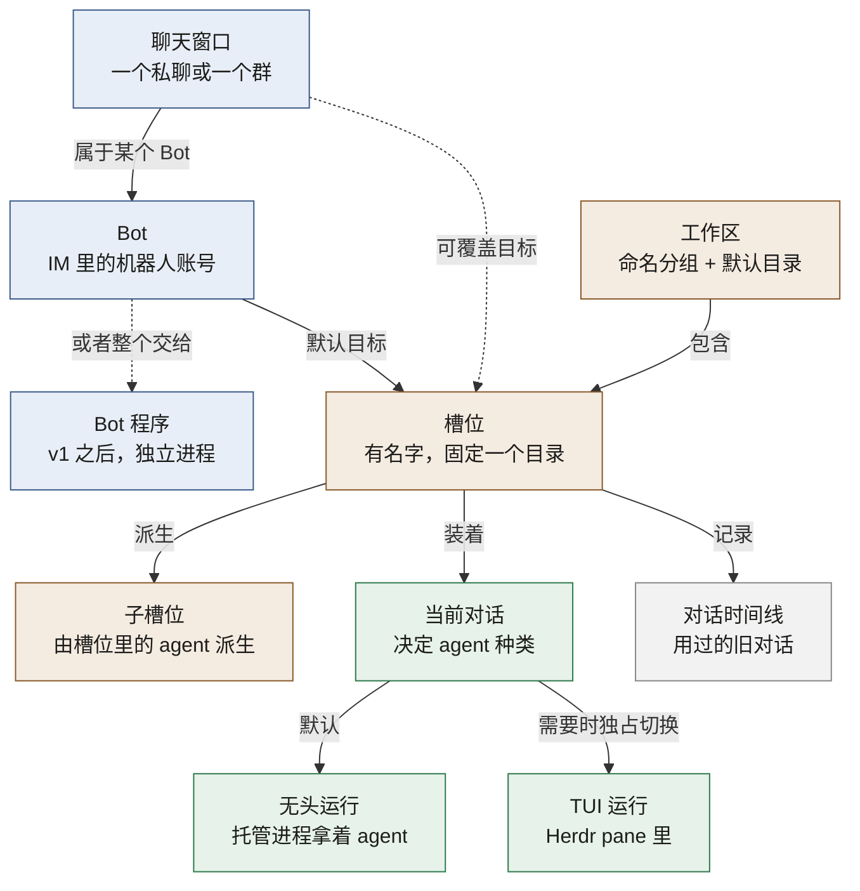
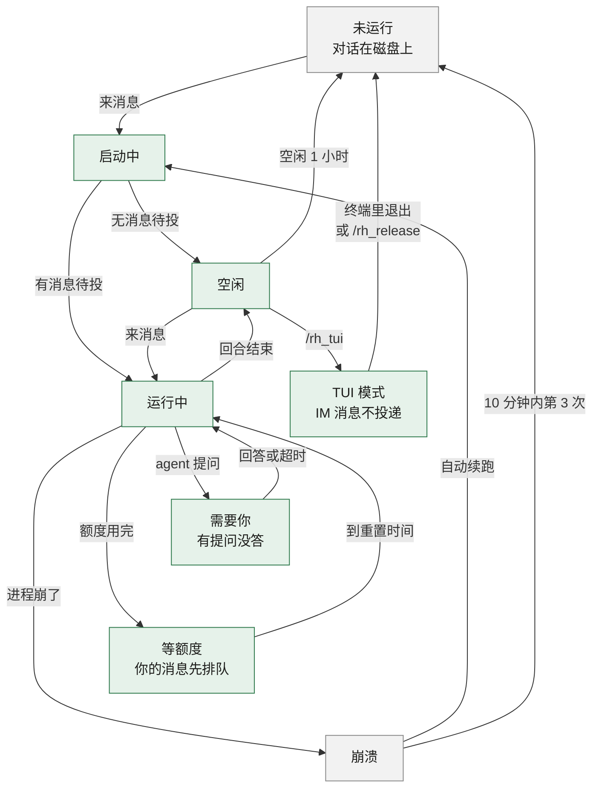
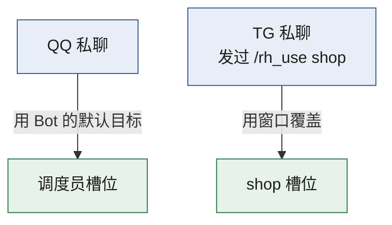
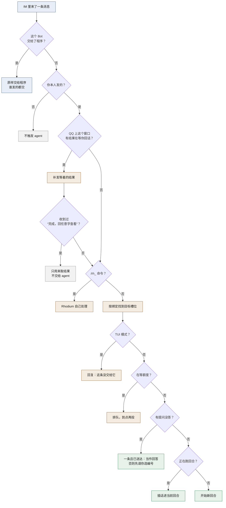
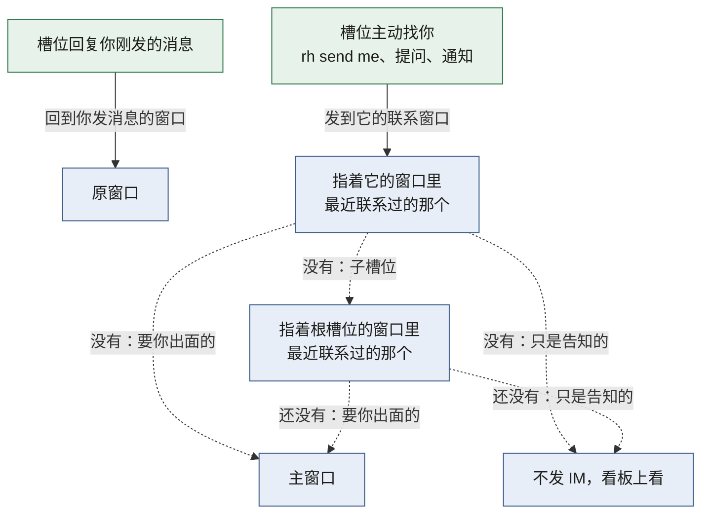

# Rhodium 产品说明

这篇回答：Rhodium 是什么、给谁用、在各种情况下怎么表现，以及每项功能放在哪一版。只讲行为，不讲实现。

前置阅读：[术语表](../GLOSSARY.md)

## 1. 这是什么

Rhodium 是一个只给你一个人用的 agent 宿主，跑在你自己的 Linux 机器上。

- 它托管 Claude Code 和 pi 的对话，以后加 Codex。
- 对话按工作区和槽位组织。这两个词和本文其他术语的定义见[术语表](../GLOSSARY.md)。
- 你主要在手机 IM 里指挥 agent。网页看板和 ssh 终端是另外两个入口。
- 以后它还要托管不经过 agent 的传统 Bot 程序，成为一个个人 Bot 平台（§8）。

北极星是手机 IM 遥控：人不在电脑前，也能用手机派活、看进度、回答 agent 的提问。

它替换的是项目原先的做法：qq-cli 把 QQ 消息打进 Herdr 里的一个 Claude 终端，这个 Claude 当调度员，再去开别的 agent。v1 就是第一个能替换这套做法的版本。

## 2. 给谁用

- 只有一个用户：你。
- 网页界面默认只能从你的 tailnet 访问。tailnet 是你用 Tailscale 组成的私有网络。你也可以改经自己的反代开放，见 §7。反代是挡在网页前面、替它收请求的服务，例如 Cloudflare Tunnel 加 Access。
- IM 里只认你本人的账号。别人的消息不触发 agent，原因见 §12。
- 只跑在一台机器上。多机以后再做，现在只在标识设计上留余地。
- 重视内存和 CPU。内存的大头是 agent 本身：本机每个 Claude 终端进程占 340–440MB（2026-10-20 实测）。所以省内存主要靠空闲回收（§4.4）。

## 3. 核心概念怎么关联



读图要点：

- 工作区是分组。槽位是工作区里的一个位置，固定在某个目录。
- 新槽位默认开在工作区的默认目录，也可以指定别的目录。
- 槽位任何时刻装着一段对话。agent 种类跟着对话走，所以换 agent 就是换一段新对话。
- 槽位用过的对话都留在时间线上，可以随时回去。
- 槽位默认以无头模式运行，需要时切到 TUI 模式。两种模式不会同时存在。
- Bot 有一个默认目标。某个聊天窗口可以把目标改成别的。
- 一个 Bot 要么由槽位驱动，要么整个交给 Bot 程序，不混用。
- 槽位里的 agent 可以派生子槽位（§6）。

## 4. 槽位的生命周期

下图是一个槽位的主要状态。任何状态下进程都可能崩溃，图里只画了最常见的一条。



读图要点：

- 绿色表示 agent 进程在跑。TUI 模式下，它跑在 Herdr 里。
- 灰色表示没有进程，只有磁盘上的对话。
- 启动后如果有消息在等，就直接开始回合。等着的可能是唤醒它的那条消息，也可能是崩溃续跑时的恢复提示（§4.5）。
- 从 TUI 切回无头，先回到“未运行”。TUI 期间有排队的消息，就马上启动、投递它们；没有就等下一条消息再启动。
- 未运行的槽位可以归档，归档后随时恢复。Bot 的默认目标不能归档（§5.2）。
- 已归档、进程停着的槽位可以删除，删了回不来（2026-10-28 定，推翻了 v1 时的“只能归档”）：
  - 只有你能删，用 `rh rm` 或网页。agent 不能删，IM 里没有这条命令（§6.2）。
  - 删的是 Rhodium 自己的记录：槽位、它的对话时间线、提问、排着的消息。`rh use` 还指着它的窗口回到 Bot 的默认目标，说一句它删除了。
  - agent 自己的对话文件不动。要接着用那段对话，用导入（§4.3）。
  - Bot 的默认目标不能删。

槽位的状态在看板上分成四种（2026-10-21 确认），看板怎么排见 §7：

- 需要你：
  - 有提问没答，包括确认请求。
  - 崩溃后没有自动恢复，例如熔断了。
  - TUI 模式下没能切回无头，要你处理后发 `/rh_release` 再试（2026-10-21 确认）。
- 运行中：
  - 启动中，或正在跑回合。
  - 等额度。卡片上标“等额度”和预计恢复时间。
  - 崩溃后要自动恢复，但同时运行的槽位已到上限，在等空位。卡片上标“崩溃，有空位后自动恢复”。
  - TUI 模式，除了没能切回无头的。卡片上标切换走到哪一步：“正在切到 TUI”“TUI 模式”（带 pane 名）“Herdr 重启中”。
- 完成：最近一个回合结束还不到 24 小时。
- 空闲：其余所有槽位，包括进程已被回收的。

“完成”的 24 小时是固定的（2026-10-31 改，#506）。原来它和一次性子槽位的自动归档时间（§6.1）用同一个值，改归档时长会顺带改看板的分组。

### 4.1 无头模式（默认）

新槽位以无头模式启动。无头 agent 和你在终端里开的配置一样。

- 加载你全部的设置、插件、skill、MCP 和 hook。
- 无头和终端用的是系统里同一个 `claude`，照常自动更新。
- 例外：Herdr 的状态 hook 在无头时不触发，因为没有 pane。
- 槽位上记着的模型、思考强度（§5.6）和审批模式（§4.8），无头进程按它起，Rhodium 起的终端也按它起（§4.2）。

Rhodium 会额外告诉 agent 三件事：

- 怎么用 `rh` 命令。
- 这条消息经由哪个 IM、哪个聊天窗口，以及这个平台的格式限制（Markdown 写法、长度上限）。
- 回复约定，见 §5.5。

这取代了原先 qq-cli 的 `[QQ]` 前缀和 Stop hook 约定。

### 4.2 切到 TUI 模式，再切回来

需要亲手在终端里操作时，把槽位切到 TUI 模式。用完退出，槽位自动回到无头。

切过去：

- 在 IM 里发 `/rh_tui`。默认等当前回合结束再切。
- 回合还在跑时，回复带一个“打断，马上切”按钮。
- 发 `/rh_tui !` 则立即打断当前回合再切。槽位还在启动时没有回合可打断，回“还在启动，过几秒再发 /rh_tui !”，什么也不做。
- `/rh_tui` 和 `/rh_release` 可以带槽位名，例如 `/rh_release w/a`，不带就是这个窗口的目标。按钮就是这样带的。
- 切好后通知你：在 Herdr 里哪个工作区的哪个标签页。只说名字，不说 pane ID。通知带一个“切回无头”按钮。
- 切好时还排着、没交给它的你的消息，不等你切回来再交（2026-10-22 确认）。例如等打断生效的、等额度的。
  - Rhodium 把它们从队列里撤下，在 IM 里单独说一声这几句没交给它，附原文和“复制”按钮。要的话到终端里再发。
  - 理由和 TUI 期间拒收消息一样：隔很久再交，上下文已经变了。
  - 切换没成功的，照旧交给它。
- Rhodium 先让无头进程退出，再在 Herdr 的一个 pane（终端里的一个分屏窗格）里打开同一段对话（`claude --resume`）。两个进程不会同时写一份对话记录。
- 槽位还没有对话（建了还没说过话）也能切（2026-10-28 定，原来回“还没有对话可以接着用”）：
  - 终端里开一段新对话，设置照下面接着用时的带。这段对话就是槽位的对话，切回无头接着用。
  - Claude 起的时候 Rhodium 就给它定好对话 ID，马上知道是哪段。pi 能定的话也一样。
  - Codex 定不了，要等第一个回合跑完、Herdr 报出来才知道。一个回合都没跑就退出，槽位还是没有对话。
- Claude 的终端按槽位记着的设置起，和无头一样（2026-10-24 确认）：
  - 记了模型就带上。Claude 最近报的模型列表里没有它（例如升级后旧名字没了），就不带，终端用这段对话原来的模型。
  - 记了思考强度就带上。
  - 审批模式按 §4.8 的表。
  - 没设过的项不带，跟随你自己的设置。
- pi 的终端不带这些。pi 自己从会话文件恢复模型和思考级别，无头时设回的值也写在里面。
  - 这段对话还没写下会话文件（例如 `/new` 之后还没说过话），就按槽位记着的模型和思考强度起，记了才带。
- Codex 的终端和 Claude 一样带模型和思考强度，审批模式按 §4.8 的表（2026-10-27 第 34 轮定）。
  - 它不连你本机的 Codex 后台服务。终端一退出，这段对话马上放开，也不会替你把后台服务拉起来。
  - 不弹“有新版本”和“信任这个目录”的提示，都用启动参数关，不改你的 Codex 配置。
  - 还没聊过就切：开一段新对话，见上面没有对话的那条。
- 从 IM 发的 `/rh_tui` 切过去后，Herdr 的焦点切到这个 pane，你回到电脑前直接就能用（2026-10-21 确认）。从网页切的也一样（2026-10-24 确认）。agent 自己调 `rh tui` 切的不动焦点，免得抢走你正在看的画面。
- 一个工作区对应 Herdr 里的一个 workspace。
- 某个目录第一次在 TUI 里打开 Claude 时，Claude 会先问你信不信任这个目录。这是 Claude 自己的安全确认，无头模式不问。确认一次以后，这个目录就不再问。Rhodium 不替你确认，因为确认记在你自己的 Claude 配置里。

TUI 期间：

- 从 IM 发给这个槽位的消息被拒收（2026-10-21 确认照旧），回复“X 在 TUI 里，这条没交给它”，接着写清下一步的命令，带“切回无头”“换一个槽位”两个按钮。网页能发消息以后，从网页发的也一样（§7）。
  - 窗口用 `/rh_use` 单独指着这个槽位、Bot 的默认目标是别的槽位时，例如：“Rhodium/pi 在 TUI 里，这条没交给它。发 /rh_use - 改和 dispatcher/main 说，或者发 /rh_release 把它切回无头。”
  - 窗口跟着默认目标、在 TUI 里的就是它时，没有 `/rh_use -` 那半句。
- `/status` 照常由 Rhodium 回答（§5.6），`/rh_` 命令照常执行。其余通用命令和普通消息一样拒收。
- agent 仍然可以用 `rh send` 给你发消息。
- 发给这个槽位的内部消息先排队，切回无头后再投。包括子槽位的汇报、别的 agent 用 `rh send` 发来的消息，以及定时任务（v1 之后）。

切回来：

- 在终端里退出 agent，槽位自动回到无头。
- 也可以在 IM 里发 `/rh_release` 强制切回。这会结束终端里的进程，所以要你确认，免得手滑。确认的消息带“切回无头”“取消”两个按钮，不另回“已请你确认”。
- 你在自己的终端里调 `rh release` 直接切回，不用确认。agent 调它照样要你确认。
- 如果你在终端里换了对话（例如 `/clear` 或 `/resume`），切回后槽位接着用新的那段。
- 你在终端里用 `/effort` 改了思考强度，又跑过一个回合，切回后槽位记下它，和在 IM 里发 `/effort` 一样（2026-10-24 确认）。ultracode（[术语表](../GLOSSARY.md)）单独记，和在 IM 里发 `/ultracode` 一样，两项各管各的（#276）。
  - ultracode 看终端里最后一次开或关它。一次都没有，就是没改。
  - 读的是终端里最后一个回合开头用的档位。回合中途 skill 自带的档位不算；你用斜杠命令直接起的 skill，那个回合跳过。
  - 和终端起来时用的比，不一样才记。起来时用的：槽位记着档位就是它，没记就是切过去之前最后一个回合用的。所以你没改，你的默认也不会被钉在槽位上。
  - 记下了东西，切回无头的通知多一行，例如“已应用 TUI 中的设置：思考强度 high，ultracode 开。”。没记就不多这一行。
  - 这几种不记：
    - 只认 Rhodium 按槽位起的终端。Herdr 自己续接的、从 pane 导入的，不知道它起来时用的什么，比不出来。
    - 终端里换了模型：换过去的模型按它自己的默认档位跑，不是你选的。
    - 槽位记的档位终端的模型没有，Claude 自己压低了：不是你改的。
    - 改完一个回合都没跑就退出：记录里读不到。要记下，改完发一句再退出。
    - 组织给思考强度设的上限压低的档位，看不出来，会当成你改的记下。真遇到了，在 IM 里发 `/effort` 设回去。
  - 终端里 Shift+Tab 换的权限模式不记（§4.8）。
- 你在终端里用 `/model` 换了模型，又跑过一个回合，切回后槽位也记下它，和在 IM 里发 `/model` 一样（2026-10-24 确认）。
  - 和思考强度一样，只认 Rhodium 按槽位起的终端，和终端起来时用的模型比，不一样才记。
  - 思考强度不跟着记，槽位原来记的不动：换过去的模型按它自己的默认档位跑，不是你选的。要别的档位，在 IM 里发 `/effort`。
  - 通知那一行写模型的显示名，例如“已应用 TUI 中的设置：模型 Sonnet 5.5。”。
  - 换到的模型在 Claude 的 `/model` 列表里没有对应的一项（例如 1M 上下文的版本），不记。
- pi 的终端也一样（2026-10-24 确认）：你在里面换的思考强度（`/thinking`、Shift+Tab）和模型（`/model`、Ctrl+P），切回后槽位记下，和在 IM 里发 `/effort`、`/model` 一样。
  - pi 一改就写进会话文件，改完不发消息直接退出也记得下。
  - 换了模型只记模型。pi 跟着换成的是那个模型的默认级别，不是你选的，不记。
  - 通知那一行写模型的原值，例如“已应用 TUI 中的设置：模型 deepseek/deepseek-v4-pro。”。
  - 和 Claude 一样，只认 Rhodium 按槽位起的终端，和终端起来时比，不一样才记。
  - 新对话还没说过话就切到终端，终端按槽位记着的设置起。和终端起来时写下的开头两行比，什么都没改就什么都不记。
    - 槽位记的思考强度这个模型没有时，pi 会降到它支持的档位，这不算你改的。
    - 槽位没记模型的，终端从你的默认开始，比不出你改了什么，不记。
  - 在终端里 `/new` 开的对话也从你的默认开始，同样不记。槽位接着用这段新对话，模型和思考强度还是原来记的。
- Codex 的终端和 Claude 一样（2026-10-27 第 34 轮定）：换了模型或思考强度、又跑过一个回合，切回后槽位记下。改完一个回合都没跑就退出，读不到，也和 Claude 一样。

Herdr 重启时：

- Herdr 重启会结束 pane 里的进程。
- 如果 TUI 进程确实没了，槽位自动回到无头，Rhodium 说一声。这是只是告知的，没有窗口指着槽位时不发（§5.10）。你 ssh 回去会发现那个 pane 不在了。
- 如果 Herdr 已经自己把进程恢复了，槽位仍算 TUI 模式。
- Herdr 重启期间发来的消息，回复“Herdr 正在重启，这条没交给它”，而不是“在 TUI 里”。

Herdr 有一项“重启后自动恢复 agent”的设置，默认打开。它可能和 Rhodium 抢同一段对话。Rhodium 不改你的 Herdr 配置，先在自己这边避开冲突：Herdr 一回来，Rhodium 就关掉那个 pane。本机实测抢得过 Herdr 自己恢复。但 Herdr 回来时 Rhodium 恰好不在线，就避不开。所以这个设置开着时，`rh doctor` 会提示你关掉它。

终端里能看到什么：

- v1 只有 TUI 模式的槽位出现在 Herdr 里。无头槽位在终端里看不到，用网页看板看。
- “每个槽位一个 pane”不做（2026-10-28 定）：原来设想无头时 pane 里跑一个终端聊天客户端，接管时原地变成 TUI。网页的对话页和终端已经能随时看任何槽位、一键切终端。

### 4.3 手动开的 agent 和导入

- 你在 ssh 里手动开的 agent，Rhodium 不管。
- 想让 Rhodium 接管，用 `/rh_import`。来源可以是磁盘上的对话记录，也可以是某个 Herdr pane。
- 现有的几个 Herdr 里的 Claude 保持原样，需要时再逐个导入。
- 从磁盘导入：给对话 ID，或它的开头几位。
  - 槽位落到默认目录为这段对话所在目录的工作区，没有就新建。
  - 槽位是无头的，下一条消息接着这段对话。
- 从 Herdr pane 导入：给 pane ID，只认 Rhodium 用的那个 Herdr 会话里的 pane。
  - 槽位直接处于 TUI 模式，pane 里的 agent 照常跑。
  - 你在 pane 里退出 agent 后，Rhodium 关掉这个 pane，槽位切回无头。关 pane 是为了 Herdr 重启时不再自动恢复这段对话。
  - 只关这个 pane：同一个 tab 里你分出来的别的 pane 照旧。tab 里只剩它时，tab 跟着关掉。
- Codex 的对话只能从磁盘导入，从 Herdr pane 导入暂缓（2026-10-27 第 34 轮定）。
  - 你自己在 pane 里开的 codex，默认把命令交给你本机的 Codex 后台服务跑。那些命令身上没有槽位身份。
  - 导入后它调 `rh`，Rhodium 认不出是哪个槽位，写操作都要你确认。
- 别的进程或别的 pane 正在用这段对话时，不导入。
- 某个槽位用过的对话，也不导入，已归档的槽位也算。删除了的槽位不算（§4）：它用过的对话又能导入。已经是某个槽位的 pane，也不导入。
  - 回复说是哪个槽位用过的，要接着用就回那个槽位找：`没能导入，这段对话是 shop/api 用过的。要接着用，先 /rh_use shop/api，再发 /resume 选它。`
  - 从 pane 导入的，先说在 pane 里退出 agent。终端里用 `rh` 的写法。
- 无头槽位每次起 agent 接着一段对话前，都先看有没有别的进程或 Herdr pane 在用它。有就不起，告诉你谁在用。等着的消息留着，那边退出后你再发一条，就一起投给它。
  - 导入的对话最容易碰上：你导入后又在终端里打开了它。
  - Codex 自己给每段对话加写锁，别的程序开着它时 Rhodium 接不上，同样告诉你“这段对话别处正在用”。你自己的 codex 退出后，它连的后台服务还会占着这段对话一阵，最长 30 分钟，这期间也接不上。
- 不带参数的 `/rh_import` 列出可以导入的：Herdr 会话里的 agent，和这个聊天窗口的槽位所在目录里的对话。
  - 正在某个 Herdr pane 里用的对话只列一次，作为那个 pane。
  - 哪个槽位用过的对话都不列，已归档的槽位也算：它们在槽位的时间线上，用 `/resume` 回去（§4.7）。
- 在 IM 里用 `/rh_import` 导入后，这个聊天窗口的消息交给导入的槽位（2026-10-21 确认）。想回到原来的目标，发 `/rh_use -`（§5.2）。
  - 你同意了别人调用的 `rh import`（确认请求）时不改窗口，只在你回答的窗口里告诉你导入的结果，成没成都说。
- 槽位名默认取对话 ID 的前 8 位，可以用 `--name` 另起。

### 4.4 空闲回收

- 无头进程默认空闲超过 1 小时就回收。
- 时长可以全局配置，也可以按槽位改，或者关掉。
- 回收只关进程，对话留在磁盘上。下一条消息来时自动恢复，会多一点启动时间。大对话也不慢：2026-10-21 实测，恢复一段 121MB 的 Claude 对话，约 1 秒就能收消息。
- agent 还有后台任务在跑时，不回收。后台任务指 agent 放到后台、回合结束后还在跑的命令或子 agent。
- 回收会结束 agent 自己的 `/loop` 一类循环。需要定时做事，用定时任务（§4.9）。

### 4.5 崩溃续跑

崩了先通知你，再自动接着跑；短时间内崩太多次就停手。

- 无头 agent 或它的托管进程崩溃时，当前回合丢失。
- Rhodium 发一条故障通知，然后自动恢复这段对话。
- 恢复时让 agent 接着做被打断的回合（2026-10-21 确认）：
  - agent 自带续跑的，用它自带的。Claude 会自己把被打断的回合重跑一遍，它只说一句 “Continue from where you left off.”。
  - 没有自带续跑的（pi 和 Codex），或者 Claude 没有可重跑的回合，Rhodium 发一句：“上一回合被打断，先检查现状再继续”。这样它不会把做过的事再做一遍。
- agent 还没把这一回合的任何一条消息读进对话就崩了，就没有回合可续（2026-10-22 确认）：
  - 例如 agent 卡住时你发了一条，它还没读就被杀了。它的对话里没有这个回合。这时让它“接着做”，它只会翻出以前的事来做。
  - 这时按空闲时崩溃处理：不自动恢复，槽位等你的下一条消息。三家 agent 都这样。
  - 故障通知照常引用那几条，附“复制”按钮（见下文），下一句写“发一条消息就恢复这段对话。”：

    ```
    dispatcher/main 崩溃了。
    发一条消息就恢复这段对话。
    原因：agent 被信号 KILL 结束

    这条不确定它收到没有，需要的话再发一遍：
    “复制测试”
    ```

  - 只要读进了一条，就照常续跑。例如回合的第一条读进了，后来的插话还没读：续跑，通知只引用那条插话。
- 只有工作目录和审批设置都没变时，才自动恢复。如果崩溃之后这个槽位的目录或审批设置被改过，Rhodium 不自动恢复，等你发消息。
- 崩溃前没答的提问作废。点旧按钮会提示“这个按钮已经失效了”。
- 故障通知用一行写原因，例如“原因：agent 退出，退出码 1”。
- 没能启动时，agent 自己的报错才是真正的原因，例如 “No conversation found with session ID”。这时原因下面再加一行“它最后报的错：”，引用这个进程的报错输出最后最多 3 行，共 300 字以内，多了截掉（2026-10-22 确认）。它没报过错就不加。中途崩溃的不加：跑久了的进程报错里杂音多，最后几行不一定是原因。
- 不确定 agent 收到没有的消息（§11），通知里引用前 60 个字，附一个“复制”按钮，方便你再发一遍。Telegram 按下复制到剪贴板，QQ 按下把全文填进输入框、不发出。平台没有这种按钮，或者全文太长放不进按钮，就把那段话单独发一条，方便长按复制。
- 同一段对话 10 分钟内崩溃 3 次就熔断：不再自动恢复，等你处理。否则“内存超限、恢复、再超限”会一直循环，白烧额度。
- 可以按槽位关掉崩溃续跑。
- Rhodium 自己重启、升级或崩溃，都不算槽位崩溃。正在跑的回合不受影响（§11）。

agent 程序暂时不在，也不算崩溃（2026-10-22 确认）：

- Claude 和 pi 会原地自更新，更新的几秒里程序不在。这时要启动的槽位先等它回来，最多等 30 秒（`durations.programWait`）。
- 等的时候，槽位是“启动中”，你的消息照旧排队。等到了就照常启动，你什么也看不到。
- 等的时候发的 `/model` 这类命令跟着等，程序回来就执行，你照常收到结果，不用重发。等不到才回“/model 没做成”，原因是“找不到 claude 程序”（2026-10-22 确认）。
- 等的时候 `rh stop` 或急停，马上结束等待。槽位回到“未运行”，不再发“没能启动”。
- 等不到，槽位回到“未运行”，你收到一条通知。等着的消息都留着，下一条消息来时再启动，一起交给它，不用重发：

```
dispatcher/main 没能启动，找不到 claude 程序。
等着的消息都还在，不用重发。下次来消息时再启动它，到时一起交给它。
原因：等了 30 秒还是找不到 ~/.nvm/versions/node/v24.19.0/bin/claude
```

别的原因起不来，例如程序没有执行权限、对话锁被别的进程拿着，照旧算崩溃。但 agent 还没收到任何东西，等着的消息也都留着，所以故障通知照上面那样说，不叫你重发（2026-10-22 验收时改）：

```
dispatcher/main 崩溃了，没能启动。
等着的消息都还在，不用重发。下次来消息时再启动它，到时一起交给它。
原因：agent 退出，退出码 127
它最后报的错：
rh-hold: cannot start /home/user/.nvm/versions/node/v24.19.0/bin/claude: Permission denied (os error 13)
```

### 4.6 额度续跑

- Claude 订阅额度或 Codex 额度用完时，槽位进入“等额度”，并通知你。两家各算各的。Codex 的 2026-10-27 第 34 轮定。
- Codex：你的套餐只有一个 7 天窗口，用完时离重置可能还有好几天。账号有 credits（Codex 的预付点数）时，Codex 可能先扣它接着跑，扣不了才算用完。
- 额度是整个账号共用的，几个槽位往往一起用完。所以通知先等 30 秒（`durations.quotaNotice`），把这期间一起用完的槽位合成一条，同一个联系窗口只发一条（2026-10-21 确认）。
  - 合成的那条写明恢复时间（取最早恢复的那个）和在等的槽位，例如“Claude 额度用完了，19:00 恢复。在等的：A、B、C。”。
  - 30 秒以后才用完的槽位，另发一条。
- 等额度期间你发的消息先排队。Rhodium 回复预计恢复的时间。
- 到额度重置时间：有排队的消息，就投排队的消息；没有，就自动发一句“继续”。
- 多个槽位同时等额度时，Rhodium 错开它们恢复的时间，避免一起又撞上限。
- 可以按槽位关掉额度续跑。
- 等额度期间发 `/stop`：到点不再发“继续”。期间你发的消息照样到点投递。
- 等额度期间 agent 崩了：被拒的回合早已结束，没有丢东西。Rhodium 重新拉起 agent，接着等。关了崩溃续跑或熔断时除外。
- 等额度期间 Claude 自己开始了一个回合，例如后台任务结束唤醒它：等额度就此结束，排队的消息跟进这个回合。这一回合又被拒的话，重新开始等。

### 4.7 换 agent 和对话时间线

- `/rh_agent pi` 等于“换成 pi，然后 `/new`”。从零开始，不交接上下文。
- 已经是 pi 再发 `/rh_agent pi`，什么也不做，回一句“本来就是 pi，没有改动。”。要新对话发 `/new`。QQ 上旧面板的按钮一直能按，这样按到旧的也不会再开一段新对话（2026-10-22 验收时改）。
  - 回合进行中、正等着换成 pi 时，发 `/rh_agent claude`（槽位现在的 agent）就是不换了，回“不换成 pi 了，还是 Claude。”。
- 回合进行中发 `/rh_agent`，和 `/rh_tui` 一样（2026-10-21 确认）：
  - 默认等当前回合结束再换。Rhodium 回你一句，写明会在回合结束后换。这个回合的最终回复照常发给你。等的期间你发的消息照常插话进这个回合。
  - 加 `!`（`/rh_agent pi !`）立即打断当前回合再换。被打断的回合不代发最终回复。打断后、换好前你发的消息，交给换上的 agent，作为它的第一个回合。
  - 槽位还在启动时没有回合可打断，`/rh_agent pi !` 回“还在启动，稍后再发”，什么也不做。不带 `!` 的等启动后的这个回合结束。
  - 回合中途 agent 崩溃或被 `rh stop` 停掉，也算回合结束：槽位照样换，不再自动恢复旧对话。
- `/new` 在当前 agent 下开一段新对话。
- 旧对话都留在槽位的时间线上。`/resume` 可以回到任何一段。
- 回到旧对话时，槽位的当前 agent 变成那段对话的 agent。
- 换对话时，旧对话里还排着没投的消息（例如等打断生效的 `!` 消息、等提问答完的汇报）留在旧对话里。回到那段对话后，它们最先投递。

### 4.8 审批模式

- 默认跳过审批：agent 调用工具不用问你。例外是绑定了群的槽位（v1 之后，§9）。
- 可以按槽位打开审批模式。打开后，每次需要许可的工具调用都会发一条审批到你的 IM。
- 选择题和计划确认不受这个开关影响，始终会问你。

切到 TUI 时，Claude 和 Codex 的终端也跟着审批模式起（Claude 的 2026-10-24 确认，Codex 的 2026-10-27 第 34 轮定）：

| agent | 槽位的审批模式 | 无头 | 终端 |
|---|---|---|---|
| Claude | 关（默认） | 跳过审批 | 跳过审批 |
| Claude | 开 | 每次需要许可都发到 IM 问你 | Claude 自己的默认，一般是 auto：它自己判断，有风险的才问 |
| Codex | 关（默认） | 不问，不加沙箱 | 不问，不加沙箱 |
| Codex | 开 | 每条命令、每次改文件都发到 IM 问你 | Codex 自己判断，危险的才问，不加沙箱 |

- Claude 的终端里，审批开时 Shift+Tab 切不到跳过审批。
- Claude 的终端里 Shift+Tab 换的模式只管那一次终端，不改槽位的审批模式。
- TUI 期间用 `rh set` 改审批模式，终端里正在跑的进程不变，下次起进程时生效。

Codex 这两行要多说几句：

- 沙箱是 Codex 限制命令读写和联网的机制。它在这台机器上起不来（系统不让普通用户建隔离环境，2026-10-27 实测），而且不稳，所以一律不用。
- 审批关时，`rm -f`、`rm -rf` 这类强制删除 Codex 自己拒跑，让它换个做法。你自己的 codex 跳过审批时也这样。
- “每条都问”是 Codex 的 `untrusted` 设置。它已从 Codex 的配置文件里拿掉，只是接口还收。哪天接口不收了，审批开的 Codex 槽位起不来，Rhodium 直接告诉你原因，不悄悄改成不问。
- Codex 的终端不认 `untrusted`，所以审批开时终端是 Codex 自己判断。
- 回合进行中改审批模式，Codex 从下一个回合起生效，Rhodium 告诉你一声。想马上停就 `/stop`。
- 审批按钮和 Claude 一样只有允许、拒绝。

### 4.9 定时任务（v1 之后）

- 用 `rh schedule` 或在 IM 里用 `/rh_cron` 设置。
- 按 cron 表达式，到点给槽位发一条消息。
- 槽位进程已被回收时，先唤醒它。
- 可以选择每次都开一段新对话。

另外三条（2026-10-21 确认）：

- 到点跑的那一回合，回复发到这个槽位的联系窗口（§5.9），和 `rh send me` 同一套规则。它是内部回合里唯一由 Rhodium 代发回复的例外（§5.5）。在 IM 里用 `/rh_cron` 建的，发到建它的那个窗口。
- Rhodium 停机期间错过的任务，启动后补跑一次。错过好几次，也只补一次。
- agent 也能用 `rh schedule` 建任务。给自己和自己的后代直接建，给别的槽位要你确认（§6.2）。每个槽位的任务数有上限。

## 5. IM 行为

### 5.1 平台

v1 只做 QQ 官方 Bot 和 Telegram 的私聊。QQ 能力最受限，Telegram 能力最全。两头一起做，才能确认同一套代码能按平台能力自动降级。

| 平台 | 版本 | 过程展示 |
|---|---|---|
| QQ 官方 Bot | v1 | 只能往后追加，不能改 |
| Telegram | v1 | 一条实时更新的消息 |
| 飞书 | v1 之后，接着终端嵌入做 | 一张实时更新的卡片，最多每 3 秒改一次 |
| Discord | v1 之后 | 一条实时更新的消息 |
| 微信 iLink | v1 之后 | 只能整条发送 |

微信 iLink 是个人微信号扫码后得到的 Bot 接口。

Rhodium 按每个平台的能力自动适配：流式输出、编辑、按钮、Markdown 写法、长度上限、发送额度。

几条平台限制（多数来自各平台官方文档；微信那条是从插件源码推断的，未核实）：

- QQ 个人开发者最多 5 个 Bot。
- 一个微信号只有 1 个 iLink Bot，而且不能进群。
- Telegram 的命令名只允许小写字母、数字和下划线。这是 Rhodium 命令用 `/rh_` 的原因。
- 飞书（第 33 轮定）：
  - 只做国内飞书，不做 Lark（国际版）。只做私聊。
  - 应用建在你当管理员的组织里。公司的组织也能接，只是多了管理员能看到、能停用，发版本要管理员批。
  - 一个应用只该连一处。连着两处时，每条消息只随机推给其中一处。所以正式和开发各用一个应用。
  - 飞书基础免费版的组织，所有自建应用共用一份每月的接口调用额度，每月 1 号刷新。用了多少，在管理后台的“费用中心”看。

### 5.2 绑定：你发的消息交给谁处理

消息在 IM 和 agent 之间有两个方向，各由不同的规则决定：

- **进**：你发的消息交给哪个[目标](../GLOSSARY.md)处理。由**绑定**决定。
- **出**：agent 的话发到哪个聊天窗口。由下面 §5.9 的规则决定，和绑定无关。

绑定分两层：

- 每个 Bot 有一个默认目标。
- 单个聊天窗口可以覆盖它，只影响这一个窗口。

举个 v1 的例子。你有一个 QQ Bot 和一个 TG Bot，默认目标都是调度员槽位：

- 一开始，两个私聊都交给调度员。它们共享同一段对话：你在 QQ 说一半，可以到 TG 接着说。
- 后来你想直接盯着 shop 的 worker，就在 TG 私聊里发 `/rh_use shop`。这给 TG 私聊加了一个覆盖。
- 现在 QQ 私聊仍然交给调度员，TG 私聊交给 shop 槽位，两边互不干扰。



改目标有三种方式：

- 在聊天窗口里发 `/rh_use <槽位>`，改这个窗口的目标。
- 发 `/rh_bind <目标>`，改这个 Bot 的默认目标。
- v1 之后，在网页拓扑图里拖线（§7）。

去掉窗口覆盖（2026-10-21 确认）：

- 发 `/rh_use -`，这个窗口回到 Bot 的默认目标。回复写明现在交给哪个槽位。
- 去掉之后，`/rh_bind` 改 Bot 的默认目标，这个窗口也跟着变。
- 槽位归档时，指着它的窗口都自动去掉覆盖，回到 Bot 的默认目标（2026-10-22 验收时改）。
  - 长期槽位和一次性子槽位（§6.1）都这样。
  - 不论是一次性子槽位 24 小时到了自动归档，还是有人用了 `rh archive` 或 `/rh_archive`。
  - Rhodium 在那个窗口说一声，例如“shop/fix 归档了，这里的消息改交给 dispatcher/main。”。
  - 你在这个窗口用 `/rh_archive` 归档的，这句并进命令的回复，不另发。
- `rh unarchive` 恢复槽位，窗口不会自动指回它。还要用它，就再发 `/rh_use`。
  - 例外：网页上归档后 8 秒内按“撤销”，槽位恢复，归档时改回默认的窗口也指回去，各收到一句（2026-10-24 定，§7）。
- Bot 的默认目标不能归档（2026-10-22 决定）。归档了的话，这个 Bot 的消息还是交给它，并把它恢复，归档也就白做了。归档默认目标多半是手误。
  - `rh archive`、`/rh_archive` 和 agent 用的 `rh archive` 都拒绝，回“dispatcher/main 是 QQ Bot 的默认目标，先用 /rh_bind 换一个再归档。”。在终端里写的是 `rh bind`。
  - 几个 Bot 都以它为默认目标时，都列出来。一个平台有几个 Bot 时，写上 Bot 的名字，例如“QQ Bot qq2”。
  - 一次性子槽位到点自动归档时（§6.1），它要是某个 Bot 的默认目标，就不归档，也不说什么。
  - 用 `/rh_bind` 或 `rh bind` 把默认目标改成一个已归档的槽位，就把它恢复，和给它发消息一样。所以 Bot 的默认目标不会是已归档的槽位。交给程序的 Bot 除外，收回时恢复（§8）。
  - `rh send` 发给已归档的槽位，照旧恢复它。

槽位改名（2026-10-23 决定）：

- 用 `rh rename` 或 `/rh_rename` 给槽位改名，只能在同一个工作区里改。新名字的规则和 `rh new` 一样，同一个工作区里不能重名。
- 绑定、窗口覆盖、父子关系、正在跑的进程和 TUI 的 tab 都按槽位认，不按名字，改名后照常可用。Rhodium 开的 tab 跟着改成新名字，导入的 pane 所在的 tab 是你的，名字不动。
- 等你回答的确认请求照旧对这个槽位执行。
- 配置文件里 Bot 的 `target` 是按名字写的。改的槽位是某个 Bot 的 `target` 时，Rhodium 先把配置文件备份到它旁边，再只改那一行引号里的名字，注释和别的内容都不动。回复写明改了哪个 Bot、备份在哪。
  - 那一行不是单独一行 `target = "工作区/槽位"` 的写法（例如写成了内联表），Rhodium 就不改名，回复说明原因。
- agent 改名的权限和停止、归档一样（§6.2）。

其他规则：

- 多个 Bot 或聊天窗口可以指向同一个槽位，它们共享同一段对话。
- 群聊（v1 之后）同样适用。例如同一个 QQ Bot，私聊指向调度员，“shop 群”指向 shop 槽位。
- 调度员没有特殊地位。它是一个普通槽位，通常是主 Bot 私聊的默认目标。

### 5.3 一条消息进来会怎样



补充规则：

- 结果在等你回话，见 §5.5“QQ 的回复额度”。`/rh_` 命令也会先走这一步：收到过提示时，你发的命令只用来取结果。
- 通用命令和透传命令在“/rh_ 命令？”那一步走“否”，和普通消息一样交给目标槽位。
  - 例外：TUI 模式时 `/status` 不回“这条没交给它”，由 Rhodium 自己回答（§4.2，2026-10-21 确认）。
- 消息以 `!` 开头时，先打断当前回合，再把消息发给 agent。全角的 `！` 也算。
  - 被打断的回合不代发最终回复。去掉 `!` 的这条消息作为新回合发出，回复发回它所在的窗口。
  - 只发一个 `!`，等于 `/stop`。
- `/stop` 停掉的回合也不代发最终回复，只回一句“已停止”。
- 打断还没生效、被停的回合还没结束时发来的消息，等它结束后作为新回合发出，回复发回第一条消息所在的窗口。
- 插话恰好在回合结束的那一刻到达时，agent 会把它当作新回合来跑。这个回合的回复照样发回这条消息所在的窗口。
- 槽位还在启动时，`/new` 和 `/stop` 回“还在启动，稍后再试”，什么也不做。
- 只有恰好一条提问没答、而且它确实发到了你这里时，你的消息才当作回答。例如 QQ 额度用完、提问没发出去时，你回的“任意字”不能被当成回答。
- 正在跑的回合没有[发起窗口](../GLOSSARY.md)，例如子槽位汇报、你对确认请求的决定开始的回合，或者 `/compact`、后台任务唤醒的回合：你的消息照样并进去，这个窗口从此成为它的发起窗口（2026-10-23 确认）。
  - 这个回合后面的过程消息和最终回复都发到这里。并进去之前它说的话不补发。
  - 理由：内部消息能把这个回合一直续下去，等它结束的话，你的消息可能一直进不去。
  - 代价：agent 在这个回合里本来说给自己听的话，并进去以后也会发给你。
  - 之后再来的汇报、`rh send` 这类内部消息，和你从 IM 开始的回合里一样，等这个回合结束再作为新回合交给它。这样回合能结束。
  - 别的窗口接着发来的，照下一条处理：并进去，回复仍发到第一个并进去的窗口。
- 正在跑的回合是别的窗口开始的，你在这个窗口发的消息并进这个回合（插话），回复发到开始回合的那个窗口。Rhodium 在你发消息的窗口回一句，例如“已并入 QQ 私聊那边正在跑的回合，回复会发在那边。”（2026-10-21 确认）：
  - 窗口用你认得的叫法：“QQ 私聊”“Telegram 私聊”。同一个平台有几个 Bot 时带上 Bot 名，例如“QQ Bot main 的私聊”。不露出 openid 或聊天 ID。
  - Bot 名默认是配置里的 ID。配置给 Bot 写了显示名（`label`）时用显示名，例如“QQ Bot Echo 的私聊”。agent 收到的来源行也一样。命令里照旧用 ID（2026-10-21 确认）。
  - 消息在等额度、排队时不回这句，那时已经回了“消息已排队”。
- 提问推到的窗口不指向提问的槽位时，你在那个窗口里回的编号或文字，回答的是这条提问，不按那个窗口的绑定交给别的槽位（2026-10-21 确认）。`!` 开头的消息和命令照常按绑定走。例如：
  - 提问改经另一个 Bot 转告（§5.5）。
  - 子槽位没有自己的联系窗口，提问推到根槽位的窗口（§5.9）。
  - 没有窗口指着这个槽位，提问推到主窗口，主窗口指着别的槽位（§5.9）。
- 挂着多条提问，或者提问还没送到你这里时，Rhodium 请你先选编号。
  - 推到这个窗口的提问，加上窗口指向的槽位自己的，来自不止一个槽位时，也是这样：排成一个列表，每条写明哪个槽位。Rhodium 不猜你答的是哪条。点提问上的按钮，照常直接回答那一条。
  - 选好编号后，这个窗口又来了新提问，你选的编号作废，要重新选。
- 进程已被回收时，“开始新回合”之前先自动恢复对话。
- 同一条 IM 消息不会被处理两次（§11）。
- 这个 Bot 交给了 Bot 程序时，消息原样交给程序，不经过上面任何一步判断。只有配对码例外，见 §8。
- agent 请你发 Telegram Bot 的 token 时（§5.11），你在那个窗口里接着发的第一条含有 token 的消息，整条由 Rhodium 收下，不交给 agent。只发 token、把 BotFather 的整段回复转发或复制过来，都一样。

### 5.4 消息类型

- v1 支持文本、图片、文件、引用，以及 QQ 的语音。
- 图片直接交给 agent 看。
- 语音优先用平台自带的语音转文字，没有时再用本机或云端转写。
  - 转出的文字当作你发的文本交给 agent，前面标上 `[语音转写]`，同时附上原音频的路径。
  - QQ：用 QQ 自带的转写，v1 已做，和 qq-cli 一样。QQ 没转出文字时，只交原音频。
  - Telegram：没有自带转写，v1 不转。收到语音回一句“暂不支持语音，这条没交给 agent。用文字再发一遍。”，不交给 agent。
  - 飞书：也没有自带转写，和 Telegram 一样先回暂不支持（第 33 轮定）。转写以后和 Telegram 一起做。
  - 以后的平台：例如微信 iLink 自带转写。
- 飞书另有几种（第 33 轮定，探针实测后补）：
  - 富文本：拼成文字交给 agent，里面的图片照常交。
  - 表情包：当图片交给 agent。小表情本来就是 `[OK]` 这样的字。
  - 合并转发：把里面的文字展开交给 agent，谁说的标成“我、A、B”，这个 Bot 自己的标“Bot”。里面的图片和文件不取，写明没取。
  - 回复某条消息：和 QQ、Telegram 的引用一样，agent 看得到原文。
- 超出平台大小限制的大文件（2026-10-21 确认）：不经 IM 发，由 agent 告诉你文件在哪。原打算 v1 之后改发下载链接，2026-10-28 定为不做（§13）。

### 5.5 回复和过程展示

从 IM 发起的回合，Rhodium 自动把最终回复发回来。过程怎么展示，看平台能力。

回复：

- 最终回复由 Rhodium 代发。
- 进度（长任务的阶段进展）由 agent 直接写在回复里，随下面的过程展示实时转给你。
- 文件、图片，以及内部回合里要告诉你的话，由 agent 用 `rh send me` 自己发（2026-10-21 确认）。内部回合指汇报、`rh send` 等别的消息开始的回合，没有人在等它回复。你的消息并进来以后，它就有了发起窗口，照常代发（§5.3）。
- 如果 agent 在这个回合里用带文字的 `rh send me` 发到了开始这个回合的窗口，Rhodium 就不再转发它这一回合后面说的话，也不再代发最终回复，以免你收到两遍。这和原先 qq-cli 的 Stop hook 规则一致。
  - 工具行照常显示（2026-10-21 确认）。
    - Telegram：这一回合的消息停在原样，去掉“正在运行”那行。后面的工具行在 `rh send me` 那条下面另起一条，接着更新。
    - QQ：本来放在一段话开头的工具行，单独发一条。回合结束时，还没发出去的工具行合成一条发出去，`rh send me` 自己那次调用也算（2026-10-22 验收时改）。
  - 已经转发出去的留着。
  - `rh send me` 之前说的话照常转发。QQ 上因为额度攒着没发的，回合结束时照常发。
  - 只发文件、不带文字的 `rh send me` 不算，这一回合照常转发（2026-10-21 确认）。Telegram 上这一回合的消息停在原样，后面的在文件下面另起一条。
  - `rh send me` 发到了别的窗口，这一回合照常转发，最终回复照常代发（2026-10-21 确认）。例如别的窗口插过话，成了联系窗口（§5.9）。
  - 之后你又发了消息、并进这个回合（插话，§5.3），这条规则就解除：agent 从那以后说的话照常转发，最终回复照常代发（2026-10-23）。
    - 从哪个窗口插话都算，回复照旧发到开始这个回合的窗口。
    - 在等 Claude 额度时发的消息也算，它到点并进这个回合（§4.6）。
    - 插话之前、`rh send me` 之后说的话，照旧不转发。
  - 你在 IM 里回答了这个回合挂着的提问（选择题、审批、计划确认，§5.8），点按钮或回文字都行，也一样解除（2026-10-23）。
    - 回答之前、`rh send me` 之后说的话，照旧不转发。
    - 提问超时、被撤回、agent 自己答掉的，不算你回答，不解除。
- `rh send me` 发到哪个窗口由 Rhodium 按联系窗口的规则定（§5.9），agent 选不了。系统提示和 `rh send me` 的帮助都这样告诉 agent，并让它别向你承诺“在 QQ 上告诉你”这类话（2026-10-22 验收时加）。

过程展示（2026-10-21 确认）：

- 一个回合的过程，就是 agent 说的话和它调用的工具，按发生的顺序排。agent 说过的话都留着。
- 工具写成工具行，以 🔧 开头。一段工具，指 agent 两段话之间的所有工具调用。
  - 简略写法：一段一行，只写工具名，连着调同一个工具合成一项，写次数。例如 `[🔧 Edit、Bash ×2]`。
  - 详细写法：每个工具一行，带关键参数，例如文件名、命令、搜索词。例如 `[🔧 Read] src/config.ts`。
  - 向你提问、计划确认、要你审批的调用、agent 自己的待办清单不算工具，不进工具行。
  - 参数里像密钥的值写成 `***`（2026-10-21 确认），因为工具行会发到 QQ 和 Telegram 的服务器上：`sk-`、`ghp_` 开头的；`Bearer`、`token=`、`--token` 后面的；`API_KEY=…` 这样、名字里带 KEY、TOKEN、SECRET、PASSWORD 的。只改发到 IM 的工具行，看板不变。
  - 用哪种写法按聊天窗口记。`/rh_verbose` 不带参数就在两种之间切换，`/rh_verbose on` 改成详细，`/rh_verbose off` 改成简略。默认能编辑消息的平台（Telegram、飞书）详细，QQ 简略。
- 能编辑消息的平台（Telegram、飞书，以后的 Discord）：一个回合一条消息，不断编辑。
  - agent 的话逐字流出，工具段放在引用块里。
  - 正在运行的工具写在工具段的最后一行，标“正在运行”。跑满 1 分钟，加上用时，每分钟更新一次。
  - 最终回复就是这条消息的最后一段，不另发。
  - 飞书上这条消息是一张卡片，同一张最多每 3 秒改一次，省每月的调用额度（第 33 轮定，看了每月用了多少再调）。
  - 飞书手机版里，卡片的字只能整张全选，选不了一部分；电脑版能选（2026-10-26 实测）。照旧一张卡片，回合结束后不补发能选的那条（2026-10-27 定）。
- QQ 私聊：消息只能往后追加。agent 每说完一段话发一条，这段话之前的工具行放在开头。最后一条就是最终回复。
  - 每条用一次被动回复。被动回复只剩 2 次时（留给最终回复和兜底的提示），后面的话先攒着，回合结束时和最终回复拼成一条发。一条放不下，攒着的话缩成一句“中间还有 N 段话没发出来，看板上能看到。”
  - 回合结束时还剩工具、没有话了，不单发。整个回合一句话都没说，就发工具行，加一句“这一回合没有回复文字。”
- 微信：只能整条发送。只发最终结果，加上 agent 主动发的里程碑。
- 遇到图片、提问、超长内容或编辑失败时，改发一条新消息。

QQ 的回复额度：

QQ 把 Bot 发的消息分成两种：

- 被动回复：针对你刚发的某条消息的回复。官方文档写的是私聊每条最多回 4 次、60 分钟内有效。
  - 2026-10-21 实测，这两个限制都没生效：对一条消息连回 20 次全部成功，61 分钟后回复也成功。这是下限，上限没测。
  - Rhodium 按实测的下限算：每条 20 次。有效期仍按 60 分钟算，比实测的 61 分钟短一点，留余量。
- 主动消息：Bot 自己推送，不针对哪条消息。官方文档写的是每个好友每天最多 1000 条、每分钟最多 20 条。
  - 你可以在 QQ 客户端里设成不接收 Bot 的主动消息，设了就一律发不出去。
  - 以前流传的“每月 4 条”，现行文档里找不到。
  - Rhodium 按官方文档算：每个 Bot 每天 1000 条（2026-10-21 确认）。v1 只有你一个好友，所以“每个好友”就是每个 Bot。这个数没实测，实测要耗额度。
  - 每分钟 20 条的频率限制，Rhodium 不管。
  - 平台按额度拒收主动消息时，这个 Bot 的主动额度记为用完。这条改经另一个平台的 Bot（通常是 Telegram）发到你的私聊，开头一行说明原本要发到哪个窗口，例如“QQ 私聊那边发不出去，改发在这里。”。没有别的 Bot 时，这条记为发送失败（2026-10-21 确认）。
  - 一个 Bot 有几个主人时（§5.11），额度仍是这个 Bot 一份，几个主人的私聊共用（2026-10-28 定）。

额度不够时：

- 被动回复用完后，改发主动消息。
- 两种都发不出去时，提问改经另一个平台的 Bot（例如 Telegram）发给你。
  - 一条提问太长、要分几段发时，剩下的额度不够发完所有段，整条都改经那个 Bot 发，免得前后顺序乱。
- 最后的退路是一句“完成，回任意字查看”。你回任意一个字，就有了新的被动回复额度，Rhodium 再把结果发给你。
  - 你回的这条消息只用来取结果，不交给 agent。
  - 前提是你确实收到了这句提示。没收到时，你的下一条消息照常交给 agent，等着的结果也一并补发。
  - 补发时平台又拒收的结果，就此作废，不再等。这通常是内容被拒，再等也发不出去。
- 这句提示怎么保证发得出去（2026-10-21 确认）：
  - 被动回复始终留最后一次，专门发这句。
  - 连这一次也没有了，改经另一个平台的 Bot 通知你。
  - 没有别的平台，就等你下一条消息到了再补发。
- Rhodium 重启不会把额度计数清零。

换到的那个 Bot 有几个主人时，发到哪个私聊（2026-10-28 定，#449）：

- 先找那个 Bot 上指着同一个槽位的主人私聊，有几个取你最近联系过的。
- 没有，就发你最近在那个 Bot 上用过的主人私聊。
- 那个 Bot 是主 Bot 时，照旧发主窗口。

飞书的调用额度：

- 飞书没有被动回复这一说，按每月的接口调用额度算（§5.1）。Rhodium 不数，你在管理后台看。
- 额度用完时，照 QQ 主动消息被拒的办法：该发到飞书私聊的话改经别的 Bot 发，开头写“飞书私聊那边发不出去，改发在这里。”。
- 下一条照旧先试飞书。被拒的调用不算额度，下个月 1 号额度回来就自然恢复。

### 5.6 命令

命令分三类：

1. Rhodium 命令：`/rh_` 开头，Rhodium 自己处理。
2. 通用命令：9 个，各家 agent 都有。Rhodium 转成对应 agent 的操作，并统一输出格式。
3. 透传命令：其余所有 `/x`，原样交给 agent。例如 Claude 的 `/btw`、pi 的 `/scoped-model`，以及 skill 带来的命令。
   - Codex 无头时没有斜杠命令，`/side` 这类只在它的终端里有。`/x` 照样原样发给它，它当一段普通文字读（2026-10-27 第 34 轮定）。

Rhodium 命令统一用下划线写，例如 `/rh_use`。连字符写法 `/rh-use` 也认。

Rhodium 命令：

| 命令 | 作用 | 版本 |
|---|---|---|
| `/rh_use [<槽位> \| -]` | 改当前聊天窗口的目标；`-` 回到 Bot 的默认目标 | v1 |
| `/rh_ls [<槽位>]` | 列出槽位；给了槽位就看它的详情 | v1 |
| `/rh_agent [<种类>]` | 换 agent，从一段新对话开始；默认等当前回合结束，加 `!` 立即打断再换 | v1 |
| `/rh_tui [<槽位>]` | 切到 TUI 模式；加 `!` 立即打断再切。不写槽位就是这个窗口的目标，下同 | v1 |
| `/rh_release [<槽位>]` | 强制切回无头，需要你确认 | v1 |
| `/rh_import` | 把磁盘上的对话或 Herdr pane 导入成槽位 | v1 |
| `/rh_bind [<目标>]` | 改这个 Bot 的默认目标 | v1 |
| `/rh_help` | Rhodium 的首页：第一行写这里交给谁，下面每个 Rhodium 功能一个按钮（§5.7） | v1 |
| `/rh_archive [<槽位>]` | 归档槽位；不写槽位就列出槽位让你点选 | v1 |
| `/rh_verbose [on\|off]` | 这个窗口的工具行用详细还是简略写法（§5.5） | v1 |
| `/rh_rename [<槽位>] <新名字>` | 给槽位改名，只能在同一个工作区里改（§5.2） | v1 |
| `/rh_group` | 设置本群的触发方式 | v1 之后，随群聊 |
| `/rh_cron` | 管理定时任务 | v1 之后 |

通用命令：

| 命令 | 作用 |
|---|---|
| `/new` | 开一段新对话 |
| `/stop [<槽位>]` | 停止当前回合；给了槽位就停那个槽位的 |
| `/status` | 看槽位和 agent 的状态 |
| `/model` | 切模型，记在槽位上 |
| `/compact` | 压缩上下文 |
| `/usage` | 看 agent 的额度和当前对话的用量 |
| `/context` | 看上下文占用 |
| `/resume` | 回到旧对话 |
| `/effort` | 设思考强度，记在槽位上：Claude 的 effort、Codex 的 reasoning effort、pi 的 thinking level。Codex 的六档 low 到 ultra 都能选，ultra 会让它自己开多个子 agent（2026-10-27 第 34 轮定） |
| `/ultracode` | 开关 Claude 的 ultracode，记在槽位上，见下 |

选择面板：要从几样里选一样的命令，不带参数时给你一个面板，按一下就选好，带参数照旧直接执行。

- 有面板的命令：`/rh_use`、`/rh_bind`、`/rh_agent`、`/rh_ls`、`/rh_import`、`/rh_archive`、`/model`、`/effort`、`/ultracode`、`/resume`。`/status` 下面挂着常用的按钮：换模型、思考强度、压缩上下文、开新对话，回合在跑时还有停止。你自己发起、要你点头的事（例如 `/rh_release`），也是一个“做 / 取消”的面板。
- `/rh_use` 的第一项是“回到默认”，就是 `/rh_use -`。`/rh_ls` 按工作区分组，第一行写一共几个槽位，每个槽位一个按钮，按下看它的详情，详情下面是能对它做的事：交给这里、切到 TUI 或切回无头、停止、归档。
- `/model` 分两步：先选模型，选了就切过去；这个模型能调思考强度的，接着问要不要改。
- `/ultracode` 开关 Claude 的 ultracode（[术语表](../GLOSSARY.md)），和思考强度分开（#276）。
  - 不带参数时给“开”“关”两个按钮，现在的那个标出来；带 `on` 或 `off` 直接设。
  - `/effort` 只管思考强度，不列 ultracode。改思考强度不动 ultracode。
  - 正在跑的 Claude 说这个模型开不了时（模型没有 xhigh、workflow 被关掉），回一句“这个模型用不了 ultracode。”，什么也不改。
  - 槽位上记着开、模型却开不了时，记的值留着，Claude 自己不让它生效。换回能开的模型就生效。
  - ultracode 下，每个像样的任务都要先编排 workflow，额度用得比平时快，无头里也一样。
  - 审批开的槽位慎用：workflow 起的子 agent，每个要审批的工具调用也都一条条发到 IM 问你，可能很多。
  - pi 和 Codex 没有 ultracode：回一句“pi 没有 ultracode。”或“Codex 没有 ultracode。”，不为它起 agent。
- 两个平台走法不同。Telegram 在同一条消息里走完：按下就改这条消息，中间的步骤有“返回”，选完写回“已选：……”，撤掉按钮。QQ 发出去的消息改不了，每一步新发一条。
- 现在的那项在按钮上标出来：Telegram 标 ✓，QQ 标 ★（2026-10-22 决定）。QQ 会给按过的按钮加上 ✓，发出去的面板又改不了；现在那项也标 ✓ 的话，按了另一项以后两个按钮都带 ✓，看不出哪个是现在的。所以 QQ 上 ✓ 只表示按过。现在是哪一项，面板开头“现在：……”那行也写着。
- 选了以后还有下文的，Telegram 上这条也要收尾，不留能再按的旧按钮（2026-10-22 验收时改）：
  - 要等回合结束的（例如回合进行中换 agent），“已选”下面写后果，只留“打断，马上换”一个按钮。
  - 要你确认的（例如 `/status` 里的“切回无头”），确认请求另发一条，这条写回“已选”、撤掉按钮。
  - 做不成的，原因直接写在这条里。
- 选的就是现在的那项（`/rh_use`、`/rh_bind`、`/rh_agent`），什么也不做，只回一句“本来就是……，没有改动。”。
- 每个面板最后有“取消”，`/status` 下面的按钮也有（2026-10-21 确认）。Telegram 撤掉按钮，原消息下面写回“已取消”；QQ 回一句“已取消，没有改动。”。
- 面板开着时，你在这个窗口打了一条命令（`/` 开头），面板就退出：Telegram 和按了“取消”一样改，QQ 不另回。按面板自己的按钮不算。`/status` 不算面板：打命令不退出它，下面的按钮照样能按。
- `/model` 第二步时取消或退出，模型已经换好，思考强度不变：Telegram 写回“已选：Opus 4.5，思考强度还是 high”；QQ 按“取消”回“思考强度还是 high。”，打命令退出时不另回。
- 一页最多 8 个选项。再多就翻页，选项带上跨页的编号。回这个编号也能选，条件是（2026-10-21 确认）：
  - 面板是这个窗口里最新的一条消息。面板之后 Rhodium 往这个窗口发过消息（agent 说的话、通知都算），Telegram 上过程消息里多了 agent 的话也算，数字就交给 agent。
  - 面板之后你在这个窗口还没发过别的消息。
  - 面板还开着，没有退出。
  - 没有提问在等你。有提问时，数字先当提问的回答。

`/model`、`/effort` 和 `/ultracode` 设的值记在槽位上（2026-10-21 确认，ultracode 见 #276）。你在 Rhodium 起的终端里改的模型、思考强度和 ultracode，切回无头时也记下来（§4.2）：

- 以后这个槽位每起一个新的 agent 进程，都自动设回这几个值。新进程包括：空闲回收后再来消息、崩溃续跑、切到 TUI（§4.2）、从 TUI 切回无头、`/new`、`/resume`。
- Rhodium 重启后接上原来还在跑的进程，不算新进程，不重设。
- 没设过就什么都不带，跟随你自己的设置（例如 `~/.claude/settings.json`）。Rhodium 不改你的全局设置，只改它起的进程。
- 选“默认”模型，就清掉记下的模型。
- 换 agent（`/rh_agent`，或 `/resume` 回到另一种 agent 的对话）时，这几个值都清掉：它们是按原来那种 agent 写的。
- 记下的模型在新版 agent 里没有了，新进程就用默认模型。Rhodium 清掉这条记录，并在联系窗口说一句。这是只是告知的，没有窗口指着槽位时不说（§5.10）。
- `/status` 显示 agent 自己报的模型和思考强度，这是它实际在用的。agent 没在运行或者不报时，显示槽位上记下的值。思考强度写原值。槽位上记着 ultracode 开时，另起一行写“已开启 ultracode”；关着、没设过、pi 的槽位都不写这一行。
- 模型写显示名，例如“Sonnet 5.5”，不写记下的“sonnet”（2026-10-22 验收时改）。默认模型写“默认”，带上它实际是哪个，例如“默认（Opus 5.5）”，不写 Claude 给的“Default (recommended)”（2026-10-24 定）。agent 在跑时用它报的模型列表；不在跑时用最近一次握手拿到的列表，Rhodium 起的进程和 `rh doctor` 的握手都算；都没有才写原值。
- 记下的模型和进程报的列表对得上（列表项的值，或者它解析成的模型），`/model` 面板就写“现在：……”，把这一项标出来。进程刚起、还没跑过回合时也一样。`/resume` 的面板也总写现在是哪段，pi 的也一样；`/effort` 在槽位记着档位时也写，进程还没跑过回合也一样（2026-10-24 定）。

槽位的 agent 没在运行时（被回收、被停、崩溃了，或者还没用过），通用命令这样处理（2026-10-21 确认）：

- `/model`、`/effort`、`/usage`、`/context`、`/compact` 先把 agent 拉起来，接着这段对话，再执行命令。拉起后槽位是空闲的，照常按回收时长回收，从拉起时算。
- 这样拉起不算一个回合（#489）。看板上它最近一个回合什么时候结束不变，还在原来那组（§4）。一次性子槽位的归档时间也照旧从最近一个回合结束算（§6.1）。
- 这种拉起受同时运行上限约束，和你的消息不同（§6.1）。到了上限，命令不执行，回复你为什么，并提示发一条消息照样能拉起它。磁盘剩余不够时（§5.10）也不拉起，同样回复你。
- `/status` 不拉起 agent，只显示 Rhodium 知道的那部分：目录、agent 种类、状态，以及记下的模型和思考强度。槽位在 TUI 里时也这样，由 Rhodium 回答，不碰终端里的 agent（2026-10-21 确认）。
- `/new`、`/stop`、`/resume` 本来就不需要 agent 在运行。

查询命令（`/status`、`/usage`、`/context`）显示什么（2026-10-24 第 31 轮定）：

- 每个 agent 给出结构化的数据：额度窗口、当前对话的用量、上下文。IM 把它排成几行字，网页把它画成信息卡（[术语表](../GLOSSARY.md)，§7）。两边说的是同一份数据，排法不同。
- `/usage` 分两块：agent 的额度、当前对话。
  - Claude 额度：5 小时和 7 天两个窗口一直有。Claude 另外返回的窗口照样显示，例如某个模型单独的 7 天额度。它先满了，一样会卡住那个模型。
  - 额外用量（Claude 的按量付费）开着才显示。
  - 重置时间在 24 小时以内，写还剩多久；再远，写时刻。重置时间已经过了（数据是旧的），写“已重置”。
  - 当前对话：这个槽位现在这段对话从开始到现在的费用和总 token。`/resume` 回去以后接着算。网页上点开看明细：输入、输出、缓存读、缓存写，Claude 的还按模型分。
  - Claude 的费用是“等效 API 价格”：同样的 token 按 API 标价要花多少。订阅下你不为这笔钱付费。网页和 IM 都这样标。
  - pi 的费用是 pi 按量计费的估算，接近真实花费，不加说明。
  - Claude 进程被强杀或崩溃时，那个进程用掉的部分不计入当前对话，也不另外标出：很少发生。
  - pi 槽位只有当前对话，不带 Claude 额度：只管当前槽位的事。
  - Codex 额度（2026-10-27 第 34 轮定）：Codex 给几个窗口写几个，你的套餐只有 7 天窗口。账号有 credits 时多一行余额，和 Claude 的额外用量那行一样。
  - Codex 不给费用，当前对话只写总 token。用 API key 登录或用自己服务商的 Codex 没有额度，只有当前对话。
- `/context`：用了多少，占当前模型最大上下文的百分比。网页上点开看分项，例如消息、工具、系统提示。
- `/status`：开头是槽位名和它的状态，下面分“模型设置”“状态”两节。
  - 模型设置：agent、模型和思考强度合成一项，开着 ultracode 才写它。
  - 状态：目录、上下文。上下文和 `/context` 写法一样。
  - 有额度窗口用到 80% 时，多一节额度，只写快满的那几个。额度只有在跑的 Claude 或 Codex 进程问得到，`/status` 又不拉起 agent，所以进程没在跑时不写。pi 槽位不写。
- `/rh_verbose` 不带参数照旧直接切换。

### 5.7 命令菜单

IM 里有两处常驻的入口，按“谁提供的”分开（2026-10-24 定）：

- **按钮行**：输入框旁边常驻的一排按钮，放 Rhodium 自己的功能，外加一个“停止”。它和 agent 无关，换 agent 不变。
- **`/` 菜单**：打 `/` 时弹出的命令列表，只放 agent 那边的命令，最后加一个 `/rh_help`。它跟着这个 Bot 的私聊现在交给的槽位的 agent 变。

两样共同的规则：

- 透传命令不进 `/` 菜单，手动输入照样能用。agent 自己的命令（Claude 的 skill、`/btw`，pi 的扩展命令）以后再进。
- 所有 `/rh_` 命令手打照旧能用，连字符写法也认。它们只是不再出现在 `/` 菜单里（`/rh_help` 除外）。
- 交给 Bot 程序的 Bot，Rhodium 不推按钮行，也不推 `/` 菜单（§8）。
- 平台限制：QQ 的两样只有私聊有，所有私聊共用一份。Telegram 两样都按聊天窗口分别设。
- 一个 Bot 有几个主人时（§5.11，2026-10-28 定）：
  - Telegram：每个主人的私聊各推一份，跟各自交给的槽位的 agent 走。
  - QQ、飞书整个 Bot 一份：只有一个主人时照旧跟他的私聊交给的槽位走；有几个时跟 Bot 的默认目标的 agent 走。
- 飞书只有 `/` 菜单，一个应用一份。飞书的机器人菜单只能在开发者后台手配，所以飞书上不做按钮行，Rhodium 的功能都从 `/rh_help` 进（第 33 轮定）。

`/` 菜单（QQ 的指令面板、Telegram 的命令列表、飞书的斜杠命令）：

- 顺序：`/stop`、`/new`、`/status`、`/resume`、`/model`、`/usage`、`/context`、`/compact`、`/effort`、`/ultracode`，最后 `/rh_help`。
- 当前 agent 用不了的不列。pi 没有 `/ultracode`。所以 Claude 槽位 11 项，pi 槽位 10 项。pi 上的 `/usage` 只有当前对话（§5.6），2026-10-24 起也列。
- 这里还没指定槽位时，只列每个 agent 都有的，也就是 pi 槽位那 10 项。网页的命令面板遇到没有 agent 的槽位，也这样列。
- `/status`、`/usage`、`/context` 是 Rhodium 答的，但说的是这段对话，所以也放这里。
- 每项带一句说明，和命令定义里的同一句。
- QQ 的指令面板最多 20 项，放得下。选一项，平台把命令填进输入框。
- 飞书推上去要过几分钟才看得到。选一项就直接发出这条命令，和手打的一样（2026-10-26 实测）。

QQ 的按钮行（自定义菜单，输入框上方那一排，2026-10-24 确认的排法）：

| 在哪 | 按钮 | 发出的命令 |
|---|---|---|
| 平铺 | 停止 | `/stop` |
| 平铺 | 槽位 | `/rh_ls` |
| 平铺 | 切换 | `/rh_use` |
| 平铺 | 换 agent | `/rh_agent` |
| 平铺 | 帮助 | `/rh_help` |
| 折叠的“终端”里 | 切到 TUI | `/rh_tui` |
| 折叠的“终端”里 | 切回无头 | `/rh_release` |
| 折叠的“更多”里 | 改名 | `/rh_rename` |
| 折叠的“更多”里 | 归档 | `/rh_archive` |
| 折叠的“更多”里 | 导入 | `/rh_import` |
| 折叠的“更多”里 | 默认槽位 | `/rh_bind` |
| 折叠的“更多”里 | 工具行详略 | `/rh_verbose` |

- 一排 7 个：5 个平铺的，加“终端”“更多”两个折叠的。折叠的按钮点开是子按钮。
- 按钮上写中文，不写命令。`/stop` 是 agent 那边的命令，但叫停要一下就到，所以按钮行也放一个。
- 不带参数的命令照旧给面板，按一下就能接着选（§5.6）。
- 按下就直接发出命令，不用再按发送。例如点“帮助”，马上发出 `/rh_help`。
- 另备着一份全平铺的排法，现在没用上：折叠的“终端”“更多”在手机上点得开，也好点。真要退回平铺，最多 10 个，就去掉“默认槽位”和“工具行详略”，它们在 `/rh_help` 里有。
- 改了按钮行以后，手机上顺利换上了新的。

Telegram 的按钮行（回复键盘，输入框下面一行，常驻）：

```
[/rh_ls] [/rh_use] [/rh_tui] [/rh_help]
```

- Telegram 的这种按钮按下，就以你的名义把按钮上的字发出来，不能另设发出去的字。所以按钮上直接写命令，Rhodium 照普通命令处理，不认按钮上的中文。
- 别的 Rhodium 功能在 `/rh_help` 里。
- 回复键盘只能随一条消息发下来，之后一直在。配对后，和它的内容变了时，Rhodium 发一条短消息带上它。
- 输入框左边的菜单按钮保持“命令列表”，不改成在 Telegram 里打开网页。
- 一行的高度合适。收起系统键盘后它还露着，之后来的带 inline 按钮的消息也挤不掉它。

`/rh_help` 是 Rhodium 的首页：

- 第一行写这个窗口的消息交给哪个槽位、用什么 agent。
- 下面每个 Rhodium 功能一个按钮：槽位、切换、切到 TUI 或切回无头（按槽位现在的模式只给一个）、换 agent、改名、归档、导入、默认槽位、工具行详略，最后是“取消”。
- 一页放下，不翻页。
- 不再列命令清单。agent 的命令在 `/` 菜单里有说明，Rhodium 的功能都是按钮。ssh 里 `rh --help` 照旧。

按钮行和 `/` 菜单什么时候重推：

- `/` 菜单：Bot 换目标、槽位换 agent 时重推。
- 按钮行：内容和 agent 无关，只在内容变了（例如升级改了按钮）、换了配对的账号时重推。
- Telegram 上你发 `/start` 时，也重推按钮行。清空和 Bot 的聊天记录以后，Telegram 客户端会给一个“开始”按钮，按下就发 `/start`，按钮行就回来了。
- 两样分开算，换 agent 只推 `/` 菜单。QQ 改按钮行每分钟最多 5 次，这样碰不到。

上面按钮行和 `/` 菜单的表现，2026-10-24 在手机上看过，当时正式环境是 1.0.0-67523b1：QQ 的按钮行、折叠的按钮和 `/` 菜单都对，Telegram 的按钮行常驻、清空记录后能找回。

### 5.8 提问与超时

agent 提问后，等你回答。超过时限没人回答，Rhodium 替你给出一个保守的回答（见下表）。提问的四种类型见[术语表](../GLOSSARY.md)。

- 提问带按钮发到你的 IM，Telegram 和 QQ 都是。选项多于 8 个，或者按钮排不进 4 行时，改用编号。
- QQ 发出去的消息改不了，所以提问了结后，按钮还留着。点了只回一条“这个按钮已经失效了”，agent 收不到。这条回复用的是这次点击自带的被动回复，不占主动消息额度。
- 网页能写以后也出现在网页上（§7）。IM 和网页谁先回答谁生效，另一边显示已由谁回答。
- 一个槽位可以同时挂几条提问，例如 agent 同时调用了几个工具。
- 确认请求不让 agent 干等（2026-10-21 确认）。`rh` 立刻返回“已请用户确认”，你的决定之后作为一条消息发给 agent。因为 Claude 调用一条命令最多等 10 分钟，等不到提问超时。
- 提问挂着时，你发的普通消息当作回答，条件见 §5.3。

确认请求什么时候推给你（2026-10-21 确认）：

- agent 在你从 IM 开始的回合里发起确认请求，而它要推到的正是这个回合的窗口时，先不推。等这个回合的最终回复发出以后再推。
  - 这样你先看到 agent 说了什么，下面紧跟着确认请求。agent 这一回合一般也不需要再做别的。
  - `rh` 返回时告诉 agent：确认请求会在你这一回合结束后推给用户。
  - 超时从推给你的时候算起。
- 其他情况照旧立刻推。例如 agent 在别的消息开始的回合里发起，或者确认请求要推到别的窗口。

确认的结果由 agent 告诉你（2026-10-21 确认）：

- 你同意 agent 发起的确认请求后，Rhodium 只回一句“已回答：同意”，不带“正在收回…”这类过程。
- Rhodium 也不再自己发结果通知，例如“X 切回无头了。”。结果写进交给 agent 的那条决定里，并请 agent 用 `rh send me` 告诉你。
  - 你在网页上同意的，改请 agent 把结果写在回复里，不用 `rh send me`。网页上看得到这一回合的回复（2026-10-27 加）。
  - 切到终端、切回无头要等一会儿才有结果。决定等切换有了结果，成没成都算，再交给 agent。
- 例外，照旧由 Rhodium 回结果：
  - 你自己在 IM 里发的 `/rh_` 命令，例如 `/rh_release`。
  - 认不出调用者的确认请求，没有 agent 能告诉你。
  - 调用者已归档，决定要等你下次给它发消息才送到。

超时：

- 默认 30 分钟（2026-10-21 确认），可以按槽位改。设为 0 表示永不超时。
- 超时时，Rhodium 先撤掉按钮（QQ 撤不掉，见上），再按类型回答：

| 类型 | 超时后的回答 |
|---|---|
| 选择题 | 把“用户暂时无法回答，请按你的最佳判断继续”当作答案 |
| 审批 | 拒绝，并附上同一句话。agent 会换别的办法 |
| 计划确认 | 不批准，并让 agent 把计划摘要发给你，然后等你 |
| 确认请求 | 视为拒绝 |

为什么审批不能“让 agent 自己判断”：工具审批只有允许和拒绝两种回答。拒绝再附上那句话，是把“按你的判断继续”传给 agent 的唯一办法。

Codex 的拒绝带不了话。超时、或你回了别的话时，Rhodium 先拒绝，再把那句话插进当前回合（2026-10-27 第 34 轮定）。

计划确认通常只在你开了计划模式时出现。你很少在 IM 里用计划模式，所以这条规则平时很少碰到。

### 5.9 agent 的话发到哪个窗口

分两种情况：

- **回复**：你发一句，agent 回一句。回复回到你发消息的那个窗口，由收到消息的那个 Bot 发出。
- **主动找你**：agent 用 `rh send me` 发文件、图片，或在内部回合里告诉你事（§5.5），或者向你提问、需要你拿主意，以及和这个槽位有关的通知。这些都发到槽位的**[联系窗口](../GLOSSARY.md)**。只是告知的通知，没有窗口指着槽位时不发（§5.10）。

联系窗口按这个顺序找（2026-10-21 确认，2026-10-27 改）：

1. 现在指着这个槽位的窗口。“指着”指窗口的目标（§5.2：窗口的覆盖，没有就用 Bot 的默认目标）就是这个槽位。只看你和各个 Bot 的私聊。一个 Bot 有几个主人时，每个主人的私聊都算（§5.11）。
   - 有几个时，取你最近联系过槽位的那个。
2. 子槽位没有时，用指着它的根槽位的窗口，取法同上。
3. 都没有时，用主窗口。

2026-10-27 去掉了“没有窗口指着它时，用最近一次给它发过消息的窗口”这一档。那个窗口多半早改指别的槽位了，话发过去你对不上是谁说的。

哪些算“联系”（用来在几个指着它的窗口里挑）：

- 你在这个窗口发给这个槽位、它收下了的消息，包括通用命令和回答提问。
- 在这个窗口对这个槽位发 `/rh_tui`、`/rh_release`。切换的结果和确认请求就回到这里，这个窗口不指着它也一样。
- 在这个窗口用 `/rh_import` 导入它。
- 被拒收的消息不算，例如槽位在 TUI 里、磁盘不够时你发的。

这样，你用 `/rh_use` 把一个窗口改指别的槽位以后，原来那个槽位的话会去还指着它的窗口，你在那里可以直接接着聊。没有窗口还指着它，就去主窗口。



`rh send me` 发到的窗口，当前的目标（§5.2：窗口的覆盖，没有就用 Bot 的默认目标）不是这个槽位时，正文前加一行 `〔工作区/槽位〕`，例如 `〔Rhodium/pi〕`，让你知道是谁说的（2026-10-21 确认）：

- 目标就是这个槽位时，不加。
- 只发文件、没有文字时，这一行单独发一条，排在文件前面。
- 你从自己的终端发的 `rh send me` 不属于哪个槽位，不加。
- 提问和故障通知本来就写着槽位名，不用再加。

agent 也可以用 `rh send <槽位>` 给别的槽位发消息。

### 5.10 通知时机

Rhodium 只在下面这些情况下主动找你。其余状态变化（回合完成、空闲、回收）只更新看板。从网页开始的回合跑完，网页上另有[未读](../GLOSSARY.md)和电脑上的[跑完提醒](../GLOSSARY.md)（§7），它们不算通知。

主动发的话分两类（2026-10-27 定）：

- **要你出面的**：要你拿主意，或者出了错、活停了、消息可能丢了。发到槽位的联系窗口（§5.9），没有窗口指着它就发主窗口。
- **只是告知的**：看板上本来就显示的状态变化。有窗口指着槽位（子槽位：指着它或它的根槽位）时照旧发到那里；没有就不发 IM，只在看板上看。
  - 为什么：没有 IM 窗口指着这个槽位时，这类变化只能来自网页、终端或 Rhodium 自己，不是你在 IM 里做的。
- 拿不准的：活卡住了或者消息可能丢了，算要你出面的；不然算只是告知的。
- 你在 IM 里对槽位发的 `/rh_tui`、`/rh_release`，结果照旧回那个窗口（§5.9）。网页上发起的，成功不发，失败按要你出面的发（§7）。

| 什么 | 哪一类 |
|---|---|
| agent 提问，包括审批和确认请求 | 要你出面的 |
| agent 的 `rh send me` | 要你出面的 |
| 子槽位要汇报，但它的父槽位已经不在 | 要你出面的 |
| 槽位崩溃或熔断，包括不确定 agent 收到没有的消息 | 要你出面的 |
| agent 出错，例如 pi 拒收你的消息 | 要你出面的 |
| 槽位没能启动：对话别处正在用，或者找不到程序 | 要你出面的 |
| 磁盘不够，没唤醒槽位，或者停下后没再启动 | 要你出面的 |
| agent 调 `rh` 被拒：太频繁、派生超出上限、磁盘不够 | 要你出面的 |
| Claude 额度用完 | 要你出面的 |
| 没能切到 TUI、没能切回无头 | 要你出面的 |
| 退回没交给 agent 的消息（切到 TUI、换 agent 时还排着的） | 要你出面的，发到每条消息来的窗口 |
| 切到 TUI 成功（不是在 IM 里发起的） | 只是告知的 |
| 切回无头：在终端里退出 agent、从终端 `rh release`、Herdr 重启以后 | 只是告知的 |
| 记着的模型在新版 agent 里没了，改用默认模型（§5.6） | 只是告知的 |
| 没能在运行中切换审批模式，空闲后重启生效 | 只是告知的 |

和槽位无关的，发主窗口：

- 某个 Bot 反复连不上平台。这条通知经另一个还在线的 Bot 发给你。它重新连上时，同样经那个 Bot 告诉你已恢复。
- Bot 程序熔断（§8）。
- `rh doctor` 自检发现的问题、升级到新版。
- Rhodium 自己挂了。这时它的 IM 连接也不在了，所以由系统服务直接调用 Telegram 接口发告警。

Rhodium 自己的话，包括通知、提问和命令的回复，都不经交给 Bot 程序的 Bot 发出。只有配对成功的那句回复例外（§8）。

另有一种不算通知的话：窗口的目标变了，Rhodium 在那个窗口说一句“消息改交给谁”，你得知道。槽位归档时说（§5.2），网页能写以后在网页、终端里改目标也说（§7）。交给程序的 Bot 和陌生人的窗口例外（§8）。Bot 有几个主人时，每个目标变了的主人私聊都说一句。

### 5.11 建 Bot 和让 agent 管 Bot

每个平台都有快速创建 Bot 并完成绑定的流程：

- QQ：扫码。qq-cli 已有 `qq init --qr`。
- Telegram：粘贴 token。Bot API 9.6 起还有 Managed Bots：一个管理用的 Bot 发来创建链接，你点开确认，新 Bot 就建好了，不用再粘贴 token。
- 微信 iLink：本身就是扫码。
- 飞书：扫码，或粘贴 App ID 和密钥（第 33 轮定，见下）。
- Discord：没有扫码，只能走向导。

v1 只做你自己建 Bot（2026-10-21 确认）：

- 你在 ssh 里用 `rh bot` 建。QQ 扫码，Telegram 粘贴 token。
- 建完自动绑定。
- 建完马上生效，不重启 Rhodium（2026-10-23 起）。
- Bot 程序这一期新加 `rh bot rm` 去掉 Bot，也马上生效，不重启。槽位驱动的 Bot 和交给程序的 Bot 都能去掉。放在第一段做。
- v1 里 agent 不能用 `rh bot`，也不能改绑定。改绑定和配对 2026-10-29 起 agent 也能用，见下面“agent 改绑定、加减小号、忘掉窗口”（#485）。

飞书的 Bot（v1 之后，第 33 轮定，2026-10-26 探针实测后补）：

- 扫码为主。`rh bot <名字> feishu` 给出二维码和链接，你在飞书里扫码或点链接，页面上新建一个应用。扫码的账号就记为你，不用配对。
- 页面上也能选已有的应用。`rh bot` 提醒你先停掉正连着它的程序：飞书没法查它连在哪。
- 扫码不方便时，`rh bot <名字> feishu --paste` 粘贴 App ID 和密钥，照提示在开发者后台配好，再 `rh pair` 配对。
- 应用名在扫码页上自己起，Rhodium 不预填。
- 权限：先拿飞书默认的一整套。第一次扫码带上要的权限等附加配置，页面上建成了应用，`rh` 却没拿到凭据。只带权限行不行，做 `rh bot` 前再试：行就只要用得上的（第 33 轮定）；不行，`rh bot` 告诉你哪些能在后台删。
- 看板要显示你的飞书头像和名字，还要在后台给应用加“获取用户基本信息”权限、发一个版本。`rh bot` 缺这项时会说。
- Lark（国际版）账号扫码，`rh bot` 说暂不支持。

Bot 的主人（2026-10-28 定，#449）：

- Bot 认作你的账号，叫这个 Bot 的**[主人](../GLOSSARY.md)**。只有主人的消息触发 agent（§12）。不是任何一个主人的，都是别人。
- 一个 Bot 可以有几个主人。例如几个 QQ 小号私聊同一个 Bot，各自用 `/rh_use` 指向不同的槽位。这样几个槽位共用一个 Bot，省下 QQ 个人开发者 5 个 Bot 的名额。
- 主人必须都是你本人的账号。把别人的号加进来，就违反了“只有你本人能触发 agent”。
- 主人有两种来处：
  - 配置里 Bot 的 `owner`，写一个账号或一个账号列表。扫码建 Bot 时，扫码的账号就写进这里。它们以配置为准，`rh pair` 改不了，要改就改配置文件。
  - 配对：拿一个配对码，用那个账号私聊 Bot 发过去。你在 ssh 里拿的，码写在 `rh` 的输出里；2026-10-29 起 agent 也能拿，码由 Rhodium 发到你的 IM（见下面“agent 改绑定、加减小号、忘掉窗口”）。
- 配对的几种用法。v1 里只有你能用；2026-10-29 起除了第一种，agent 也能用，规则见下面（#485）：
  - `rh pair <Bot>`：发码的账号成为唯一配对来的主人，原来配对来的都去掉。配置里写了 `owner` 的 Bot 不能这样配对。
  - `rh pair <Bot> --add`：发码的账号再加为一个主人，原来的都不变。配置里写了 `owner` 的 Bot 也能加。
  - `rh pair <Bot> --rm <账号>`：去掉一个配对来的主人。配置里的去不掉。
  - `rh pair <Bot> --list`：列出这个 Bot 的主人，标出哪些来自配置。`--rm` 要的账号从这里看。
  - 2026-10-29 起，`--list` 还写出每个主人的私聊现在交给哪个槽位，好认出是哪个小号（#485）。
- 每个主人和 Bot 的私聊都是你的私聊，各是一个窗口，各有各的目标。联系窗口（§5.9）、换 Bot 发（§5.5）、命令菜单（§5.7）、目标变了的那句话（§5.10）和拓扑图（§7）都把每个主人的私聊算进来，细则在各节。
- QQ 主动消息的额度仍按每个 Bot 一份，不按主人分开算（§5.5）。

agent 改绑定、加减小号、忘掉窗口（2026-10-29 定，#485）：

- 改绑定原排在 Bot 程序这一期的第二段，现在提前做，不含交给程序的部分。
- 加减小号、忘掉窗口是这次新加的。
- agent 调用时这样：

| 命令 | agent 调用 |
|---|---|
| `rh use`、`rh bind` | 直接做。碰到下面两种情况，转成确认请求 |
| `rh pair <Bot> --list` | 直接做，只读 |
| `rh pair <Bot> --add` | 直接做。配对码由 Rhodium 发到你的 IM，不交给 agent |
| `rh pair <Bot> --rm <账号>` | 转成确认请求 |
| `rh pair <Bot>`，换成唯一一个主人 | 拒绝，只有你能用 |
| `rh forget <Bot>/<窗口 ID>` | 转成确认请求 |

`rh use`、`rh bind` 碰到这两种情况，要你确认：

- 改了调用者的联系窗口（§5.9）交给谁。
  - 联系窗口是 agent 主动找你时用的窗口，多半就是你正在和它说话的那个。
  - “这个窗口”和“最近联系的窗口”是同一个东西，按 §5.9 的同一套规则找：先找指着它的私聊，子槽位没有再找指着根槽位的，有几个取你最近联系过的那个；都没有就是主窗口。
  - `rh bind` 也算：联系窗口没有自己选过槽位（`/rh_use`），跟着这个 Bot 的默认目标，改默认目标就改了它。
  - 理由：agent 把你手上的窗口指到别处，你下一句话就交给了别人。
- 动了主 Bot：`rh bind` 主 Bot，或者 `rh use` 主 Bot 的窗口。这条原是下面第二段的规则，一起提前做。
- 都不沾的直接做，例如把一个小号的私聊指向某个槽位。
- 目标变了的窗口照旧收到一句“这里的消息改交给……”（§5.10）。
- 确认请求和别的一样，推到调用者的联系窗口（§6.2）。要改的正是联系窗口时，确认请求就发在这个窗口里。

agent 用 `rh pair <Bot> --add` 加小号：

- Rhodium 把配对码发到调用者的联系窗口。码单独一条，长按就能复制。
- `rh` 给 agent 的输出里没有码，只说发到了哪里、多久内有效。例如“配对码已发到用户的 QQ 私聊，10 分钟内有效。”
- 理由：agent 读到的网页、文件里可能藏着别人写的指令。码不经 agent，被带偏的 agent 不会顺手把 `rh` 的输出转给别人。
  - 这只防顺手转出去，不防恶意：agent 以你的身份运行，真要找码，能从 Rhodium 的库里读到。
- 你在手机上收到码，换到要加的小号，私聊这个 Bot 发过去。
- 只有你从终端直接调用时，码才写在 `rh` 的输出里。认不出的调用者经你同意执行的，码也发到 IM。
- 配上了没有，agent 用 `--list` 看，Rhodium 不另告诉它。
- 再要一次码，旧码作废，谁要的都一样。
- Bot 还没有主人时，`--add` 就是第一次配对。所以 agent 也能给新 Bot 配上第一个主人，码一样发到你的 IM。

忘掉聊天窗口，用 `rh forget <Bot>/<窗口 ID>`：

- 典型用法：用 `rh pair --rm` 去掉一个小号以后，再忘掉它的窗口，它就从列表和拓扑图上消失。
- 私聊的窗口 ID 就是对方的账号，和 `rh pair --list` 列的一样。
- 删掉的是 Rhodium 记着的这个窗口：
  - 它自己选的槽位（`/rh_use`）、`/rh_verbose` 和联系时间。
  - 看板上它的头像和名字。
  - 这个窗口的收发记录。所以以后引用那里以前的消息，找不到原文。
- 不在那个窗口说什么。平台上的聊天记录不动。
- 那个账号再发消息，Rhodium 像对新窗口一样重新记下它：跟着 Bot 的默认目标，别的设置都是默认。
- 忘掉不等于去掉主人。要它不再触发 agent，先 `rh pair --rm`。
- 你和 agent 都能用，agent 要你确认。IM 和网页上没有这条命令。
- 拒绝的情况：
  - 主窗口。它写在配置里，要换就改配置。
  - 有回合从这个窗口开始，还在跑。等它跑完。
  - 有推到这个窗口的提问还没答。先答掉，网页上也能答。
  - 有从这个窗口发来、还在排队的消息，例如在等额度。等它交给 agent。
  - agent 要忘的是它自己的联系窗口。确认请求会推到那里，它本身就是挂在这个窗口的提问，你同意了也忘不掉。所以 agent 一调用就拒绝，不问你。
  - Bot 交给了程序（§8）。那些窗口归程序。

Bot 程序这一期的第二段起，agent 也可以用 `rh` 管理 Bot 和 Bot 程序（§8），2026-10-24 定：

- 直接做：
  - 建 QQ Bot：Rhodium 把建 Bot 的二维码图片发到你的 IM，你在手机 QQ 里长按识别，新建一个 Bot。第二段开工前在手机上试一次，识别不了再另想办法。
  - 建 Telegram Bot：Rhodium 在你的 IM 里请你把 BotFather 给的 token 发过来。你发的 token 由 Rhodium 收下，不交给 agent，也不存进库。以后引用那条消息，agent 也看不到 token。token 会经过 IM，这一点可以接受。
  - 绑定、改目标，包括把 Bot 交给程序或收回。交给槽位的部分 2026-10-29 提前做了，规则见上（#485）。
  - 登记程序、启停程序、删掉程序的登记。删登记不动程序的目录，再登记一次就回来。
- 要你确认：去掉 Bot、改动主 Bot 的绑定。前者不可逆，后者可能让你失去遥控入口。
  - 改了调用者联系窗口的绑定也要你确认（2026-10-29 加，见上），交给程序时一样。
- 主 Bot 就是主窗口所在的 Bot。它不能交给程序，谁来都拒绝：交出去，你就没有遥控入口了。
- 去掉 Bot 是从 Rhodium 里去掉：断开连接、删掉配置。平台上的 Bot 本身还在，要删得到平台上删。
- 主 Bot 去不掉，谁来都一样。要去掉它，先改主窗口。

## 6. 派生与 agent 之间的权限

### 6.1 派生

- 槽位里的 agent 用 `rh spawn` 创建子槽位。子槽位可以是别的 agent 种类。
- agent 在项目 X 里派生时，子槽位落到默认目录为 X 的工作区；没有这样的工作区，就新建一个。
- 子槽位和手动建的槽位一样：看板上看得到，你可以直接给它发消息，也可以切 TUI 接管。
- 子槽位完成或卡住时，Rhodium 把这件事作为一条消息发给父 agent，叫作汇报。
- 有聊天窗口绑着子槽位时，它不汇报，“完成”和“卡住”都不发（2026-10-21 确认）。
  - “绑着”指这个窗口用 `/rh_use` 把目标覆盖成了这个子槽位（§5.2）。只看窗口的覆盖，不看联系窗口，也不看 Bot 的默认目标。
  - 理由：你在那个窗口里直接和它说话，父 agent 用不着再收汇报。父 agent 要知道它干了什么，自己用 `rh read` 看。
  - 没有窗口绑着它了，例如你用 `/rh_use` 把窗口改指别处，之后照旧汇报。
- 子槽位也可以用 `rh send me` 直接找你。
- 父槽位已经不在时，汇报改成通知直接发给你。有窗口绑着子槽位时同样不发。

子槽位的生命周期由父 agent 在创建时决定：

- 一次性：完成后空闲 24 小时自动归档。24 小时可以配置。归档时，指着它的聊天窗口回到 Bot 的默认目标（§5.2）。它是某个 Bot 的默认目标时不归档（§5.2）。
- 长期：一直保留，直到被显式关闭。

之后你可以用 `rh set <槽位> lifetime=longterm` 把一次性的改成长期，`lifetime=oneoff` 反过来（2026-10-21 确认）。`rh ls` 里的“生命周期”和看板随之改变。

- 改成一次性时，24 小时从它最后一个回合结束算起。已经空闲超过 24 小时的，马上归档。
- 调度员把一次性子槽位的结果交给你以后，就主动归档它，不等 24 小时。这样做完的活就不再占子槽位的名额（下表）。
- 你说“回收”“收掉”“不要了”，调度员归档那个槽位；说“停掉”，只停进程（[术语表](../GLOSSARY.md)）。拿不准时它先问你。

为了防止派生失控，有几条上限，都可以配置。

| 上限 | 默认值 |
|---|---|
| 同时运行的无头槽位 | 8 个 |
| 每个父槽位没归档的子槽位 | 4 个 |
| 派生深度 | 3 层 |
| 每个槽位调用 `rh` 的频率 | 每分钟 120 次 |

前三条在派生时检查，超出时 `rh spawn` 被拒绝。最后一条限制调用频率，超出的 `rh` 调用被拒绝。两种情况都会通知你。

“同时运行”这条上限，按是谁唤醒槽位分三种（2026-10-21 确认）：

- 你本人发的消息：总能唤醒，不受上限。手机上发的消息被拒，比多占一点内存更糟。
  - 例外是 `/model` 这类要 agent 在运行的通用命令：它拉起槽位时受上限，到上限就不执行，回复你（§5.6）。
- agent 派生，或者用 `rh send` 唤醒已回收的槽位：受上限。超过就拒绝，并通知你。
- Rhodium 自己发起的唤醒（子槽位汇报、崩溃续跑、额度续跑、把你对确认请求的决定送给 agent）：到上限时不拒绝，先排队，有空位再起。拒绝的话，汇报会丢，续跑会失败。

同时运行数是按本机 64GB 内存估算的，其余是经验值，都没有实测。

### 6.2 agent 之间的权限

所有槽位都能用 `rh`。能做什么，看操作对象是不是自己的后代：

| 操作 | 对自己的后代 | 对其他槽位 |
|---|---|---|
| 查看、发消息、派生到任何工作区 | 直接做 | 直接做 |
| 停止、切模式、换 agent、归档、改名 | 直接做 | 发确认请求到你的 IM，你同意才执行 |

确认请求超时视为拒绝（§5.8）。

另外几条 `rh` 的规则（2026-10-21 确认）：

- agent 不能改按槽位的设置，例如审批模式。这些设置是用来管 agent 的。
- agent 不能用急停（§10）。它不该一次停掉所有槽位的活。
- agent 不能删除槽位（§4）。删了回不来，只有你能删（2026-10-28 定）。
- agent 建 Bot、去掉 Bot、改绑定的规则见 §5.11。建 Bot、去掉 Bot 要等 Bot 程序这一期的第二段。
- 改绑定、加减小号、忘掉窗口 2026-10-29 提前放开，规则见 §5.11（#485）。
- Rhodium 认不出是谁在调用 `rh` 时：
  - 从交互式终端调用的，算你本人。
  - 其余的只读操作放行。只给你用的命令（`rh set`、`rh rm`、急停、不带参数的 `rh pair`）一律拒绝。其他写操作要你确认。例如你在 ssh 里手动开的 agent 调 `rh`。

## 7. 网页界面

网页是一个 PWA（可以装到手机桌面的网页）。Rhodium 不做登录页。

- 默认经 Tailscale 访问，只认你的 Tailscale 账号，不对公网开放。
- 你也可以改经自己的反代（§2）开放。这时由反代认人，Rhodium 不认身份：谁过得了反代、连得到看板的端口，谁就能完全控制看板，包括网页终端。风险你担。
- 只在本机用也行：不认身份、只听本机，用本机的浏览器或 `ssh -L` 打开。

v1 是只读看板：

- 首页列出在用的槽位，每个槽位写着状态（§4）和最近一句话，排法见下。
- 点进槽位，看对话记录和最近事件。
- 无头槽位卡住时，显示进程状态、最近事件和错误输出。
- TUI 模式的槽位，状态只显示切换走到哪一步（§4）。在终端里时是“TUI 模式”和 pane 名。
- 可以看 Rhodium 自己的日志和状态。
- 不能在网页里做任何操作。

聊天记录以各 agent 自己的对话记录文件为准。所以 TUI 期间的回合，切回无头后网页上也看得到。

首页这样排（2026-10-23 确认，2026-10-31 改，#506）：

- 最上面是需要你的槽位，离开自己的工作区，集中在一张卡片里，用全名。
- 下面是[置顶](../GLOSSARY.md)的槽位，单独一张卡片，上面一个图钉，用全名。
  - 在列表行的菜单里置顶、取消置顶。只有无头槽位有这个菜单，所以 TUI 模式的槽位置顶不了。
  - 按置顶的先后排，先置顶的在上。不能拖动。
  - 置顶的槽位需要你时移进需要你，不需要了再回来。
  - 归档不清掉置顶，但已归档的只在已归档里；恢复后回到置顶。
  - 记在服务器上，换设备也在。IM 和 `rh` 都没有置顶，`/rh_ls` 和拓扑图照旧排。
- 其余是一串块，按块里最新的[动静](../GLOSSARY.md)排，新的在前：
  - 有两个以上顶层槽位的工作区是一块，自成一张卡片，上面一行小字写工作区名。顶层槽位指父槽位不在用的：没有父槽位，或者父槽位已归档。
    - 点工作区名折叠这张卡片，折叠后写着它有几个槽位。这台设备记住折叠状态。
  - 别的每棵槽位树自成一块，用全名：工作区那半是灰色细字，槽位名加粗。相邻的这种块画在同一张卡片里，所以这样的卡片可能有几张，夹在工作区的卡片之间。
  - 已经移进需要你、置顶的行，不算它原来那块的动静。
- 块里不分在跑、完成、空闲，都按动静排，新的在前。在跑靠蓝字和蓝点看出来。这改掉了 10-23 定的“卡片里运行中的在前”。
- 每个槽位一行，点开进对话页：
  - 左边是 agent 的 logo，角上一个状态色小圆点。
  - 第一行是名字，右边是状态：需要你、崩溃是琥珀色小标签，运行中是蓝字，完成写“N分钟前结束”，空闲只写最近动静的时间。完成和空闲只差颜色和字，不影响顺序。
  - 第二行是最近一句话，你说的前面加“你：”。别的槽位用 rh send 发来的、子槽位的汇报不算你说的，不加。运行中却没在跑回合的，例如等额度、TUI 模式、启动中，这一行换成蓝字的状态。
  - 空闲的整行淡一些。
  - 名字右边画 Bot 头像，带平台标志：你现在在这个 Bot 的私聊或主窗口里说话会进这个槽位，就画这个 Bot（2026-10-25 定）。按你的聊天实际落在哪画，不按 Bot 的默认目标；默认目标去拓扑图上看。
- 派生的子槽位缩进，排在父槽位下面。一棵树按树里最新的动静排。
  - 别的工作区的子槽位也挂在父槽位下面，用全名：父槽位在哪，它就在哪（2026-10-31 定，#506）。
  - 父槽位置顶，子孙跟着进置顶。
  - 父槽位需要你时，子槽位留在原处单独一行。
- 已归档的统一折叠在页面最底下。
- 三处小改进（2026-10-25 定）：
  - 鼠标在列表上时行不挪位置，移开以后再重排。触屏上手指碰着列表时也不挪，最后一次抬起 3 秒后再重排（2026-10-31 加，#506）。
  - 当前打开的槽位在折起的工作区里或已归档里，也露出它那一行。
  - 折起的工作区里有在跑的，槽位数前面加一个蓝点。
- 名字放不下时，工作区那半先缩，至少留 3 个字。
- 没有在用槽位的工作区不出现。不显示目录路径。
- 首页顶上能在“列表”和“拓扑图”之间切换。这台设备记住上次用的那个。
- 电脑上居中一栏，宽度够时一个槽位一行。左右分栏时，左边的窄栏照手机上两行的样子。

宽屏的对话页（2026-10-25 第 32 轮定）：

- 平时照旧：左边是列表或拓扑图，右边是对话。
- 对话顶栏的“放大”进[放大模式](../GLOSSARY.md)：左边换成一条专门的窄侧栏，对话往左拉宽。
  - 侧栏的内容和顺序同首页列表，工作区是能折叠的标签，槽位不装卡片。没有标题，最上面是“新建槽位”“跳转”“导入”。
  - 拓扑图不当侧栏。从拓扑图旁边的对话放大，左边也是这条侧栏。
  - 放大模式里怎么调宽度，左边都还是侧栏。点“缩小”才回去，回去时列表或拓扑图落在最后打开的那个槽位上。
  - 侧栏能收起，收起后什么都不留，展开按钮上亮琥珀点表示别的槽位需要你。窗口窄于 1280px 时默认收着。
  - 侧栏左下角一个齿轮，点开切主题、开关跑完提醒。手机上、首页上不放：首页顶栏有主题按钮（2026-10-31 定，#491）。
- ⌘K（别的系统 Ctrl+K）开[跳转框](../GLOSSARY.md)，按名字跳到槽位。Alt+↑↓ 换上一个、下一个槽位。电脑上打开槽位时，光标就在输入框里。
- 对话的“⋯”里有“全屏”，进浏览器的真全屏。
- 手机上首页列表只多了 Bot 头像、折起的工作区的蓝点，名字里工作区那半至少留 3 个字。别的不变。
- 中屏（600–1023px 宽、至少 480px 高，例如折叠屏展开）上，打开对话直接进放大模式，侧栏默认收着，没有分栏（2026-10-28 定）。“缩小”回到对话的来处：列表或拓扑图。拓扑图照手机的排法。

v1 之后网页最先做，按这个顺序（§13）：

1. 换前端技术栈。
2. 槽位页改成对话界面：结构化的消息流，工具调用折叠。
3. 网页能写。2026-10-24 定的顺序是“先能聊天”：写操作的底子和停止键、发消息、答提问、回合在跑时的待发队列、命令面板、输入框下面的 agent 和模型按钮、槽位上的按钮、拓扑图改绑定，最后是新建、导入和设置。
   - 网页上的选择单和 IM 里的选择面板用同一份候选。
   - 对话页上边聊边做的操作（换 agent、换模型和思考强度、切到终端）放在输入框下面一排；不常用的收在顶栏“⋯”里（2026-10-24 定）。
   - 命令面板学 T3 Code 和 Orca：一个面板列出这个槽位能用的命令；输入框下面的按钮是其中几条的快捷方式，弹出同一张选择单（2026-10-24 定）。
   - 命令面板不列 `/rh_` 命令：它们在网页上都有按钮或别的去处，手打照样能用（2026-10-24 定）。
4. 拓扑图（原来叫关系图）：节点是 Bot 和聊天窗口、工作区和槽位，以后加 Bot 程序；连线是绑定和派生；每个节点带着状态。对话时间线不画在图上，放在详情里。
   - 只读的部分提前做（2026-10-23）：点击进入、点亮有关的节点、看详情和时间线，Bot 和你的私聊用平台上的头像。
   - 一个 Bot 有几个主人（§5.11）时，每个主人的私聊各画一个节点，各带自己的头像和名字。
   - 平时的画法 2026-10-24 改了：跟着默认的窗口接进 Bot 自己的终点，Bot 画一条线到默认目标，只有单独选过槽位的窗口自己画线；收着的工作区只露出有线指着的槽位；线能点。
   - 改绑定和槽位上的操作（包括电脑上的右键）放进第 3 步网页能写（2026-10-24 定），怎么改见下面“网页能写以后”。
5. TUI 槽位的终端嵌入：在网页里看和操作 Herdr 里的那个终端，叫[网页终端](../GLOSSARY.md)。
   - 槽位在 TUI 模式时，对话页换成完整的终端（2026-10-24 提）。
   - 排在哪见 §13。
   - Rhodium 自己画终端，画面和直接用 Herdr 一样，中文不错位。不搬 herdr-web（一个第三方的 Herdr 网页终端），也不再链接它（2026-10-24 定）。
   - 同一时刻只有一处在操作：能打字，也决定终端多大（2026-10-24 定）。
     - 打开就接过来，不用再按一下。
     - 页面关掉、切到别的应用、藏到后台，就放手；回到前台自己接回来。
     - 回到前台时别处已经接过去，就不抢，写着“已在别处打开”（2026-10-24 定）。只有按“在这里继续”或者重新打开页面，才接过来。不然手机一亮屏，就抢走电脑上正用着的终端。
     - 另一台设备或另一个标签打开，那边接过去。这边写着“已在别处打开”，按“在这里继续”再接回来。
     - 你 ssh 里的 Herdr 不算一处：网页在操作时，你在 Herdr 里照样能往这个 pane 打字。
   - 终端按网页的大小排（2026-10-24 定）。网页在操作时，你电脑上 Herdr 里的这个 pane 也是这么大，放手后自己改回来。
     - 字号能放大缩小，这台设备记住。
   - 顶栏一个按钮在终端和对话记录之间切换；收回终端放进顶栏的“⋯”，照旧弹框确认（2026-10-24 定）。
   - 手机上终端下面一排特殊键（Esc、Tab、Shift+Tab、Ctrl+C、方向键、回车）加一个输入框（2026-10-24 定）。电脑上直接在终端里打。
   - 网页终端和写操作一样：只认你（见本节开头），只认看板自己的页面。
   - 看板只开得了槽位的 pane。不是槽位的，先用 `rh import` 导成槽位。

网页能写以后，这样做（2026-10-21 确认）：

- 网页上做的操作，以你本人的身份执行，和你在终端里用 `rh` 一样。
- 结果只在网页上显示，和终端里一样。两个例外：
  - 网页改了某个聊天窗口的目标，Rhodium 在那个窗口说一句，和槽位归档时一样（§5.2）。你在终端里用 `rh use`、`rh bind` 改的也这样。
    - 交给程序的 Bot 例外，见 §8。
  - 网页发起的切换失败了，照旧发故障通知。
- 提问在网页上答了，IM 那边也改：Telegram 把那条提问原地改成“已在网页回答：……”；QQ 改不了消息，补发一行，占一次主动消息。
- 网页不算聊天窗口，不改联系窗口。agent 主动找你，仍然发到 IM（§5.9）。
  - 从网页开始的回合，回复只在网页上显示。
  - 回合中途你从 IM 插一句，或者在 IM 里答了它的提问，这个回合的回复改发到 IM。答提问这一条是 2026-10-24 补的：提问一定推到 IM，你多半是被它叫回 IM 的。
  - 有提问挂着时，网页的输入框被提问卡片占住，先答提问。
  - agent 收到的来源行写 `[来自 网页]`，和别的来源行同一个格式（2026-10-24 改）。
- 只有收回终端（强制切回无头）、切到终端和删除槽位在网页上弹确认框。确认只在网页上做，不走 IM。归档不弹，它随时能恢复。
  - 删除是 2026-10-28 加的：删了回不来，也不给撤销。
  - 切到终端是 2026-10-27 加的：一按，槽位就离开 IM 和网页的对话，手滑了只能收回，收回又会结束终端里的 agent。
  - 急停不上网页，照旧只在 ssh 里（2026-10-24 改，照 2026-10-21 定的“急停不是要在手机上做的操作”）。
  - agent 发起的确认请求照旧推到 IM，网页上也显示，谁先答谁生效。
- 回合在跑时，网页上发的话先排进输入框上面的待发队列，回合跑完作为下一个回合发出（2026-10-24 定，学 T3 Code 和 Orca）。
  - 每条能改成插话、编辑或删掉。按停止，队列暂停，要你按“继续”。
  - IM 里照旧直接插话。开头写 `!` 照旧是打断再发。
- 网页上切到终端，Herdr 的焦点跟过去，和 IM 一样（§4.2，2026-10-24 定）。
- 网页上归档后，轻提示里带“撤销”，留 8 秒：按下槽位恢复，归档时改回默认的窗口也指回去（§5.2，2026-10-24 定）。
- 网页不做推送（2026-10-24 定）。IM 照旧是推送的渠道：提问、通知、崩溃都发 IM。从网页开始的回合跑完，要你回网页看。网页上帮你两样（2026-10-27 定）：
  - [未读](../GLOSSARY.md)：回合在你没看着时跑完，回复只在网页上，列表和侧栏里那一行亮一个点，标签页标题写个数，打开它的对话就灭。回复发到 IM 的回合不算。只记在这个页面里，不同步到别的设备，刷新就没了。
  - [跑完提醒](../GLOSSARY.md)：电脑上页面在后台或窗口没焦点时，你从网页发起的回合跑完、槽位需要你，就弹一条系统通知，点它打开那个槽位，看过了自己消失（2026-10-31 改，#493）。只在你第一次从网页发消息时问一次授权。手机上没有。
  - 不在 IM 里说一句“跑完了”，不弹轻提示，也不做网页推送。
- 拓扑图上改目标，不一处一处弹框（细节 2026-10-24 定）：
  - 按路径那一行的编辑开关才能改，平时点节点、点线照旧。
  - 圆点分起点和终点：窗口和 Bot 右边的是起点，槽位左边的和 Bot 自己的是终点。起点只能换成起点，终点只能换成终点（2026-10-24 定）。
  - 先点一条线，再点它的终点，把终点拿起来放到别的终点上；点它的起点，是和同一种的起点互换。也能长按起点拖过去，或者从终点拖到起点。
  - 窗口放到自己 Bot 的终点上是跟着默认；放到默认目标那个槽位上是单独选了它。
  - 可以连着改几处，确认后一起生效。确认前能撤销一步，一次互换算一步；确认后 8 秒内能整批撤销。
  - 确认后按新的线重排拓扑图，次序没变就不动。
- 看板只认它自己页面发来的请求。别的网站借你的浏览器冒充你，发不进来。
- 本机上的程序（包括 agent）能绕过 Tailscale 或反代直接连看板，冒充你操作。这一点挡不住，只能接受。

查询结果放在哪（2026-10-24 第 31 轮定）：

- 查询命令的结果都放进同一种[信息卡](../GLOSSARY.md)，一行就能说完的也一样。选择单也放进去，例如 `/model`、`/resume`、换 agent。
- 信息卡浮在输入框正上方。宽屏时只占对话那一栏，不挡左边的列表和拓扑图。
- 输入框照样能用：接着打下一条命令，卡片就换成新的。点卡片外面、按 Esc、点叉，都会关掉。
- 轻提示只给两种：动作做完的回执，例如“已压缩上下文”；还有出错。
- `/usage` 的额度画成进度条，快满时变色，不写“快满了”这类字。
- 网页上打 `/rh_ls` 直接回到首页列表，打 `/rh_help` 直接打开命令面板。

网页 UI 一批优化（2026-10-28 定，#451）：

- 模型和 agent 的单子：再点一次按钮收起；标题和 ✕ 固定在顶上，思考强度固定在底部；顶上一个拖动把手，往下拖就关。打开时不加动画。
- 思考强度换成拖动条，样子照 Codex 桌面版，只列当前模型的几档，越高越紫；调完单子不关。
- 模型多时有搜索框；pi 的模型按提供商分组。
- 首页列表和放大模式侧栏里，右键或长按一行弹一个小菜单（iPad、iPhone 上的长按 2026-10-31 加的，#504）：没归档的无头槽位是“归档”，已归档的无头槽位是“恢复”“删除”。在终端里的槽位不弹。2026-10-31 又给没归档的无头槽位加了“停止”（回合在跑时）、“开新对话”“改名”“切到终端”，做的和对话里的一样（#491）；同一天又加了“置顶”或“取消置顶”（#506）。
- 新建槽位和导入用一个目录选择器：停在哪个文件夹就选哪个，只读，能浏览到 `/`。新建的槽位和从磁盘导入的对话，文件夹决定工作区；从 Herdr pane 导入的，照旧按 pane 自己的目录。
- 出错的轻提示 8 秒后自己消失，带一条倒计时的进度条。原来留着，点掉为止。

不排期：

- 网页里的交互式运维，例如重启、升级 Rhodium。Rhodium 挂了，网页也跟着挂，运维照旧走 ssh（§10）。
- 用 Electron 或 Tauri 包成桌面应用。

## 8. Bot 程序（v1 之后）

Rhodium 也是一个个人 Bot 平台。Bot 程序不经过 agent，直接收发 IM 消息；Rhodium 替它管 IM 连接和进程。这一期分两段做，排期见 §13。下面的规则是 2026-10-23 和 2026-10-24 两轮拷问定的。标了“待定”的是写规格时新提的，等确认，写的是默认的做法。

是什么：

- Bot 程序是一个独立进程，任何语言都能写。Rhodium 只管它的进程，不管它里面是什么。
- 一个程序就是一条启动命令、一个目录，加上 Rhodium 发给它的一个令牌。把它告诉 Rhodium，叫[程序登记](../GLOSSARY.md)。
- 它通过 Rhodium 在本机开的接口收消息、发消息。接口只在本机开放。
- 接口采用 Satori 协议的一部分。Satori 是一个跨平台聊天机器人协议，Koishi 社区定的。
- 最常见的一种是 Entari 项目。Entari 是一个 Python 写的 Bot 框架，它本身就是 Satori 客户端，所以 Entari 项目不改代码就能连上 Rhodium。
- 只保证 Entari 能用。用别的框架（例如 Koishi、NoneBot）的 Satori 客户端写的 Bot，大概率也能连上，但不保证，要接时再测。
- Rhodium 持有 IM 连接，替程序处理发送额度和平台差异。

这一期接口能做的：

- 收：私聊里的文字、图片、引用，以及按钮被按下。程序收得到被引用的那句原文。
- 发：文字、图片、引用、按钮、文件。长文字按平台上限自动分段。
  - 按钮有两种：按下交回给程序的，和打开一个链接的。两个平台都用真的链接按钮。
  - 发文件在这一期里做，不在第一段。
- 不做：Markdown、命令菜单、流式输出、群聊。
- 别人发来的文件和语音，这一期不交给程序，以后再说。
- 别人发给程序的原话不进库，只在 Rhodium 的内存里留一小时，给断线补发和找回被引用的原文用。所以别人引用自己一小时以前说的话，程序拿不到原文。
- 程序自己发的话存不存，待定。默认存：和 Rhodium 的回复一样存前若干字，留 90 天，别人引用时找得到。
  - 代价：程序把别人的原话写进回复，这些话也跟着进库。

Bot 和程序：

- 一个 Bot 要么由槽位驱动，要么整个交给一个程序（§3）。一个 Bot 只交给一个程序。
- 一个程序可以驱动几个 Bot。
- 主 Bot 不能交给程序，谁来都拒绝（§5.11）。
- 把 Bot 交给程序、收回来，用 `rh bind` 做。IM 里的 `/rh_bind` 只能选槽位：在一个 Bot 上把它自己交给程序，你就没法再在这个 Bot 上发 `/rh_` 命令收回它了。
- 回合还没完，就把发起这个回合的 Bot 交给了程序，或者用 `rh bot rm` 去掉了：余下的回复改发到这个槽位的联系窗口（§5.9），不再经这个 Bot。
- 这个 Bot 上还在等你回话的消息（§5.5），在交出去或去掉时改经另一个 Bot 发给你，和额度用完时换 Bot 一样。没有能发的 Bot，就不发了。
- 窗口的目标变了时那句“这里的消息改交给……”（§5.10）：
  - 交出去时不说。
  - 收回来时（`rh bind` 回槽位，或者 `rh app rm` 删掉程序登记），只在你和这个 Bot 的私聊里说。别人给程序发过消息，也有自己的窗口，但不跟他们说：他们是程序的用户，QQ 上每说一句还占这个 Bot 一次主动消息。
  - 收回以后，他们的窗口照样跟着这个 Bot 的默认目标。以后再改默认目标（`rh bind`、网页上挪 Bot 那条线），也只在你的私聊里说。没交给过程序的 Bot 也这样：陌生人给它发过消息，也有窗口。
  - 交出去以前在这个 Bot 上用 `/rh_use` 选过槽位的窗口，那个槽位归档时，覆盖照样清掉，不说。网页上归档后按“撤销”，这些窗口也不指回去（§7）。
- 网页上改不了交给程序的 Bot，交出去、收回都在终端里用 `rh bind` 做。
  - 拓扑图上画不画它，待定。默认不画。拓扑图上画出程序以后再说。

交给程序的 Bot 上：

- 它收到的私聊消息，不管谁发的，都原样交给程序。别人的消息也交，理不理由程序决定。
- `/rh_` 命令、通用命令和 `!` 在这里都不归 Rhodium 管，原样交给程序。想遥控 Rhodium，用主 Bot 或 ssh。
- 只有配对码例外：你用 `rh pair` 拿到的码发给这个 Bot，照旧由 Rhodium 收下，不交给程序。
  - Rhodium 照旧在这个窗口回一句“已配对”。它回的是你刚发的码，程序收不到这一来一回。不回，你不知道配上了没有。
- 程序要知道哪个账号是你。Rhodium 照旧靠配对认出你，再告诉程序你在它每个 Bot 下的用户 ID，有几个主人（§5.11）就给几个。主人有增减，Rhodium 重启这个程序。
- 这里的“别人”指不是这个 Bot 任何一个主人的账号。
- Rhodium 不往它上面推命令菜单，也不经它发通知、提问或任何自己的话。上面那句“已配对”除外。
- 程序不能让别人的消息触发 agent，因为只有你本人能触发 agent（§12）。Rhodium 自己挡不住，这条写进给 agent 的写程序指南。

QQ 的额度：

- 额度按 Bot 算，和槽位驱动的 Bot 一样（§5.5）。
- 程序回复某条消息时，Rhodium 用这条消息的被动回复额度发。被动用完改发主动消息。
- 主动也用完了，这条就不发，把错误还给程序。不等你回话，也不改经别的 Bot 发：程序的话只从它自己的 Bot 发出。
- 不针对哪条消息的推送（例如定时提醒）用主动消息。

发没发出去：

- 程序发消息时，Rhodium 等平台有了结果再回它：发成了，或者失败。
- 结局不明的（例如超时）也当失败回给程序。Rhodium 不重发（§11），要不要重试由程序决定。

进程：

- 登记后 Rhodium 拉起程序。程序退出了就自动重启。
- 10 分钟内退出 3 次就熔断：不再重启，通知你，发到主窗口。改好后你重新启动它。次数和时长与槽位的熔断（§4.5）用同一组配置。
- 只在熔断时通知你。单次退出由 Rhodium 默默重启。
- Rhodium 重启、升级或崩溃时，程序照跑。程序和 Rhodium 的连接断了，程序自己连回来，断开期间来的消息补发给它。
  - Rhodium 停着时别人发的消息，平台在它起来后补发过来，照样交给程序。
  - 会丢的只有 Rhodium 停下那一刻已经收下、还没推给程序的几条，窗口只有几毫秒。QQ 消息进 Rhodium 时本来就有这样的窗口，这一点可以接受。
- 停程序时，先请它自己退出，10 秒后还没退才强制结束。Entari 只有收到中断信号（`SIGINT`）才做清理。
- 机器重启后，Rhodium 把该跑的程序都拉起来。
- 程序的输出进系统日志，用 `rh app logs` 看。
- 交给它的 Bot 有增减、你的配对变了，Rhodium 重启这个程序。程序的代码改了，也是重启它，不做热加载。
- 程序重启的那几秒里来的消息，程序收不到。

热插拔：

- 登记、启停程序，把 Bot 交给程序或收回，都在运行中生效，不重启 Rhodium。
- 新建和去掉 Bot 也一样（§5.11）。

agent 写程序（第二段）：

- agent 写的程序放在 `~/bots/<名字>`。每个程序一个 Entari 项目、一个进程。
- 用 `rh app new` 从模板建项目。模板锁定依赖的版本，带一份写程序的指南。
- 写好后 agent 用一条 `rh` 命令登记，Rhodium 拉起它。
- 程序第一次启动前，不用你看代码。新 Bot 要你在手机上建好，这本身就是一次确认。
- agent 能做哪些、哪些要你确认，见 §5.11。

### 验收场景：一句话生成 Bot

在 IM 里对 Claude 说一句话，它就参考现有的 Reminder 的代码，新建一个等效的 Entari 程序和一个新的 QQ Bot。

Reminder 只是个例子：一个现成的、自己连 QQ 的 Python Bot，回几条指令，也到点发提醒。换成你手头的就行。它不迁到 Rhodium，照旧自己跑。

完整流程：

1. agent 在 `~/bots/` 下建好 Entari 项目，写好代码。
2. agent 发起建 QQ Bot。Rhodium 把建 Bot 的二维码图片发到你的 IM（§5.11），你在手机 QQ 里长按识别，新建一个 Bot。
3. agent 用 `rh` 登记程序，把新 Bot 交给它。
4. Rhodium 拉起程序。你在 QQ 里和新 Bot 说话，它像 Reminder 那样回你、到时间提醒你。

全程不重启 Rhodium。这条流程跑通，“一句话生成 Bot”就算做好了。

验收以后留 Reminder（2026-10-24 定）：

- 验收到收到一次到点提醒为止。
- 然后去掉新 Bot 和它的程序，QQ 的 Bot 名额也腾出来。
- 有的服务只认最近一次登录。新程序验收时登过的，之后给 Reminder 重新登一次。
- Reminder 的代码一直不动。

## 9. 群聊（v1 不做，规则已定）

v1 的 IM 只做私聊，群聊放在 v1 之后。下面的规则已经定了，实现时照做。

触发：

- 群里别人的消息只当上下文，不触发 agent（§12）。
- 你自己的消息，默认只在 @ Bot 或回复 Bot 时触发。
- 可以用 `/rh_group` 按群改成“你的每条消息都触发”。

上下文：

- 所有群消息都存下来，只当上下文用。
- 触发时，附上“上次触发以来的群消息”，压缩并限长。默认最多 30 条、2000 字。
- 这些群消息放在明确标为“不可信”的分隔符里，提醒 agent 不要把它们当指令。
- agent 需要更早的记录时，自己用 `rh` 查。

安全护栏：

- 绑定了群的槽位，默认打开审批模式。可以按群关掉，例如全是可信的人的群。
- 在群里发 `/rh_bind` 不直接生效。Bot 会到私聊里请你确认。

平台限制：

- 微信不能进群。
- QQ 要群主在添加 Bot 时打开“接收全量消息”，否则只收得到 @ Bot 的消息。
- QQ 群里，同一个人在不同群的 ID 不一样。怎么认出“这是你本人”还没验证，候选做法是看群主身份，或在群里发一次配对码。认不出时，QQ 群只记录、不触发。
- 只有飞书和 Discord 能拉群历史。QQ 和 Telegram 只能从 Bot 进群那一刻起自己存。

## 10. 运维方式

- 重启、升级只走 ssh（`rh` 命令行、systemd）。日志和状态也能在网页上看（§7）。
- IM 里没有 `/rh_restart` 这类命令。
- agent 有 shell 权限，技术上总能执行 `systemctl --user restart`。Rhodium 不为 agent 专门开 `rh restart`，也不刻意阻止它。
- `rh doctor` 做自检。例如 Claude 升级后，检查 Rhodium 和它的通信是否还对得上。
  - 它只做检查，不改槽位和设置，所以谁都能用：你、槽位里的 agent，以及 Rhodium 认不出的调用者（§6.2）。
  - 升级脚本靠它判断新版能不能用。替你升级的 agent 不在终端里跑脚本，也能用它。
- 急停：`rh stop --all` 一次停掉所有 agent，出事时用。只有你能用（2026-10-21 确认）。
  - 急停本身不叫醒任何 agent：等空位的唤醒、汇报这类内部消息，都留到各自槽位下次启动。
  - 有槽位在等回合结束切到 TUI（§4.2），切换跟着取消，槽位停着，还是无头模式。请求切换的会收到一句“你请求的 rh tui Rhodium/pi 被急停取消了，Rhodium/pi 停着，还是无头模式。”（2026-10-22 确认）：
    - agent 请求的，留到它下次有消息时一起收，不叫醒它。
    - 你在 IM 里发的 `/rh_tui`，在你发命令的窗口说。
  - 排着还没交给 agent 的你的消息，例如等打断生效的、等额度的，不留到下次启动（2026-10-22 确认）。Rhodium 把它们从队列里撤下，在 IM 里单独说一声这几句没交给它，附原文和“复制”按钮。
- `rh stop` 和急停时，已经写给 agent、它还没收下的你的消息（§11），跟着进程一起没了。Rhodium 像故障通知那样说一声，附原文和“复制”按钮，发到这句消息来的窗口（2026-10-22 确认）。
- 改配置文件后，要重启 Rhodium 才生效（2026-10-21 确认）。重启不打断正在跑的回合（§11），所以不做热加载。
  - 例外：用 `rh bot` 建或去掉的 Bot 马上生效，不用重启（§5.11）。这时是 Rhodium 自己改配置文件。你手改配置文件，照旧要重启。
- Rhodium 不改你的 `~/.claude` 设置和 Herdr 配置。

## 11. 可靠性：你能指望什么

能保证的：

- Rhodium 重启、升级或崩溃，不打断正在跑的回合。期间 agent 的输出先存在磁盘上，Rhodium 回来后接着读。
- 同一条 IM 消息不会被处理两次，即使平台重发了它。
- 你的消息交给 agent 时，如果不确定 agent 收到没有（例如 Rhodium 恰好在这时重启），不自动重发，只提示你。否则 agent 可能把“部署到生产”这类事做两遍。
- Rhodium 发到 IM 的消息，如果发送结果不明（例如超时，平台可能已经收到），也不自动重发，只在看板上标出来。宁可少一条，也不发重复。
  - QQ 的被动回复例外：原样再发一次，只再发这一次。第一次其实已经到了的话，QQ 认得出第二次是重复，直接丢掉，你不会看到两遍（2026-10-21 实测）。
- QQ 回复额度的计数不随重启清零。
- 飞书（v1 之后）：Rhodium 停着、重启或断网时你发的消息，连上时把这个私聊最近 24 小时拉回来补上，不用等飞书几分钟后的重推。之后飞书的重推按消息 ID 挡掉，不会交给 agent 两次（2026-10-26 实测）。

做不到的：

- 托管进程自己崩溃，会丢当前回合。它只转发数据，不解析协议。崩了按 §4.5 处理。
- QQ 断线期间发来的消息，只有重连时续上断点，平台才会补发。断点是平台给这个 Bot 的连接记下的位置。QQ 没有拉历史消息的接口，补发不了的就丢了。
  - `rhodium` 把断点存在库里。在跑时断网，或者重启、升级、崩溃，重连时都续上断点，期间你在 QQ 上发的消息平台会补发。
  - 停机或断线太久，断点过期了，只能从头连，期间的消息就丢了。这时 Rhodium 记一条事件。
  - 断点多久过期，2026-10-21 实测：断开 6 分钟后仍能续上，断开期间的消息都补发过来了。这是下限，上限没测。
  - 同一天实测：不续断点、从头连，断开期间的消息一条也不补发。
- 飞书断线超过 24 小时，更早的消息不补拉，飞书自己约 7 小时后也不再重推，就丢了。

## 12. 合规约束

- Claude 用你自己的登录，跑官方未修改的 `claude` 程序，以无头方式运行（`claude -p`，输入输出都用 stream-json）。
- 登录有两种，Rhodium 都认，`rh doctor` 会写出是哪种：
  - 订阅：在终端里运行 `claude` 登录，或者用 `claude setup-token` 拿到的 `CLAUDE_CODE_OAUTH_TOKEN`。`rh doctor` 写“订阅”和套餐名。用量计入你的套餐额度。无头用量是否单独计算，官方文档的措辞有歧义，上线后实测。
  - 你自己的 API：API key，或者 API 地址和令牌，写在 `~/.claude/settings.json` 的 `env` 里，例如 `ANTHROPIC_API_KEY`，或 `ANTHROPIC_BASE_URL` 和 `ANTHROPIC_AUTH_TOKEN`。Bedrock 这类别家的后端也算。`rh doctor` 写“API”和它的来源。按用量计费。
- Rhodium 不经手这些凭据，由 `claude` 自己读。
- Rhodium 是 systemd 服务，看不到你在 `.bashrc`、`.zshrc` 里 `export` 的变量。所以令牌要写在 `settings.json` 里。
- 只有你本人能触发 agent。条款禁止让别人经由你的登录使用，所以别人的消息绝不触发 agent，群里也一样。Bot 程序也不能让别人的消息触发 agent（§8）。
- 不用 `--bare`。它和订阅登录不兼容。官方说它将来会成为 `-p` 的默认值，所以 Rhodium 要显式确保它不生效。
- pi 不能用 Claude 订阅登录，改用 ChatGPT 登录或 API key。
- Codex 用你自己 `codex` 的登录，跑官方未修改的 `codex`。凭据由 `codex` 自己读，Rhodium 不经手（2026-10-27 第 34 轮定）。
  - 登录有三种，Rhodium 都认，`rh doctor` 会写出是哪种（2026-10-27 补）：ChatGPT 登录；API key；你在 `~/.codex/config.toml` 里配的自己的服务商（`model_provider`），按服务商计费。
  - Rhodium 用 `codex` 自己的配置，不替它选服务商，不改 `~/.codex`。
  - 服务商的令牌如果来自环境变量（`env_key`），这个变量要在 Rhodium 服务的环境里，道理同上面 Claude 的令牌。`rh doctor` 发现没有会告诉你，建议改用服务商的 `auth` 命令，例如读一个 0600 的文件。
  - OpenAI 的文档说，本地或开源的应用可以用 app-server 登录，商用或托管的服务不行。Rhodium 在你自己的机器上、只给你用，属于前一种。
  - Codex 的进程和终端都看不到 Claude 的登录和令牌，和 pi 一样。
- 每个使用者都用自己的订阅或自己的 API，不共用一个登录。
- Anthropic 更希望第三方工具用 API key（帮助中心第 13189465 号文章）。
- 以上是对公开文档的理解，不是法律意见。

## 13. 版本路线

v1 的定义：第一个能替换 qq-cli + Herdr 调度员方案的版本。

v1 包含：

| 功能 | 备注 |
|---|---|
| Claude 驱动 | |
| pi 驱动、槽位内换 agent | pi 用来验证驱动接口 |
| QQ、Telegram 私聊 | |
| 文本、图片、文件、引用 | 超出平台上限的大文件，由 agent 告诉你在哪（§5.4） |
| QQ 语音 | 用 QQ 自带的转写（§5.4） |
| 无头模式、空闲回收、崩溃续跑、额度续跑 | |
| 提问与超时、两类通知 | |
| 切 TUI（`/rh_tui`、`/rh_release`） | |
| 导入（`/rh_import`） | |
| 派生、汇报父 agent、`rh send me` | |
| agent 之间的权限 | |
| 只读看板 | |
| 命令菜单 | 按钮行放 Rhodium 的功能，`/` 菜单放 agent 的命令（§5.7） |
| 你用 `rh bot` 建 Bot 并绑定（QQ 扫码、TG 粘贴 token） | 只有你能用 |
| `rh doctor` 自检 | |

v1 之后这样排（2026-10-26 改）：

1. 网页的前 3 步，顺序见 §7：前端技术栈、对话界面、网页能写。
   - 拓扑图的只读部分从第 4 步提前做。
   - 拓扑图改绑定也在网页能写这一步。
2. 终端嵌入（§7 第 5 步），网页能写之后做。
   - 2026-10-24 又定：排在拓扑图改绑定的新画法和 IM 按钮行之后，Bot 程序之前。
   - 宽屏的放大模式（§7）排在它前面（2026-10-25 定）：两边都要改对话顶栏，先做放大免得冲突。
3. 飞书，终端嵌入之后做（2026-10-26 定：飞书、Codex、Bot 程序按这个顺序，先只排顺序，暂不开工）。
   - 飞书和 Bot 程序都要改 `rh bot` 和建适配器的地方，所以两者一先一后，不同时做。
4. Codex 驱动。驱动接口从一开始就按三家设计。
5. Bot 程序（§8），Codex 之后做。分两段：
   - 第一段：Rhodium 能托管 Bot 程序。只有你能用 `rh` 登记程序、把 Bot 交给它。`rh bot rm` 去掉 Bot 也放在这一段。
   - 第二段：agent 也能用 `rh` 管 Bot 和程序（§5.11），做到“一句话生成 Bot”。
   - 第二段里 agent 改绑定的部分提前做，不含交给程序；一起加 agent 加减小号和忘掉窗口（§5.11）。
6. 定时任务：`rh schedule`、`/rh_cron`（§4.9）。
7. 其余按需：要用哪个，再排进来。
   - 群聊，规则已定（§9）。Bot 程序的群聊也在这时一起定。
   - Discord、微信。
   - Telegram 语音。要本机或云端转写，现在回一句暂不支持（§5.4）。

不排期：

- 网页里的交互式运维（§7）。
- 桌面应用包装。
- 多机器。现在只在标识上留余地。

不做（2026-10-28 定）：

- 超出平台上限的大文件改发下载链接。由 agent 告诉你文件在哪就够了（§5.4）。
- 每个槽位一个 Herdr pane（§4.2）。

节奏：几乎不互相干扰的功能可以并行，各自独立做（2026-10-23 改）。原来定的是 v1 之后一项一项做。网页和 Bot 程序不在此列，照上面的顺序先后做（2026-10-23 定）。
