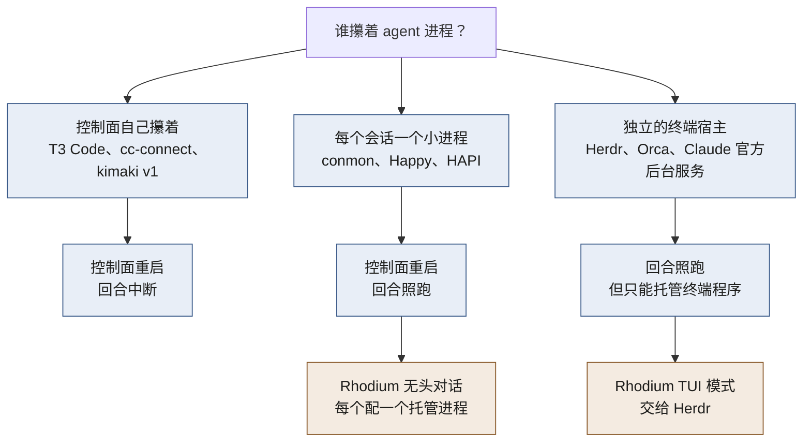
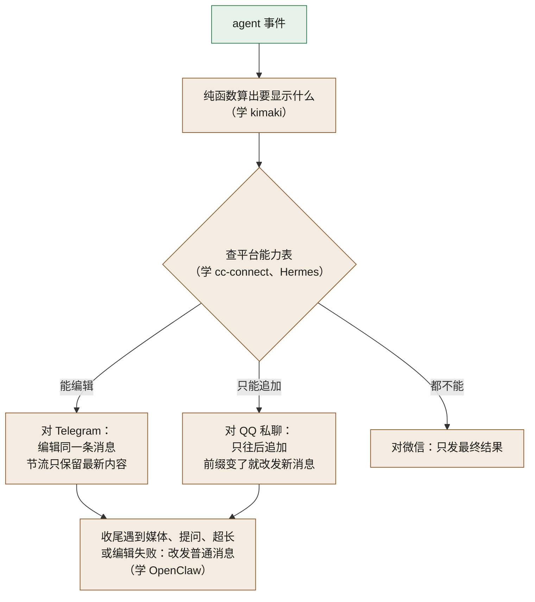

# 调研摘要

这篇回答：Rhodium 的设计从哪些现成项目借鉴了什么，哪些坑是别人踩过的，哪些外部事实限制了设计。

前置阅读：[GLOSSARY.md](../GLOSSARY.md)

> 调研做于 2026-10-19 至 10-21。§3 的飞书一段是 2026-10-26 补的。
>
> 版本号、issue 编号这类数字会过时，细节以原始调研为准（见最后一节）。
>
> 协议的字段细节不在本篇。

## 先说结论

- 没有一个现成项目能直接当 Rhodium 的底座。最接近的是 kimaki v2 和 HAPI：
  - kimaki v2 只接 Discord，没有多 Bot 绑定。
  - HAPI 有 TUI 接管，但 IM 只用来推通知，不能在 IM 里对话。
- 借得最多的是三类做法：
  - 每个对话配一个小进程攥住 agent。控制面（负责调度的常驻服务，比如 Rhodium 自己）重启时，回合不断。
  - 消息先存下来再投递。结局不明的消息不自动重发。
  - IM 适配器只报告平台能做什么。平台做不到时换什么做法（例如不能编辑就改发新消息），统一写在一个地方。
- 别人最常踩的坑，是让桥（把 IM 接到 agent 的中间程序）自己拉起并攥着 agent 进程：
  - kimaki v1 因此留下孤儿进程，跑 7 天内存涨到 5.8GB。
  - cc-connect 和 CodexClaw 的结构决定了桥一重启，回合就断。
- Claude 的 stream-json 通信没有能直接搬来的 TypeScript 实现。Rhodium 照官方 Python SDK 自己写，见 §7。

## 总表

| 项目 | 是什么 | 我们借鉴了什么 | 我们刻意没学什么 |
|---|---|---|---|
| Claude Code 官方（agent view、Remote Control） | Anthropic 自己的后台会话管理和手机遥控 | 控制面停了，会话进程等它重连 空闲约 1 小时回收进程、保留对话 | 不能当底座：只服务 Claude，第三方接不进来 |
| 官方 Python SDK | Anthropic 开源的 Claude 控制库（MIT） | Claude 驱动的逻辑照它移植 | — |
| 官方 TS SDK | Anthropic 的 Claude 控制库，专有许可 | 只当协议说明书读，字段名以它为准 | 复制它的代码 拿它当运行时（它自带一份固定版本的 CLI） |
| conmon / containerd-shim | 容器运行时给每个容器配的小监护进程 | 托管进程的结构 | 容器相关的部分 |
| Happy / HAPI | 手机遥控 Claude、Codex 的开源项目 | 每个会话一个包装进程，中心服务重启不影响它 停会话时杀整个进程组 | 手机来消息就抢占终端 断线补发用的缓冲只放内存 |
| T3 Code | 自托管的 agent 控制面 | 命令的“已处理”记录和它的动作一起提交 先给快照、再给增量 录制回放测试的格式 | 完整的事件溯源（只以事件日志为准） 控制面直接攥着 agent |
| OpenCode V2 | 自带 agent 的用户级后台服务 | 输入先存下再执行 持久事件和逐字输出分开 | agent 跑在服务进程里 |
| Orca | 带独立终端常驻服务的 agent IDE | 用 `systemd-run` 让子进程离开服务的 cgroup 结局不明的投递永不重试 | 当底座（无头 Linux 路径连续回归） |
| Codex app-server | Codex 官方的 JSON-RPC 服务 | 线程、回合、条目、请求四层事件模型 重启后续跑并提示“先检查现状” | 默认每小时自动更新 |
| kimaki | Discord ↔ OpenCode 的桥 | 附着到常驻服务，不自己拉起 agent 纯函数渲染 | 新消息默认打断当前回合 |
| OpenClaw | 自带 agent 的个人助理平台 | 进度消息的编辑和收尾规则 命令菜单没变就不推 还没发出的回复存库，重启后补发 | 整个平台（两万多个 TS 文件） ACP 会话的审批不回传聊天 |
| Hermes Agent | 自带 agent 的多 IM 网关 | 收消息的 Bot 和执行目标分开记 进程死掉的回合不重放 一个平台出错时经另一个平台告警 | 12 万行的网关 |
| cc-connect | Go 写的 IM ↔ Claude/Codex/pi 桥 | 平台能力用可选接口声明 往 agent 环境变量注入会话键 | agent 是桥的子进程 回复跟着“最近一条消息”走 不认识的控制请求不回应答 |
| 腾讯 openclaw-qqbot | QQ 官方给 OpenClaw 写的插件 | 只能追加的 QQ 流式状态机 引用消息索引存盘 | — |
| qq-cli | 用户原来用的 QQ 桥（Bun/TS） | QQ 被动回复额度计数 | 从终端画面截输出 `[QQ]` 前缀和 Stop hook 约定 |
| CodexClaw | 用户自己写的 QQ ↔ Codex 桥（Rust） | 工具调用折叠成 ×N 结果写回前确认前台对话没换 | 桥自己攥着 agent 进程 |
| Satori 与 Koishi | 跨平台聊天协议和它的参考实现 | Bot 程序 API 用 Satori 子集 IM 连接和应用分进程 | 把 satori.js 嵌进来当 IM 层 |
| NoneBot、AstrBot、Entari | 现成的 Bot 框架 | 不借代码，它们能当 Satori 客户端接进来 | 插件和 IM 在同一进程 |
| ACP 及其适配器 | 想统一各家 agent 的协议 | claude-agent-acp 里消息怎么显示成界面 | 用它统一三家主力 agent |
| coder/agentapi | 把 TUI 包成 HTTP 接口 | — | 靠屏幕变化判断 agent 状态 |
| Matrix 桥接 | 用 Matrix 当中枢、桥接各 IM | — | 当中枢：没有桥支持 QQ 官方 Bot 接口 |
| Herdr | 用户在用的终端多路复用器 | TUI 模式的宿主 | 自己写终端宿主 |

## 1. 托管进程与重启不断

结论：Rhodium 要求自己重启、升级、崩溃时，正在跑的回合不断。现成项目里，只有“每个会话一个小进程”和“独立终端宿主”两派做到了。做到的项目各有限制：

- Herdr、Orca 只托管终端里的程序。
- Happy、HAPI 的包装进程是它们完整的 CLI 程序，比较重（HAPI 的跑在 Bun 上），还和它们自己的协议绑死。
- conmon 只面向容器。

没有一个能直接拿来托管 Rhodium 的无头 agent，所以[托管进程](../GLOSSARY.md)要自己写。

借来的做法：

- **攥住管道的小进程**。conmon 给每个容器配一个监护进程。它拿着容器的输入输出，写日志和退出码。容器引擎经 socket 重连它。Rhodium 的托管进程照这个结构做。
- **等重连**。Claude 官方的 agent view 里，后台管理进程（supervisor）停掉后，会话进程会等约一分钟，让新的管理进程重连（文档摘录，原文待核对）。
- **离开服务的 cgroup**：
  - systemd 停一个服务时，会杀掉这个服务 cgroup（systemd 给每个服务划的进程圈）里的所有进程。
  - `detached` 只能让子进程脱离进程组，脱离不了 cgroup，所以照样被杀。
  - Orca 用 `systemd-run --user --scope` 把子进程放进另一个 cgroup。
  - HAPI 让 systemd 停服务时只杀主进程（`KillMode=process`）。
  - Rhodium 用 `systemd-run --user` 拉起托管进程，它的父进程是 systemd，不是 Rhodium。
- **反例**。服务用默认的 `KillMode=control-group` 时，它拉起的子进程会随重启一起死。
- **新旧版本并存**。Orca 按协议版本给 socket 和 pid 文件命名，新旧两版常驻服务同时在跑。Rhodium 的托管进程也带版本号，新旧并存，不原地升级。
- **重启后续跑**。Codex 的常驻服务重启后，会自动续跑被打断的回合，并追加一句“服务重启打断了上一回合，先检查现状再继续”。Rhodium 的[崩溃续跑](../GLOSSARY.md)给 pi 照抄这个恢复提示；Claude 用它自带的续跑。
- **崩溃熔断**。codex-acp 在 5 分钟内最多重启 5 次。Rhodium 也给崩溃续跑加了[熔断](../GLOSSARY.md)。
- **判断进程死活**。Happy 只在系统明确回答“没有这个进程”时，才认定它死了。存下来的旧 PID 不能拿来 kill。
- **杀进程组**。Happy 停会话时杀整个进程组，否则孙进程会变成看不见的孤儿。

别人踩过的坑：

- kimaki v1 自己拉起 OpenCode，留下孤儿进程。跑 7 天后常驻内存涨到 5.8GB，另占 1.3GB swap（kimaki #69、#117）。v2 改成只附着用户的常驻服务才稳定。
- OpenCode 的 `service restart` 起了新的常驻服务，旧的没退。两份服务各带一套 MCP 子进程，泄漏约 1.5GB（opencode #42270）。所以从第一天起就要保证同一时刻只有一个主进程在跑。
- dtach、abduco、shpool、zmx 会给子进程分配一个终端。JSON 行经过终端会被回显、换行会被改写，所以它们只适合 TUI，不适合无头。

为什么托管进程用 Rust：本机实测空闲进程的常驻内存，socat 3.7MB，bun 14.5MB，node 45MB。按 socat 推算，Rust 写的托管进程每个约 2–4MB（估算）。

## 2. 事件与断线续传

结论：Rhodium 以状态表为准，事件表只用于通知和断线续传。状态表记每样东西现在是什么状态，直接改写。事件表按顺序追加变化记录。下面这些投递规则是从别人那里借的。

- **去重放在动作之前**。HAPI 在数据库层去了重，但处理函数里的动作和广播又执行了一遍（hapi #1874）。所以去重必须在执行任何动作之前做完。
- **输入先存下再执行**。OpenCode V2 先写一条持久记录，再唤醒执行。同一个 ID 重复写入只算一次。
- **命令只执行一次**。T3 Code 给每条命令记一条“已处理”，和它要触发的动作在同一个数据库事务里写入。所以同一条命令重试，只执行一次。
- **进程死掉的回合不重放**。Hermes 遇到已经开始、进程却死了的回合，不重放，因为无法证明哪些副作用已经发生。
- **结局不明的投递不重试**。Orca 把按键投递的结果分成三种：已执行、被拒、不确定。不确定的永不重试。
- **Rhodium 的规则**。还没发出去的消息，重启后补发（学 OpenClaw 的待发队列）。发了但不知道对方收没收到的，不重发，只提示你。发给 agent 和发到 IM 的消息都这样处理。
- **先给快照再给增量**。T3 Code 的订阅先拿一份带序号 N 的快照，再推序号大于 N 的事件。要回放的超过 128 条或 1 MiB，就退回快照。
- **逐字输出不入库**。OpenCode 和 T3 Code 都只把持久事件写库，逐字输出只在内存里推给订阅者。
- **告诉客户端回放是否完整**。HAPI 重连时先说回放是完整的还是有缺口，有缺口就让客户端全量重拉。
- **通知要存盘**。HAPI 把回放序号放在进程内存里，中心服务一重启，历史通知全丢（hapi #1941）。
- **先答者生效**。Codex 的审批被任一端答复后，会广播给所有连接，其他端据此撤回按钮。Rhodium 以后在 IM 和网页上同时显示提问时，也按谁先答谁生效，另一边的按钮撤掉。
- **只推要紧的**：
  - Happy 原来逐条推送，一个回合每 10 秒震一次手机，后来只推完成、审批和提问。
  - Happy 曾经两个月推送全挂，没人发现。所以每次推送都要记下结果。
  - Rhodium 收得更紧：完成也不推，只推[通知](../GLOSSARY.md)里的两类。

刻意没学：T3 Code 的完整事件溯源，也就是以只追加的事件日志为唯一真相。它的编排器一个文件就有 1.2 万行，有用户报告本地库涨到约 217MB（t3code #16997）。单用户单机用不上这套。

## 3. IM 适配与渲染

结论：各家桥最后都收敛到同一套做法。适配器只如实报告平台能力。怎么渲染、平台做不到时换什么做法，都写在一处。

渲染：

- **能力声明**。cc-connect 用 40 多个 Go 可选接口声明能力，Hermes 看适配器有没有实现某个方法。Rhodium 的适配器只报告能否编辑、有没有按钮、是否只能追加、长度上限这类事实。
- **纯函数渲染**。kimaki 的渲染是一个纯函数：输入 agent 事件，输出要对 Discord 做的操作。它不碰网络、数据库和时钟，测试直接回放录下来的事件。
- **节流**。OpenClaw 同一时刻只让一个编辑请求在路上，新内容到了就覆盖还没发的旧内容。
- **格式说明交给 agent**。cc-connect 把平台的 Markdown 方言说明写进 agent 的系统提示。Rhodium 也这样做。

QQ：

- QQ 流式只能往后追加，已发出的前缀不能改。腾讯插件的状态机在前缀一变时就结束流，改发普通消息。
- 被动回复有额度：私聊里每条入站消息最多回 4 次，60 分钟内有效。qq-cli、腾讯插件和官方文档都这样写，但私聊实测这个限制没生效（见下面“外部约束”）。
- 主动发的消息可以先借最近一条没过期的入站消息，按被动回复发（腾讯插件，私聊缓存 30 分钟）。
- 引用消息只带一个索引键，原文要本地查。腾讯插件把索引写成追加文件，重启后重建。
- QQ 官方 Node SDK 默认用随机数当消息序号，重试时平台无法去重（读源码核实）。Rhodium 自己给出固定的序号。2026-10-21 实测，平台按消息 ID 加序号去重：同一个序号再发一次，被拒，业务码 40054005。
- CodexClaw 把连续的工具调用折叠成一行 ×N，省被动额度。

路由和回复：

- Hermes 给每条入站消息记两段身份：收到消息的 Bot，和执行它的目标。回复总从收到消息的那个 Bot 发出。这对应 Rhodium 的[绑定](../GLOSSARY.md)：Bot 有默认目标，单个聊天窗口可以覆盖。
- OpenClaw 的路由会记下按哪条规则命中，方便排障。路由只负责选目标。判断“是不是你本人发的”，是另一套独立检查。
- cc-connect 往 agent 子进程的环境变量里注入会话键，`send` 命令读它就知道回哪里。`rh send` 用同样的办法。
- CodexClaw 每换一次前台对话，计数加 1。回合结果写回前，先看计数变没变，变了就不写进新对话。
- **跨平台告警**。Hermes 的某个平台连续出错时，暂停这个平台，并通过另一个在线平台通知用户。

cc-connect 踩过的坑：

- 回复串成了上一条消息的答案（cc-connect #814）。
- 任意一条入站消息会在 500ms 内把 AskUserQuestion 答成空（#1086）。
- 共同原因：状态散在内存锁里，回复跟着“最近一条消息”走。Rhodium 把回复绑到回合上。

飞书（2026-10-26 补，对照了 12 个开源的飞书 Bot 和桥，包括飞书官方的 channel-sdk 和 OpenClaw 插件、社区的 openclaw-feishu、cc-connect、lark-channel-bridge、AstrBot）：

- **收下才回执**。openclaw-feishu 先把事件写进持久队列，写成功才回执，写失败就断开让飞书重推。Rhodium 同样等消息记进库才让 SDK 回执。别的几家收到就回执，处理放到后台。
- **按消息 ID 去重**。各家都按 `message_id`，不按 `event_id`，保留 30 分钟到 24 小时。Rhodium 的入站去重本来就按消息 ID、存在库里。
- **不补拉**。各家都不补拉，反而丢掉 30 分钟前或进程启动前的消息，注释说那是重连后的重推。Rhodium 要补拉，是自己定的，没有先例。
- **心跳**。node-sdk 默认不看心跳，bridge 自己设了超时，channel-sdk 另加一层保活。Rhodium 设心跳和握手的超时。
- **流式**。新项目多用 CardKit 的流式卡片，100 到 200 毫秒推一次；退回整张改时 0.4 到 1.5 秒一次。没有一家处理流式 10 分钟自动关闭。Rhodium 用整张改，每 3 秒最多一次，比各家都省。
- **复制**。没有一家在卡片里做复制。openclaw 的 issue #147906 试了 11 种发法：代码块的复制按钮只在只有一段 Markdown 的富文本消息里有，卡片里都没有。飞书官方插件后来改成默认发富文本。
- **转义**。没有一家转义 agent 写的 Markdown。openclaw-feishu 转义自己拼的字时先换实体、再加反斜杠。cc-connect 把不是 http 的链接改成纯文字，不然整张卡片被拒。
- **按钮**。cc-connect 最多等 2.5 秒，等不到先回“加载中”；飞书官方插件立刻回提示，再在后台处理。
- **扫码和主人**。各家扫码都不带附加配置，拿默认的整套权限。openclaw-feishu 把扫码人记为主人；cc-connect 查扫码人是不是 Bot 自己。
- **刻意没学**。node-sdk 自带的 `channel` 模块把限流的 230020 当成“被撤回”、99991400 当成“没权限”，Rhodium 不用它，错误码自己对。AstrBot 长连接时不去重。

群聊（v1 之后）预先借好的做法：

- OpenClaw 用两个固定标记包住群上下文，默认 50 条，上限 200 条。
- OpenClaw 的工具权限只按触发者算，不按上下文里出现的人算。
- cc-connect 的群上下文要等回合被 agent 接受后才算用掉。

## 4. 命令与菜单

- **一张命令表**。Hermes 在注册表里给每条命令声明 agent 忙时怎么办：直接执行、拒绝，还是先中断再执行。IM 菜单和帮助都从这张表生成。
- **菜单没变就不推**。OpenClaw 按命令表内容算哈希，没变就不调 Telegram 接口，避免被限流。kimaki 也只在内容变化时推送。
- **超上限先砍次要的**。OpenClaw 和 kimaki 超出平台上限时，都先砍 skill 带来的命令。
- **不进菜单但能用**。kimaki 带冒号的 MCP prompt 不进菜单，手动输入仍可用。Rhodium 的[透传命令](../GLOSSARY.md)也这样处理：不进菜单，手动输入照样能用。
- **透传的坑**。cc-connect 把 Telegram 的 `/start` 原样透传给 Claude，得到一句 “Unknown command”。它对每条透传命令还先回一句“未知命令”，白占一次 QQ 被动额度。
- **命令拼写**。Telegram 命令名不能带连字符（见下文“外部约束”）。这是 Rhodium 命令改用下划线的原因。

## 5. Bot 程序与 Satori

结论：Bot 程序 API 用 Satori 的一个子集，Rhodium 当 Satori 服务端。IM 层不用 Satori 的实现。

- **为什么值得**：
  - 现成应用只用到 Satori 很小一块：一个 WebSocket 事件流，加十来个 HTTP 方法。
  - Koishi、NoneBot、Entari、AstrBot 的 Satori 客户端都能原样连上。
  - Entari 项目的示例配置默认就连 `ws://127.0.0.1:5140/satori`。
- **借的形态**。Koishi 的“一个持有 IM 连接的服务端，加若干独立进程里的应用”，就是 Rhodium Bot 平台那一半的原型。
- **借的机制**：
  - `referrer`：事件带上被动回复上下文，应用回复时原样带回。额度表因此留在服务端，Bot 程序不用管 QQ 额度。
  - `internal` 接口：标准里没有的平台功能，通过 `/v1/internal/...` 直接调用平台原生接口。
  - 退出码 51 表示“请重启我”，这是 Koishi 的约定。
  - 用 Satori 自带的心跳判断程序是否僵死。
- **上游实现的坑**（照形态，不照实现）：
  - Koishi 服务端的重放缓冲声明了却从不写入，断线续传实际是空操作（读码所得，未实测）。
  - satori-python 服务端读错了续传字段名。
  - 两家的事件序号都只在内存里，重启归零。Rhodium 用持久的事件序号。
  - 内部接口和代理接口不校验 token。
  - 登录还没上线就推登录事件，Koishi 和 NoneBot 的客户端会报错。
  - 事件广播给所有连接，不能按应用过滤。
- **Satori 缺的东西**：流式、命令菜单注册、扫码建 Bot、按钮事件里的原消息 ID、块级 Markdown。Rhodium 用规范允许的扩展方式补上。
- **不把 satori.js 当 IM 层**，原因有三：
  - main 分支正在做 5.0-alpha 重构。
  - Telegram 适配器 2025-11 之后没更新。
  - QQ 适配器把被动回复窗口写死成 5 分钟。
- **IM 层自写**。IM 层改为基于各平台官方 SDK 自写。五个平台都有在维护的 SDK 的语言，只有 TypeScript。
- **不用 OneBot**。OneBot 11 的 QQ 实现基本都是模拟个人 QQ 号的非官方客户端，例如 NapCat、LLOneBot，有封号风险。Rhodium 只用官方 Bot 接口。
- **进程隔离**。上面四个框架的插件都和 IM 连接在同一进程里。AstrBot 就有插件顶层 import 卡住整个进程启动的问题（AstrBot #8695）。Satori 的服务端和应用分进程，这本身就是隔离边界。
- **内存对照**（本机实测）：AstrBot 空载约 279MB，NoneBot 加四个适配器约 113MB。

## 6. agent 控制协议

结论：每家 agent 都用它自己的原生无头接口，不套统一协议。调研建议：Rhodium 的事件模型可以参照 Codex 的四层结构（线程、回合、条目、请求），具体由架构决定。条目指一次工具调用或一段回复。

- **状态已趋同**。Claude、Codex、pi 和 ACP v2 都能拼出“空闲、运行中、等用户回应”三种状态。判断完成只认各家的空闲信号。例如 pi 的 `agent_end` 之后还可能重试，真正的终点是 `agent_settled`。
- **四层模型**。Codex app-server 把对话分成线程、回合、条目、请求四层。T3 Code 已经用它统一过多家 agent。
- **应用自有 ID**。T3 Code 的 ID 由自己分配，agent 的原生 ID 只当引用。Rhodium 的槽位和对话也用自己的 ID。
- **Codex 共享常驻服务**。客户端断开不打断回合（见下文“外部约束”），挂起的审批在重连时重放。但它默认每小时检查更新并重启自己，这会打断回合。应该关掉它的自动更新（`autoUpdateEnabled`）。
- **pi 需要托管进程**。pi 的 rpc 模式随父进程退出（见下文“外部约束”）。实测父进程被杀后，它 2 秒内退出。
- **pi 的分行坑**。必须严格按换行符分行。Node 的 `readline` 会在 U+2028、U+2029 处断行，不能用。
- **pi 要一直读**。读端一停，pi 就会卡住。
- **pi 本体没有审批**。只能用扩展拦截工具调用，再转成界面请求。
- **ACP 不当统一层**。它的损失正好落在 Rhodium 最在意的地方：
  - [插话](../GLOSSARY.md)、额度、后台任务，要么不在规范里，要么藏在私有扩展字段里。
  - codex-acp 自己拉起私有的 app-server，丢掉了共享常驻服务的“断线不打断回合”。
  - pi-acp 把重试和压缩事件变成了普通文本。
- **不读屏**。coder/agentapi 靠“屏幕 2 秒不变”判断状态，Claude 一升级就截不到输出（agentapi #207），项目已于 2026-09 归档。qq-cli 原来的读屏做法也一并去掉。
- **TUI 交给 Herdr**。Herdr 有文档化的 `herdr terminal session observe/control`：输出渲染后的画面，同一时刻只有一个控制者。自建终端宿主的最小版本估算 1.5–3 人周，做到可用再加 4–8 周（估算）。
- **Herdr 的代价**。Herdr server 重启会结束 pane 里的进程。它的热交接（不杀进程换新版 server）仍是实验功能。

## 7. Claude 驱动：现成的 stream-json 实现

结论：没有能直接搬进来的 TypeScript 实现。Rhodium 自己写驱动，逻辑照官方 Python SDK 移植（估算 500–800 行）。

stream-json 是 `claude -p` 的一种通信方式：标准输入输出上每行一条 JSON。除了对话消息，还有要求对方应答的控制请求，例如审批和中断。

逐个看：

- **官方 Python SDK（MIT）**。唯一覆盖完整、又能合法移植的实现。照抄这几处做法：
  - 自己按换行符切行，跳过不以 `{` 开头的行。有的 CLI 版本会往输出里混调试行。
  - 每个控制请求带一个请求号，应答按请求号对回去。
  - 对方撤回请求（`control_cancel_request`）时，取消对应的处理，不再回应答。
  - 回合结束以会话状态变成 `idle` 为准，不看 `result` 消息。后台任务做完后会再跑一轮，再出一个 `result`。
  - 关闭时先关 stdin 等 5 秒，再发 SIGTERM 等 5 秒，最后 SIGKILL。前 5 秒留给 CLI 写完对话记录，不等会丢最后一条回复。
  - 遇到不认识的消息类型直接跳过。它的老版本遇到新类型会直接崩。
  - 移植的代码保留它的 MIT 声明。
- **官方 TS SDK**：
  - 许可证是“All rights reserved”。只当协议说明书读，字段名以它的类型文件为准，不复制代码。
  - 它的版本和 CLI 一一对应，还自带一份固定版本的 CLI。
- **HAPI**。自己用 TypeScript 实现了协议。但它是 AGPL，而且只做了审批、中断、撤回三件事。只看思路。
- **cc-connect 是反例**。收到不认识的控制请求时不回应答，只写日志。按协议，CLI 会一直等。它的仓库里也没有 LICENSE 文件，只看思路。
- **opcode**。AGPL，每次只跑一个单次 `claude -p`，不用控制协议，没有可借的。
- **claude-agent-acp（Apache-2.0）**。建在 SDK 上。借它“消息怎么显示成界面”的处理，例如怎么识别计划确认被拒。
- **T3 Code（MIT）**。借它的录制回放测试：把真实对话录成文件，逐条核对“宿主该发什么、CLI 回了什么”。它录的是 SDK 层的对象，Rhodium 改成录原始的每一行。
- **社区的 Go、Rust SDK**。都是 Python 版的移植，不如直接看 Python 版。Anthropic 没有官方的 Go 或 Rust SDK。

调研建议：

- 先只做协议的一小部分：握手（`initialize`）、审批（`can_use_tool`）、中断（`interrupt`）、撤回、会话状态。其余按功能逐个加。
- 不在握手时注册回调（hooks），也不让 Rhodium 经这条管道充当 MCP 服务器。两者都要求 Rhodium 在回合中途随时在线作答，Rhodium 一重启就失效。
- 审批不怕 Rhodium 重启。重连后重发 `initialize`，CLI 会把还在等答复的审批重新交出来（2.1.268 起保证）。

协议变得很快：约 100 天发了 100 个版本（2.1.205→2.1.304，日期取自 npm）。所以照 TS SDK 的要求，不认识的消息类型和字段一律忽略。新功能按 CLI 自己声明的能力（`capabilities`）开关，不按版本号判断。

## 外部约束

只列结论和来源。

**Claude 订阅合规**

- 本人用自己的订阅登录官方未修改的 `claude`，文档允许。[法律合规页](https://code.claude.com/docs/en/legal-and-compliance.md)
- 第三方 agent 程序（例如 pi）不得借用 Claude 订阅登录，所以 pi 改用 ChatGPT 登录或 API key。[法律合规页](https://code.claude.com/docs/en/legal-and-compliance.md)
- 消费者条款第 3 节禁止自动化访问，除非用 API key 或官方另有明确许可。本人用未修改的 `claude` 正属于法律合规页明确允许的情况。[消费者条款](https://www.anthropic.com/legal/consumer-terms) 第 3 节
- 不能让别人经你的账号触发 agent。[消费者条款](https://www.anthropic.com/legal/consumer-terms) 第 2 节
- 用订阅跑 `claude -p`，用量计入套餐额度。[帮助页](https://support.claude.com/en/articles/17154008-api-credits-for-max-and-team-plans)
- Agent SDK 帮助页 2026-10-07 的条目说 API credit 也覆盖 `claude -p`，同一页又说仍然可以用订阅额度。到底按哪个算，待实测。[Agent SDK 帮助页](https://support.claude.com/en/articles/15036540-use-the-claude-agent-sdk-with-your-claude-plan)
- `--bare` 不读 OAuth 登录，且将来会成为 `-p` 的默认值，要显式锁定不用它。[Headless 页](https://code.claude.com/docs/en/headless.md)
- `-p` 会话可以用 `claude --resume <id>` 在终端里接着用。[Sessions 页](https://code.claude.com/docs/en/sessions.md)
- 两个进程不能同时写同一份对话记录。[agent view 页](https://code.claude.com/docs/en/agent-view.md)

以上是对公开文档的理解，不是法律意见。

**IM 平台**

- QQ：个人认证开发者最多 5 个 Bot。[QQ 机器人 FAQ](https://bot.q.qq.com/wiki/bot_FAQ/)
- QQ：openid 按 Bot 隔离，同一用户在不同群的 `member_openid` 也不同。[唯一 ID 说明](https://bot.q.qq.com/wiki/develop/api-v2/dev-prepare/unique-id.html)
- QQ：命令菜单只支持私聊，全局一份，最多 10 个一级项。[菜单接口](https://bot.q.qq.com/wiki/develop/api-v2/autogen/api/v2_menu.put.html)
- QQ：群里默认只收 @Bot 的消息，收全部要群主开“接收全量消息”。[QQ 机器人 FAQ](https://bot.q.qq.com/wiki/bot_FAQ/)
- QQ：被动回复官方写的是私聊每条最多 4 次、60 分钟内有效，群里每条最多 5 次、5 分钟内有效。2026-10-21 私聊实测，连回 20 次、隔 61 分钟再回都成功，官方写的私聊限制没生效。[消息概述](https://bot.q.qq.com/wiki/develop/api-v2/server-inter/message/overview.html)
- QQ：主动消息官方写的是每个好友每天最多 1000 条、每分钟最多 20 条，用户可以设成不接收。没实测。[消息概述](https://bot.q.qq.com/wiki/develop/api-v2/server-inter/message/overview.html)
- QQ：发送单聊消息接口的错误码表里，讲主动消息条数的只有 40034100（主动消息发送超过频控限制，排查建议“请降低发送频率或等待配额恢复”）。同一页的主动消息频控规则把每秒、每分钟 20 条和每天 1000 条都算作频控，这个码没分是哪一种。别的主动消息被拒：40034105（无权限）、40054013（用户拒收消息）。旧文档单聊常见错误码里的 22009（`msg limit exceed`）现在的表里没有。没实测碰到过。[发送单聊消息](https://bot.q.qq.com/wiki/develop/api-v2/autogen/api/v2_users_user_openid_messages.post.html)（2026-10-28 更新）
- 微信 iLink：一个微信号只有一个 Bot，不能进群。[OpenClaw 微信文档](https://docs.openclaw.ai/channels/wechat)
- Telegram：命令名只允许小写字母、数字、下划线，1–32 个字符。[BotCommand](https://core.telegram.org/bots/api#botcommand)
- Telegram：同一聊天约每秒 1 条，群里每分钟 20 条。[Bot FAQ](https://core.telegram.org/bots/faq)
- Telegram：群里默认只收命令和对 Bot 的回复，要关 Privacy Mode 或设为管理员才收全部。[Bot 功能](https://core.telegram.org/bots/features)
- Telegram：Bot API 9.6 起，可以发链接让用户确认创建 Bot（Managed Bots）。[Bot 功能](https://core.telegram.org/bots/features)
- 飞书：每次改权限或事件订阅都要发新版本并审核。[自建应用审核](https://open.feishu.cn/document/best-practices/intro-to-custom-app-review)
- 飞书：长连接 3 秒内没处理完或处理出错，按 15 秒、5 分钟、1 小时、6 小时重推，最多 4 次（飞书开放平台的“事件概述”）。成功了也可能重复推，要按 `message_id` 去重。[接收消息](https://open.feishu.cn/document/server-docs/im-v1/message/events/receive)
- 飞书：一个应用连着几个长连接时，每条消息只随机推给其中一个。[长连接](https://open.feishu.cn/document/server-docs/event-subscription-guide/event-subscription-configure-/request-url-configuration-case)
- 飞书：基础免费版的组织，所有自建应用共用每月的接口调用额度，用完回 HTTP 429、错误码 99991403。[调用量上限](https://open.feishu.cn/document/platform-notices/platform-updates-/custom-app-api-call-limit)
- 飞书：卡片整张改，每条每秒最多 5 次，发出 14 天内能改，最多 30KB。[更新卡片](https://open.feishu.cn/document/server-docs/im-v1/message-card/patch)
- Discord：没有 `MESSAGE_CONTENT` 特权时，没 @Bot 的消息内容为空。[Gateway](https://docs.discord.com/developers/events/gateway)
- 群历史：只有飞书和 Discord 有接口。Telegram 的 Bot API 里没有。QQ 的接口索引里没找到（未核实）。没有接口的只能自己存。[飞书消息列表](https://open.feishu.cn/document/server-docs/im-v1/message/list)、[Discord 消息](https://docs.discord.com/developers/resources/message)

**各 agent 的无头接口**

- Claude：`claude -p` 配 stream-json 输入输出。现成实现见 §7。
- Codex：`codex app-server` 可以作为共享常驻服务（daemon）跑，客户端断开不打断回合。来源：openai/codex 源码的 `app-server-daemon/README.md`。
- Codex：`codex app-server --listen stdio://` 开的线程，来源是 `vscode`，默认就出现在 resume 列表里。只按 `appServer` 来源过滤反而一条都列不出。来源：2026-10-27 在 0.162.1 上实测，录制在 `test/fixtures/codex/`。早先照 `ThreadListParams` 的类型推断“要显式包含 `appServer`”，实测不对。
- Codex：自己给每个线程加跨进程的写锁，两个进程不会同时写一份对话记录，后来的那个被拒。来源：同上实测，以及 openai/codex 源码的 `rollout/src/writer_lock.rs`。
- pi：`pi --mode rpc` 只走 stdio，随父进程退出。来源：pi 1.3.0 自带文档 `docs/rpc.md`。
- pi：会话是普通 JSONL 文件，源码里没找到会话锁，两个进程同写会交错。来源：pi 1.3.0 源码 `session-manager.js`。
- 本机空闲内存（实测）：Claude TUI 每个 340–440MB，`codex app-server` 约 105MB，`pi --mode rpc` 约 117MB，Herdr server 约 37MB。

## 原始调研在哪

原始材料只在本机 `.scratch/` 下，不进仓库。

- `.scratch/research/2026-10-27-feishu/`：飞书的代码对照（`study.md`）和真飞书探针的结果（`probe-results.md`）。`2026-10-27-feishu-r33/` 是飞书文档的事实核查，`2026-10-26-codex-feishu/feishu.md` 是最早的可行性评估。

- `.scratch/research/2026-10-21-claude-protocol/`：1 份 Claude stream-json 调研，含现成实现逐个看、协议清单、实现前要跑的探针。
- `.scratch/research/2026-10-20-reference-architectures/`：4 份参考架构调研，分别是远程宿主、IM 桥、Bot 框架、agent 控制。
- `.scratch/research/2026-10-20-facts/`：6 份事实核查，分别是 Claude 无头、Codex 与 pi 无头、IM 平台、本机现状、终端宿主、T3 Code/AstrBot/ACP。
- `.scratch/research/2026-10-19-im-agent-architecture/`：前一天的 11 个整体方案和评审，汇总在 `FINAL.md`。那一轮的结论是“以 TUI 为主”，后来已改成无头优先，读旧材料时以本篇为准。
