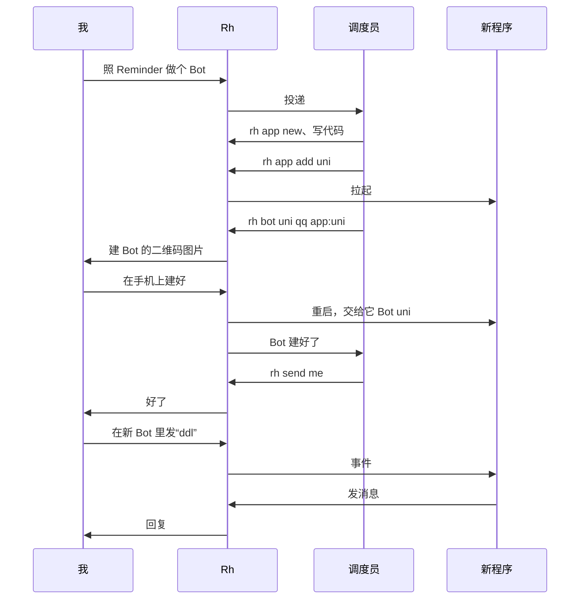

# Bot 程序规格

这篇回答：Bot 程序这一期要解决哪些问题、做成什么样、满足哪些需求、怎么测、分两段怎么交付、明确不做什么。

前置阅读：[术语表](../../GLOSSARY.md)、[产品说明](../product.md)、[ADR-0007](../adr/0007-satori-for-bot-apps.md)、[架构](../architecture.md)、[IM 文字与交互规范](../im-style.md)、[v1 规格](v1.md)

这一期的范围在 2026-10-23、2026-10-24 两轮拷问里定下。行为规则写在[产品说明](../product.md) §8、§5.11，实现写在[架构](../architecture.md) §14。这里只写需求、命令、库和配置的变化、测试和交付。这一期排在什么时候，见[产品说明 §13](../product.md#13-版本路线)。

## 问题

**每个 Bot 都要自己连 IM。**

- 下文拿 Reminder 当例子，它是[产品说明 §8](../product.md#验收场景一句话生成-bot) 里那个现成的 QQ Bot。拿 token、连网关、断线重连、算被动和主动额度、去重，它全是自己写的。
- 再写一个 Bot，这些又要写一遍。
- 一个 QQ Bot 只能有一个网关连接。Reminder 的 Bot 没法和 Rhodium 共用连接，也就用不上 Rhodium 已经做好的额度和重连。

**Rhodium 的 Bot 只能交给槽位。**

- 想要一个不经过 agent 的小 Bot，例如给别人用的查询 Bot，Rhodium 帮不上。
- 用 Entari 写的 Bot 要连一个 Satori 服务端才能跑。Rhodium 原来没有。

**Bot 去不掉，除非重启 Rhodium。**

- `rh bot` 建的 Bot 已经当场生效，不用重启（[架构 §8.5](../architecture.md#85-建-bot-与配对)）。
- 去掉一个 Bot 却只能手改配置，再重启 `rhodium`。重启不打断回合，但会断开所有连接。
- 以后程序也连在 `rhodium` 上，每去掉一个 Bot，所有程序就断一次。

**agent 不能管 Bot。**

- v1 里 agent 不能建 Bot、改绑定，故事 48–51 移到了这一期。
- 其中改绑定 2026-10-29 提前做了，不含交给程序的部分（#485，[v1 规格](v1.md)故事 546）。
- 想多一个 Bot，你得 ssh 上去自己建。

## 方案

这一期做完后，Rhodium 能托管 Bot 程序：程序连上 Rhodium 的 Satori 接口收发消息，Rhodium 管 IM 连接、额度和进程。agent 也能用 `rh` 写程序、建 Bot、接线，你在手机上扫一次码就行。

一次“一句话生成 Bot”是这样的：



读图要点：

- 图里的 Rh 就是 Rhodium。你在主 Bot 的私聊里对调度员说一句话。
- 调度员用 `rh app new` 在 `~/bots/reminder` 从模板建一个 Entari 项目，照 Reminder 的代码写插件，再用 `rh app add` 登记。Rhodium 把它拉起来。
- 调度员用 `rh bot` 发起建 QQ Bot。Rhodium 把建 Bot 的二维码图片发到你的 IM，`rh` 马上返回，调度员不用干等。
- 你在手机 QQ 里长按识别，建好 Bot。Rhodium 不重启，直接连上新 Bot，交给程序 `uni`，重启这个程序让它拿到新 Bot。结果作为一条消息交给调度员。
- 之后你在新 Bot 里说的话，Rhodium 原样交给程序。程序的回复经 Rhodium 发出，QQ 的额度由 Rhodium 算。

这一期包含：

- 程序登记和进程管理：`rh app`，systemd 临时服务，崩了重启，熔断。
- Satori 服务端：只保证 Entari，最小集加上按钮（包括链接按钮）、引用和发文件。
- 交给程序的 Bot：消息在认你本人之前分叉，原样交给程序；Rhodium 自己的话不经它发。别人的原话不进库。
- 这一期说的“别人”，指不是这个 Bot 任何一个[主人](../../GLOSSARY.md)的账号。一个 Bot 可以有几个主人，都是你本人的账号（[产品说明 §5.11](../product.md#511-建-bot-和让-agent-管-bot)）。
- Bot 热插拔：建 Bot 时直接交给程序；去掉 Bot 也不重启 `rhodium`，槽位驱动的 Bot 也一样。
- agent 用 `rh` 管 Bot 和程序，QQ、Telegram 的 Bot 都能建，带写程序的模板和指南。

分两段交付，见[“里程碑”](#里程碑)。

## 用户故事

“用户”就是你本人。“调度员 agent”指主 Bot 私聊默认交给的那个槽位里的 agent，换成任何槽位里的 agent 也成立。“程序的作者”指写 Bot 程序的人或 agent。编号接着 [v1 规格](v1.md) 往下排。

这里只列这一期要满足的需求。每条行为的细则以[产品说明](../product.md) §8、§5.11 为准。

### 程序和进程

164. 作为用户，我想要把一个 Bot 程序登记给 Rhodium，写明名字、目录和启动命令，以便不用自己写 systemd 单元。
165. 作为用户，我想要 Rhodium 拉起登记的程序，程序退出了就自动重启，以便它一直在线。
166. 作为用户，我想要程序 10 分钟内退出 3 次就不再重启，并在主窗口通知我，以便坏程序不会无限循环。
167. 作为用户，我想要 Rhodium 重启、升级时程序照跑，连接断了程序自己连回来，断开期间来的消息补发给它，以便升级 Rhodium 不用挑时间。
168. 作为用户，我想要机器重启后 Rhodium 把该跑的程序都拉起来，以便不用一个个手动恢复。
169. 作为用户，我想要用 `rh app` 列出、启动、停止、重启程序，看它的日志，删掉登记，以便在 ssh 里管理程序。
170. 作为用户，我想要停程序时先请它自己退出，以便 Entari 能做完清理。
171. 作为用户，我想要每个程序只收得到自己的 Bot 的消息，也只能经自己的 Bot 发消息，以便一个程序写错了不会动到别的 Bot。

### 交给程序的 Bot

172. 作为用户，我想要用 `rh bind` 把一个 Bot 整个交给一个程序，也能收回来，一个程序可以驱动几个 Bot，以便一个 Entari 项目能带几个 Bot。
173. 作为用户，我想要交给程序的 Bot 收到的私聊消息，不管谁发的，都原样交给程序，`/rh_` 开头的也一样，以便程序可以给别人用，命令名也不被 Rhodium 占着。
174. 作为程序的作者，我想要知道用户在每个 Bot 下的用户 ID（一个 Bot 有几个主人就有几个），用户在交给程序的 Bot 上照样能用 `rh pair` 配对，以便程序能认出主人，不用自己再做一套绑定。
175. 作为用户，我想要 Rhodium 不往交给程序的 Bot 上推 `/rh_` 菜单，也不经它发通知和提问，以便那个 Bot 上只有程序自己的话。
176. 作为程序的作者，我想要现成的 Entari 项目不改代码就能连上 Rhodium，以便直接用 Entari 的插件写法。
177. 作为程序的作者，我想要回复某条消息时 Rhodium 自动用 QQ 的被动回复，用完改发主动消息，主动也用完时我收到错误，以便不用自己算 QQ 的额度。
178. 作为程序的作者，我想要发文字、图片、引用、文件和按钮（包括打开链接的按钮），收文字、图片、引用和按钮的按下，收到引用时拿得到被引用的原文，以便写出常见的 Bot。
179. 作为程序的作者，我想要发消息时同步知道发成了没有、平台的消息 ID 是什么，结局不明的也当失败告诉我，以便自己决定要不要重试。
180. 作为程序的作者，我想要长文字由 Rhodium 按平台上限自动分段，以便不会因为太长发不出去。

### Bot 热插拔

181. 作为用户，我想要用 `rh bot` 建 Bot 时目标直接写程序，建好马上交给它，不重启 Rhodium，以便建 Bot 不断开任何程序和 Bot 的连接。
182. 作为用户，我想要用 `rh bot rm` 把一个 Bot 从 Rhodium 去掉，马上断开它，不用改配置再重启，以便不用的 Bot 不再占着连接。

### agent 管 Bot 和程序

183. 作为调度员 agent，我想要用 `rh bot` 建一个 QQ 或 Telegram Bot：QQ 的二维码图片由 Rhodium 发到用户的 IM，Telegram 的 token 由用户在 IM 里直接交给 Rhodium，用户建好后结果作为一条消息告诉我，以便在手机上一句话就能多一个 Bot，我也不用干等。取代 v1 的故事 48。
184. 作为调度员 agent，我想要用 `rh bind`、`rh use` 改 Bot 和聊天窗口的目标，包括把 Bot 交给程序和收回来，以便替用户接好线。取代 v1 的故事 49。2026-10-29 起，改到槽位的部分提前做了，第二段只剩交给程序和收回（#485，[v1 规格](v1.md)故事 546）。
185. 作为用户，我想要 agent 用 `rh bot rm` 去掉 Bot 前先问我，以便不可逆的操作经我点头。取代 v1 的故事 50。
186. 作为用户，我想要 agent 改动主 Bot 的绑定前先问我，主 Bot 谁也不能交给程序，以便我不会失去遥控入口。取代 v1 的故事 51。2026-10-29 起，先问我的部分提前做了，还加了一条：改到 agent 联系窗口的也先问（#485）。
187. 作为调度员 agent，我想要用 `rh app` 登记、启停、重启程序，看它的日志，以便写完程序自己让它上线，出了错自己排查。
188. 作为调度员 agent，我想要用 `rh app new` 在 `~/bots/<名字>` 从模板建好一个 Entari 项目，里面带写程序的指南，以便不用自己摸索 Entari 的坑，依赖版本也是锁好的。
189. 作为用户，我想要在 IM 里对调度员说一句话，它就参考现有的代码做出一个新的 Bot 程序和 Bot，以便想要一个小 Bot 时不用自己动手。
190. 作为用户，我想要 agent 写的程序不让别人的消息触发 agent，以便守住 Claude 订阅条款。

## 实现决定

这一节只写这一期定下的实现选择和对外的约定。怎么实现，见[架构](../architecture.md) §14 和 [ADR-0007](../adr/0007-satori-for-bot-apps.md) 的补充。

### 已定的大方向

- 每个程序一个独立进程，由 systemd 的临时服务管，不用托管进程。熔断的次数由 Rhodium 自己数。见 ADR-0007 的补充、[架构 §14.1](../architecture.md#141-程序登记和进程管理)。
- Satori 只保证 Entari，做最小集加上按钮、引用和发文件，不开扩展。见 ADR-0007 的补充、[架构 §14.2](../architecture.md#142-satori-服务端)。
- 别人发给程序的原话不进库。推给程序的事件只在内存里留一小时，库里只存每个程序的事件序号。见[架构 §14.2](../architecture.md#142-satori-服务端)。
- 消息在认你本人之前分叉，现有路径上的每个分叉点见[架构 §14.6](../architecture.md#146-现有路径上的分叉点)。
- 程序登记进库，Bot 热插拔，都不重启 `rhodium`。见[架构 §14.1](../architecture.md#141-程序登记和进程管理)、[§14.8](../architecture.md#148-bot-热插拔)。
- 扫码挪进 `rhodium`，终端和 agent 共用。agent 建 Bot 时，QQ 的二维码图片和 Telegram 的 token 都经你的 IM。见[架构 §14.9](../architecture.md#149-agent-建-bot)。

### 模块

新加两个，都在[架构 §2](../architecture.md#2-组件和职责) 的表里：

- Satori 服务端：信令、登录、续传、四个方法、代理路由、元素的编解码、内存里的事件缓冲。它属于“对外接口”，只把请求变成输入。
- 程序管理：调 `systemd-run`、`systemctl`、`journalctl`，起停程序、查单元状态。它和槽位运行器平级，不懂 Satori。

改动的：

- 路由：入站分叉、`satori` 输入、程序的起停和状态、`rh app` 和改过的 `rh bot`、`rh bind`、`rh use`、`rh pair`、拦下 Telegram 的 token、给程序找引用的原文，以及 `target()`、`contactChat()`、`mainChat()`、`elsewhere()`、`tell()`、`unbind()` 和回合的回复里排除交给程序的 Bot，交出去、去掉时把“等你回话”的消息改到别的 Bot。
- IM 适配器：按钮多一种链接按钮；发消息能引用一条消息。
- 存储：一个新迁移。
- 主循环：适配器能在运行中加和停；`satori` 请求等出站记录有了结局再回应。
- 假 IM 平台：多一个假的扫码流程，测试用。

模板和指南放在 `docs/agents/` 下：

- `docs/agents/bot-template/`：一个 Entari 项目，带一个 hello 插件（收到 `hello` 回“hello from Entari”；收到图片取一次，回它有多少字节；收到带引用的消息，引用这条消息回“你引用了：”加被引用的原文；收到 `按钮` 回一条带回调按钮和链接按钮的消息，按下回调按钮回“按下了”），`uv.lock` 锁定 Entari 和 satori-python 的版本，配置里的地址和令牌都引用 Rhodium 交给程序的环境变量。第一段先放进来，真 Entari 测试和第一段验收都用它。
- `docs/agents/bot-programs.md`：写 Bot 程序的指南，第二段写。
- 两样都编进 `rhodium`，`rh app new` 从这里复制，不依赖仓库在本机的位置。

### 对外的约定

程序看得到的东西，发出去以后只加不改：

- Satori 的那一块：地址、信令、登录的四样、频道 ID 的写法、四个方法、错误码。见[架构 §14.2](../architecture.md#142-satori-服务端)。
- 交给程序的环境变量。见[架构 §14.1](../architecture.md#141-程序登记和进程管理) 的表。
- `referrer` 对程序是不透明的。程序只管原样带回，里面写什么 Rhodium 可以随时改。
- 收到的 `<quote>` 的 `id` 也是不透明的。程序只拿它调 `message.get`，或者发引用时带回。

### `rh` 命令

新加 `rh app`，改了 `rh bot`、`rh bind`、`rh use`、`rh pair`。和 v1 一样，参数以 `rh --help` 为准，`rh --help`、`rh --skill` 都从命令定义生成。

程序名由小写字母、数字和 `-` 组成，不超过 32 个字符。目标写成 `app:<程序名>` 时指程序，和槽位名分开。`rm` 不能当 Bot 的名字。

| 命令 | 做什么 | 谁用 |
|---|---|---|
| `rh app new <名字>` | 在 `~/bots/<名字>` 从模板建一个 Entari 项目，带写程序的指南。目录已经在了就不建 | 第二段起，你、agent |
| `rh app add <名字> [--dir <目录>] -- <命令…>` | 登记程序，马上拉起。不写 `--dir` 就是 `~/bots/<名字>`。agent 不能写 `--dir` | 你；agent 第二段起 |
| `rh app ls` | 列出程序：目录、命令、交给它的 Bot、状态（在跑、停着、熔断）、连着几条 | 你、agent |
| `rh app logs <名字> [-n <行数>] [-f]` | 看程序的日志 | 你、agent |
| `rh app start`、`stop`、`restart <名字>` | 启动、停止、重启。`start` 也清掉熔断 | 你；agent 第二段起 |
| `rh app rm <名字>` | 停掉并删掉登记。交给它的 Bot 回到槽位驱动，用原来的默认目标。目录不动 | 你；agent 第二段起 |
| `rh bind <Bot> app:<程序>` | 把 Bot 交给程序，重启这个程序。`rh bind <Bot> <槽位>` 收回来。主 Bot 拒绝 | 你；agent 第二段起，动主 Bot 或 agent 联系窗口的要你确认。绑到槽位的，agent 2026-10-29 起就能用（#485） |
| `rh use <Bot>/<窗口 ID> …` | 不变。对交给程序的 Bot 的窗口拒绝 | 你、agent。动主 Bot 或 agent 联系窗口的要你确认。2026-10-29 起提前有了（#485） |
| `rh bot <名字> qq\|telegram [<目标>]` | 建 Bot，马上生效，不重启。目标可以是槽位或 `app:<程序>` | 你；agent 第二段起 |
| `rh bot rm <名字>` | 从 Rhodium 去掉 Bot：断开、删配置。主 Bot 拒绝 | 你；agent 第二段起，要你确认 |
| `rh pair <Bot>` | 不变。交给程序的 Bot 也能配对，配完重启程序 | 不带参数的只有你；`--list`、`--add`、`--rm` 2026-10-29 起 agent 也能用（#485） |

IM 里的 `/rh_bind` 不认 `app:`，理由见[产品说明 §8](../product.md#8-bot-程序v1-之后)。

权限照[产品说明 §5.11](../product.md#511-建-bot-和让-agent-管-bot)，落到 `rh` 上是这样：

| 操作 | 你 | agent（第二段起） |
|---|---|---|
| 看程序列表、看日志 | 直接做 | 直接做，第一段就能 |
| 建项目、登记、启停、重启、删登记 | 直接做 | 直接做 |
| 建 QQ Bot | 直接做，终端里扫码 | 直接做，二维码图片发到你的 IM |
| 建 Telegram Bot | 直接做，终端里粘贴 token | 直接做，你在 IM 里把 token 发给 Rhodium |
| 改绑定，包括交给程序、收回 | 直接做 | 直接做；动主 Bot 的、改了调用者联系窗口的转成确认请求。绑到槽位的 2026-10-29 起提前有了（#485） |
| 把主 Bot 交给程序 | 拒绝 | 拒绝 |
| 去掉 Bot | 直接做 | 转成确认请求 |
| 配对 | 直接做 | 2026-10-29 起（#485）：`--list` 直接做；`--add` 直接做，码发到你的 IM；`--rm` 转成确认请求；不带参数的拒绝 |

- 主 Bot 怎么认，见产品说明 §5.11。库里 Bot 表的“是否主 Bot”一列从没用上，这一期也不用。
- 动主 Bot 的绑定：`rh bind` 主 Bot，或者 `rh use` 主 Bot 的窗口。
- 改了调用者联系窗口的绑定：照[产品说明 §5.11](../product.md#511-建-bot-和让-agent-管-bot)，2026-10-29 加（#485）。
- 主 Bot 不能去掉，也不能交给程序，你来也一样。

### 数据表

所有改动放进一个迁移，追加在迁移数组的末尾。

| 表 | 变化 |
|---|---|
| Bot | 加两列：交给哪个程序（空着就是槽位驱动）、登录序号。迁移时给已有的 Bot 按建行的先后编好登录序号 |
| Bot 程序（新） | 名字（唯一）、目录、启动命令（JSON 数组）、令牌、状态（跑、停、熔断）、最近一个事件序号 |
| 入站消息 | 不加列。交给程序的，去向写程序 |
| 出站记录 | 不加列。程序发的，追踪 ID 是那次请求的 ID |

几点说明：

- 新表照旧带机器名一列，ID 用 ULID。
- 没有程序事件表。别人发给程序的原话不进库，推给程序的事件只在内存里（2026-10-24 定）。库里只有程序表上的序号，`rhodium` 重启后接着往上数。
- 令牌和别的状态一样存在库里，库文件本来就只有你能读。

### 配置

- `[satori]` 下的 `port`：Satori 服务端在 `127.0.0.1` 上听的端口，默认 5140。和别的实例怎么分开、端口被占怎么办，见[架构 §14.2](../architecture.md#142-satori-服务端)。
- `botsDir`：agent 写的程序放在哪，默认 `~/bots`。`rh app new` 和不写 `--dir` 的 `rh app add` 用它。测试指向临时目录。
- `durations.appEventKeep`：内存里的事件缓冲、收到的图片的取法留多久，默认 `"1h"`。
- `durations.appCheck`：多久查一次程序的单元，默认 `"30s"`。
- `durations.botScan`：agent 建 Bot 时，等你扫码或发 token 最多等多久，默认 `"10m"`。
- 程序的熔断沿用槽位的 `durations.crashWindow` 和 `limits.crashCount`。
- `rh bot` 写进配置文件的 `[bots.<名字>]` 表，格式不变。

### 新加的几句话

下面是样例。实现时照 [IM 文字与交互规范](../im-style.md) 的规矩定稿，写进那篇。

建 QQ Bot 的二维码，发到 agent 所在槽位的联系窗口，图片跟在这句后面：

```
dispatcher/main 要建一个 QQ Bot：uni。
在手机 QQ 里长按识别下面这张图，选“创建新机器人”。
10 分钟内有效，不想建就别理它。
```

建 Telegram Bot 时请你发 token，也发到联系窗口：

```
dispatcher/main 要建一个 Telegram Bot：uni。
在 BotFather 里建好 Bot，把它给的 token 发到这里，整段回复复制过来也行。token 由 Rhodium 收下，dispatcher/main 看不到。
10 分钟内有效，不想建就别理它。
```

程序熔断，发到主窗口：

```
Bot 程序 uni 10 分钟内退出了 3 次，已经停下。
看日志：rh app logs uni
改好后：rh app start uni
```

建 Bot 的结果，作为内部消息交给 agent。给 agent 看的，不用口语：

```
[Rhodium] rh bot uni qq：QQ Bot uni 已建好，已交给程序 uni，程序已重启。扫码的账号已记为用户，不用配对。
[Rhodium] rh bot uni qq：没建成，用户 10 分钟内没有扫码。
[Rhodium] rh bot uni telegram：Telegram Bot uni 已建好，已交给程序 uni，程序已重启。发 token 的账号已记为用户，不用配对。
[Rhodium] rh bot uni telegram：Telegram Bot uni 已建好，已交给程序 uni，程序已重启。还没配对：rh pair uni --add 会把配对码发到用户的 IM，用户在 Telegram 里把码发给 uni，程序才认得出用户。
[Rhodium] rh bot uni telegram：没建成，用户 10 分钟内没有发 token。
```

Telegram 建好的两句：token 在 Telegram 私聊里发的用第一句，在 QQ 里发的用第二句。在 Telegram 里发的记不记为用户还待定，不记的话也用第二句（[架构 §14.9](../architecture.md#149-agent-建-bot)）。

## 测试决定

照 [v1 规格](v1.md#测试决定)的规矩：只测外部看得到的行为，只在进程和网络的边界换上假的，测试名带故事编号。

### 和正在用的 Rhodium 隔开

- 程序的单元名用测试实例自己的前缀，和托管进程一样。测试结束时停掉自己前缀的所有单元。
- Satori 服务端的端口写 0。
- `botsDir` 指向测试的临时目录，测试不碰 `~/bots`。

### 接缝

接缝一（整机）多一个假东西：**假 Satori 客户端**。

- 它是测试里的一个小 TypeScript 程序：连 WebSocket、发 IDENTIFY、收事件、调 HTTP 方法，能按测试的要求断线、带序号重连。
- 它经代理取图片时不带任何请求头，和 satori-python 一样（[架构 §14.2](../architecture.md#142-satori-服务端)）。
- 它也能当被登记的程序跑：程序管理用 `systemd-run` 拉起它，测试经它看程序收到了什么、让它发什么、让它退出。
- 它会调 `message.get`，测试能让它在收到不带原文的引用时调，和 Entari 一样。
- 绝大多数测试写在这一层：分叉、续传、隔离、额度、元素、按钮、引用、热插拔、权限、agent 建 Bot。
- agent 建 Bot 靠假 IM 平台：
  - 模仿 QQ 的假 Bot 走假扫码：`rh bot <名字> fake` 走同一条扫码的路，测试经假平台的 socket 说“扫好了”。
  - 模仿 Telegram 的假 Bot 走 token 的路：测试经假平台在联系窗口里发一条 token。

进程管理用真的 systemd，和托管进程的测试一样：

- 程序退出后被重启；连着退出 3 次熔断、主窗口收到通知，退出 2 次不熔断（时长照旧调成秒级）。刚起就崩的、跑过一个窗口的，都是第 3 次。
- `rhodium` 停着时程序连着崩，兜底的设置让它停下；`rhodium` 起来后标成熔断、发通知。
- 停程序时程序收到 `SIGINT`。
- `kill -9` 掉 `rhodium`，趁它停着经假平台发一条，再启动：程序没被碰，重连后收到这一条。
- `rhodium` 照跑、程序断开再带序号连回来：补齐断开期间的事件。

真 Entari 测试，兜住“只保证 Entari”：

- 用模板里锁好版本的 Entari hello 项目，连一个测试用的 `rhodium`，经假 IM 收发一次。
- 检查：命令在私聊里不带前缀也触发；回复带着 `referrer` 走被动回复；发一张图片，Entari 经代理取到它，回的字节数和发的一样；引用一条消息再发一句，Entari 回出被引用的原文，带原文和不带原文（要调 `message.get`）的都试；`kill -9` 掉 `rhodium` 再启动，Entari 自己连回来，之后的消息照样回。
- 默认跑（2026-10-24 定）：Entari 改得快，跑一遍不费时。
- 它要本机的 `uv` 和 `uv` 的缓存。开头先 `uv sync --frozen --offline`，缓存里没有依赖、做不到就跳过并写明原因，不算失败。更新模板时先联网同步一次。
- Satori 的结论大多来自读码，所以这条测试在第一段尽早写，先于按钮、收图片和引用。

不在自动测试里的：

- 真 QQ、Telegram。靠里程碑验收。
- 手机上长按识别二维码、在 BotFather 里建 Bot。靠探针 C 和第二段验收。
- agent 写出来的程序本身。那是验收的内容。

### 真机探针

- **探针 A：临时服务的熔断。** 2026-10-23 已做。`StartLimitBurst` 数的是窗口里的启动次数，第一次启动也算：设成 3 时，刚起就崩的第 3 次退出熔断，跑过一个窗口的第 4 次才熔断。所以熔断改由 Rhodium 自己数，`StartLimitBurst` 只当兜底，见[架构 §14.1](../architecture.md#141-程序登记和进程管理)。
- **探针 B：新 QQ Bot 的按钮、链接按钮和引用。** 第一段验收时跑，见[第一段的验收](#第一段rhodium-托管-bot-程序)。要在手机上看，agent 做不了；测试 Bot 也到验收时才建。退回的做法（链接写成文字、去掉引用）在做按钮和引用时就先做好。看三样，结果写回[架构 §14.4](../architecture.md#144-程序怎么发消息)、[§14.5](../architecture.md#145-按钮)：
  - 新建的 Bot 没申请 Markdown 时，带按钮的消息发不发得出、手机上看到什么。
  - 跳转按钮显不显示、点了能不能打开，链接要不要先在 QQ 开放平台登记。
  - 私聊里发消息带 `message_reference`，手机上是不是显示成引用。
- **探针 C：手机上长按识别二维码。** 第二段开工前，要你在安卓手机上做。把建 Bot 的二维码图片发进 QQ 私聊，长按看能不能识别、走完“创建新机器人”。走不完再来问你，另想办法。
  - 走完会真建出一个 QQ Bot，占一个名额。试完就到 QQ 开放平台删掉它，见[“风险”](#风险)。

## 不做的事

| 不做的事 | 什么时候再说 |
|---|---|
| Markdown、命令菜单注册、流式输出 | Entari 支持了，或者真有程序要用时 |
| 程序的 Bot 进群 | 和群聊一起，按需 |
| 收到的文件、语音交给程序 | 以后再说，2026-10-24 定的 |
| 程序发音频、视频 | 有程序要用时 |
| 其余 Satori 方法 | 有程序要用时 |
| 保证 Koishi、NoneBot 等别的客户端 | 有现成的 Bot 要接时再测 |
| Telegram 的 Managed Bots | 按需 |
| 把 Reminder 迁到 Rhodium | 不迁，2026-10-23 定的 |
| 接机器上已有的 Entari 项目 | 不管它，2026-10-23 定的 |
| 程序热加载代码 | 不做，改了就重启这个程序 |
| 程序重启那几秒里的消息 | 不补，见[“风险”](#风险) |
| 看板和拓扑图上画出程序 | Bot 程序做完以后，按需。这一期拓扑图上不画交给程序的 Bot（[架构 §14.7](../architecture.md#147-rhodium-自己的话不碰程序的-bot)） |

## 里程碑

### 第一段：Rhodium 托管 Bot 程序

只有你能用 `rh` 登记程序、把 Bot 交给它。

交付：

- 库和配置的改动，一个迁移。
- 程序登记和进程管理：`rh app add`、`ls`、`logs`、`start`、`stop`、`restart`、`rm`。`ls` 和 `logs` agent 也能用，其余只有你。熔断由 Rhodium 自己数。
- Satori 服务端：信令、登录、续传（内存里的事件缓冲）、隔离、`message.create`、`user.channel.create`、`login.get`。
- 交给程序的 Bot：`rh bind <Bot> app:<程序>`、主 Bot 拒绝、入站分叉、QQ 额度、菜单和通知的排除、回合中途交出去的回复改发联系窗口、`rh use` 拒绝、配对后重启程序；目标变了时那句交出去不说，收回和以后改默认目标都只在你的私聊里说；收回时默认目标已归档的，把它恢复；网页上碰不到它（[架构 §14.7](../architecture.md#147-rhodium-自己的话不碰程序的-bot)）。
- 发图片、收图片（代理路由）。
- 引用：收到的引用带原文交给程序，`message.get`；程序发的引用发成平台上的引用回复。
- 按钮：发和按下，包括链接按钮。
- Bot 热插拔：`rh bot` 的目标能写 `app:<程序>`；`rh bot rm`，不重启。只有你能用。
- 模板里的 Entari hello 项目和真 Entari 测试。

覆盖的用户故事：164–182。178 里发文件的部分在第二段。

你来验收：

- 把模板里的 hello 项目复制到 `~/bots/hello`，`rh app add hello -- uv run --frozen python main.py`。
- 用 `rh bot hello qq app:hello` 扫码建一个测试 Bot，建好就交给 hello。`rhodium` 没重启：主 Bot 那边正在跑的回合照常，`systemctl --user status` 里的启动时间没变。
  - 先登记程序再建 Bot：不带目标的 `rh bot` 绑到主 Bot 的默认目标，Bot 一上线就推了 `/rh_` 菜单，之后再交给程序也不撤（[架构 §14.7](../architecture.md#147-rhodium-自己的话不碰程序的-bot)）。
- 在 QQ 里给测试 Bot 发 `hello`，收到“hello from Entari”。发 `/rh_ls`，没有 Rhodium 的回复。测试 Bot 的菜单里没有 `/rh_` 命令。
- 给测试 Bot 发一张图片，收到它的字节数。
- 引用测试 Bot 回的“hello from Entari”再发一句，收到“你引用了：hello from Entari”。引用你自己刚发的一句，也收到那句原文。
  - 引用测试 Bot 的那一步照待定的默认：程序发的话存进库（[产品说明 §8](../product.md#8-bot-程序v1-之后)）。
- 发 `按钮`，收到一条带两个按钮的消息。按回调按钮收到“按下了”，按链接按钮能打开网页。
- 探针 B：上面两步里，看带按钮的消息发没发出来、手机上什么样，链接按钮能不能点开，“你引用了”那条回复在手机上是不是显示成引用。结果写回架构 §14.4、§14.5。
- 在 ssh 里重启 `rhodium`，趁它没起来时给测试 Bot 发一句 `hello`。它回来后你收到回复。`rh app ls` 里程序一直在跑。
- `rh app stop hello` 以后发 `hello` 没有回复；`rh app start hello` 以后再发就有。
- 连着 `kill -9` 程序进程，每次等它重启好再杀。杀 2 次不熔断，第 3 次后主窗口收到熔断通知（[架构 §14.1](../architecture.md#141-程序登记和进程管理)）。`rh app start hello` 以后又能用。
- `rh bind main app:hello` 被拒绝。
- 收尾（2026-10-24 定）：`rh bot rm hello`，`rhodium` 不重启。然后到 QQ 开放平台删掉这个 Bot，名额留给第二段。

### 第二段：agent 管 Bot，一句话生成 Bot

交付：

- 探针 C。
- 扫码挪进 `rhodium`：终端的 `rh bot` 改成从 `rhodium` 拿链接、等结果；agent 调的把二维码图片发到 IM，结果作为内部消息交给 agent。
- agent 建 Telegram Bot：Rhodium 在 IM 里请你发 token，拦下你发的 token，不交给 agent。
- agent 的权限：`rh app`、`rh bind`、`rh use`、`rh bot`、`rh bot rm` 照上面的权限表开放，要确认的转成确认请求。
  - `rh bind`、`rh use` 绑到槽位的 2026-10-29 已经开放（#485），这里只加交给程序和收回。
- 程序发文件：`<file>` 照 `rh send me --file` 发出去。
- 模板和指南：`docs/agents/` 下一份写 Bot 程序的指南，模板编进 `rhodium`，`rh app new` 把模板和指南放进新项目。`rh --skill` 里说一句写 Bot 程序先用 `rh app new`。
  - 指南列出 Entari 的坑：两种命令写法；命令的返回值会自动发出；定时任务没有会话，要自己挑 Bot；用 `RHODIUM_OWNERS` 认主人；不能让别人的消息触发 agent。
  - 指南写明怎么不连 Rhodium 就测插件，照 Entari 项目自带测试的写法。

覆盖的用户故事：183–190，178 里发文件的部分。

你来验收：一句话生成 Bot。

- 在主 Bot 的私聊里对调度员说：“参考 `<Reminder 的目录>`，做一个等效的 Entari Bot。”
- 收到建 Bot 的二维码图片，在手机 QQ 里长按识别，建一个新 Bot。
- 调度员告诉你程序跑起来了。全程 `rhodium` 没重启。
- 在新 Bot 里发 Reminder 的几条指令，回复和 Reminder 一样。到时间收到一次提醒。
- 让调度员再建一个 Telegram Bot，也交给这个程序。
  - 请发 token 的话发到调度员的联系窗口。二维码要在手机 QQ 里长按，所以这个窗口在 QQ 上，token 也在 QQ 里发。
  - 在 Telegram 的 BotFather 里建好 Bot，把它的整段回复复制到 QQ 里发过去。Telegram 的消息转发不到 QQ。
  - 调度员收到“已建好”，结果里写着还没配对。它的对话里没有 token。
- 在 QQ 里引用你发 token 的那条消息，对调度员说一句。它看到的引用是“找不到原文”，没有 token：QQ 的引用原文只从库里找，这条没存。
- 在 ssh 里 `rh pair` 新的 Telegram Bot，在 Telegram 里把配对码发给它，收到“已配对”。程序重启后，在新 Telegram Bot 里发 Reminder 的一条指令，回复和 QQ 上一样。
- 让调度员“把刚才那个 QQ Bot 去掉”，你收到确认请求，点拒绝。
- 让调度员把主 Bot 交给这个程序，直接被拒绝，你不会收到确认请求。
- 收尾（2026-10-24 定）：留 Reminder，去掉新做的。
  - 让调度员去掉新的 QQ Bot、Telegram Bot 和程序。去掉 Bot 的确认请求点同意。
  - 到 QQ 开放平台删掉新 QQ Bot，在 BotFather 里删掉新 Telegram Bot。
  - 新程序验收时登过的服务，给 Reminder 重新登一次。

## 风险

- **Entari 变得快。** 几乎一个人维护，一周发了 5 版，0.19 有破坏性改动，satori-python 前一天刚改了认账号的办法。模板锁版本；真 Entari 测试默认跑。
- **Satori 的结论大多来自读码。** 没实测过任何服务端或客户端。真 Entari 测试放在第一段尽早写。
- **QQ 个人开发者最多 5 个 Bot。** 现在用着 3 个，剩 2 个。
  - 探针 C 会真建一个，第一段验收建一个。两个同时在，3 加 2 正好用满 5 个。
  - 探针 C 的 Bot 试完就删，第一段的测试 Bot 验收完删。
  - 第二段验收要再建一个，所以排在第一段验收删完测试 Bot 之后。
- **QQ 的按钮要 Markdown 权限，链接按钮和引用没实测。** 新建的 Bot 可能发不出按钮，见探针 B。发不出的退回文字。Telegram 不受影响。
- **在同一台手机上扫码。** 二维码显示在手机上，就没法用这台手机的相机扫，所以靠长按识别，见探针 C。
- **token 经过 IM。** agent 建 Telegram Bot 时，token 留在你的聊天记录里，也经过 IM 平台。这一点已接受。agent 看不到它，引用那条消息也看不到；库里也没有。见[架构 §14.9](../architecture.md#149-agent-建-bot)。
- **程序能做 agent 能做的一切。** 程序和 agent 都以你的用户身份运行，令牌只防误用（[架构 §11](../architecture.md#11-安全与访问)）。“不让别人触发 agent”只能写进指南。
- **陌生人能刷程序的 Bot。** 每条消息都记入站、建额度行、放进事件缓冲，没有限流。入站记录照旧最多留 90 天；事件缓冲留 1 小时，刷得越多占的内存越多。
- **`rhodium` 停下那一刻的几条会丢。** 事件只在内存里，已经收下、还没推给程序的那几条跟着进程没了。窗口只有几毫秒。
- **程序重启那几秒的消息会丢。** satori-python 每次启动不带序号，补发不了。改了代码、交给它的 Bot 有增减、配对变了，都会重启。
- **别人引用一小时以前的话，程序拿不到原文。** 别人的原话只在内存里留一小时。引用程序自己发的话不受影响。
- **程序转述别人的话会进库。** 照待定的默认，程序发的话存前若干字，留 90 天（[架构 §14.3](../architecture.md#143-消息怎么进来)）。程序把别人的原话写进回复，例如模板的 hello 插件回“你引用了：”加原文，这些话就跟着进了库。“别人的原话不进库”只管 Rhodium 自己收到的。
- **链接按钮只显示标签。** 按下以前看不到会打开哪里。QQ 发不出、退回成“标签：链接”时，链接写进了正文，和程序发的别的话一样存 90 天；链接里要是带着凭据，也一起留下。
- **`media/` 目录不清理。** 程序发的图片和文件也存在那里，发得越多越大，和 `rh send me --file` 一样。

## 其他说明

### 拆 issue

- 两段的“交付”列表就是拆 issue 的粗分。每张工单写明覆盖哪几条故事、被哪张挡住。
- 迁移只在第一张工单里加，后面的工单不再动迁移数组。
- 每张工单等它“被谁挡”里的工单都合了再开始。互不挡的可以同时做。
