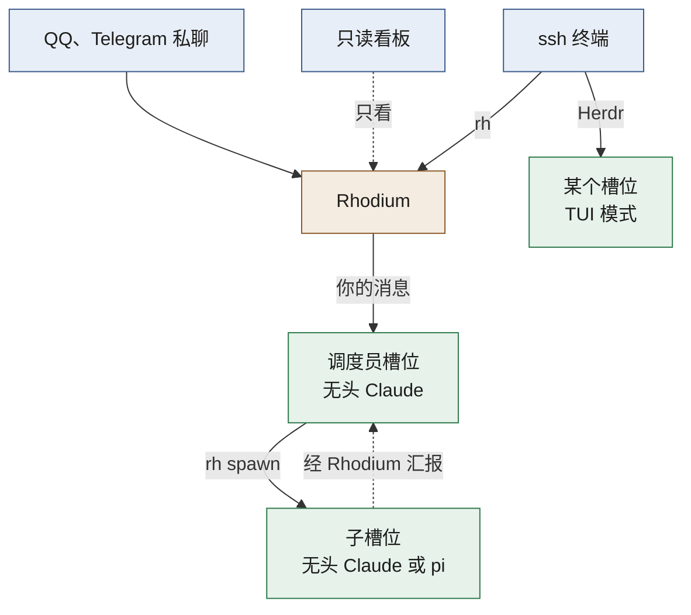
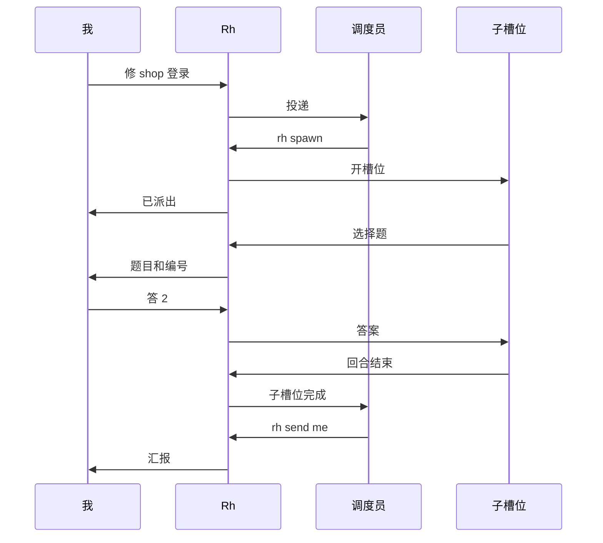
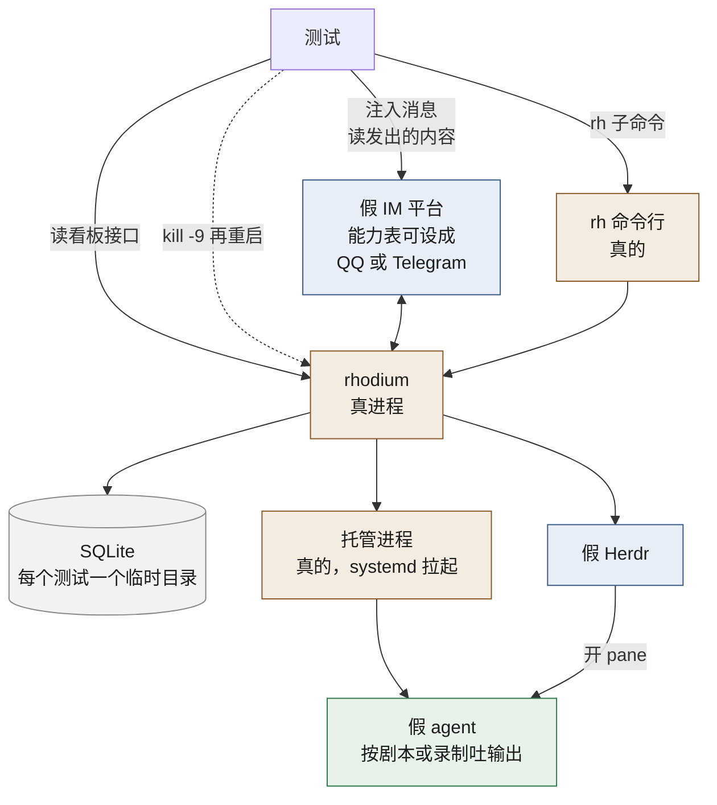
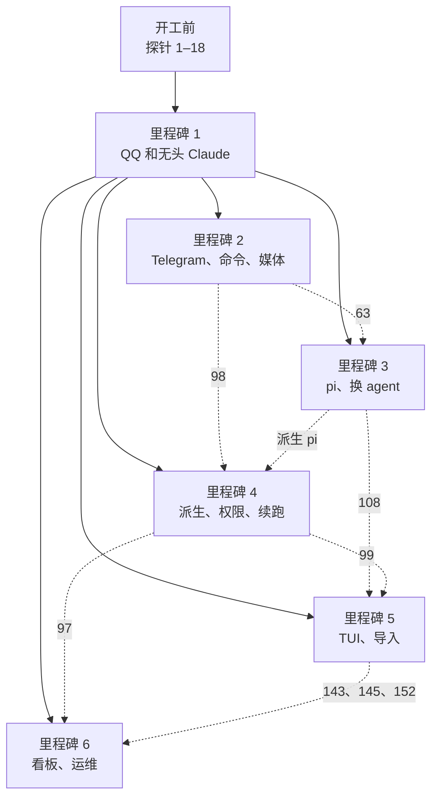

# Rhodium v1 规格

这篇回答：v1 要解决哪些问题、做成什么样、满足哪些需求、怎么测、分几步交付、明确不做什么。

前置阅读：[术语表](../../GLOSSARY.md)、[产品说明](../product.md)、[架构](../architecture.md)、[架构决定记录](../adr/)、[IM 文字与交互规范](../im-style.md)

v1 的定义：第一个能替换 qq-cli + Herdr 调度员方案的版本。

## 问题

v1 之前，项目靠 qq-cli 加 Herdr 里的一个“调度员” Claude，在手机上遥控 agent。它能用，但有五类问题。下面的事实来自 2026-10-20 对当时那台机器的只读核查。

**消息靠读屏和约定传递。**

- qq-cli 给你的 QQ 消息加上 `[QQ]` 前缀，再打进 Herdr 里的一个 Claude 终端。
- Claude 得记住自己调 `qq send` 回你。它忘了，就靠 Stop hook 在回合结束时把最后一段话补发出来。
- `/model`、`/resume` 这类命令的输出，是从终端屏幕上截下来的。截取靠识别界面上的分隔线，Claude 的界面一改版就会失效。
- 进度全靠 agent 自觉用 `qq send` 发。它不发，长任务期间手机上就一直没动静。

**提问会卡住终端。**

- Claude 的选择题和确认框会卡住终端，手机上答不了。所以调度员的说明里干脆禁止它用选择题，改成发编号文本让你回。
- 终端被确认框卡住时，你发的消息先暂存起来。你要用 `/key` 远程按键解开它，而你在手机上只能看到 `/screen` 截下来的几行文字。

**调度员得手工编排一切。**

- 调度员的 `CLAUDE.md` 里写了一长串 Herdr 命令：建 workspace、起 agent、发任务、在后台开监视脚本。
- 监视脚本靠在屏幕上 grep 文字来判断子 agent 是不是真的干完了，还要再等 15 秒防抖。
- 子 agent 卡住时，调度员只能读屏、远程按键。
- 调度员用 `claude -p` 跑的轻活，跑完就没了。你看不到它，也接不过来。
- 你只能和调度员说话。想直接问 shop 那个 agent，要么让调度员转述，要么 ssh 上去。

**看不到全局。**

- 没有一个地方能一眼看到所有 agent 在干什么、谁在等你。
- 想知道，只能 ssh 进 Herdr 一个个翻。

**占资源，也不够稳。**

- 7 个 Claude 终端一直开着，合计约 2.7GB 内存（2026-10-20 实测）。没人用也不释放。
- 重启调度员要靠一个脚本：先等 20 秒，再杀掉 Claude 重开，而且 pane 名必须还叫 `qq`，否则 qq-cli 会再开一个。
- Herdr 重启会结束所有 pane 里的 Claude，调度员也在其中。
- 只有 QQ 一个入口。Telegram 能编辑消息、有按钮，现在用不上。

## 方案

v1 交付后，你在 QQ 或 Telegram 的私聊里，直接和槽位里的无头 agent 对话。Rhodium 负责投递消息、展示过程、把提问送到手机、把派生结果汇报回来。不再读屏，也不再靠约定。

几个词先说明。槽位是一个有名字、固定在某个目录的 agent 位置。无头指 agent 在后台跑，没有终端界面。派生指 agent 自己开新的槽位。TUI 模式指把槽位切到终端界面里亲手用。完整定义见[术语表](../../GLOSSARY.md)。

读图要点：

- 你有三个入口：QQ 或 Telegram 私聊、只读看板、ssh 终端。看板只走 tailnet。
- 调度员是一个普通槽位，你的私聊默认发给它。
- 调度员用 `rh spawn` 把活派给子槽位。子槽位干完或卡住时，Rhodium 发一条消息告诉调度员。
- 需要亲手操作时，把某个槽位切到 TUI 模式，在 ssh 里的 Herdr 里接着用同一段对话。

和现在相比，变化如下：

| 现在 | v1 之后 |
|---|---|
| 消息加 `[QQ]` 前缀打进终端 | 消息直接交给无头 agent，最终回复由 Rhodium 代发 |
| 命令输出从屏幕上截取 | 9 个通用命令走 agent 的程序接口，输出格式统一 |
| 选择题卡住终端，要用 `/key` 按键 | 选择题以按钮或编号发到手机，没人答就超时，由 agent 自行判断 |
| 调度员背一串 Herdr 命令、后台跑监视脚本 | 调度员用 `rh spawn` 派活，子槽位完成或卡住时 Rhodium 通知它 |
| 只能和调度员说话 | 用 `/rh_use` 切到任何槽位直接说话 |
| 长任务期间手机上没动静 | Telegram 上一条消息实时更新，QQ 上 agent 每说完一段话发一条 |
| 只有 ssh 进去才知道谁在干什么 | 手机上打开看板 |
| 几个 Claude 终端一直开着 | 无头进程空闲 1 小时就回收，下一条消息来时自动恢复 |
| 重启调度员或 Herdr 会打断 agent | Rhodium 自己重启或升级，不打断正在跑的回合 |
| 只有 QQ | QQ 和 Telegram |

一次典型的派活是这样的：

读图要点：

- 图里的 Rh 就是 Rhodium。你在手机 QQ 上发“帮我修 shop 的登录问题”。
- 调度员用 `rh spawn` 在 shop 目录开一个一次性的子槽位，把任务交代给它。
- “已派出”是调度员这一回合的最终回复。这个回合由你的消息开始，所以 Rhodium 替它发给你。
- 子槽位的选择题直接送到你手机上，不经过调度员。
- “子槽位完成”这条消息开始的回合，没有发起它的聊天窗口，Rhodium 不代发最终回复（[架构 §3](../architecture.md#3-一条消息的完整旅程)）。调度员检查完结果，要自己用 `rh send me` 用一两句话告诉你，再归档这个一次性子槽位（[产品说明 §6.1](../product.md#61-派生)）。

v1 包含这些，完整的版本路线见[产品说明 §13](../product.md#13-版本路线)：

- agent：Claude 和 pi。pi 用来验证换 agent 这条路是通的。
- IM：QQ 官方 Bot 和 Telegram，只做私聊。
- 网页：只读看板。
- 切到 TUI 模式，再切回来。
- 派生槽位，以及 agent 之间的权限规则。
- `rh` 命令行，给 agent 用，也给你在 ssh 里用。
- 上线方式：本机上开发用的那套 Rhodium（开发实例）先和 qq-cli 并行一段时间，再转正，接过原来的 QQ Bot。2026-10-23 已切换，见[“切换上线”](#切换上线)。

## 用户故事

“用户”就是你本人。“调度员 agent”指主 Bot 私聊默认发给的那个槽位里的 agent。“worker agent”指被派去干具体活的槽位里的 agent，通常是子槽位。调度员没有特殊能力，写成“调度员 agent”的故事，换成任何槽位里的 agent 也成立。

这里只列 v1 要满足的需求。每条行为的细则以[产品说明](../product.md)为准。

### 槽位与对话

细则见[产品说明 §3](../product.md#3-核心概念怎么关联)、[§4](../product.md#4-槽位的生命周期)。

1. 作为用户，我想要按项目建工作区，每个工作区带一个默认目录，以便新槽位自动开在对的目录里。
2. 作为用户，我想要在一个工作区里开几个有名字的槽位，以便同一个项目里并行做几件事。
3. 作为用户，我想要新槽位开在别的目录，以便同一个工作区里也能处理相邻的仓库。
4. 作为用户，我想要新槽位默认以无头模式运行，以便不占终端也能干活。
5. 作为用户，我想要无头 agent 加载我在终端里用的全部设置、插件、skill、MCP 和 hook，以便它和我在终端里开的 agent 能力一样。
6. 作为用户，我想要无头和终端用系统里同一个 `claude`，照常自动更新，以便不用维护两个版本。
7. 作为用户，我想要 Rhodium 自动告诉 agent 回复约定和 `rh` 的用法，以便我不用再在每个目录的 `CLAUDE.md` 里写 qq-cli 的约定。
8. 作为任何槽位里的 agent，我想要知道每条消息来自哪个平台、哪个聊天窗口，以及这个平台的格式限制，以便写出在手机上显示正常的回复。
9. 作为用户，我想要发 `/new` 开一段新对话，以便换话题时不带旧上下文。
10. 作为用户，我想要发不带参数的 `/resume`，看到这个槽位用过的对话列表，点选或回编号就能回去，以便接着做以前的事。
11. 作为用户，我想要发 `/rh_agent pi` 把槽位换成 pi，从一段新对话开始，以便在同一个目录里试另一家 agent。
12. 作为用户，我想要回到一段旧对话时，槽位自动换成那段对话的 agent，以便不用记哪段是谁的。
13. 作为用户，我想要 pi 用 ChatGPT 登录或 API key 运行，不碰我的 Claude 订阅，以便符合 Claude 的订阅条款。
14. 作为用户，我想要无头进程空闲 1 小时后自动回收，以便省内存。
15. 作为用户，我想要被回收的槽位在下一条消息来时自动恢复对话，以便我感觉不到它被回收过。
16. 作为用户，我想要按槽位改回收时长，或者关掉回收，以便常用的调度员一直待命。
17. 作为用户，我想要 agent 还有后台任务在跑时不被回收，以便长任务不被打断。
18. 作为用户，我想要按槽位打开审批模式，以便在不放心的目录里，agent 每次调用需要许可的工具都先问我。
19. 作为用户，我想要用 `/rh_import` 把磁盘上的一段对话接管成槽位，以便以前在终端里做的事能在手机上继续。
20. 作为用户，我想要用 `/rh_import` 把某个 Herdr pane 里正在用的 agent 接管成槽位，以便不用先关掉它再手动恢复。
21. 作为用户，我想要我在 ssh 里手动开的 agent 不被 Rhodium 碰，以便终端里的习惯照旧。
22. 作为用户，我想要在 ssh 里用 `rh` 列出、新建、停止和归档槽位，以便不开手机也能管理。
23. 作为用户，我想要归档一个槽位后它从看板上消失，但对话保留、随时能恢复，以便看板上只放正在用的。
532. 作为用户，我想要用 `rh rm <工作区/槽位>` 删除一个已归档、进程停着的槽位，以便不再用的槽位不一直堆在“已归档”里。2026-10-28 加的（#457）。
533. 作为用户，我想要删除只去掉 Rhodium 自己的记录：槽位、它的对话时间线、提问、排着的消息；agent 自己的对话文件不碰；`rh use` 指着它的窗口回到 Bot 的默认目标，以便要找回那段对话时，还能用导入接回来。2026-10-28 加的（#457）。
534. 作为用户，我想要只有我能删除：agent 调 `rh rm` 一律拒绝，IM 里没有这条命令；没归档的、进程还在的、是 Bot 默认目标的槽位都不删，回一句为什么，以便回不来的事不会被误做。2026-10-28 加的（#457）。

### IM 私聊

细则见[产品说明 §5](../product.md#5-im-行为)。

24. 作为用户，我想要在 QQ 私聊里和槽位对话，以便在手机上派活。
25. 作为用户，我想要在 Telegram 私聊里和槽位对话，以便用上消息编辑和按钮。
26. 作为用户，我想要只有我本人的账号能触发 agent，以便守住 Claude 订阅条款，也不被陌生人操纵。
27. 作为用户，我想要第一次用某个 Bot 时，确认一次哪个账号是我，以便之后不用手动维护白名单。
28. 作为用户，我想要在 ssh 里用 `rh bot` 扫码建一个 QQ Bot，建完自动绑定，以便几分钟内多一个入口。
29. 作为用户，我想要在 ssh 里用 `rh bot` 粘贴 token 接入一个 Telegram Bot，建完自动绑定，以便几分钟内多一个入口。
30. 作为用户，我想要每个 Bot 有一个默认槽位，以便我一开口就是在对调度员说话。
31. 作为用户，我想要在聊天窗口里发 `/rh_use <槽位>`，把这个窗口改指到别的槽位，以便直接和 shop 的 agent 说话，不经调度员转述。
32. 作为用户，我想要发 `/rh_bind <目标>` 改一个 Bot 的默认槽位，以便换一个常用的槽位当默认。
33. 作为用户，我想要 QQ 私聊和 Telegram 私聊能指向同一个槽位、共享同一段上下文，以便换个 App 接着聊。
34. 作为用户，我想要回复总是回到我发消息的那个窗口，以便在哪问就在哪看。
35. 作为用户，我想要发文本、图片、文件和引用消息时 agent 都能收到，以便发截图和文件给它看。
36. 作为用户，我想要我发的图片 agent 能直接看到，以便问界面上的问题。
37. 作为用户，我想要 agent 正在跑回合时，我发的新消息并进当前回合，以便中途纠正方向，不用等它跑完。
38. 作为用户，我想要在消息前加 `!` 先打断当前回合再发，以便它跑偏时马上停下。
39. 作为用户，我想要从 IM 发起的回合结束后，Rhodium 自动把最终回复发给我，以便 agent 不用记得回我。
40. 作为用户，我想要 agent 在这个回合里已经用带文字的 `rh send me` 发到开始这个回合的窗口时，Rhodium 不再转发它这一回合后面说的话，也不再代发最终回复，但工具行照常显示；只发文件不算，以便同一个结果不收两遍，又能看到它还在干什么。
41. 作为用户，我想要 QQ 的被动回复次数用完后，自动改发主动消息；主动消息被平台按额度拒收时，改经另一个平台的 Bot 发给我，以便额度紧时也能收到回复。
42. 作为用户，我想要 QQ 的主动消息也用完时，至少收到一句“完成，回任意字查看”，以便知道结果已经出来了。
43. 作为用户，我想要指定一个主窗口，以便 agent 找不到更合适的窗口时，消息仍有地方去。
44. 作为调度员 agent，我想要用 `rh send me` 给用户发文件、图片，以及在内部回合（汇报、`rh send` 开始的回合）里告诉他事，以便没人等我回复时他也能知道。进度直接写在回复里，随过程展示转给他。
45. 作为 worker agent，我想要用 `rh send me` 直接找用户，消息自动发到我的联系窗口（指着我的窗口里他最近用的那个；没有窗口指着我，就是主窗口。2026-10-27 改，原来是他最近联系我的那个窗口），以便我不用知道他在哪个 App 上。
46. 作为 worker agent，我想要没有窗口指着我时，`rh send me` 改用指着根槽位的窗口，以便消息照样能送到。
47. 作为 worker agent，我想要 `rh` 自动知道我是哪个槽位，以便 `rh send me` 一行就能用，不用传身份参数。
48. 移到 v1 之后：调度员 agent 用 `rh` 帮用户建 Bot，把二维码发给他扫。见[“不做的事”](#不做的事)。
49. 移到 v1 之后：调度员 agent 用 `rh` 改 Bot 和聊天窗口的绑定。2026-10-29 提前做了，见故事 546。
50. 移到 v1 之后：agent 删除 Bot 前先问用户。
51. 移到 v1 之后：agent 改动主 Bot 的绑定前先问用户。2026-10-29 提前做了，见故事 546。
479. 作为用户，我想要没有窗口指着某个槽位时，它的 `rh send me` 和确认请求发到主窗口，开头写着是哪个槽位，不发到很久以前和它聊过、现在指着别的槽位的窗口，以便我一看就知道是谁在找我。2026-10-27 加的（#412）。
480. 作为用户，我想要没有窗口指着某个槽位时，它切到 TUI、切回无头这类只是告知的变化不发 IM，看板上看得到就行；有窗口指着它时照旧发到那里，以便我在网页上操作的槽位不去打扰别的聊天。2026-10-27 加的（#412）。
481. 作为用户，我想要没有窗口指着子槽位时，它主动找我发到指着它的根槽位的窗口，以便和派它的调度员在同一个地方说。2026-10-27 加的（#412）。
482. 作为用户，我想要没有窗口指着某个槽位时，它崩溃这类要我出面的通知发到主窗口，以便出了事我一定收得到。2026-10-27 加的（#412）。
512. 作为用户，我想要一个 Bot 认我的几个账号（例如几个 QQ 小号）作主人，每个私聊各用 `/rh_use` 指向不同的槽位，以便几个槽位共用一个 Bot，省下 Bot 名额。2026-10-28 加的（#449）。
513. 作为用户，我想要用 `rh pair <Bot> --add` 再加一个主人、`rh pair <Bot> --rm <账号>` 去掉一个、`rh pair <Bot> --list` 看有哪些，`rh pair <Bot>` 照旧换成唯一一个；配置里的 `owner` 能写成列表，以配置为准，以便按需增减小号。2026-10-28 加的（#449）。
514. 作为用户，我想要每个主人私聊里的回复、提问、审批和 `rh send me` 都发到指着那个槽位的主人私聊，以便哪个小号在聊哪个槽位，话就回到哪里。2026-10-28 加的（#449）。
515. 作为用户，我想要换 Bot 发时，先发到那个 Bot 上指着同一个槽位的主人私聊，没有就发到我最近在那个 Bot 上用过的那个，以便换了 Bot 也对得上是谁在说话。2026-10-28 加的（#449）。
516. 作为用户，我想要 Telegram 每个主人的私聊各有自己目标的菜单，看板上每个主人的私聊各带头像和名字，以便分得清几个小号。2026-10-28 加的（#449）。
546. 作为调度员 agent，我想要用 `rh use`、`rh bind` 改聊天窗口和 Bot 的目标，只有改到用户正在跟我说话的窗口（我的联系窗口）、或者动到主 Bot 时才请他确认，以便替他接好小号的线，又不会悄悄把他手上的窗口指走。2026-10-29 加的（#485）。
547. 作为调度员 agent，我想要用 `rh pair <Bot> --add` 给 Bot 加一个小号，配对码由 Rhodium 直接发到用户的 IM、不经过我，配上没有用 `--list` 看，`--list` 还写出每个主人的私聊交给哪个槽位，以便他在手机上就能加小号，我被带偏时也不会顺手把码转给别人。2026-10-29 加的（#485）。
548. 作为用户，我想要 agent 用 `rh pair <Bot> --rm` 去掉主人、用 `rh forget` 忘掉窗口前先问我，不带参数的 `rh pair` 只有我能用，以便谁能触发 agent、哪些窗口被删由我点头。2026-10-29 加的（#485）。
549. 作为用户，我想要用 `rh forget <Bot>/<窗口 ID>` 让 Rhodium 忘掉一个聊天窗口，它就从列表和拓扑图上消失，那个账号再发消息时像新窗口一样重新记下，以便去掉小号以后不留它的窗口。2026-10-29 加的（#485）。

### 命令

细则见[产品说明 §5.6](../product.md#56-命令)、[§5.7](../product.md#57-命令菜单)。

52. 作为用户，我想要 Rhodium 自己的命令统一以 `/rh_` 开头，以便一眼区分哪些归 Rhodium 管、哪些交给 agent。
53. 作为用户，我想要连字符写法（例如 `/rh-use`）也能用，以便按老习惯输入也不出错。
54. 作为用户，我想要 9 个通用命令（`/new /stop /status /model /compact /usage /context /resume /effort`）在 Claude 和 pi 上输出格式一样，以便换 agent 不用重新学。
55. 作为用户，我想要发 `/stop` 停掉当前回合、保留对话，以便叫停后还能接着聊。
56. 作为用户，我想要发 `/status` 看到槽位的目录、agent、模型和运行状态，以便确认消息会发到哪。
57. 作为用户，我想要发不带参数的 `/model` 时列出可选模型让我点选，以便不用记模型名。
58. 作为用户，我想要 `/effort` 在 Claude 上调 effort、在 pi 上调 thinking level，并且它和 `/model` 设一次就记在槽位上、换了进程或切到终端也照样生效，我在终端里改的切回来也记下，以便用同一个命令控制思考强度，回收或崩溃之后也不会悄悄回到默认。
59. 作为用户，我想要发 `/usage` 看 Claude 订阅额度用了多少、什么时候重置，以便决定要不要省着用。
60. 作为用户，我想要发 `/context` 看上下文占了多少，发 `/compact` 压缩它，以便长对话不被撑爆。
61. 作为用户，我想要其余的 `/x` 原样交给 agent（例如 Claude 的 `/btw` 和 skill 带来的命令），以便 agent 的全部命令在手机上都能用。
62. 作为用户，我想要 IM 的命令菜单只列 Rhodium 命令和当前 agent 支持的通用命令，以便菜单不被几十个冷门命令挤满。
63. 作为用户，我想要窗口换了槽位、槽位换了 agent 之后，菜单自动跟着变，以便菜单里的命令总是能用的。
64. 作为用户，我想要发 `/rh_ls` 列出所有槽位和它们的状态，以便在手机上挑要切过去的槽位。
65. 作为用户，我想要发 `/rh_help` 看到所有命令的简短说明，以便忘了命令时能查。

### 过程展示

细则见[产品说明 §5.5](../product.md#55-回复和过程展示)。

66. 作为用户，我想要在 Telegram 上一个回合只占一条消息，并且实时更新，以便看进度又不被刷屏。
67. 作为用户，我想要 agent 调用的工具写成以 🔧 开头的工具行：Telegram 默认每个工具一行、带文件名或命令，正在跑的那个标“正在运行”；QQ 默认只写工具名和次数；发 `/rh_verbose on|off` 按窗口切换；参数里像密钥的值写成 `***`，以便一眼看出 agent 在干什么，又不把密钥发到 IM 平台上。
68. 作为用户，我想要 Telegram 上 agent 的话和工具段按发生的顺序排，正文逐字流出来，说过的话都留着，以便不用等回合结束就能开始读。
69. 作为用户，我想要回合结束后这条消息定稿，最终回复就是它的最后一段，以便回看时过程和结果都在一处。
70. 作为用户，我想要在 QQ 上 agent 每说完一段话就收到一条，这段话之前的工具行放在开头，以便 QQ 不能编辑消息也能看到进度。
71. 作为用户，我想要 QQ 上中途的话最多用到剩余回复次数只剩两次，再多就攒到最后和最终回复一起发，以便过程展示不会提前耗光额度、导致最终结果发不出来。
72. 作为用户，我想要遇到图片、提问、超长内容或编辑失败时，Rhodium 改发一条新消息，以便重要内容不被埋在旧消息里。
73. 作为用户，我想要 Markdown 按平台的写法转换，以便手机上看到的格式是对的。
74. 作为用户，我想要超长内容按平台的长度上限自动分段，以便不会因为太长而发送失败。

### 提问与超时

细则见[产品说明 §5.8](../product.md#58-提问与超时)。

75. 作为用户，我想要 agent 的选择题以按钮发到手机，选项多到放不下按钮时用编号，以便在手机上直接答。
76. 作为用户，我想要计划确认也发到手机，让我批准或不批准，以便在计划模式下也能遥控。
77. 作为用户，我想要审批模式打开的槽位把每次需要许可的工具调用发给我，让我允许或拒绝，以便危险操作经我点头。
78. 作为用户，我想要只挂着一条提问时，我回的普通消息直接当作回答，以便不用找按钮。
79. 作为用户，我想要同时挂着几条提问时，Rhodium 先让我选编号，以便答案不会答错题。
80. 作为用户，我想要提问超时（默认 30 分钟）后，Rhodium 按类型替我给一个保守的回答（见[产品说明 §5.8](../product.md#58-提问与超时)），以便我不在时 agent 不会一直停着。
81. 作为用户，我想要按槽位改超时时长，设成 0 就永不超时，以便重要的槽位一直等我。
82. 作为用户，我想要提问超时或已经答过后，按钮自动撤掉，以便不会误答。
83. 作为用户，我想要点旧按钮时提示“这个按钮已经失效了”，以便知道这次点击没有生效。
84. 作为 worker agent，我想要照常调用 `AskUserQuestion`，问题自动送到用户手机上，以便不用像现在这样被禁止提问、改发编号文本。
85. 作为任何槽位里的 agent，我想要停止、切模式、换 agent 或归档一个不是我后代的槽位时，Rhodium 替我向用户发确认请求，以便我能做这件事，又不越权。
86. 作为用户，我想要确认请求超时就视为拒绝，以便我不在时 agent 不会擅自动别的槽位。

### 派生

细则见[产品说明 §6](../product.md#6-派生与-agent-之间的权限)。

87. 作为调度员 agent，我想要用 `rh spawn` 开一个子槽位，指定 agent 种类、目录和任务，以便把活交出去，自己继续接用户的话。
88. 作为调度员 agent，我想要在项目 X 里派生时，子槽位自动落到默认目录为 X 的工作区，没有就新建一个，以便不用先手动建工作区。
89. 作为调度员 agent，我想要创建时把子槽位标成一次性或长期，以便一次性的活做完后自动收拾。
90. 作为调度员 agent，我想要子槽位完成或卡住时，Rhodium 主动发一条消息告诉我，以便不用在后台跑脚本盯屏幕。
91. 作为调度员 agent，我想要用 `rh` 读子槽位最近的对话和状态，以便核对它做得对不对再向用户汇报。
92. 作为调度员 agent，我想要用 `rh send <槽位>` 给子槽位追加指示，以便中途调整任务。
93. 作为调度员 agent，我想要直接停止、切模式、换 agent 或归档自己的后代，不用问用户，以便管理自己派出去的活。
94. 作为 worker agent，我想要也能派生自己的子槽位，以便把大任务再拆开。
95. 作为 worker agent，我想要查看任何槽位的状态、给任何槽位发消息，以便和别的 agent 协作。
96. 作为 worker agent，我想要我的父槽位已经不在时，我的完成和卡住事件直接发给用户，以便事情不会没人知道。
97. 作为用户，我想要子槽位和手动建的槽位一样出现在看板上，缩进排在父槽位下面，以便知道 agent 派出了哪些活、是谁派的。
98. 作为用户，我想要能用 `/rh_use` 切到子槽位直接和它说话，以便绕过调度员插手。
99. 作为用户，我想要能用 `/rh_tui` 接管子槽位，以便在终端里亲手处理它卡住的地方。
100. 作为用户，我想要一次性子槽位完成后空闲 24 小时自动归档，并能用 `rh set <槽位> lifetime=longterm` 或 `oneoff` 改它是一次性还是长期，以便看板不被做完的活占满，想留的又能留下。
101. 作为用户，我想要派生有上限：同时运行的无头槽位数、每个父槽位的子槽位数、派生深度、调用 `rh` 的频率，以便 agent 失控时不会烧光额度和内存。
102. 作为用户，我想要派生超出上限时被拒绝，并通知我，以便我知道有 agent 在乱派活。

### TUI 切换

细则见[产品说明 §4.2](../product.md#42-切到-tui-模式再切回来)。

103. 作为用户，我想要发 `/rh_tui` 把槽位切到 Herdr 的一个 pane 里，以便 ssh 上去亲手操作同一段对话。
104. 作为用户，我想要 `/rh_tui` 默认等当前回合结束再切，以便不打断正在做的事。
105. 作为用户，我想要发 `/rh_tui !` 立即打断当前回合再切，以便马上接手。
106. 作为用户，我想要 pane 开在这个工作区对应的 Herdr workspace 里，以便在 Herdr 里按项目找到它。
107. 作为用户，我想要 Rhodium 保证无头进程先退出、再开 TUI，以便两个进程不会同时写一份对话记录。
108. 作为用户，我想要 Claude 和 pi 的槽位都能切 TUI，以便不管哪家 agent 都能亲手接管。
109. 作为用户，我想要 TUI 期间从 IM 发给这个槽位的消息被拒收，并回复“X 在 TUI 里，这条没交给它”和下一步怎么办（`/rh_use -` 改和默认槽位说，或 `/rh_release` 切回）；`/status` 照常由 Rhodium 回答，以便知道消息没送到、接下来怎么做。
110. 作为用户，我想要 TUI 期间子槽位的汇报和别的 agent 发来的消息先排队，切回无头后再投，以便它们不丢。
111. 作为 worker agent，我想要在 TUI 模式下照样能用 `rh send` 给用户发消息，以便用户不在终端前也能收到进展。
112. 作为用户，我想要在终端里退出 agent 后，槽位自动回到无头，以便手机上马上能接着聊。
113. 作为用户，我想要我在终端里换了对话（例如 `/clear` 或 `/resume`）后，切回无头时槽位用新的那段，以便手机上接着的是我刚才在终端里用的那段。
114. 作为用户，我想要人不在电脑前时用 `/rh_release` 强制切回无头，以便不用 ssh 也能收回槽位。
115. 作为用户，我想要 `/rh_release` 先问我确认，以便不会误杀终端里的进程。
116. 作为用户，我想要 Herdr 重启带走 TUI 进程时，槽位自动回到无头，并在有窗口指着它时通知我，以便我知道那个 pane 为什么不见了。
117. 作为用户，我想要 Herdr 重启期间发来的消息收到“Herdr 正在重启，这条没交给它”，而不是“在 TUI 里”，以便知道该等一会儿再发。
544. 作为用户，我想要还没有对话的槽位也能切到终端：终端里开一段新对话，按槽位记着的模型、思考强度、审批模式起，以便新建的槽位不用先发一句话才能进终端。2026-10-28 加的（#461），原来回“还没有对话可以接着用”。
545. 作为用户，我想要终端里开的这段新对话就是槽位的对话，切回无头接着用；Codex 要等第一个回合跑完 Rhodium 才知道是哪段，一个回合都没跑就退出，槽位还是没有对话，以便终端里开的对话不丢。2026-10-28 加的（#461）。

### 可靠性

细则见[产品说明 §4.5](../product.md#45-崩溃续跑)、[§4.6](../product.md#46-额度续跑)、[§5.10](../product.md#510-通知时机)、[§11](../product.md#11-可靠性你能指望什么)。

118. 作为用户，我想要 Rhodium 重启、升级或崩溃时，正在跑的回合不中断，期间的输出也不丢，以便升级 Rhodium 不用挑时间。
119. 作为用户，我想要同一条 IM 消息只处理一次，即使平台重发了它，以便同一件事不会做两遍。
120. 作为用户，我想要发出去的消息不重复，以便同一段话不收两遍。
121. 作为用户，我想要结局不明的消息一律不自动重发（细则见[产品说明 §11](../product.md#11-可靠性你能指望什么)），以便宁可少一条，也不会重复。
122. 作为用户，我想要 QQ 回复次数的计数不随 Rhodium 重启清零，以便不会因为计数错了而发送失败。
123. 作为用户，我想要 agent 崩溃时先收到一条故障通知，以便知道刚才那个回合丢了。
124. 作为用户，我想要 agent 崩溃后 Rhodium 自动恢复对话，并提醒 agent 先检查现状再继续，以便它不会把做过的事再做一遍。
125. 作为用户，我想要短时间内反复崩溃时停止自动恢复、等我处理（细则见[产品说明 §4.5](../product.md#45-崩溃续跑)），以便不会无限循环地烧额度。
126. 作为用户，我想要按槽位关掉崩溃续跑，以便有些槽位崩了就停。
127. 作为用户，我想要 Claude 额度用完时收到通知，几个槽位一起用完时在一个窗口只收到一条，以便知道 agent 停下来的原因，又不被刷屏。
128. 作为用户，我想要等额度期间我发的消息先排队，并告诉我预计恢复时间，以便不用一直重发。
129. 作为用户，我想要到额度重置时间自动继续：有排队的消息就投排队的，没有就发一句“继续”，以便半夜额度恢复后活接着干。
130. 作为用户，我想要多个槽位同时等额度时错开恢复，以便它们不会一起又撞上限。
131. 作为用户，我想要按槽位关掉额度续跑，以便不急的槽位不抢额度。
132. 作为用户，我想要 Rhodium 只在需要我拿主意或出了故障时主动找我，其余状态变化只更新看板，以便手机不被刷屏。
133. 作为用户，我想要某个 Bot 反复连不上平台时，经另一个还在线的 Bot 通知我，它重新连上时也告诉我，以便知道那个入口断了、什么时候好了。
134. 作为用户，我想要 Rhodium 自己挂掉时，系统服务直接经 Telegram 给我发告警，以便知道遥控整个断了。
135. 作为用户，我想要磁盘剩余不到 2GB 时，Rhodium 拒绝新开和恢复槽位，并通知我，以便不会写坏对话记录。

### 看板

细则见[产品说明 §7](../product.md#7-网页界面)。

136. 作为用户，我想要在手机或电脑的浏览器里打开看板，以便不 ssh 也能看全局。
137. 作为用户，我想要看板只能经我的 tailnet 访问，只认我的 Tailscale 账号，以便不暴露到公网。
138. 作为用户，我想要把看板添加到手机主屏幕，以便像 App 一样一点就开。
139. 作为用户，我想要看板把需要我的槽位放在最上面，其余按工作区收进卡片，每个槽位写着状态和最近一句话，以便一眼看到谁在等我、谁在忙什么。
140. 作为用户，我想要看板自动更新，以便不用手动刷新。
141. 作为用户，我想要点进槽位看到对话记录，以便不用 ssh 就知道 agent 做了什么。
142. 作为用户，我想要点进槽位看到最近的事件，例如收到哪条消息、发出了什么、提问有没有人答，以便知道 Rhodium 替它做了什么。
143. 作为用户，我想要在 TUI 期间做的回合，切回无头后在看板上也看得到，以便对话记录是完整的。
144. 作为用户，我想要无头槽位卡住时，看板显示进程状态、最近事件和错误输出，以便判断是 agent 在想还是进程坏了。
145. 作为用户，我想要 TUI 模式的槽位显示“TUI 模式”和 pane 名，以便知道去 Herdr 的哪里找它。
146. 作为用户，我想要已归档的槽位统一折叠在页面最底下，需要时能打开看，以便看板干净又不丢信息。
147. 作为用户，我想要在看板上看 Rhodium 自己的状态和日志，以便不 ssh 也能初步排查问题。

状态怎么分，见[产品说明 §4](../product.md#4-槽位的生命周期)；首页怎么排，见[产品说明 §7](../product.md#7-网页界面)。

### 运维

细则见[产品说明 §10](../product.md#10-运维方式)。

148. 作为用户，我想要 Rhodium 作为 systemd 用户服务运行，开机自启，崩了自动拉起，以便不用手动看着它。
149. 作为用户，我想要重启、升级、看日志只在 ssh 里做（用 `rh` 和 systemd），IM 里没有这类命令，以便运维和日常遥控分开。
150. 作为用户，我想要运行 `rh doctor`，检查 Rhodium 和当前的 `claude`、pi、Herdr 还对不对得上，以便 Claude 自动更新后第一时间知道通信有没有坏。
151. 作为用户，我想要 `rh doctor` 确认 `--bare` 没有生效，以便订阅登录不会突然失效。
152. 作为用户，我想要 `rh doctor` 检查 Herdr 的“重启后自动恢复 agent”设置会不会和 Rhodium 抢同一段对话（待验证），以便提前避开冲突。
153. 作为用户，我想要追查一条 IM 消息的去向：投给了哪个槽位、为什么投给它、回复有没有发出去，以便出问题时不用翻原始日志。
154. 作为用户，我想要一条命令停掉所有 agent，以便出事时紧急刹车。
155. 作为用户，我想要 Rhodium 每天自动备份自己的数据，以便数据坏了能恢复。
156. 作为用户，我想要 Rhodium 不改我的 `~/.claude` 设置和 Herdr 配置，以便我的终端环境不受它影响。

### 迁移

从原来的方案（qq-cli 加 Herdr 调度员）迁过来时用。本机迁移的经过记在私有文档 `docs/history.local.md`。

157. 作为用户，我想要 Rhodium 先用一个新的 QQ Bot，qq-cli 继续用原来的 Bot，两套并行，以便 Rhodium 出问题时我还有能用的入口。
158. 作为用户，我想要从第一天起就接上一个 Telegram Bot，以便并行期也能试 Telegram 的体验。
159. 作为用户，我想要新的调度员槽位开在 `~/RhodiumWorkplace`，作为主 Bot 私聊的默认目标；原来的调度员切换时保留成另一个普通槽位，原来的 QQ Bot 指向它，以便两边的角色设定和对话都不丢。
160. 作为用户，我想要调度员的 `CLAUDE.md` 改成用 `rh spawn` 和 `rh send`，去掉 Herdr 命令、`qq send` 和 `[QQ]` 约定，以便说明文件变短、不再依赖读屏。
161. 作为用户，我想要现有几个 Herdr 里的 Claude 保持原样，需要时再用 `/rh_import` 逐个接管，以便迁移不打断手头的事。
162. 作为用户，我想要 Rhodium 稳定后，停掉 qq-cli，把原来的 QQ Bot 交给转正的开发实例，以便最后只剩一套。
163. 作为用户，我想要切换后的一段时间里保留 qq-cli 的安装和配置，以便出问题时能退回去。

## 实现决定

这一节只写 v1 定下的实现选择。怎么实现，写在[架构](../architecture.md)和各篇 ADR 里。这里每条只给结论和链接。

### 已定的大方向

- 一个常驻进程 `rhodium`，加上每个无头 Claude 或 pi 对话一个托管进程，见 [ADR-0002](../adr/0002-one-daemon-plus-holders.md)。
- `rhodium` 和 `rh` 是同一个 TypeScript 程序，跑在 Bun 上，见 [ADR-0005](../adr/0005-typescript-on-bun.md)。
- 托管进程用 Rust 写，只用标准库，见 [ADR-0003](../adr/0003-holder-in-rust.md)。
- 和 `claude` 的通信自己写，不用 Agent SDK，见 [ADR-0004](../adr/0004-claude-raw-stream-json.md)。
- Claude 和 pi 各走自己的原生接口，不套 ACP，见 [ADR-0009](../adr/0009-no-acp.md)。
- QQ 和 Telegram 的适配器自己写，QQ 部分从 qq-cli 搬代码和测试，见 [ADR-0008](../adr/0008-own-im-adapters.md)。
- 数据以状态表为准，见 [ADR-0006](../adr/0006-state-tables-not-event-sourcing.md)。
- TUI 交给 Herdr，见 [ADR-0010](../adr/0010-herdr-hosts-tui.md)。
- v1 不做 Bot 程序接口。[ADR-0007](../adr/0007-satori-for-bot-apps.md) 是 v1 之后的事。
- Codex 在 v1 之后接，连接方式见 [ADR-0011](../adr/0011-codex-private-app-server.md)。

### 模块

v1 的模块、各自的职责和接口，见[架构 §2](../architecture.md#2-组件和职责)。

另外加一个对话记录读取器。它按字节位置分页读 agent 自己的记录文件，给看板用（[架构 §7.7](../architecture.md#77-对话记录)）。

### 关键协议和契约

- **托管进程协议 `hold/1`。** 消息名和字段已定稿，见[架构 §4.4](../architecture.md#44-和-rhodium-的协议)。定稿后只加字段，不改已有字段的含义。要改含义就开 `hold/2`（[架构 §4.7](../architecture.md#47-版本与升级)）。
- **和 `claude` 的通信。** 只实现[架构 §6.2](../architecture.md#62-claude自己说-stream-json) 列出的那几种控制请求和输出。不认识的消息和字段一律跳过。
- **和 pi 的通信。** `pi --mode rpc`，审批靠 Rhodium 的扩展，见[架构 §6.3](../architecture.md#63-pi)。
- **驱动的统一接口。** 路由只认[架构 §6.1](../architecture.md#61-统一接口) 那一套。Claude 和 pi 的驱动要报出同样的事件，9 个通用命令的输出格式也一样。
- **IM 适配器的能力表。** 适配器只如实报告平台能做什么，不做降级。降级只在渲染器和路由两处（[架构 §8](../architecture.md#8-im-适配)、[§8.1](../architecture.md#81-能力表)、[§8.2](../architecture.md#82-发送策略)）。
- **告诉 agent 的话。** 不变的内容放进追加的系统提示。这条消息从哪来，放在每条消息开头一行（[架构 §6.1](../architecture.md#61-统一接口)）。
- **投递的四条规矩：**
  - 同一条 IM 消息只处理一次（[架构 §7.3](../architecture.md#73-入站去重)）。
  - 发给 IM 的消息结局不明时，不自动重发（[架构 §7.4](../architecture.md#74-出站结局不明的消息不自动重发)）。
  - 写给 agent 的输入结局不明时，不自动重发（[架构 §4.6](../architecture.md#46-输入到底写进去没有)）。
  - 一条提问谁先答谁生效。答复真正送到 agent，才算答完（[架构 §7.5](../architecture.md#75-提问)）。

### `rh` 怎么认出调用者

`rh` 要知道是哪个槽位在调用，才能按[产品说明 §6.2](../product.md#62-agent-之间的权限) 判断权限。按下面的顺序认，前一条认不出才看后一条。

1. **令牌。** 拉起 agent 时注入环境变量 `RHODIUM_SLOT` 和 `RHODIUM_TOKEN`，`rh` 调用时带上令牌（[架构 §9.1](../architecture.md#91-rh-怎么连上-rhodium)）。
    - 无头 agent：托管进程拉起它时注入。
    - 切到 TUI 的 agent：建 Herdr tab 时经 pane 的 `env` 参数注入，不写在启动命令里，免得令牌进 Herdr 的应答和恢复记录。做法见[架构 §10.3](../architecture.md#103-herdr-桥用到的接口)。
2. **进程关系。** 没带令牌时，看 `rh` 自己报的 PID。
    - `rh` 是 agent 的子进程，和 agent 在同一个 systemd 单元里。
    - 查 `/proc/<pid>/cgroup`。落在哪个 `rh-hold-<对话>` 单元里，就是哪个槽位。
    - 为什么不用 `SO_PEERCRED` 从 socket 取对方的 PID：Bun 拿不到。而且所有进程都以你的用户身份运行，自报和内核取到的一样只防误操作。以后要防冒充，再经 `bun:ffi` 调 `getsockopt`。
    - 不在任何单元里，就沿父进程链往上找，看能不能对上某个 TUI 槽位里 agent 的 PID。
    - 从 Herdr pane 导入的槽位靠这一条认。那个进程在导入前就在跑，没法补注入令牌。
3. **都认不出。**
    - 从交互式终端调用的（`rh` 的标准输入是终端），算你本人。
    - 其余算未知调用者，例如你在 ssh 里手动开的 agent。只读操作放行；只给你用的命令（`rh set`、`rh rm`、`rh stop --all`、不带参数的 `rh pair`）一律拒绝；其他写操作转成确认请求发给你。

这些只防误操作，不防恶意（[架构 §11](../architecture.md#11-安全与访问)）。第 3 条的行为规则见[产品说明 §6.2](../product.md#62-agent-之间的权限)。

### `rh` 命令

`rh` 是 agent 和你共用的命令行。它和 IM 里的 `/rh_` 命令共用一份命令定义。`rh --help`、给 agent 看的 `rh --skill`、IM 里的 `/rh_help` 和菜单说明，都从这份定义生成，不会互相对不上。

v1 的子命令如下。具体参数在实现时定，以 `rh --help` 为准。

槽位在命令里写成 `工作区/槽位`，例如 `shop/fix-login`。名字由文字（汉字也行）、数字和 `_ . -` 组成，不超过 64 个字符。改绑定的命令（`rh use`、`rh bind`，以及 IM 里的 `/rh_use`、`/rh_bind`）可以只写槽位名，前提是没有别的槽位重名，例如 `/rh_use shop`。

| 命令 | 做什么 | 主要谁用 |
|---|---|---|
| `rh ls` | 列出槽位和状态 | 你、agent |
| `rh ws` | 建工作区、列出工作区 | 你 |
| `rh new` | 新建槽位：名字、目录、agent 种类 | 你 |
| `rh spawn` | 派生子槽位：agent 种类、目录、任务、一次性或长期 | agent |
| `rh send` | 给 `me` 或某个槽位发消息，可以带文件 | agent |
| `rh read` | 看某个槽位的状态和最近的对话 | agent |
| `rh stop` | 停掉槽位的进程，对话保留 | 你、agent |
| `rh stop --all` | 停掉所有 agent，出事时紧急刹车 | 只有你 |
| `rh archive` | 归档槽位。`rh ls` 默认不列已归档的，`rh ls --all` 才列。归档时，指着它的聊天窗口回到 Bot 的默认目标，长期槽位也一样。Bot 的默认目标不能归档，先用 `rh bind` 换一个（[产品说明 §5.2](../product.md#52-绑定你发的消息交给谁处理)） | 你、agent |
| `rh unarchive` | 恢复归档的槽位。你给已归档的槽位发消息，消息照常投递，槽位也自动恢复（2026-10-21 确认）。恢复后窗口不会自动指回它（[产品说明 §5.2](../product.md#52-绑定你发的消息交给谁处理)） | 你、agent |
| `rh rm` | 删除已归档、进程停着的槽位：Rhodium 忘掉它自己的记录，agent 自己的对话文件不动，要接着用就导入（[产品说明 §4](../product.md#4-槽位的生命周期)）。IM 里没有这条命令。2026-10-28 定，推翻了 v1 时定的“槽位没有删除命令，只能归档” | 只有你 |
| `rh rename` | 给槽位改名，只能在同一个工作区里改。是某个 Bot 在配置文件里的 `target` 时，先备份配置文件，再改那一行引号里的名字（[产品说明 §5.2](../product.md#52-绑定你发的消息交给谁处理)） | 你、agent |
| `rh agent`、`rh tui`、`rh release`、`rh import` | 和 IM 里同名的 `/rh_` 命令一样，只是要写明对哪个槽位 | 你、agent |
| `rh use`、`rh bind` | 和 IM 里同名的 `/rh_` 命令一样，只是要写明对哪个窗口或 Bot。`rh use <Bot>/<窗口 ID> -` 和 `/rh_use -` 一样，回到 Bot 的默认目标 | 你、agent。改到 agent 的联系窗口或动到主 Bot 的，agent 要你确认（2026-10-29 起，#485，[产品说明 §5.11](../product.md#511-建-bot-和让-agent-管-bot)） |
| `rh bot` | 建 Bot，建完自动绑定。QQ 扫码，Telegram 的 token 由你在 ssh 里粘贴（[架构 §8.5](../architecture.md#85-建-bot-与配对)） | 只有你。agent 管 Bot 在 v1 之后 |
| `rh pair` | 给出一个 Bot 的配对码，你用自己的账号私聊发给它，完成配对（[架构 §8.5](../architecture.md#85-建-bot-与配对)）。`--add` 再加一个主人，`--rm <账号>` 去掉一个，`--list` 列出主人（[产品说明 §5.11](../product.md#511-建-bot-和让-agent-管-bot)） | 不带参数的只有你。2026-10-29 起 agent 能用另外三种：`--list` 直接做，`--add` 的码发到你的 IM，`--rm` 要你确认（#485） |
| `rh forget` | 忘掉一个聊天窗口：Rhodium 删掉它自己选的槽位、设置和收发记录，那个账号再发消息时重新记下。主窗口、有回合或提问挂在那里、有消息还在排队的不忘；agent 不能忘它自己的联系窗口（[产品说明 §5.11](../product.md#511-建-bot-和让-agent-管-bot)）。IM 里没有这条命令。2026-10-29 加（#485） | 你、agent。agent 要你确认 |
| `rh set` | 改按槽位的设置，以及槽位是一次性还是长期（`lifetime=longterm` 或 `oneoff`） | 只有你 |
| `rh doctor` | 自检（[架构 §12](../architecture.md#12-可观测性与运维)） | 你、agent、每日定时。认不出的调用者也能用（[产品说明 §10](../product.md#10-运维方式)） |
| `rh trace` | 追查一条 IM 消息的去向（[架构 §12](../architecture.md#12-可观测性与运维)） | 你 |

权限照[产品说明 §6.2](../product.md#62-agent-之间的权限)。落到 `rh` 上是六条：

- agent 对不是自己后代的槽位做停止、归档、换 agent、切模式、改名，`rh` 转成确认请求。
- agent 调 `rh bot` 一律拒绝。agent 管 Bot 在 v1 之后做（[产品说明 §5.11](../product.md#511-建-bot-和让-agent-管-bot)）。
- agent 调 `rh use`、`rh bind`、`rh pair`、`rh forget`，照[产品说明 §5.11](../product.md#511-建-bot-和让-agent-管-bot) 的表，有的直接做，有的转成确认请求，不带参数的 `rh pair` 拒绝。2026-10-29 起，原来一律拒绝（#485）。
- agent 调 `rh set` 一律拒绝。审批模式这类设置是用来管 agent 的，不能让它自己改。
- agent 调 `rh stop --all` 一律拒绝。急停是给你用的，agent 不该一次停掉所有人的活。
- agent 调 `rh rm` 一律拒绝。删了回不来，只有你能删（2026-10-28 定）。

### 数据表

全部放在一个 SQLite 文件里。每张表的用途见[架构 §7.1](../architecture.md#71-状态表)，这里定到关键字段。聊天正文不进库，例外见[架构 §7.1](../architecture.md#71-状态表)。

| 表 | 关键字段 |
|---|---|
| 工作区 | 名字、默认目录、对应的 Herdr workspace |
| 槽位 | 所属工作区、名字、目录、模式、状态、当前对话、父槽位、一次性或长期、最近联系它的聊天窗口（2026-10-27 起不用）、当前回合的发起窗口和入站消息、打断当前回合的时间、当前回合有没有用 `rh send me` 带文字发到发起窗口、归档时间、按槽位的设置、`rh` 令牌、TUI 模式下的 Herdr tab 和 pane、pane 里 agent 的 PID 及其启动时间、Herdr 断开的时间、等额度的恢复时间和还没告诉你它在等额度、等着把切换结果告诉 agent 的确认决定（[架构 §9.6](../architecture.md#96-确认请求怎么落地)）或你发切换命令的窗口、回合结束后要换成的 agent、切到终端后要不要聚焦 pane、`/model` 和 `/effort` 记下的模型和思考强度 |
| 对话 | 所属槽位、agent 种类、agent 自己的会话 ID、开始时间、最后活跃时间、最近几次崩溃的时间、当前回合在 IM 上的进度 |
| 托管进程 | 对话、systemd 单元名、协议版本、`out.log` 已处理到的字节位置、当前 agent 进程的输出在 `out.log` 里的起点、它的报错在 `err.log` 里的起点、Rhodium 是否主动要停它、它的退出是否已处理 |
| agent 输入 | 目标对话、写入编号、来源、状态、排队原因 |
| Bot | 平台、名字、是否主 Bot、配对来的主人（你的用户 ID 列表）、待用的配对码及其失效时间和是不是 `--add` 给的、默认目标、上次推给平台的菜单、连接状态 |
| 聊天窗口 | 所属 Bot、平台的窗口 ID、覆盖的目标、开着的面板（翻页的记各编号对应的命令；Telegram 上还记它是哪条消息、退出后写成什么）、工具行用详细还是简略写法、最近一次联系槽位的时间 |
| 入站消息 | 聊天窗口加平台消息 ID（两者合起来唯一）、追踪 ID、发送者、去向和原因 |
| 出站记录 | 聊天窗口、追踪 ID、状态、平台消息 ID、回复的是哪条入站消息、QQ 用的固定消息序号、带着哪条提问的按钮 |
| 提问 | 槽位、种类、agent 那边的请求号、截止时间、推给你的时间、推到的窗口、答案、谁答的、送到 agent 的时间、状态（待推、挂着、已答、已送达、失效） |
| 额度 | 额度归谁、已用多少、什么时候重置 |
| 事件 | 全局序号、时间、来源、追踪 ID、槽位、类型、少量数据 |

几点说明：

- ID 用 ULID，也就是按时间排序的唯一 ID。每张表带一列机器名，给以后多机留余地（[架构 §7.1](../architecture.md#71-状态表)）。
- 槽位的时间线，就是它在对话表里的行按时间排列。
- 按槽位的设置是槽位表上的几列：审批模式、回收时长、提问超时、崩溃续跑、额度续跑。空着就用全局默认。
- 要写给 agent 的东西都进 agent 输入表：你的消息、`rh send`、子槽位的汇报、崩溃后的恢复提示、额度续跑的“继续”、确认请求的结果。TUI 期间、等额度期间和到了运行上限时的排队，也在这里。
- agent 输入的状态有五种：排队、写入中、已写入、已收下、结局不明。已写入是写进了 agent 的标准输入、agent 还没收下；它这时退出，这条就是结局不明（[架构 §4.6](../architecture.md#46-输入到底写进去没有)）。
- 出站记录的状态有六种：待发、等你回话、发送中、已发、失败、结局不明。等你回话：QQ 两种额度都用完，等你下一条消息带来新的被动回复额度（[架构 §8.2](../architecture.md#82-发送策略)）。
- 额度表管 QQ 的两种额度：每条入站消息的被动回复次数、每个 QQ Bot 的主动消息。QQ 的次数、有效期和主动上限都是配置项（`limits.qqPassiveReplies`、`durations.qqPassiveWindow`、`limits.qqActive`、`durations.qqActiveWindow`）。被动回复的默认值按探针 12 的实测定，主动消息的默认值按官方文档定（没实测）。各项默认值见[产品说明 §5.5](../product.md#55-回复和过程展示)。
- Claude 额度不进额度表。槽位等额度时，槽位表记它错开之后的恢复时间，见[架构 §7.6](../architecture.md#76-额度)。
- 熔断按对话计数，和[产品说明 §4.5](../product.md#45-崩溃续跑) 一致。它只看对话表上记的崩溃时间，不看事件表。事件表清空后，Rhodium 照常工作（[ADR-0006](../adr/0006-state-tables-not-event-sourcing.md)）。
- Bot token 不进库，放在配置文件里。

### 配置

- 一个 TOML 格式的配置文件，权限 0600。里面放 Bot token、主窗口，以及全局默认值：回收时长、提问超时、派生上限、各项开关。
- 带外告警（`rhodium` 挂掉时绕过它直接发的告警）另用一个 0600 的环境文件。里面只放告警用的 Telegram Bot token 和你的 chat ID；测试时还可以写 Bot API 的地址，指向假的 Bot API。告警服务不解析主配置文件，所以配置文件写坏了，告警照样发得出去。
- 改配置文件要重启 `rhodium` 才生效。重启不打断回合，所以代价很小。`rh bot` 加的 Bot 例外，当场生效（[架构 §8.5](../architecture.md#85-建-bot-与配对)）。
- 按槽位的设置存在库里，用 `rh set` 改，立即生效。
- 所有时长都能配置，包括熔断的 10 分钟窗口。时长写成 `"30s"`、`"10m"`、`"1h"`、`"7d"` 这样。测试靠这一点把时长调成秒级。
- systemd 单元名前缀、socket 目录和锁目录也是配置项。正式实例用默认值，测试实例各用各的（见[“和正在用的 Rhodium 隔开”](#和正在用的-rhodium-隔开)）。
- `rhodium` 自己作为哪个 systemd 用户服务运行，写在顶层的 `unit`，默认 `rhodium`；开发实例写 `rhodium-dev`。看板按它从 journald 读 `rhodium` 的日志。`rhodium` 发现自己不在这个服务里运行时（例如 `rh dev`、手动启动），看板不显示日志。
- `claude`、`pi` 和 `herdr` 的路径也是配置项，写在 `[programs]` 下。写绝对路径，或只写程序名、按 `PATH` 找。整机测试把它们指向假 agent 和假 Herdr。
- 切 TUI 时 pane 开在哪个 Herdr 会话，写在 `[herdr]` 下的 `session`，默认 `default`，也就是你自己在用的 Herdr 会话。开发实例写一个单独的会话，例如 `rhodium-dev`，开发时切出的 pane 就不会开进你的 Herdr；转正时改成你自己的会话。测试实例各用一个自己的会话。
- 托管进程的程序 `rh-hold` 的路径是顶层的 `holdBin`，写绝对路径。不写就用和 `rhodium` 装在同一目录的那个。
- 主窗口是顶层的 `mainChat`，写成 `<Bot 名字>/<平台的窗口 ID>`。私聊的窗口 ID 就是你在这个 Bot 下的用户 ID。不写就没有主窗口。
- 看板写在 `[board]` 下。各项怎么用、看板怎么查请求，见[架构 §11](../architecture.md#11-安全与访问)；为什么能这么选，见 [ADR-0013](../adr/0013-board-exposure-is-yours.md)：
  - `port`：看板听的端口，默认 7800。测试实例写 0，由系统挑一个空闲端口。
  - `bind`：看板听的地址，写 IP，默认 `127.0.0.1`。
  - `auth`：谁来认是不是你。`"tailscale"`（默认）按 `login` 认；`"none"` 不认身份，交给端口前的反代。
  - `login`：你的 Tailscale 账号，`auth = "tailscale"` 时用。请求头 `Tailscale-User-Login` 等于它的请求才放进来。不写就谁都进不来。
  - `hosts`：反代用的主机名列表，`auth = "none"` 时用，可选。写小写，不带协议和端口，例如 `["board.example.com"]`。
  - 只写 `port` 和 `login` 的旧配置不用改，行为照旧。
  - `[board]` 里哪项写错，都只关看板，Rhodium 照常启动。
- Telegram Bot 写 `platform = "telegram"` 和 `token`。可选的 `apiRoot` 指向别的 Bot API 服务器，例如测试里的假 Bot API。
- 假 IM 平台的 Bot 和别的 Bot 一样写在 `[bots.<名字>]` 下：`platform = "fake"`；`like` 取 `qq` 或 `telegram`，选用哪边的能力表；`socket` 是假平台的 socket 路径。
- 每个 Bot 的表里还可以写三项：
  - `label`：Bot 的显示名，可以带空格，例如 `label = "Echo Agent"`。窗口名和 agent 收到的来源行用它，例如“QQ Bot Echo Agent 的私聊”。命令里照旧用 `[bots.<名字>]` 的名字。不写就用名字。
  - `owner`：你在这个 Bot 下的用户 ID，视为已配对。可以写一个字符串，也可以写一个列表，例如 `owner = ["id1", "id2"]`：一个 Bot 认几个主人（[产品说明 §5.11](../product.md#511-建-bot-和让-agent-管-bot)）。`rh bot` 扫码建 QQ Bot 时，QQ 返回了扫码账号的用户 ID，就把它写成 `owner`，和 qq-cli 的 `qq init --qr` 一样；Telegram 和没返回 ID 的情况照常用 `rh pair` 配对。
  - `target`：这个 Bot 的默认目标槽位，写成 `工作区/槽位`。用 `/rh_bind` 改过之后以库里的为准。槽位改名时，Rhodium 跟着改这一行（`rh rename`）。

### QQ 菜单的 10 项

v1 交付时按固定的优先级，取当前 agent 支持的前 10 个命令。2026-10-24 改成按钮行只放 Rhodium 的功能、`/` 菜单只放 agent 的命令，见[产品说明 §5.7](../product.md#57-命令菜单)。pi 没有 `/usage`，是因为 pi 没有额度接口（[架构 §6.1](../architecture.md#61-统一接口)）。

## 测试决定

### 什么算好测试

- 只测外部看得到的行为：IM 里收到了什么，agent 收到了哪些输入，`rh` 返回了什么，看板接口给出了什么。
- 不直接查数据库。要看状态，就用 `rh ls` 或看板接口。这样改表结构时，测试不用跟着改。
- 不替换内部模块，只在进程和网络的边界换上假的。
- 每条测试对应一条用户故事里的一个场景，测试名带上故事编号。
- 不假造时钟。所有时长都是配置项，测试里调成秒级。
- 每个测试用自己的临时目录和 SQLite 文件。
- 测试在你的机器上跑。托管进程照样用 `systemd-run --user` 拉起，所以单元的设置也一起测到了。

### 和正在用的 Rhodium 隔开

测试和你正在用的 Rhodium 共用同一个 systemd 用户管理器。Rhodium 靠单元名和 socket 目录认自己的托管进程（[架构 §4.2](../architecture.md#42-怎么拉起)、[§5](../architecture.md#5-rhodium-重启或升级时)）。不隔开的话，两边会把对方的托管进程当成自己的。

- 每个测试实例用自己的单元名前缀，例如 `rh-test-<随机>-hold-*`。正式实例用 `rh-hold-*`。
- 每个测试实例用自己的 socket 目录和锁目录。
- 每个实例只核对自己前缀的单元。
- `kill -9` 只针对测试实例自己记下的 PID。
- 测试结束时，用 `systemctl --user stop` 停掉自己前缀的所有单元。

### 三个测试接缝

接缝指测试在哪里把真东西换成假的。接缝越少、越靠外，重构时测试越不用跟着改。v1 只设三个。

#### 接缝一：整机，假 IM 加假 agent

这是最主要的一层，绝大多数测试写在这里。

真的部分：`rhodium` 进程本身、托管进程、`rh` 命令行、看板接口。

假的部分有三个：

- **假 IM 平台。** 它是 Rhodium 自带的一个测试平台，在配置里像 QQ、Telegram 一样启用。
  - 能力表可以设成和 QQ 或 Telegram 一样。
  - 测试经一个本地 socket 往里注入消息，包括平台重发的重复消息。
  - 测试能读出 Rhodium 发出和编辑的内容，也能让某次发送成功、失败或超时。
  - 本地开发时，`rh dev --fake` 用的也是它，在终端里收发，不用真 Bot，不耗额度。
- **假 agent。** 一个可执行文件，在配置里替换 `claude` 和 `pi` 的路径。它按剧本或录制吐输出。剧本可以让它提问、开后台任务、报额度用完、中途崩溃。
- **假 Herdr。** 一个小程序，只实现 Herdr 桥用到的那几条接口。它“开 pane”时直接起假 agent。

测什么：除了真 IM 平台和真 agent 本身，用户故事里的行为都在这里测。例如：

- 路由和三类命令。
- 提问、编号回答和超时。
- 过程展示在 QQ 和 Telegram 两种能力下怎么降级，QQ 的额度怎么用。
- 派生、权限和上限。
- 到了同时运行的上限时，Rhodium 自己发起的唤醒（子槽位汇报、崩溃续跑、额度续跑、送达你对确认请求的决定）排队等空位，不被拒绝。
- `rh` 认调用者的三种情况：带令牌、只能按进程认、都认不出。
- 空闲回收、崩溃续跑、熔断、等额度。
- TUI 切换的每一步。
- 通知发到哪个窗口。
- 看板接口给出的分组和对话记录。看板读的记录文件，用真实记录文件的副本。

为什么够：Rhodium 自己的逻辑全在这个接缝里面。外面只剩 IM 平台和 agent 的真实表现。agent 的真实表现由接缝三兜住，IM 平台由探针和里程碑验收兜住。

#### 接缝二：托管进程，回合中途 kill -9 rhodium

用接缝一的同一套工具，换一个不停输出带序号的行的假 agent。要过的场景：

- 回合中途 `kill -9` 掉 `rhodium`，再启动。agent 输出的每一行都被处理，只处理一次，顺序不变。
- 恰好在“写入中”和“已写入”之间 kill。重启后，这条输入不会写两遍，也不会丢。
- 回合中途插话写进去了、agent 还没收下时 kill。agent 之后收下它（`rhodium` 不在时，或者重启以后），或者一直没收下，然后崩溃。故障通知只引用一直没收下的那种。
- kill 掉托管进程。agent 跟着停，Rhodium 按崩溃处理。
- agent 自己退出。退出码被记下来，来源标明是 agent。
- 几种难切的行都原样到达：
  - 含 U+2028 的行。有的工具会把这个字符当成换行。
  - 几 MB 长的行。
  - 一个汉字被切在两块数据中间的行。
- 以后出了 `hold/2`，再加一条：旧版托管进程还在跑时，新的 `rhodium` 能和它说话。

为什么够：托管进程不看行的内容，所以对它来说，假 agent 和真 agent 没有区别。“Rhodium 重启不打断回合”这条承诺，全部落在这一层。托管进程不另写单元测试，它的行为在这里都看得到。

#### 接缝三：Claude 驱动，回放录制的真实对话

- 录制来自托管进程的 `in.log` 和 `out.log`，是一段真实对话双向的原始内容（[架构 §4.5](../architecture.md#45-输出落盘与回放)）。
- 每份录制带一个 `meta` 文件，记 agent 的版本和场景名。录制格式见[架构 §4.5](../architecture.md#45-输出落盘与回放)。
- 回放时，假 `claude` 按录制吐输出，同时逐行核对驱动写进去的内容。uuid 这类每次随机生成的值，只核对有没有、放在哪。
- 测试检查驱动报出的统一事件对不对。
- 接缝一的假 agent 和这里的回放器是同一个程序。

v1 至少录这些场景：

- 普通回合，带逐字输出和工具调用。
- 审批，允许一次，拒绝一次。
- 选择题。
- 计划确认。
- 回合中插话。
- `!` 打断，打断时还挂着一条审批。
- 回合结束后，后台任务做完把会话唤醒，又跑一轮。
- 额度用完。
- 重发握手消息 `initialize`，拿回还没答的审批。
- 9 个通用命令各一次。
- 在真实录制里手工插入不认识的消息类型和字段。

pi 驱动用同样的办法，录 pi 的 rpc 对话。

为什么够：只有驱动懂 agent 的协议。录制是真 CLI 的输出，测试不会和现实脱节。`claude` 升级后重录几份，和旧录制一比，就知道协议变了哪里。

录制来自真实对话，可能带着私人内容或密钥。存进仓库前要清理，或者专门为录制跑无害的场景。

#### 不在自动测试里的

- 真 QQ 和 Telegram 的 SDK 调用。适配器很薄。QQ 的额度计数、分块、配对沿用 qq-cli 现成的测试，其余靠探针和里程碑验收。
- 真 Herdr。靠探针和里程碑 5 的验收。
- 路由和渲染器默认不单独测，它们的行为在接缝一里都看得到。例外：组合多到整机测试写不过来时，例如渲染器的工具行写法和按剩余额度攒话，可以直接给它输入、比输出。

### 真机探针

探针是实现前要跑的实验：用真的 `claude`、pi、Herdr 和新建的 Bot，确认设计依赖的事实成立。

- 标“耗额度”的会跑一两个最便宜模型的回合，消耗少量 Claude 订阅额度。跑之前要你同意。
- 跑完把结果写回架构文档，把那里的“待验证”换成实测值。
- 探针脚本以后并进 `rh doctor` 和每月的升级日（[架构 §12](../architecture.md#12-可观测性与运维)）。

每个探针下面有三种条目：

- “验证”是要确认成立的事。紧跟在它下面的“如果不成立”是备选做法。
- “记下”是只要量出来、没有对错的数或格式。
- 个别“如果太慢”“如果太大”跟在“记下”后面，说明结果不理想时怎么调。

#### 全部在开工前跑

- 约 3–4 天（估算，来自架构评审时选中的方案的探针阶段）。
- 12–18 不耗 Claude 额度，和 1–11 同时跑，不拉长这段时间（估算）。
- 16–18 也放在开工前。里程碑 1 之后几条线同时开工，一开工就要用到它们的结果。里程碑 1 里的假 Herdr，也要照探针 18 的结果写。

Claude，1、2、8 不跑模型，其余耗额度：

1. **核对 `claude` 程序里的协议名字。** 只读文件，不运行 `claude`。
    - 验证：v1 要用的消息名，在本机的 `claude` 里都找得到。
        - 如果不成立：缺的那项功能先不做，`rh doctor` 把它列为降级。
2. **只握手，不跑回合。** 只发握手消息 `initialize` 和查询类的控制请求。
    - 验证：握手应答里有命令列表、模型列表和还没答的审批。
        - 如果不成立：缺的那项功能先不做，`rh doctor` 把它列为降级。
    - 验证：只发 `initialize` 和 `get_context_usage`，不消耗额度。
        - 如果不成立：`rh doctor` 只做离线核对，不握手。
    - 验证：`get_usage` 能查到订阅额度的用量和重置时间。
        - 如果不成立：`/usage` 改成发文本命令 `/usage`，再读输出。
    - 记下：空闲的无头 `claude` 占多少内存。[架构 §13](../architecture.md#13-资源估算) 里这个数还待测。
3. **跑一个最小回合。** 耗额度。
    - 验证：回合结束时先出 `result`，最后才出 `idle` 状态。
        - 如果不成立：先查环境变量 `CLAUDE_CODE_EMIT_SESSION_STATE_EVENTS` 有没有生效。
    - 验证：回合结束后进程不退出，能接着收下一条。
        - 如果不成立：每个回合用 `--resume` 重起一次进程，慢但能用。
4. **审批来回和中断。** 耗额度。
    - 记下：审批请求实际带了哪些字段。
    - 验证：中断回合时，CLI 会撤回还挂着的审批。
        - 如果不成立：Rhodium 发出中断后，自己把这些审批作废。
5. **重连后拿回没答的审批。** 耗额度。
    - 验证：重发 `initialize`，应答里列出还没答的审批。
        - 如果不成立：没答的提问不标失效，照常等你答。托管进程补发的输出里有每个提问和撤回，所以补读之后，库里的提问表本身就是准的（重启流程见[架构 §5](../architecture.md#5-rhodium-重启或升级时)）。
6. **选择题和计划确认长什么样。** 耗额度。
    - 记下：选择题的答案放在哪个字段。
    - 记下：计划确认的计划正文放在哪个字段。
    - 验证：审批模式关闭时，这两种提问照样发给 Rhodium。
        - 如果不成立：审批关闭的槽位也用默认权限模式，由驱动自动批准其余工具（[架构 §6.2](../architecture.md#62-claude自己说-stream-json)）。
7. **关掉输入后怎么收尾。** 耗额度。
    - 验证：有后台任务时，CLI 等它做完才退出。
        - 如果不成立：不影响 v1。Rhodium 本来就只在没有后台任务时关输入（[架构 §6.2](../architecture.md#62-claude自己说-stream-json)）。
    - 验证：退出后对话记录完整，`--resume` 能接上。
        - 如果不成立：加长关掉输入后的等待时间。
8. **给 CLI 发坏数据。** 不跑模型。
    - 验证：坏行和不认识的消息，不会让 CLI 退出。
        - 如果不成立：Rhodium 发每一行之前，先按已知格式自查，不认识的不发。
    - 验证：不认识的控制请求（要求对方回应答的那种消息）会收到错误应答。
        - 如果不成立：Rhodium 给每个控制请求的应答设超时，到时没回就当这项功能不可用。
9. **崩溃后让 CLI 自己续跑。** 耗额度。
    - 验证：没公开的环境变量 `CLAUDE_CODE_RESUME_INTERRUPTED_TURN`，能让 CLI 恢复时自己重跑被打断的回合。
        - 如果成立：用它代替 Rhodium 自己加的恢复提示。
        - 如果不成立：照原计划，Rhodium 恢复后发一句“上一回合被打断，先检查现状再继续”。
10. **恢复后系统提示会不会更新。** 耗额度。
    - 验证：关掉系统提示快照后，`--resume` 会重新读追加的说明文件。
        - 如果不成立：说明文件改了以后，在恢复后的第一条消息开头补上改动。
11. **大对话的恢复时间和内存。** 耗额度。
    - 记下：恢复 10MB、50MB、121MB 的对话各要多久。
        - 如果太慢：调度员槽位默认关掉空闲回收。
    - 记下：无头 Claude 连同插件带的子进程，一共占多少内存。
        - 如果太大：调低同时运行的默认上限。

QQ，用新建的 Rhodium Bot：

12. **QQ 的回复额度。**
    - 验证：被动回复每条消息能回 4 次、60 分钟内有效。这两个数来自 qq-cli 的代码注释，官方文档也这样写。
        - 如果不成立：按实测值改配置。
    - 记下：主动消息的上限。写回配置和[产品说明 §5.5](../product.md#55-回复和过程展示)。
    - 结果（2026-10-21）：实际限制比这宽，实测至少 20 次、至少 61 分钟。主动消息只查了文档，没实测。都写在[产品说明 §5.5](../product.md#55-回复和过程展示)。被动回复的默认值已按实测改成每条 20 次。主动消息的默认值按官方文档改成每个 Bot 每天 1000 条，没实测（2026-10-21 确认）。
13. **QQ 会不会按消息序号去重。**
    - 验证：用同一个固定序号重发，平台只收一条。
        - 如果成立：QQ 发送超时可以安全地重试一次（[架构 §7.4](../architecture.md#74-出站结局不明的消息不自动重发)）。
        - 如果不成立：超时一律标结局不明，不重试。这已是默认。
    - 结果（2026-10-21）：成立。QQ 被动回复结局不明时，用同一个序号重试一次，见[架构 §7.4](../architecture.md#74-出站结局不明的消息不自动重发)。
14. **QQ 断线后多久内能续上。**
    - 记下：`rhodium` 重启后，平台会补发多长时间内的消息。
    - 结果写回[产品说明 §11](../product.md#11-可靠性你能指望什么)。超出这个时间的消息会丢，没有补救办法。这是 IM 连接放在 `rhodium` 里的代价（[ADR-0002](../adr/0002-one-daemon-plus-holders.md)）。
    - 结果（2026-10-21）：只有续上断点平台才补发，断开 6 分钟仍能续上，上限没测。`rhodium` 把断点存在库里，重启后续上，见[产品说明 §11](../product.md#11-可靠性你能指望什么)。
15. **QQ 私聊能不能用按钮。**
    - 验证：私聊消息能带可以点的按钮。
        - 如果不成立：用编号。这已是默认。
    - 结果（2026-10-21）：成立，QQ 私聊已用上按钮，见[架构 §8.1](../architecture.md#81-能力表)。
    - 更正（2026-10-22 真机实测）：按钮只在 Markdown 消息上显示，纯文本消息上看不到。带按钮的消息改发 Markdown，见[架构 §8.2](../architecture.md#82-发送策略)。

Telegram、pi 和 Herdr：

16. **Telegram 的菜单和草稿消息。** 用新建的 Telegram Bot。
    - 验证：能按聊天窗口注册 `rh_` 开头的命令。
        - 如果不成立：菜单改成全局注册。
    - 验证：`sendMessageDraft` 能代替反复编辑同一条消息。
        - 如果不成立：继续编辑消息。这已是默认。
17. **pi 的会话和审批扩展。** 用 pi 自己的登录，不碰 Claude 订阅。
    - 验证：`--session-id` 能接着用同一个会话。
        - 如果不成立：在 pi 的会话目录里取最新的文件。
    - 验证：关掉输入后，会话文件完整。
        - 如果不成立：加长关掉输入后的等待时间。
    - 验证：审批扩展在 rpc 模式下能拦下工具调用，并发出请求。
        - 如果不成立：pi 槽位的审批模式降级为只通知、不拦截。
18. **Herdr 的会话 ID、启动命令和重启。** 只开 TUI、换对话，不发消息，不耗额度。要重启 Herdr server，所以另起一个单独的 Herdr 会话（`herdr --session <名字>`）来跑，不碰你正在用的那个。
    - 验证：在 TUI 里 `/resume` 换了对话，pane 报告的会话 ID 跟着变。
        - 如果不成立：切回时去 Claude 的记录目录里，找这个目录最新的对话。
    - 验证：pane 的启动命令可以写成 `env RHODIUM_SLOT=… RHODIUM_TOKEN=… claude --resume …`，pane 里的 agent 调 `rh` 时带着令牌。
        - 如果不成立：TUI 槽位只靠进程关系认身份（见[“`rh` 怎么认出调用者”](#rh-怎么认出调用者)）。
    - 验证：能拿到 pane 里 agent 的 PID。
        - 如果不成立：导入的 pane 里的 agent 调 `rh` 时，按认不出身份处理。
    - 验证：Herdr 重启后重新连上时，Rhodium 先解除 pane 和对话的关联、关掉 tab，能抢在 Herdr 自动恢复之前。
        - 如果不成立：`rh doctor` 提示你关掉 `resume_agents_on_restore`（[产品说明 §4.2](../product.md#42-切到-tui-模式再切回来)）。
    - 验证：解除关联后，Herdr 的恢复记录里不再有这段对话。
        - 如果不成立：同上，`rh doctor` 提示你关掉这个设置。
    - 结果（2026-10-21，Herdr 0.9.1）：
        - 前三条成立。`/clear` 也会让会话 ID 变。
        - 后两条照字面不成立：Herdr 的解除关联接口既拦不住自动恢复，也不清恢复记录。
        - 改成直接关 tab，两条都成立：抢得过 Herdr 自己恢复，恢复记录也清了。
        - `rh doctor` 照备选做法仍提示你关掉 `resume_agents_on_restore`，防 Herdr 回来时 Rhodium 恰好不在线。
        - 细节和 Herdr 接口清单见[架构 §10.2](../architecture.md#102-herdr-重启)、[§10.3](../architecture.md#103-herdr-桥用到的接口)。

## 不做的事

v1 明确不做下面这些。先后照[产品说明 §13](../product.md#13-版本路线) 的版本路线，下表的“放到什么时候”是 v1 时的排法。

| 不做的事 | 放到什么时候 |
|---|---|
| 看板重做和网页 GUI：换前端技术栈、对话界面、网页上的操作和发消息、拓扑图、终端嵌入 | v1 之后最先做，顺序见[产品说明 §7](../product.md#7-网页界面) |
| 超出平台大小限制的大文件改发下载链接。由 agent 告诉你文件在哪 | 不做（2026-10-28 定）。原写：v1 之后，跟着网页做 |
| 定时任务：`rh schedule`、`/rh_cron` | v1 之后，网页之后 |
| Codex 驱动 | v1 之后，定时任务之后 |
| 群聊：触发规则、群上下文、群安全护栏、`/rh_group` | 按需，规则已定（[产品说明 §9](../product.md#9-群聊v1-不做规则已定)） |
| 飞书、Discord、微信 | 按需 |
| Telegram 的语音消息（QQ 的用平台转写，v1 已做） | 按需 |
| Bot 程序 API、一句话生成 Bot | 按需 |
| agent 用 `rh` 建 Bot、删 Bot、改绑定，以及其中要你确认的规则（故事 48–51） | 按需，和 Bot 程序、一句话生成 Bot 一起做 |
| 在网页里做运维操作 | 不排期 |
| 无头槽位出现在 Herdr 里（每个槽位一个 pane） | 不排期 |
| 桌面应用包装 | 不排期 |
| 多机器 | 不排期 |
| 仓库公开 | v1 之后再定 |

下面这些不是延后，而是设计上就不做：

- IM 里的运维命令，例如重启、升级、看日志。
- 自动把现有几个 Herdr 里的 Claude 转成无头槽位。需要时用 `/rh_import` 按需接管。
- 修改你的 `~/.claude` 设置或 Herdr 配置。
- 给多人用。Claude 订阅只允许你本人使用，多人用必须改用 API key，不在路线上。

## 里程碑

### 怎么估的

- 名义周数：一个人带着 AI 编码 agent 连续写代码的时间。各里程碑的底数来自 2026-10-21 架构评审时选中的方案的分期，再加上自写 Claude 驱动和回放工具的工作量（估算多 0.5–1 周）。
- 日历周数约等于名义周数乘 1.3。1.3 来自同一次评审：v1 名义约 8 周，按“先写测试、再独立审查”的流程估 10–12 周。
- 这些都是估算，没有按实际进度校正过。里程碑 1 做完后，用实际耗时重估后面的。
- 本篇的周数都已作废，只留作记录：v1 的代码实际由 AI agent 并行开发，主体在 2026-10-21 一天里写完。

每个里程碑的验收有两部分：

- 自动测试全过，覆盖它列出的用户故事。
- 你亲手做几件事，见各里程碑的“你来验收”。几个里程碑的验收可以合并着做，见[“总时间，以及能并行的地方”](#总时间以及能并行的地方)。

### 里程碑 1：在 QQ 私聊里和无头 Claude 对话

先接 QQ，不先接 Telegram，原因有三个：

- 你每天在用 QQ。
- qq-cli 的 QQ 代码和测试能直接搬过来。
- QQ 只能追加、还有额度限制，最难的降级先做掉。

如果 QQ 的探针出了大问题，例如新 Bot 建不了，这个里程碑就换成 Telegram，其余不变。

交付：

- 新 QQ Bot 在 QQ 开放平台上手工建好，把凭据写进配置文件。扫码建 Bot 在里程碑 2。
- 存储：v1 的全部数据表一次建好。
- 托管进程和槽位运行器：起停、重连，`rhodium` 重启不打断回合。
- Claude 驱动：普通回合、逐字输出、插话、`!` 打断、审批、选择题、计划确认，重连后找回还没答的提问。
- QQ 适配器：从 qq-cli 搬来，加上配对、入站去重、出站记录、被动和主动额度。
- QQ 上的过程展示：agent 每说完一段话发一条，开头是工具行；最终回复代发。
- 提问推到 QQ，按编号回答，超时后给保守的回答。
- 通用命令 `/new`、`/stop`、`/status`，以及透传命令。
- 空闲回收和自动恢复。
- 崩溃时发故障通知。自动续跑在里程碑 4。
- `rh ls`、`rh ws`、`rh new`、`rh send me`、`rh stop`（含 `--all`）、`rh archive`、`rh set`，以及认调用者的办法。TUI 那部分在里程碑 5。
- `rhodium` 的 systemd 用户服务。
- 三个测试接缝要用的工具：假 IM 平台、假 agent 兼回放器、假 Herdr。假 Herdr 到里程碑 5 才用，提前写好，是为了里程碑 1 之后几条线一起开工。

覆盖的用户故事：1–9、14–18、22、24、26–27、30、34、37–42、45、47、52–53、55–56、61、70–71、76–81、84、118–123、148–149、154、156–157、159。

你来验收：

- 用新的 QQ Bot 私聊，配对一次。
- 让调度员槽位（`~/RhodiumWorkplace`）做一件要跑几分钟、会调用工具的事。手机上依次看到 agent 说的话，每条开头是它调用过的工具，最后收到最终回复。
- 它跑的时候插一句话，它会照着调整。
- 再发一条以 `!` 开头的消息，它停下手上的事，改做这一条。
- 让它用 `AskUserQuestion` 问你，回编号作答。
- 再让它问一次，这次不理它。到超时它自己接着做。验收时可以把超时调短。
- 回合进行中，在 ssh 里重启 `rhodium`。回合不断，手机上的输出不丢也不重复。
- 等它空闲超过回收时长，再发一条消息。它接着上次的对话。

估算：名义约 3 周，日历约 4 周。加上开工前的探针，约第 5 周交付。

- 依据：评审时选中的方案估约 3 周（含探针），评审把它校正为 3–4 周。
- 本规格再加自写 Claude 驱动和回放工具，估名义约 3 周（不含探针）、日历约 4 周。
- 里程碑 1 内部分块同时写，估算还能再省约 1 周，见[“总时间，以及能并行的地方”](#总时间以及能并行的地方)。

里程碑 1 之后你就可以日常试用。正式的并行期从里程碑 2 开始，见“切换上线”。

### 里程碑 2：Telegram、完整的命令和媒体

交付：

- Telegram 适配器：配对、一条消息实时编辑、按钮、按聊天窗口注册菜单。
- 渲染器的其余降级：改发新消息、Markdown 按平台转换、超长分段。
- 媒体：收图片、文件和引用，用 `rh send --file` 发出去。
- 通用命令 `/model`、`/effort`、`/usage`、`/context`、`/compact` 在 Claude 上的实现。
- IM 里的 `/rh_use`、`/rh_bind`、`/rh_ls`、`/rh_help`。
- 两个平台的命令菜单，包括 QQ 的 10 项。
- `rh bot`：扫码建 QQ Bot，粘贴 token 接入 Telegram Bot，建完自动绑定。只给你用。
- 主窗口，以及两类通知的完整规则。某个 Bot 连不上时，经另一个 Bot 通知你。

覆盖的用户故事：25、28–29、31–33、35–36、43–44、57–60、62、64–69、72–75、82–83、132–133、158。

你来验收：

- 用 `rh bot` 扫码建一个新 QQ Bot，建完自动绑定，在 QQ 里给它发一句话。
- 在 ssh 里粘贴 token，接入一个 Telegram Bot，配对。
- 在 Telegram 里派一件活。一条消息实时更新，最后定稿。
- 用 `/rh_use` 让 QQ 和 Telegram 指向同一个槽位，在两边接着同一段对话聊。
- 发一张截图问界面上的问题。让 agent 用 `rh send me` 回你一个文件。
- 从菜单点 `/model`，在列表里选一个模型。等槽位被回收后再发一条消息，`/status` 里还是这个模型。
- 在 Telegram 上点按钮回答一个选择题。再让它问一次，不理它，超时后按钮自动消失。

估算：名义约 1.5 周，日历约 2 周。

### 里程碑 3：pi 和换 agent

交付：

- pi 驱动和 Rhodium 的审批扩展。
- `/rh_agent`，以及槽位的对话时间线。
- 不带参数的 `/resume`：列出时间线，选一段回去，agent 跟着换。
- 9 个通用命令在 pi 上的实现，输出格式和 Claude 一样。
- 槽位换 agent 后，菜单跟着变。

覆盖的用户故事：10–13、54、63。63 要用里程碑 2 的菜单，放在最后做。

你来验收：

- 发 `/rh_agent pi`，和 pi 聊几句。`/status` 显示的是 pi。
- 9 个通用命令在 pi 上各发一次，格式和 Claude 一样。
- 发 `/resume`，从时间线里选回原来的 Claude 对话。槽位自动换回 Claude。

估算：名义约 1 周，日历约 1.5 周。

### 里程碑 4：派生、权限和自动续跑

交付：

- `rh spawn`：按目录找工作区或新建、一次性或长期、派生上限、`rh` 的调用频率上限。
- 到了同时运行的上限时，Rhodium 自己发起的唤醒排队等空位。
- 子槽位完成或卡住时汇报给父槽位。父槽位不在，就通知你（[架构 §9](../architecture.md#9-派生与-rh)）。有聊天窗口绑着子槽位时不汇报（[产品说明 §6.1](../product.md#61-派生)）。
- `rh send <槽位>`、`rh read`，以及 `rh send me` 沿父槽位往上找窗口。
- agent 之间的权限和确认请求。
- 崩溃后自动续跑和熔断。
- 等额度、额度续跑、错开恢复。
- 调度员的 `CLAUDE.md` 改用 `rh spawn` 和 `rh send`。

覆盖的用户故事：46、85–96、98、100–102、124–131、160。

- 98 要用里程碑 2 的 `/rh_use`，放在最后做。
- 派生 pi 子槽位要用里程碑 3。

你来验收：

- 走通本篇“方案”一节那张派活的图：让调度员派一个子槽位修 shop 的问题。子槽位提问，你在手机上答。它做完后，调度员向你汇报。
- 用 `/rh_use` 切到子槽位，直接和它说话。
- 让调度员停一个不是它后代的槽位。你收到确认请求。
- 在 ssh 里 `kill -9` 一个无头 `claude` 进程。你收到故障通知，它自动恢复。
- 10 分钟内杀到第 3 次，它停下来等你。
- 额度用完很难人为触发，这条靠自动测试。真碰到时再看一次。

估算：名义约 1.3 周，日历约 2 周。

### 里程碑 5：TUI 切换和导入

交付：

- Herdr 桥。
- `/rh_tui`：默认等回合结束，加 `!` 立即切。切过去的 pane 带上槽位令牌。
- `/rh_release`：先请你确认，再强制切回。
- 终端里退出后自动切回无头。终端里换过对话，切回后用新的那段。
- 对话锁和扫描，保证两个进程不写同一段对话。
- Herdr 重启时的处理。
- `/rh_import`：从磁盘上的对话记录，或从 Herdr pane。

覆盖的用户故事：19–21、99、103–117、161。

- 99 要用里程碑 4 的派生，放在最后做。
- 108 里 pi 的部分要用里程碑 3。

你来验收：

- 发 `/rh_tui`，把调度员切到 Herdr。ssh 进去，接着同一段对话。
- 这期间从 QQ 发消息，收到“X 在 TUI 里，这条没交给它”，下一句写着怎么办。发 `/status`，照常收到回答。
- 在终端里 `/clear` 后退出。手机上接着聊的是新的那段对话。
- 再切一次 TUI，然后在手机上用 `/rh_release` 收回。
- 槽位在 TUI 模式时，重启 Herdr server。下面两种结果都算对。按探针 18 的结果，Rhodium 在线时是第一种；Herdr 回来时 Rhodium 恰好不在线，才会是第二种：
  - TUI 进程没了。你收到故障通知，槽位回到无头。
  - Herdr 自己恢复了进程。槽位仍是 TUI 模式，没有通知。
  - 两种情况下，都不会有两个进程写同一段对话。
- 用 `/rh_import` 接管现有 pane 里的一个。

估算：名义约 1 周，日历约 1.5 周。

### 里程碑 6：看板和运维

交付：

- 只读看板：只走 tailnet、只认你的账号、能添加到手机主屏幕。
- 看板内容：四组槽位、对话记录、最近事件、卡住时的诊断、Rhodium 自己的日志。
- `rh doctor`：Claude 升级后的离线核对和握手、`--bare`、Herdr 的自动恢复设置、库里的托管进程和 systemd 单元是否对得上、磁盘和备份、看板的配置和暴露（[ADR-0013](../adr/0013-board-exposure-is-yours.md)）。
- 每日备份、`rh trace`、磁盘不到 2GB 时拒绝新开和恢复槽位。
- `rhodium` 挂掉时，由系统服务绕过它，直接经 Telegram 发告警。

覆盖的用户故事：23、97、134–147、150–153、155。

- 97 要用里程碑 4 的派生，放在最后做。
- 143、145、152 要用里程碑 5 的 Herdr 桥，也放在最后做。

你来验收：

- 在手机上打开看板，添加到主屏幕。四组分得对。
- 点进一个槽位，看到对话记录，包括 TUI 期间的回合。
- 用 `rh trace` 追一条你刚发的消息。
- Claude 自动更新后，`rh doctor` 报告版本变化和核对结果。
- 故意让 `rhodium` 起不来，例如把配置文件写坏。你在 Telegram 上收到告警。告警服务不读这个配置文件，见[“配置”](#配置)。

估算：名义约 1.2 周，日历约 1.5 周。

### 切换上线

这一步主要是观察和改配置。2026-10-23 已切换，切换的步骤和经过记在私有文档 `docs/history.local.md`。

- 并行期从里程碑 2 开始。开发实例 `rhodium-dev` 用新的 QQ Bot 和 Telegram Bot，qq-cli 继续用原来的 QQ Bot。
- 不等满一周无故障，准备好就切（2026-10-23 改的，原来要等满一周）。
- 切换当天由 agent 照步骤清单执行，每一步你审批了再做。清单只用这一次，不写进部署文档。
- 切换时开发实例转正，名字不改。
- 原来的调度员由一个新槽位接替，原来的 QQ Bot 交给 Rhodium，指向这个槽位。
- qq-cli 的安装和配置再留一段时间，出问题时能退回去。退回的步骤写下来，不演练。
- 覆盖的用户故事：159、162–163。

### 总时间，以及能并行的地方

先给结论，都是估算：

- 全部按顺序做：开工前的探针加六个里程碑，日历约 12–13 周。
- 里程碑 1 之后分四条线同时做：v1 约 8 周。
- 里程碑 1 内部也分块同时写：v1 约 7 周。

下面的并行做法已在 2026-10-21 确认。

读图要点：

- 实线是整个里程碑的依赖。里程碑 2 到 6 的主体都只依赖里程碑 1。
- 虚线是单条故事的依赖，线上标着故事号。这些故事放到所在里程碑的最后做，不用等对方整个做完。

里程碑 1 之后的四条线：

| 线 | 做什么 | 日历（估算） |
|---|---|---|
| 一 | 里程碑 2 | 约 2 周 |
| 二 | 里程碑 4。最后做 98，这时第一条线已经做完 | 约 2 周 |
| 三 | 里程碑 3，接着做里程碑 5。最后做 63 和 99 | 约 3 周 |
| 四 | 里程碑 6。最后做 97，以及 143、145、152 | 约 1.5 周，加上等第三条线 |

- 第三条线最长，约 3 周。它决定 v1 什么时候做完。
- 所以 v1 约等于：开工前 3–4 天，加里程碑 1 约 4 周，加约 3 周，合计约 8 周（估算）。
- 第三条线把里程碑 3 和 5 串在一起，是因为两者都要改槽位运行器，同时改容易冲突。里程碑 5 的主体其实只依赖里程碑 1。拆成第五条线，最长的线可能缩到约 2 周，但冲突会多，所以默认不拆。
- 每条线的 issue 照样先写测试、再交给独立的审查 agent。审查 agent 可以同时开几个，不会让几条线排队。

里程碑 1 内部也能分块同时写：

- 先用约 3 天（估算）定下数据表、统一事件、能力表和 `hold/1`。
- 然后分五块，交给不同的 agent 同时写：
  - 托管进程。只依赖 `hold/1`。
  - Claude 驱动。
  - QQ 适配器和 QQ 上的过程展示。
  - 存储和路由。
  - 测试工具：假 IM 平台、假 agent 兼回放器、假 Herdr。
- 估算能再省约 1 周。

并行的代价：

- 几条线都会改路由和数据表。里程碑 1 先把数据表全部建好，把路由的输入种类定稿。之后只加不改，冲突才少。
- 你的验收是串行的，几条线会让验收挤在一起。建议合并成三次：
  1. 里程碑 1 做完后。
  2. 里程碑 2、3、4 做完后，约在里程碑 1 之后第 2 周。
  3. 里程碑 5、6 做完后，约在里程碑 1 之后第 3 周。

## 其他说明

### 已确认的默认值（2026-10-21）

下面这些原先是本规格定的默认值，或者产品说明里留作待定的。2026-10-21 全部确认，只改了建 Bot 的范围。

行为规则已写回产品说明：

- 看板四组怎么分：见[产品说明 §4](../product.md#4-槽位的生命周期)。“完成”组原来和一次性子槽位的归档共用一个时长，2026-10-31 起固定 24 小时（#506）。
- QQ 菜单放哪 10 项：见[产品说明 §5.7](../product.md#57-命令菜单)。
- 同时运行上限对你的消息、agent 的唤醒、Rhodium 自己的唤醒各怎么处理：见[产品说明 §6.1](../product.md#61-派生)。
- QQ 两种额度都用完时，“完成，回任意字查看”怎么发出去：见[产品说明 §5.5](../product.md#55-回复和过程展示)。
- 确认请求不让 agent 干等：见[产品说明 §5.8](../product.md#58-提问与超时)。
- v1 只做你自己用 `rh bot` 建 Bot，agent 管 Bot 移到 v1 之后：见[产品说明 §5.11](../product.md#511-建-bot-和让-agent-管-bot)、[§13](../product.md#13-版本路线)。
- agent 不能用 `rh set` 和急停，认不出调用者时怎么办：见[产品说明 §6.2](../product.md#62-agent-之间的权限)。
- 改配置文件要重启 `rhodium` 才生效：见[产品说明 §10](../product.md#10-运维方式)。

开发安排留在本篇：

- 里程碑 1 先接 QQ：见[“里程碑 1”](#里程碑-1在-qq-私聊里和无头-claude-对话)。
- 里程碑 1 之后分四条线同时开发，你的验收合并成三次：见[“总时间，以及能并行的地方”](#总时间以及能并行的地方)。
- 里程碑 6 完成后，准备好就切换，2026-10-23 已切换：见[“切换上线”](#切换上线)。
- 自动测试只设三个接缝：见[“三个测试接缝”](#三个测试接缝)。
- Herdr 的自动恢复不改你的配置。Rhodium 重连后先关 tab，实测抢得过；设置开着时 `rh doctor` 仍提示你关掉，防 Rhodium 不在线的情况：见[产品说明 §4.2](../product.md#42-切到-tui-模式再切回来)和探针 18。

### 拆 issue

- 每个里程碑的“交付”列表，就是拆 issue 的粗分。
- 每个 issue 写明它覆盖哪几条用户故事。测试名里也带上编号，方便对照。
- 依赖别的里程碑的故事（图里的虚线）单独拆成 issue，写明要等哪个里程碑。
